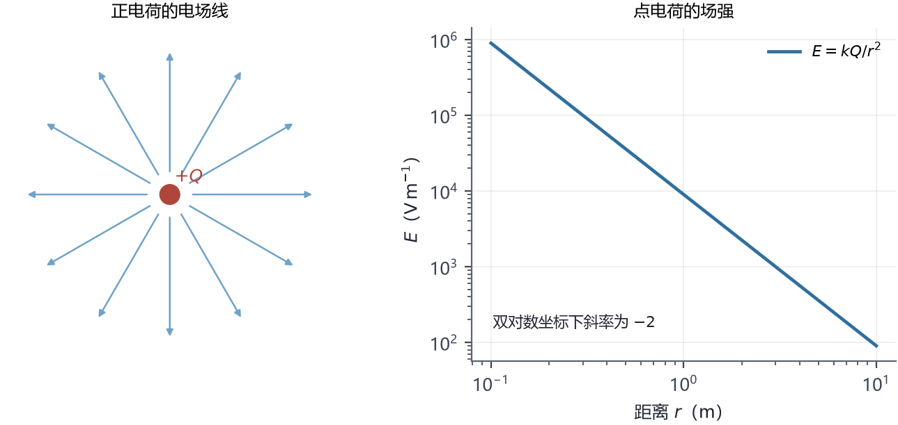
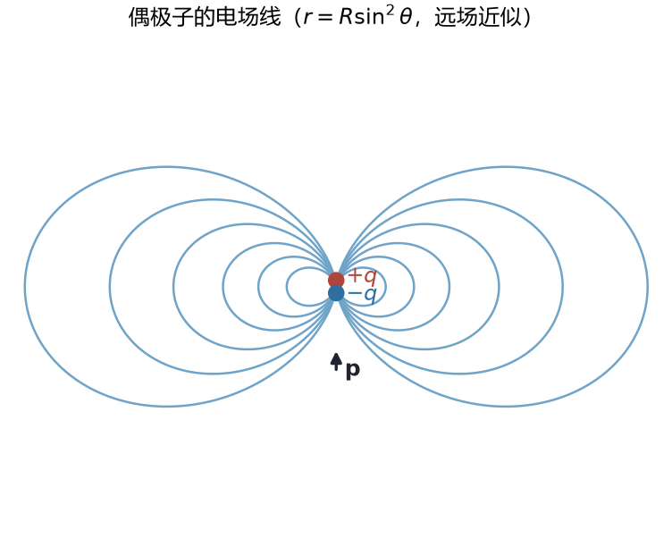
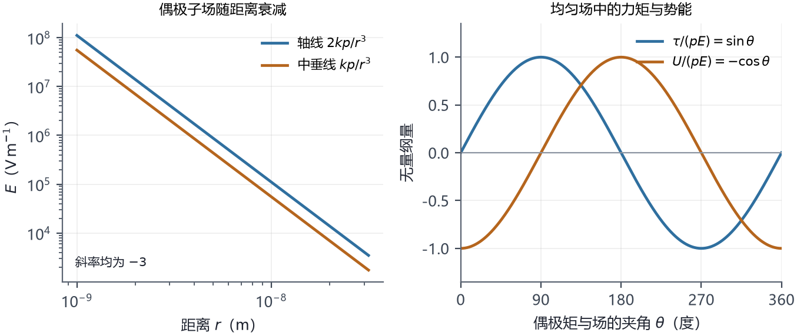

# 第 6 章 电场强度、电场线与电偶极子

## 6.1 两个电荷之间是空的

把两个带电小球放在真空里，相距一米，它们之间有确定的力。中间什么都没有，没有空气，没有绳子，力是怎么传过去的？

这个问题在牛顿时代就有争议。牛顿本人不接受"超距作用"，但他也给不出机制，只能把引力当成一条数学规律。电磁力的处境更尴尬：电荷可以随时移动，力的大小和方向随之改变，如果力是"瞬间"传过去的，那么移动一个电荷，远处的电荷应该立刻感受到变化。

法拉第在 1830 年代给出了一个不同的图像。他认为带电体周围的空间处于一种"紧张状态"，他称之为电场。另一个电荷放在这个空间里，感受到的不是远处电荷的直接作用，而是它所在位置的场的作用。力的传递需要时间，但当时无法测量这个时间。

这个图像在 1865 年被麦克斯韦写成方程，在 1888 年被赫兹的实验证实：电磁作用以有限速度传播，速度就是光速。场的概念从此不再是一个方便的比喻，而是一个独立的物理对象，它携带能量、携带动量，可以脱离电荷单独存在。

这个有限速度还带来一个可观测的后果。如果把一个电荷抖动一下，远处的电荷不会立刻感受到，而是等一段时间之后才感受到。这段时间等于距离除以光速，在实验室尺度上只有纳秒量级，但在地球与月球之间是一点三秒。这个延迟不是测量精度的问题，而是场的传播需要时间。在静电学里，电荷不动，场不随时间变，延迟无关紧要；一旦电荷运动，它就成了核心问题，第二十五章与第二十七章都在处理它。

在引入场之后，"两个电荷之间的力"这句话被拆成两句：电荷在周围空间产生电场；电场对放在其中的电荷施力。第一句由库仑定律给出，第二句是场的定义。

## 6.2 电场强度的定义

要描述一个点的电场，最直接的办法是放一个试探电荷进去，看它受多大力。试探电荷要足够小，小到它的电荷不会明显改变原来的电荷分布；它的尺寸也要足够小，小到可以认为它处在一个点上。

定义

$$\mathbf{E}=\frac{\mathbf{F}}{q_0} , \tag{6.1}$$

$\mathbf{F}$ 是试探电荷 $q_0$ 受到的力，$\mathbf{E}$ 是该点的电场强度。$\mathbf{E}$ 的方向规定为正电荷受力的方向。单位是牛顿每库仑，也写成伏特每米，两者等价：

$$1\ \mathrm{N/C}=1\ \mathrm{J/(C\cdot m)}=1\ \mathrm{V/m} . \tag{6.2}$$

这个定义有一个循环：用电荷受力定义场，又用场求电荷受力。循环不构成逻辑问题，因为场是由其他电荷产生的，定义只是给出了"如何测量一个已经存在的场"的操作方法。真正的内容在下一节：已知电荷分布，如何算出场。

$\mathbf{E}$ 是矢量场。空间每一点都有一个矢量，大小和方向都可能随位置变化。要完整描述它，需要给出三个分量 $E_x(x,y,z)$、$E_y(x,y,z)$、$E_z(x,y,z)$，或者给出大小与方向。本书大部分问题有对称性，只需要一个分量。

## 6.3 点电荷的场

把一个点电荷 $Q$ 放在原点，在位置 $\mathbf{r}$ 放一个试探电荷 $q_0$。由库仑定律，$q_0$ 受到的力是

$$\mathbf{F}=\frac{1}{4\pi\varepsilon_0}\frac{Qq_0}{r^2}\hat{\mathbf{r}} . \tag{6.3}$$

除以 $q_0$：

$$\mathbf{E}=\frac{1}{4\pi\varepsilon_0}\frac{Q}{r^2}\hat{\mathbf{r}} . \tag{6.4}$$

这就是点电荷的场。$Q>0$ 时场沿径向向外，$Q<0$ 时向内。大小与 $Q$ 成正比，与距离平方成反比。

多个电荷时，由叠加原理，总场是各个场的矢量和：

$$\mathbf{E}=\frac{1}{4\pi\varepsilon_0}\sum_i\frac{Q_i}{r_i^2}\hat{\mathbf{r}}_i . \tag{6.5}$$

连续分布时换成积分：

$$\mathbf{E}=\frac{1}{4\pi\varepsilon_0}\int\frac{dq}{r^2}\hat{\mathbf{r}} . \tag{6.6}$$

这两个式子是计算电场的全部工具。所有具体问题都是把 $dq$ 写成密度乘微元，把 $\hat{\mathbf{r}}/r^2$ 分解成分量，再积分。能不能积出来取决于对称性，这也是下一章引入高斯定理的动机。

举一个量级。一个质子的电荷是 $+e=1.6\times10^{-19}\ \mathrm{C}$，在 $0.53\times10^{-10}$ 米（玻尔半径）处产生的场强是

$$E=8.99\times10^{9}\times\frac{1.6\times10^{-19}}{\left(0.53\times10^{-10}\right)^{2}}\approx5.1\times10^{11}\ \mathrm{V/m} . \tag{6.7}$$

这个数字在第一章出现过，是原子内部场强的典型值。

## 6.4 电场线

场的分布用箭头画出来会很乱，法拉第用另一种表示：画一族曲线，曲线上每一点的切线方向就是该点的场方向。这样的曲线叫电场线。

电场线有几条规则，它们不是约定，而是从场的性质推出来的。

电场线从正电荷出发，终止于负电荷，或者延伸到无穷远。这是因为场的方向由正电荷指向外，沿场线走就离开了正电荷；走到负电荷附近，场指向负电荷，线就终止在那里。没有电荷的地方，线不能突然中断，因为那意味着场在该点没有定义。

电场线不相交。如果两条线在一点相交，那一点的场就有两个方向，与"每点只有一个场矢量"矛盾。

电场线的疏密表示场强的大小。这条规则的依据是通量：穿过一个垂直于场的小面元的线数与 $E$ 成正比。线画得密，单位面积穿过的线多，场就强。这个关系在下一章会定量化，高斯定理说的就是“穿过的线数等于包围的电荷除以 $\varepsilon_0$”。

可以把这个关系写成一个约定：画线时让穿过单位垂直面积的线数正比于 $E$。一个点电荷的场是球对称的，穿过半径 $r$ 的球面的总线数等于 $E\cdot4\pi r^2=kq\cdot4\pi/\varepsilon_0=q/\varepsilon_0$，与 $r$ 无关。这正是“线从电荷发出后总数不变”的数学含义。下一章会看到，这个守恒性质对任意闭合曲面都成立，不只对球面。

电场线不是粒子的运动轨迹。把一个电荷放进场里，它的轨迹由力和初速度共同决定，一般不与场线重合。只有在场线是直线且初速度为零或沿场线时，轨迹才与场线重合。

图 6-1 左边画了正电荷的场线。线的条数固定，随着半径增大，同样条数分布在越来越大的球面上，密度按 $1/r^2$ 下降，与场强一致。这个"条数守恒"的直观图像是高斯定理的雏形。

## 6.5 电偶极子

两个大小相等、符号相反的电荷，相距一个小距离，组成一个电偶极子。定义偶极矩

$$\mathbf{p}=q\mathbf{d} , \tag{6.8}$$

$\mathbf{d}$ 是从负电荷指向正电荷的矢量，大小是两个电荷的间距，方向规定为从负到正。偶极矩的单位是 $\mathrm{C\cdot m}$。

偶极子在自然界很常见。水分子有永久偶极矩，因为氧原子吸引电子的能力强，氢那一端带正电；氨分子、氯化氢分子也是。没有永久偶极矩的分子在外场中会被极化，产生感生偶极矩。第十章讲介质时，这些偶极子会大量出现。

偶极子的场不能直接用点电荷公式，因为两个电荷的场要叠加，而且方向不同。分两个特殊方向算，可以得到简洁的结果。

### 6.5.1 轴线上的场

把偶极子放在 $z$ 轴上，正电荷在 $z=+a/2$，负电荷在 $z=-a/2$，于是 $\mathbf{p}$ 沿 $+z$，$p=qa$。求轴线上 $z\gg a$ 处的场。

两个电荷都在轴线上，场的方向都沿 $z$ 轴。正电荷的场向外（$+z$），负电荷的场向内（指向负电荷，即 $-z$）。观察点在 $z>a/2$，正电荷更近，所以合场沿 $+z$：

$$E_z=\frac{1}{4\pi\varepsilon_0}\left[\frac{q}{\left(z-a/2\right)^2}-\frac{q}{\left(z+a/2\right)^2}\right] . \tag{6.9}$$

通分。分子是两个平方之差：

$$\left(z+\frac{a}{2}\right)^2-\left(z-\frac{a}{2}\right)^2=\left(z+\frac{a}{2}+z-\frac{a}{2}\right)\left(z+\frac{a}{2}-z+\frac{a}{2}\right)=2z\cdot a . \tag{6.10}$$

分母是两个平方之积：

$$\left(z-\frac{a}{2}\right)^2\left(z+\frac{a}{2}\right)^2=\left[\left(z-\frac{a}{2}\right)\left(z+\frac{a}{2}\right)\right]^2=\left(z^2-\frac{a^2}{4}\right)^2 . \tag{6.11}$$

代入：

$$E_z=\frac{q}{4\pi\varepsilon_0}\cdot\frac{2az}{\left(z^2-a^2/4\right)^2} . \tag{6.12}$$

$z\gg a$ 时，分母里的 $a^2/4$ 可以忽略，分母约为 $z^4$：

$$E_z\approx\frac{1}{4\pi\varepsilon_0}\frac{2qa}{z^3}=\frac{1}{4\pi\varepsilon_0}\frac{2p}{z^3} . \tag{6.13}$$

偶极子的场按 $1/r^3$ 衰减，比点电荷快一阶。这个差别来自"正负电荷的场几乎抵消"：距离远时，两个电荷的场大小相近、方向相反，剩下的只是它们之间距离带来的差异。

为什么可以忽略 $a^2/4$？因为 $z\gg a$ 时，$(z^2-a^2/4)^2=z^4(1-a^2/4z^2)^2\approx z^4(1-a^2/2z^2)$，相对误差是 $a^2/2z^2$ 的量级。要让这个误差小于百分之一，需要 $z>7a$，也就是观察距离大于电荷间距的七倍。这个条件在偶极子近似里必须满足。

### 6.5.2 中垂线上的场

观察点取在偶极子的中垂线上，到中心的距离为 $r$，$r\gg a$。两个电荷到观察点的距离都是 $R=\sqrt{r^2+a^2/4}$，两个场的大小都是 $kq/R^2$。

方向不同。正电荷的场沿"从正电荷到观察点"的方向，负电荷的场沿"从观察点到负电荷"的方向。两个矢量与中垂线的夹角相同，都在中垂线两侧。把每个场分解成沿中垂线的分量和沿轴线的分量。

沿中垂线的两个分量方向相反，大小相等，互相抵消。沿轴线的两个分量方向相同，都指向负电荷那一侧，也就是与 $\mathbf{p}$ 反向。每个分量的大小是 $(kq/R^2)\cdot(a/2R)$，两个加起来：

$$E=\frac{1}{4\pi\varepsilon_0}\frac{q}{R^2}\cdot\frac{a}{R}=\frac{1}{4\pi\varepsilon_0}\frac{qa}{R^3} . \tag{6.14}$$

$r\gg a$ 时 $R\approx r$：

$$E\approx\frac{1}{4\pi\varepsilon_0}\frac{p}{r^3} , \tag{6.15}$$

方向与 $\mathbf{p}$ 相反。

对比两个结果：轴线上是 $2kp/r^3$，中垂线上是 $kp/r^3$，方向相反，大小差一倍。这个 2 比 1 的差别是偶极子场的特征，它与磁偶极子的场（第十五章算的圆环电流）形式完全一样，只是把 $\mathbf{p}$ 换成 $\mathbf{m}$，把 $1/\varepsilon_0$ 换成 $\mu_0$。

### 6.5.3 任意方向的场

轴线与中垂线是两个特殊方向，任意方向的场需要更一般的推导。把偶极子放在原点，$\mathbf{p}$ 沿 $z$ 轴，观察点在球坐标 $(r,\theta)$，$r\gg a$。

正电荷在 $z=+a/2$，负电荷在 $z=-a/2$。观察点相对于正电荷的位置矢量是 $\mathbf{r}-\mathbf{a}/2$，相对于负电荷是 $\mathbf{r}+\mathbf{a}/2$。场的表达式是

$$\mathbf{E}=\frac{q}{4\pi\varepsilon_0}\left[\frac{\mathbf{r}-\mathbf{a}/2}{\left|\mathbf{r}-\mathbf{a}/2\right|^{3}}-\frac{\mathbf{r}+\mathbf{a}/2}{\left|\mathbf{r}+\mathbf{a}/2\right|^{3}}\right] . \tag{6.16}$$

分母可以展开。$\left|\mathbf{r}\mp\mathbf{a}/2\right|^{-3}=r^{-3}\left(1\mp\mathbf{a}\cdot\mathbf{r}/r^{2}+\cdots\right)^{-3/2}\approx r^{-3}\left(1\pm\frac{3}{2}\frac{\mathbf{a}\cdot\mathbf{r}}{r^{2}}\right)$，这里用到 $(1+x)^{-3/2}\approx1-\frac{3}{2}x$ 与 $\mathbf{a}\cdot\mathbf{r}=ar\cos\theta$。代入上式，保留到 $a$ 的一次项：

$$\mathbf{E}\approx\frac{q}{4\pi\varepsilon_0r^{3}}\left[\left(\mathbf{r}-\frac{\mathbf{a}}{2}\right)\left(1+\frac{3a\cos\theta}{2r}\right)-\left(\mathbf{r}+\frac{\mathbf{a}}{2}\right)\left(1-\frac{3a\cos\theta}{2r}\right)\right] . \tag{6.17}$$

展开并只保留 $a$ 的一次项（$\mathbf{r}$ 乘 $a/r$ 的那一项是零阶以上的修正，要保留；$\mathbf{a}$ 乘 $a/r$ 的项是二阶，丢掉）：

$$\mathbf{E}\approx\frac{q}{4\pi\varepsilon_0r^{3}}\left[-\mathbf{a}+\mathbf{r}\cdot\frac{3a\cos\theta}{r}\right] . \tag{6.18}$$

把 $\mathbf{a}$ 换成 $\mathbf{p}/q$，并注意 $\mathbf{r}=r\hat{\mathbf{r}}$：

$$\mathbf{E}\approx\frac{1}{4\pi\varepsilon_0r^{3}}\left[3\left(\mathbf{p}\cdot\hat{\mathbf{r}}\right)\hat{\mathbf{r}}-\mathbf{p}\right] . \tag{6.19}$$

这就是偶极子场的普遍公式。把它投影到 $\hat{\mathbf{r}}$ 方向与垂直于 $\hat{\mathbf{r}}$ 的方向，得到两个分量：

$$E_r=\frac{1}{4\pi\varepsilon_0}\frac{2p\cos\theta}{r^{3}},\qquad E_\theta=\frac{1}{4\pi\varepsilon_0}\frac{p\sin\theta}{r^{3}} . \tag{6.20}$$

验证两个极限。$\theta=0$（轴线）时 $E_r=2kp/r^3$，$E_\theta=0$，与 (6.13) 一致；$\theta=\pi/2$（中垂线）时 $E_r=0$，$E_\theta=kp/r^3$，方向与 $\mathbf{p}$ 反向，与 (6.15) 一致。一般方向的场就是这两个分量的组合，大小随方向在 $kp/r^3$ 与 $2kp/r^3$ 之间变化。

图 6-2 画了偶极子的场线。近处场线从正电荷出发，绕一大圈回到负电荷；远处的场线近似为闭合的环形，形状由 $r=R\sin^2\theta$ 给出，$\theta$ 是从偶极矩方向量起的极角。这条曲线方程可以从场线微分方程推出来：场线满足 $dr/E_r=r\,d\theta/E_\theta$，代入偶极子的 $E_r=2kp\cos\theta/r^3$ 与 $E_\theta=kp\sin\theta/r^3$，得 $dr/r=2\cot\theta\,d\theta$，积分得 $\ln r=2\ln\sin\theta+\text{常数}$，即 $r=R\sin^2\theta$。

## 6.6 偶极子在均匀场中

把一个偶极子放进均匀电场 $\mathbf{E}$，正电荷受 $q\mathbf{E}$，负电荷受 $-q\mathbf{E}$，两个力大小相等方向相反，合力为零。但它们的作用点不同，产生一个力矩。

取偶极矩与场的夹角为 $\theta$。以偶极子中心为转轴，正电荷的力臂是 $(a/2)\sin\theta$，负电荷的力臂也是 $(a/2)\sin\theta$，两个力矩同向，加起来：

$$\tau=qE\cdot\frac{a}{2}\sin\theta+qE\cdot\frac{a}{2}\sin\theta=qEa\sin\theta=pE\sin\theta . \tag{6.21}$$

写成矢量：

$$\boldsymbol{\tau}=\mathbf{p}\times\mathbf{E} . \tag{6.22}$$

力矩的方向由右手定则给出，效果是把偶极子转向与场同向。$\theta=0$ 时力矩为零，这是稳定平衡；$\theta=\pi$ 时力矩也为零，但这是不稳定平衡，稍微偏离就会被转走。

转动过程中电场力做功。把偶极子从 $\theta=\pi/2$ 转到 $\theta$，力矩做功

$$W=\int_{\pi/2}^{\theta}\tau\,d\theta'=\int_{\pi/2}^{\theta}pE\sin\theta'\,d\theta'=pE\left[-\cos\theta'\right]_{\pi/2}^{\theta}=pE\cos\theta . \tag{6.23}$$

保守力做功等于势能减少，所以取 $\theta=\pi/2$ 处势能为零，得

$$U=-pE\cos\theta=-\mathbf{p}\cdot\mathbf{E} . \tag{6.24}$$

$\theta=0$ 时 $U=-pE$，能量最低；$\theta=\pi$ 时 $U=+pE$，能量最高。这与力矩把偶极子转向 $\theta=0$ 一致：系统趋向能量最低的状态。

## 6.7 偶极子在非均匀场中

均匀场中偶极子只受力矩，不受合力。非均匀场中两个电荷处的场不一样，合力不再为零。设正电荷处的场是 $\mathbf{E}(\mathbf{r}+\mathbf{d}/2)$，负电荷处是 $\mathbf{E}(\mathbf{r}-\mathbf{d}/2)$，合力是

$$\mathbf{F}=q\left[\mathbf{E}\left(\mathbf{r}+\frac{\mathbf{d}}{2}\right)-\mathbf{E}\left(\mathbf{r}-\frac{\mathbf{d}}{2}\right)\right] . \tag{6.25}$$

$d$ 很小时，用一阶泰勒展开：$\mathbf{E}(\mathbf{r}+\mathbf{d}/2)-\mathbf{E}(\mathbf{r}-\mathbf{d}/2)\approx(\mathbf{d}\cdot\nabla)\mathbf{E}$，其中 $\mathbf{d}\cdot\nabla=d_x\partial_x+d_y\partial_y+d_z\partial_z$。代入得

$$\mathbf{F}=\left(\mathbf{p}\cdot\nabla\right)\mathbf{E} . \tag{6.26}$$

如果场是由电势产生的（第九章会证明这一点），这个式子可以简化为 $\mathbf{F}=\nabla(\mathbf{p}\cdot\mathbf{E})$，与势能 $U=-\mathbf{p}\cdot\mathbf{E}$ 一致。

这个结果解释了一个常见现象：带电的塑料尺能吸起不带电的纸片。尺子的场是非均匀的，靠近尺子的一端场强，远离的一端场弱；纸片被极化后成为一个偶极子，两端受到的力不相等，合力指向场强的地方，也就是尺子。如果场是均匀的，纸片只会被扭转，不会被吸过去。

## 6.8 再算一个积分：带电圆盘

均匀带电的薄圆盘，半径 $R$，面电荷密度 $\sigma$，求轴线上距圆心 $z$ 处的场。这个例子用两次积分，一次是把圆盘分成圆环，一次是把圆环的贡献加起来，可以练习积分技巧。

把圆盘分成半径从 $r$ 到 $r+dr$ 的细圆环。圆环的面积是 $2\pi r\,dr$，带电荷 $dq=\sigma\cdot2\pi r\,dr$。由上一节算过的圆环轴线场公式（第五章 (5.14)），这个圆环在轴线上产生的场是

$$dE=\frac{1}{4\pi\varepsilon_0}\frac{dq\cdot z}{\left(r^{2}+z^{2}\right)^{3/2}}=\frac{\sigma z}{2\varepsilon_0}\frac{r\,dr}{\left(r^{2}+z^{2}\right)^{3/2}} . \tag{6.27}$$

所有圆环的场方向相同，都沿轴线，直接标量相加：

$$E=\frac{\sigma z}{2\varepsilon_0}\int_0^{R}\frac{r\,dr}{\left(r^{2}+z^{2}\right)^{3/2}} . \tag{6.28}$$

积分用换元 $u=r^{2}+z^{2}$，$du=2r\,dr$：

$$\int\frac{r\,dr}{\left(r^{2}+z^{2}\right)^{3/2}}=\frac{1}{2}\int u^{-3/2}du=-u^{-1/2}=-\frac{1}{\sqrt{r^{2}+z^{2}}} . \tag{6.29}$$

代入上下限：

$$E=\frac{\sigma z}{2\varepsilon_0}\left[\frac{1}{z}-\frac{1}{\sqrt{R^{2}+z^{2}}}\right]=\frac{\sigma}{2\varepsilon_0}\left[1-\frac{z}{\sqrt{R^{2}+z^{2}}}\right] . \tag{6.30}$$

检查两个极限。$R\to\infty$（无限大平面）时，括号里的第二项趋于零，$E\to\sigma/(2\varepsilon_0)$，与距离无关。这个结果是下一章用高斯定理会再得到的结论。$z\gg R$ 时，把 $z/\sqrt{R^2+z^2}=(1+R^2/z^2)^{-1/2}\approx1-R^2/2z^2$ 代入，括号约为 $R^2/2z^2$，于是 $E\approx\sigma R^2/(4\varepsilon_0z^2)=Q/(4\pi\varepsilon_0z^2)$，回到点电荷的场，其中 $Q=\sigma\pi R^2$ 是圆盘的总电荷。两个极限都对。

## 6.9 场的实在性

场是不是一个真实的物理对象，还是只是一个计算工具？这个问题在十九世纪争论了很久，现在有明确的答案：场是实在的。

三条证据。第一，电磁场携带能量。第十章会算出电场的能量密度是 $\frac{1}{2}\varepsilon_0E^2$，第二十一章会算出磁场的能量密度是 $B^2/(2\mu_0)$。这些能量分布在空间里，不在电荷上。第二，电磁场携带动量。光照射到物体上会产生压力，叫辐射压，太阳帆就是利用它。第三，电磁场可以脱离电荷独立存在。电磁波在真空中传播，波源关闭之后，已经发出的波继续前进，携带能量与动量。

场的数学描述是一个矢量场，每点一个矢量。这个描述在第十九章之后会扩展：电场与磁场不是两个独立的场，而是同一个电磁场的两个分量，换一个参照系，它们会互相转化。

---

这一章把“力”换成了“场”。库仑定律描述的是两个电荷之间的力，场的语言描述的是一个电荷在空间中产生的分布，以及这个分布如何作用于另一个电荷。两种描述在静电情形下等价，但场的语言可以推广到变化的电荷、运动的电荷、没有电荷的真空，后者是第六篇的主题。

偶极子是这一章的重点，因为它是处理介质的基础。介质在外场中被极化，产生大量偶极子，这些偶极子的场叠加起来，宏观上表现为介电常数。下一章先用高斯定理把对称电荷分布的场算出来，避免每次都要做积分。
