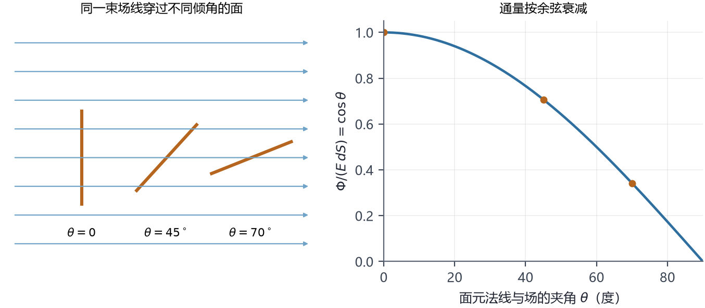
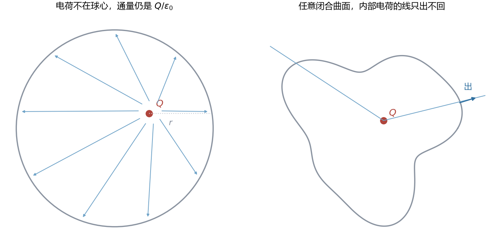
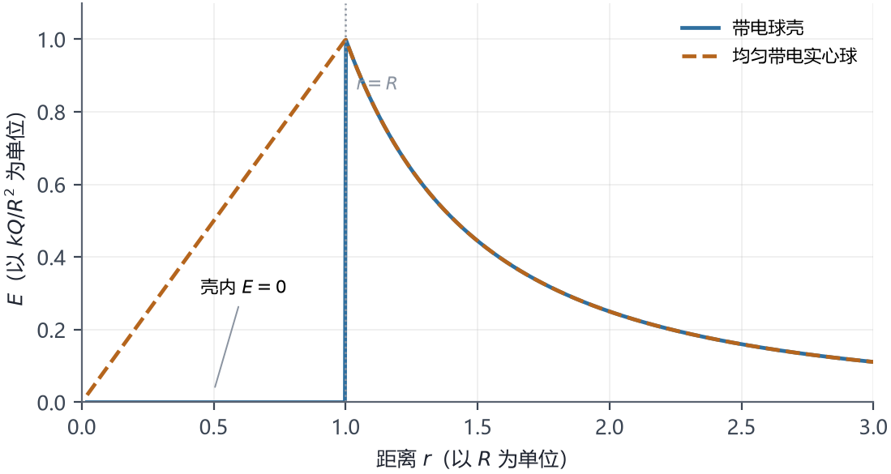

# 第 7 章 电通量与高斯定理

## 7.1 一个不用积分就能算出的场

第六章算了圆环、圆盘轴线上的场，两个积分都不算难。但如果要算一个均匀带电球壳内外各点的场，直接积分就很麻烦了。球壳上每一点到观察点的距离都不一样，方向也不一样，要把整个球面上的贡献按矢量加起来。这个积分能做，但需要技巧，而且很容易算错。

有一个办法可以完全绕开积分。它只用一条关于通量的定理，就能给出球壳的场、无限长直线的场、无限大平面的场，而且结果是精确的，不是近似。

这条定理叫高斯定理，它说的是：穿过任意闭合曲面的电通量，等于这个曲面内部包围的总电荷除以 $\varepsilon_0$，与曲面外面有多少电荷无关，与曲面的形状也无关。

这条定理的历史比麦克斯韦方程组早。高斯在 1813 年研究引力时就得到了类似的关系，后来被用到电学上。它的价值在于把一个“对整块曲面求和”的问题变成了一个“数一数里面有多少电荷”的问题，而后者往往只是一个乘法。

定理的内容很少，但要用好它，得先弄清两件事：通量是什么，为什么它只与内部的电荷有关。

## 7.2 通量

考虑一个平面面元 $dS$，法线方向记作 $\hat{\mathbf{n}}$。如果电场 $\mathbf{E}$ 均匀，穿过这个面元的"流量"是

$$d\Phi_E=\mathbf{E}\cdot d\mathbf{S}=E\,dS\cos\theta , \tag{7.1}$$

$d\mathbf{S}=\hat{\mathbf{n}}\,dS$ 是面元矢量，$\theta$ 是电场与法线的夹角。通量的单位是 $\mathrm{V\cdot m}$，量纲上等于 $\mathrm{N\cdot m^2/C}$。

这个定义来自流体的类比。设想空间里有一种流体以速度 $\mathbf{v}$ 流动，单位时间穿过面元 $dS$ 的体积是 $\mathbf{v}\cdot d\mathbf{S}$。电场不是流体的速度，但"穿过一个面的多少"这个几何概念是一样的。

$\cos\theta$ 的来历是投影。面元倾斜时，它在垂直于电场方向上的投影面积是 $dS\cos\theta$。只有投影面积上的场线能穿过去，所以通量要乘 $\cos\theta$。$\theta=0$ 时面元垂直于场，通量最大；$\theta=90^\circ$ 时面元平行于场，没有场线穿过，通量为零。图 7-1 画了同一束场线穿过不同倾角的面元。

对于曲面，要把它分成许多小面元，每个面元的通量相加：

$$\Phi_E=\int_S\mathbf{E}\cdot d\mathbf{S} . \tag{7.2}$$

这是曲面积分。对闭合曲面，规定法线指向外侧，积分写成 $\oint_S$。

## 7.3 立体角

要理解高斯定理，需要一个几何量：立体角。

从一点看一个面元，它在单位球面上占的面积就是立体角：

$$d\Omega=\frac{dS_\perp}{r^2} , \tag{7.3}$$

$dS_\perp$ 是面元在垂直于视线方向上的投影面积，$r$ 是面元到观察点的距离。整个球面对应 $4\pi$ 立体角，这是立体角的单位球面度的定义。

用球坐标写，$dS=r^2\sin\theta\,d\theta\,d\phi$，所以

$$d\Omega=\sin\theta\,d\theta\,d\phi . \tag{7.4}$$

对 $\theta$ 从 $0$ 到 $\pi$、$\phi$ 从 $0$ 到 $2\pi$ 积分，得 $4\pi$。

立体角有一个关键性质：一个面元 $dS$ 在观察点张开的立体角，等于 $dS$ 在视线垂直方向上的投影除以 $r^2$。反过来，$dS_\perp=r^2d\Omega$。这个关系让"点电荷的场穿过一个面的通量"可以写成与距离无关的形式。

## 7.4 点电荷的场穿过球面

点电荷 $Q$ 在球心，半径 $r$ 的球面把电荷包围在内。球面上每一点，电场都沿径向向外，与法线同向，$\cos\theta=1$。场强大小处处相同：

$$E=\frac{1}{4\pi\varepsilon_0}\frac{Q}{r^2} . \tag{7.5}$$

通量是场强乘球面积：

$$\Phi_E=E\cdot4\pi r^2=\frac{1}{4\pi\varepsilon_0}\frac{Q}{r^2}\cdot4\pi r^2=\frac{Q}{\varepsilon_0} . \tag{7.6}$$

$r$ 完全消掉了。这不是巧合：场强按 $1/r^2$ 衰减，面积按 $r^2$ 增长，两个因子正好抵消。这就是平方反比律的一个直接后果。

如果电荷不在球心，上面的推导就不成立了，因为各点的场强不再相等，方向也不再与法线平行。但通量仍然是 $Q/\varepsilon_0$。理由如下。

把球面分成许多小面元，每个面元的通量是 $\mathbf{E}\cdot d\mathbf{S}=E\,dS\cos\theta$。电场沿径向，大小 $E=kQ/r^2$，$r$ 是该面元到电荷的距离。$\cos\theta\,dS$ 正好是这个面元在垂直于径向方向上的投影面积，除以 $r^2$ 就是它张开的立体角：

$$\mathbf{E}\cdot d\mathbf{S}=k\frac{Q}{r^2}\cdot r^2d\Omega=kQ\,d\Omega . \tag{7.7}$$

对整个闭合曲面积分，立体角覆盖整个 $4\pi$，于是

$$\Phi_E=kQ\cdot4\pi=\frac{Q}{\varepsilon_0} . \tag{7.8}$$

这个推导对任意形状的闭合曲面都成立，只要电荷在曲面内部。因为从电荷看出去，任何一个把电荷包住的闭合曲面都相当于一个完整的球面，各面元的立体角之和总是 $4\pi$。

如果电荷在曲面外部，情况不同。从电荷引出的每一条射线，穿过闭合曲面时一定是"进去一次、出来一次"，两次的立体角符号相反，通量相互抵消。所以外部的电荷对总通量没有贡献。

把这两条合起来：多个电荷时，只有内部的电荷有贡献，总通量是

$$\oint_S\mathbf{E}\cdot d\mathbf{S}=\frac{1}{\varepsilon_0}\sum_{i,\text{内}}Q_i=\frac{Q_{\text{内}}}{\varepsilon_0} . \tag{7.9}$$

这就是高斯定理。它对静止电荷严格成立，对运动电荷也成立，是麦克斯韦方程组的第一个方程。

## 7.5 用高斯定理求场：球对称

高斯定理本身是一个关于通量的等式，要求场，还需要对称性。思路是：选一个闭合曲面，让面上各点的场强大小相同、方向与法线平行（或垂直），这样 $\oint\mathbf{E}\cdot d\mathbf{S}=E\cdot S$，可以直接解出 $E$。

### 7.5.1 均匀带电球壳

一个半径为 $R$ 的球壳，总电荷 $Q$ 均匀分布。

球外一点，$r>R$。取半径为 $r$ 的同心球面作高斯面。由球对称，面上各点场强大小相同，方向沿径向。通量是 $E\cdot4\pi r^2$。包围的电荷是 $Q$。由高斯定理：

$$E\cdot4\pi r^2=\frac{Q}{\varepsilon_0}\quad\Rightarrow\quad E=\frac{1}{4\pi\varepsilon_0}\frac{Q}{r^2} . \tag{7.10}$$

球壳外的场与把所有电荷集中在球心的点电荷完全一样。

球内一点，$r<R$。同样取同心球面作高斯面，但内部没有电荷，$Q_{\text{内}}=0$：

$$E\cdot4\pi r^2=0\quad\Rightarrow\quad E=0 . \tag{7.11}$$

球壳内部处处场强为零。这个结论与直觉不符：球壳上每一块电荷都在内部产生场，为什么加起来是零？原因是各块的场互相抵消。取球内一点，画一条过该点的直线，它与球面交于两小块面积，这两块到该点的距离分别是 $r_1$、$r_2$，面积与距离平方成正比（立体角相同），所以两块产生的场大小相等、方向相反。整条直线上的每一对小块都这样抵消，总场为零。

还可以做一个一致性检验。球壳表面上的场强，由 $r=R$ 代入 (7.10) 得 $E=kQ/R^2$；另一方面，球壳的面电荷密度是 $\sigma=Q/(4\pi R^2)$，由导体表面场强公式得 $E=\sigma/\varepsilon_0=Q/(4\pi\varepsilon_0R^2)$，两者相等。两条完全不同的路线得到同一个结果，这说明高斯定理与库仑定律是自洽的。

这个结论有重要的实际意义：一个带电的金属球壳，内部完全没有电场，放在里面的仪器不受外部电荷的干扰。这是静电屏蔽的定量依据。

### 7.5.2 均匀带电球体

把电荷均匀分布在半径 $R$ 的球体内部，体电荷密度 $\rho=Q/(\frac{4}{3}\pi R^3)$。

球外，$r>R$，与球壳一样，$E=kQ/r^2$。

球内，$r<R$，高斯面内包围的电荷是

$$Q_{\text{内}}=\rho\cdot\frac{4}{3}\pi r^3=Q\frac{r^3}{R^3} . \tag{7.12}$$

通量 $E\cdot4\pi r^2$ 等于 $Q_{\text{内}}/\varepsilon_0$：

$$E\cdot4\pi r^2=\frac{1}{\varepsilon_0}Q\frac{r^3}{R^3}\quad\Rightarrow\quad E=\frac{1}{4\pi\varepsilon_0}\frac{Qr}{R^3} . \tag{7.13}$$

球内的场随半径线性增长，在球心为零，在球面达到最大值 $kQ/R^2$。图 7-3 右边画了球壳与球体两种情形的场强曲线。

## 7.6 柱对称

一根无限长的细线，线电荷密度 $\lambda$，求距线 $r$ 处的场。

取一个半径为 $r$、高为 $h$ 的同轴圆柱面作高斯面。圆柱有两个底面和一个侧面。

电场的方向由对称性决定：沿径向，垂直于轴线。底面的法线沿轴向，与电场垂直，通量为零。侧面上各点场强大小相同，方向与法线平行，通量是 $E\cdot2\pi rh$。

包围的电荷是 $\lambda h$。由高斯定理：

$$E\cdot2\pi rh=\frac{\lambda h}{\varepsilon_0}\quad\Rightarrow\quad E=\frac{\lambda}{2\pi\varepsilon_0r} . \tag{7.14}$$

高度 $h$ 消掉了，场只与到轴线的距离有关，按 $1/r$ 衰减，比点电荷慢一阶。原因是一维的"面积"（周长）按 $r$ 增长，而不是按 $r^2$。

这个结果在第五章用积分算过有限长杆的延长线场，两者不能直接对比，因为方向不同。如果用积分算无限长线的场，会得到一个更复杂的表达式，化简之后与 (7.14) 一致。

同轴电缆是柱对称的另一个例子，也是实际器件。内导体是半径 $a$ 的圆柱，外导体是半径 $b$ 的圆筒，两者之间是绝缘介质。内导体带线电荷密度 $+\lambda$，外导体带 $-\lambda$（电荷总是成对出现，因为整体中性）。

求二者之间的场，$a<r<b$。取半径 $r$、高 $h$ 的同轴圆柱面作高斯面，包围的电荷是 $\lambda h$，侧面通量是 $E\cdot2\pi rh$，于是

$$E=\frac{\lambda}{2\pi\varepsilon_0r} . \tag{7.15}$$

求外导体之外的场，$r>b$。高斯面把内导体的 $+\lambda h$ 与外导体的 $-\lambda h$ 都包在里面，总电荷为零：

$$E\cdot2\pi rh=0\quad\Rightarrow\quad E=0 . \tag{7.16}$$

外导体之外没有场。这是同轴电缆能用于信号传输的原因：外面的电场为零，不会干扰附近的电路，也不容易被外来电场干扰。第十章算圆柱形电容时会用到 (7.15)。

## 7.7 面对称

一个无限大的均匀带电平面，面电荷密度 $\sigma$，求附近的场。

取一个穿过平面的扁圆柱（"药盒"）作高斯面，两个底面面积都是 $A$，分别位于平面两侧，与平面平行；侧面垂直于平面。

由对称性，电场垂直于平面，向两侧对称地指出去（$\sigma>0$ 时）。两个底面的法线也垂直于平面，与电场平行；侧面的法线与电场垂直，通量为零。

总通量是 $E\cdot A+E\cdot A=2EA$。包围的电荷是 $\sigma A$。由高斯定理：

$$2EA=\frac{\sigma A}{\varepsilon_0}\quad\Rightarrow\quad E=\frac{\sigma}{2\varepsilon_0} . \tag{7.17}$$

场强与距离无关，是一个均匀场。这个结论只在无限大平面附近成立，有限大的板边缘处场会弯出去（边缘效应）。第六章用积分算圆盘轴线场时，取 $R\to\infty$ 得到同样的 $\sigma/(2\varepsilon_0)$，两条路一致。

两块平行的大金属板，带等量异号电荷，面密度分别是 $+\sigma$ 与 $-\sigma$。两板之间的场是两块板场的叠加：正板产生 $\sigma/(2\varepsilon_0)$ 指向外，负板产生 $\sigma/(2\varepsilon_0)$ 指向它，两板之间方向相同，相加得 $\sigma/\varepsilon_0$；两板外侧方向相反，相减得零。这个结果在第十章讲平行板电容时会用到。

## 7.8 导体与高斯定理
高斯定理可以推出第五章提到的几条导体性质，现在有了严格论证。

导体内部场强为零。如果不为零，自由电子会移动，直到场为零，这是静电平衡的定义。

导体内部没有净电荷。在导体内部取一个闭合曲面，它完全在导体内部才成立，但更直接的取法是取一个紧贴导体表面的"薄壳"作为高斯面，一面在导体内部、一面在导体外部。薄壳内部的场为零，所以穿过薄壳内表面的通量为零；薄壳的体积趋于零，能包围的电荷也趋于零。这说明导体内部的电荷密度为零，净电荷只能分布在表面。

导体表面的场垂直于表面。如果场有切向分量，表面电荷会沿表面移动，与静电平衡矛盾。由高斯定理可以进一步算出表面附近的场强大小：取一个极扁的药盒，一个底面在导体内部（场为零），另一个在外部，侧面通量为零，于是 $E\cdot A=\sigma A/\varepsilon_0$，得 $E=\sigma/\varepsilon_0$。注意这个结果与无限大平面的 $\sigma/(2\varepsilon_0)$ 不同，因为导体内部的场为零，只有外表面一侧有通量。

## 7.9 高斯定理的适用范围

高斯定理是从库仑定律的平方反比性质推出来的，但它比库仑定律更普遍。它对任意闭合曲面成立，对运动电荷成立，对变化的场也成立，是麦克斯韦方程组的第一条。在第六篇会把它写成微分形式 $\nabla\cdot\mathbf{E}=\rho/\varepsilon_0$。

用高斯定理求场需要对称性，这不是定理的限制，而是计算手段的限制。对于没有对称性的电荷分布，高斯定理仍然成立，但左边的积分算不出来，只能回到库仑定律的积分。

高斯定理与库仑定律是等价的。从库仑定律推出高斯定理，上面已经做了；反过来，假设只知道高斯定理，对一个以点电荷为球心、半径为 $r$ 的球面用它，得到 $E$ 只依赖于 $r$，且 $E\cdot4\pi r^2=Q/\varepsilon_0$，即 $E=Q/(4\pi\varepsilon_0r^2)$，这正是库仑定律。

这个反向推导还给出了一个检验平方反比的方法。如果库仑力是 $1/r^{2+\delta}$，那么穿过半径 $r$ 的球面的通量就不是常数，而是正比于 $r^{-\delta}$。测出不同半径球面的通量，看它随 $r$ 怎么变，就能定出 $\delta$。第五章提到的那个精度为 $10^{-16}$ 的实验，测的就是这个。

---

这一章从"通量"这个几何概念出发，得到了一个只与内部电荷有关的等式。它的用处在于把面积分换成代数式，代价是需要对称性。球、柱、面三种对称性覆盖了大部分教科书问题，也覆盖了后面要用的电容器、导线、螺线管的场。

下一章把电场沿路径积分，得到电势。这两条路线——对面积分得到高斯定理，对路径积分得到电势——是静电学的两条主线。
