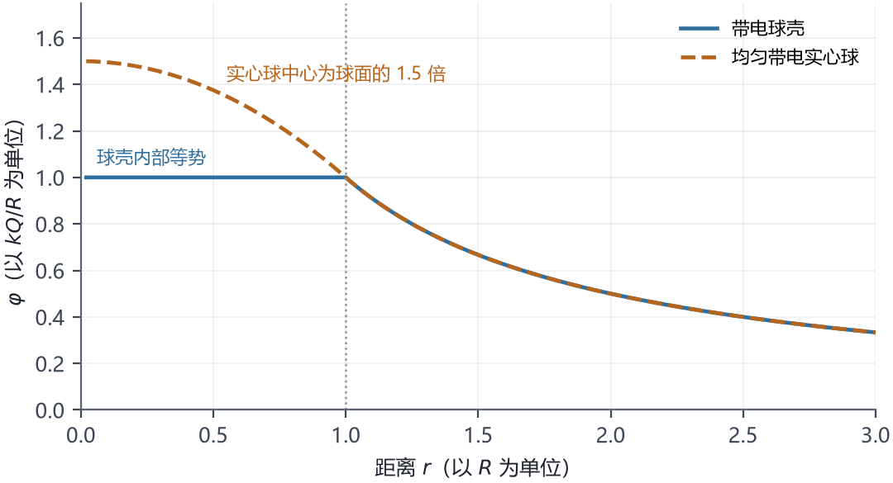
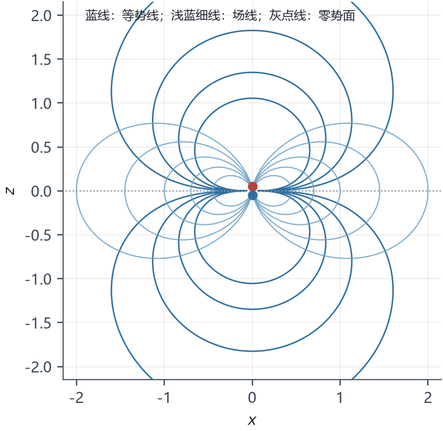

# 第 8 章 电势能、电势与等势面

## 8.1 从"爬楼梯"说起

爬一层楼，身体做的功变成了重力势能。站在高处的小球，松手之后势能变成动能，落地的速率只与高度差有关，与走的是楼梯、斜坡还是电梯无关。这件事在第四章已经说过：重力是保守力，可以定义势能。

静电力与重力有相同的数学形式，都是平方反比，都是有心力。所以静电力也是保守力，也可以定义势能。这个势能除以电荷，得到一个只与位置有关的量，叫电势。

引入电势的动机是计算。电场是矢量，叠加时要分解、要算分量，稍不注意就错。电势是标量，叠加时直接相加。已知电势之后，电场可以通过求导得到（下一章），这条路在计算上通常比直接求场简单。

另一个动机是电路。电池的电压、电容的耐压、电表的读数，都是电势差。第十二章讲电路时，整个理论都建立在电势上。

把两种算法的代价比一下。求三个电荷在某点的场，要把每个电荷的场分解成三个分量，共九个分量，再分别相加；求电势只需算三个数，直接相加。求完电势再求梯度，与直接求场相比，运算量通常更小，出错的概率也低。代价是电势丢掉了方向信息，要知道场的方向必须求导，而求导在某些坐标系里也不简单。两条路各有适用的场合，本书后面会根据问题选。

## 8.2 静电力是保守力

要定义势能，必须先证明静电力做功与路径无关。

先看点电荷的情形。一个电荷 $Q$ 固定在原点，另一个电荷 $q$ 从 $A$ 点沿某条路径移到 $B$ 点。路径上每一小段的位移是 $d\mathbf{l}$，电场力做的功是 $q\mathbf{E}\cdot d\mathbf{l}$，其中

$$\mathbf{E}=\frac{1}{4\pi\varepsilon_0}\frac{Q}{r^2}\hat{\mathbf{r}} . \tag{8.1}$$

把位移分解成径向分量与垂直于径向的分量。$\mathbf{E}$ 沿径向，与垂直分量点乘为零，只有径向分量有贡献。径向位移是 $dr$，所以

$$\mathbf{E}\cdot d\mathbf{l}=E\,dr=\frac{1}{4\pi\varepsilon_0}\frac{Q}{r^2}dr . \tag{8.2}$$

总功

$$W=q\int_{r_A}^{r_B}\frac{1}{4\pi\varepsilon_0}\frac{Q}{r^2}dr . \tag{8.3}$$

积分的上下限只与两端的位置有关，与路径无关。这说明每一步的贡献只取决于半径怎么变，而与绕了多少弯无关：绕弯只改变垂直方向的位移，那部分不做功。

对多个电荷或连续分布，总场是各个场的叠加，每一部分的功都与路径无关，加起来仍然与路径无关。所以静电场是保守场。

把这件事说得再紧一点。取一条闭合路径，从一点出发绕一圈回到原点，电势能的变化必须为零，所以电场力做的功为零：

$$\oint\mathbf{E}\cdot d\mathbf{l}=0 . \tag{8.4}$$

这条式子对任意闭合路径成立，是静电场的基本性质。它与“做功与路径无关”是同一件事的两种写法：绕一圈的功等于“去路的功”加上“回路的功的负值”，两者相等就互相抵消。第六篇会把这个积分改写成旋度，得到 $\nabla\times\mathbf{E}=0$，并在第二十四章把它换成含时间导数的形式。

由此可以定义电势能。取一个参考点 $P_0$，规定那里的电势能为零，则

$$U(\mathbf{r})=-\int_{P_0}^{\mathbf{r}}q\mathbf{E}\cdot d\mathbf{l} . \tag{8.5}$$

负号的意思是：电场力做正功时电势能减少，与重力势能的约定一致。把电荷从无穷远移到某点，如果电场力做正功（同号电荷相斥，实际要外力推），电势能减少，所以 $U$ 是负的。

## 8.3 电势

电势能正比于电荷 $q$，把 $q$ 除掉的量只与场有关：

$$\varphi(\mathbf{r})=\frac{U(\mathbf{r})}{q}=-\int_{P_0}^{\mathbf{r}}\mathbf{E}\cdot d\mathbf{l} . \tag{8.6}$$

这叫电势，单位是伏特，$1\ \mathrm{V}=1\ \mathrm{J/C}$。

两点之间的电势差

$$\varphi_A-\varphi_B=\int_A^B\mathbf{E}\cdot d\mathbf{l} , \tag{8.7}$$

等于把单位正电荷从 $A$ 移到 $B$ 时外力做的功（克服电场力）。这个量在电路里叫电压。电压与参考点的选择无关，因为参考点的电势在相减时消掉了。

参考点通常取无穷远，$\varphi(\infty)=0$。这个选择在有限大小的电荷分布下总是可行的。在电路问题里参考点常取地线或电源负极，也是任意的，只要全电路统一。

## 8.4 点电荷的电势

取无穷远为零，点电荷 $Q$ 在距它 $r$ 处的电势：

$$\varphi(r)=-\int_{\infty}^{r}\frac{1}{4\pi\varepsilon_0}\frac{Q}{r'^2}dr' . \tag{8.8}$$

积分要算。先算不定积分：

$$\int\frac{dr'}{r'^2}=-\frac{1}{r'} . \tag{8.9}$$

定积分：

$$\varphi(r)=-\frac{Q}{4\pi\varepsilon_0}\left[-\frac{1}{r'}\right]_{\infty}^{r}=-\frac{Q}{4\pi\varepsilon_0}\left(-\frac{1}{r}+\lim_{r'\to\infty}\frac{1}{r'}\right)=\frac{1}{4\pi\varepsilon_0}\frac{Q}{r} . \tag{8.10}$$

结果很简洁：电势按 $1/r$ 衰减，比场强慢一阶。$Q>0$ 时电势处处为正，$r\to0$ 时趋于无穷；$Q<0$ 时处处为负。

为什么按 $1/r$ 而不是 $1/r^2$？因为电势是场强的积分，积分一次，幂次降一。这个关系下一章会反过来说：场强是电势的导数，求导一次，幂次升一。

## 8.5 叠加

电势是标量，多个电荷时直接相加：

$$\varphi=\frac{1}{4\pi\varepsilon_0}\sum_i\frac{Q_i}{r_i} . \tag{8.11}$$

连续分布时

$$\varphi=\frac{1}{4\pi\varepsilon_0}\int\frac{dq}{r} . \tag{8.12}$$

这两个式子比对应的电场公式好算得多，因为没有矢量分解。求一个电荷分布的电场，可以先求电势，再求梯度，这是常用策略。

举一个简单的例子。两个等量异号电荷 $+q$ 与 $-q$ 相距 $a$，求空间中一点的电势。设该点到两个电荷的距离分别是 $r_+$ 与 $r_-$，则

$$\varphi=\frac{q}{4\pi\varepsilon_0}\left(\frac{1}{r_+}-\frac{1}{r_-}\right) . \tag{8.13}$$

在偶极子的中垂面上，$r_+=r_-$，电势为零。这个结果可以推广：一对等量异号电荷的零势面就是它们的中垂面。这样的面在实验里很有用，它是“电势为零但场不为零”的例子，说明电势为零不代表没有电场。

把 (8.12) 在远处展开，可以得到偶极子电势的简洁形式。设偶极矩为 $p=qa$，观察点到中心的距离为 $r$，与偶极矩的夹角为 $\theta$。由余弦定理，两个距离满足

$$r_{\pm}\approx r\mp\frac{a}{2}\cos\theta , \tag{8.14}$$

这是把 $\sqrt{r^2\mp ar\cos\theta+a^2/4}$ 对 $a/r$ 展开到一阶的结果。代入 (8.12)，分母取 $r_+r_-\approx r^2$：

$$\varphi\approx\frac{q}{4\pi\varepsilon_0}\cdot\frac{r_- -r_+}{r_+r_-}\approx\frac{q}{4\pi\varepsilon_0}\cdot\frac{a\cos\theta}{r^2}=\frac{1}{4\pi\varepsilon_0}\frac{p\cos\theta}{r^2} . \tag{8.15}$$

写成矢量形式，$p\cos\theta=\mathbf{p}\cdot\hat{\mathbf{r}}$：

$$\varphi=\frac{1}{4\pi\varepsilon_0}\frac{\mathbf{p}\cdot\hat{\mathbf{r}}}{r^2} . \tag{8.16}$$

偶极子电势按 $1/r^2$ 衰减，比点电荷快一阶，但比场强 $1/r^3$ 慢一阶，因为场强是电势的导数。这个形式在第十章算介质极化时会反复用到。

## 8.6 带电球壳与球体的电势

球壳半径 $R$，总电荷 $Q$。

球外 $r>R$：场是 $kQ/r^2$，与点电荷相同，所以电势也是 $kQ/r$。

球内 $r<R$：场为零，电势不变。把 (8.6) 从 $r$ 积到 $R$，场为零，积分为零，所以球内各点电势都等于球面上的值：

$$\varphi_{\text{内}}=\frac{1}{4\pi\varepsilon_0}\frac{Q}{R}\qquad(r\le R) . \tag{8.17}$$

球壳内部是一个等势区。这与"内部场为零"是同一件事的两种说法。

均匀带电球体，半径 $R$，总电荷 $Q$。球外仍是 $kQ/r$。球内场强是 $kQr/R^3$，从 $r$ 积到 $R$ 再算球面电势：

$$\varphi(r)=\varphi(R)+\int_r^R E\,dr'=\frac{kQ}{R}+\int_r^R\frac{kQr'}{R^3}dr' . \tag{8.18}$$

积分

$$\int_r^R\frac{kQr'}{R^3}dr'=\frac{kQ}{R^3}\cdot\frac{R^2-r^2}{2} . \tag{8.19}$$

代入：

$$\varphi(r)=\frac{kQ}{R}+\frac{kQ}{2R^3}\left(R^2-r^2\right)=\frac{kQ}{2R^3}\left(3R^2-r^2\right) . \tag{8.20}$$

球心处 $\varphi=kQ\cdot3R^2/(2R^3)=3kQ/(2R)$，是球面电势的 1.5 倍。球内电势从中心到表面按抛物线下降，场强则线性增长，两者互为导数关系。

## 8.7 等势面

把空间中电势相同的点连起来，得到等势面。点电荷的等势面是一族同心球面；均匀场的等势面是一族平行平面；偶极子的等势面复杂一些，但每一条都垂直于场线。

等势面有一个基本性质：它处处与电场线垂直。

证明只需一行。在等势面上取一小段位移 $d\mathbf{l}$，沿等势面走电势不变，$d\varphi=0$。由 (8.6) 的微分形式 $d\varphi=-\mathbf{E}\cdot d\mathbf{l}$，得

$$\mathbf{E}\cdot d\mathbf{l}=0 . \tag{8.21}$$

两个非零矢量的点乘为零，说明它们垂直。因为 $d\mathbf{l}$ 是等势面内的任意方向，所以 $\mathbf{E}$ 垂直于整个等势面。

这个性质有一个实用推论：电场线从高电势指向低电势，且总是垂直穿过等势面。把电荷放在等势面上移动，电场力不做功，因为力垂直于位移。

等势面的疏密也有意义。两个相邻等势面之间的电势差固定，如果它们在空间上靠得很近，说明这段距离内场强很大，因为 $E\approx\Delta\varphi/\Delta l$。这个关系在下一章会写成精确的微分形式。看一张等势线图，密集的地方就是场强的地方，这比看场线更直观。

等势线可以用实验画出来。在一个浅盘里装导电液，两端接电源，液面上就有一个稳定的电势分布。用一个探针和一个电压表，探针一端接一个固定参考点，另一端在液面上移动，电压表读数相同的点连起来就是等势线。这个方法叫电解槽模拟，它的好处是可以直接看到场的形状，也可以用来验证计算。

## 8.8 电势差与电子伏特

电势差的单位是伏特。一节干电池的电动势是 $1.5\ \mathrm{V}$，意思是把 $1\ \mathrm{C}$ 的正电荷从负极搬到正极，非静电力做功 $1.5\ \mathrm{J}$。家用电压 $220\ \mathrm{V}$ 是有效值，峰值是 $311\ \mathrm{V}$，这一点第十三章会说明。

在微观尺度上，焦耳太大，用电子伏特：

$$1\ \mathrm{eV}=1.602\times10^{-19}\ \mathrm{J} , \tag{8.22}$$

这是一个电子经过 $1\ \mathrm{V}$ 电势差所获得的能量。原子物理里的能量都是 eV 或 keV 量级，核物理是 MeV，粒子物理是 GeV 或 TeV。

把电子伏特与电势联系起来：一个电子在 $1\ \mathrm{V}$ 的电势差中被加速，动能增加 $1\ \mathrm{eV}$。如果电势差是 $10\ \mathrm{kV}$，电子获得 $10\ \mathrm{keV}$，速率约 $5.9\times10^7\ \mathrm{m/s}$，是光速的五分之一。再高就需要相对论修正，本书不涉及。

## 8.9 一个容易混淆的地方

电势与电势能是两个量，单位不同，容易混。

电势 $\varphi$ 是场的性质，单位伏特，与放什么电荷无关。电势能 $U=q\varphi$ 是电荷与场共同具有的能量，单位焦耳，与电荷有关。同一个位置，正电荷的电势能为正，负电荷的电势能为负。

电场力做功与电势能变化的关系是 $W=-\Delta U$。正电荷从高电势移到低电势，$q>0$，$\Delta\varphi<0$，$\Delta U<0$，电场力做正功，动能增加。负电荷从高电势移到低电势，$\Delta U>0$，电场力做负功，动能减少。这就是为什么在电场中电子向高电势运动，与正电荷相反。

看一个具体的装置。示波器的偏转板是一对平行金属板，相距 $d=5\ \mathrm{mm}$，加电压 $U=200\ \mathrm{V}$。板间场强 $E=U/d=4\times10^{4}\ \mathrm{V/m}$，方向从正板指向负板。电子带负电，受力方向与场相反，向正板偏转。加速度

$$a=\frac{eE}{m_e}=\frac{1.6\times10^{-19}\times4\times10^{4}}{9.1\times10^{-31}}\approx7.0\times10^{15}\ \mathrm{m/s^2} .$$

这个加速度是重力加速度的 $7\times10^{14}$ 倍，电子在板间飞过 $3\ \mathrm{cm}$ 只需约 $3\ \mathrm{ns}$，偏转量不到一毫米。要提高灵敏度就得加长板或减小电压，这是示波器设计里的基本权衡。

等势面也是场的性质，与放入的电荷无关。但“电荷沿等势面移动不做功”这条对任何电荷都成立，因为 $\mathbf{E}\perp d\mathbf{l}$ 与电荷的符号无关。

电势零点的选择也需要说一句。点电荷取无穷远为零，这个选择使得有限大小电荷分布的电势在无穷远趋于零，符合“远处没有影响”的直觉。但在无限长直线的场里，无穷远处的电势发散，不能取作零点，只能取某个有限距离为零。无限大平面的情形也一样。这不是理论的缺陷，而是理想化模型的局限：真实的线和平都是有限的，只是尺寸远大于观察距离时才近似为无限。

电势还有一个性质值得记住：只要没有电荷的地方，电势就不能有极大值或极小值。理由是极值点要求梯度为零，而梯度为零意味着场为零，但场为零的区域只能由导体的屏蔽或对称性产生，不能由无电荷空间的电势产生。这条结论叫电势的极值原理，它是解边值问题的基础。

## 8.10 两个球壳之间的电势差

把两个同心球壳套在一起，内壳半径 $a$、带电荷 $+Q$，外壳半径 $b$、带电荷 $-Q$。求两者之间的电势差。

两者之间的场强，由高斯定理（取半径 $r$ 的球面，$a<r<b$，包围的电荷是 $+Q$）：

$$E=\frac{1}{4\pi\varepsilon_0}\frac{Q}{r^2}\qquad(a<r<b) . \tag{8.23}$$

电势差由积分得：

$$\varphi_a-\varphi_b=\int_a^bE\,dr=\frac{Q}{4\pi\varepsilon_0}\left(\frac{1}{a}-\frac{1}{b}\right) . \tag{8.24}$$

把括号内通分：

$$\varphi_a-\varphi_b=\frac{Q}{4\pi\varepsilon_0}\cdot\frac{b-a}{ab} . \tag{8.25}$$

$b-a$ 是两壳的间距。间距很小时，$ab\approx a^2$，电势差与间距成正比，与面积 $4\pi a^2$ 成反比，这正是平行板电容的形式。第十章会把这个式子直接变成圆柱形与球形电容的公式。
代一组数看看量级。取 $a=0.10\ \mathrm{m}$，$b=0.11\ \mathrm{m}$，$Q=1.0\ \mathrm{nC}$，则

$$\varphi_a-\varphi_b=8.99\times10^{9}\times10^{-9}\times\frac{0.01}{0.10\times0.11}\approx8.2\ \mathrm{V} .$$

一个纳库的电荷在厘米级间距上产生几伏的电压，这个量级与实验里的静电计相符。把 $Q$ 换成微库，电压就变成几千伏，空气会被击穿。

顺带算一下这个球形电容的电容值。按定义 $C=Q/(\varphi_a-\varphi_b)$，代入 (8.24)：

$$C=4\pi\varepsilon_0\frac{ab}{b-a} .$$

代入上面的数得 $C\approx1.2\times10^{-10}\ \mathrm{F}=120\ \mathrm{pF}$。这个公式在第十章会重新推导，那里会说明为什么电容只由几何决定、与电荷量无关。

## 8.11 完整算一遍：两电荷的电势与搬运功

两个点电荷，$q_1=+2.0\ \mu\mathrm{C}$ 在原点，$q_2=-3.0\ \mu\mathrm{C}$ 在 $(0.30\ \mathrm{m},0)$。求两者中点 $P(0.15\ \mathrm{m},0)$ 的电势，以及把 $q_3=+1.0\ \mu\mathrm{C}$ 从无穷远搬到 $P$ 时外力做的功。

中点到两个电荷的距离都是 $0.15\ \mathrm{m}$。电势是标量和：

$$\varphi_P=k\left(\frac{q_1}{r_1}+\frac{q_2}{r_2}\right)=8.99\times10^{9}\times\frac{2.0\times10^{-6}-3.0\times10^{-6}}{0.15} . \tag{8.26}$$

先算分子：$2.0\times10^{-6}-3.0\times10^{-6}=-1.0\times10^{-6}\ \mathrm{C}$。除以 $0.15$，得 $-6.67\times10^{-6}\ \mathrm{C/m}$。乘 $k$：

$$\varphi_P=8.99\times10^{9}\times\left(-6.67\times10^{-6}\right)\approx-5.99\times10^{4}\ \mathrm{V}\approx-6.0\times10^{4}\ \mathrm{V} . \tag{8.27}$$

负六万伏。这个数值看起来很大，但 $1\ \mu\mathrm{C}$ 的电荷在十几厘米处产生这个量级的电势是正常的：$k$ 是 $10^{9}$ 量级，电荷是 $10^{-6}$ 量级，除以 $0.1$ 量级，结果就是 $10^{4}$ 量级。

搬运功由 (8.5) 给出，取无穷远电势为零：

$$W_{\text{外}}=q_3\left(\varphi_P-\varphi_\infty\right)=1.0\times10^{-6}\times\left(-5.99\times10^{4}\right)\approx-6.0\times10^{-2}\ \mathrm{J} . \tag{8.28}$$

负功，说明电场自己在把正电荷往里拉（净电荷为负，$P$ 点电势为负）。如果松手，$q_3$ 会自己加速冲向 $P$，动能增加 $0.060\ \mathrm{J}$。

换一个位置看对比。在 $x$ 轴上 $x=0.10\ \mathrm{m}$ 处，到 $q_1$ 是 $0.10\ \mathrm{m}$，到 $q_2$ 是 $0.20\ \mathrm{m}$：

$$\varphi=8.99\times10^{9}\left(\frac{2.0\times10^{-6}}{0.10}-\frac{3.0\times10^{-6}}{0.20}\right)=8.99\times10^{9}\times5.0\times10^{-6}\approx4.5\times10^{4}\ \mathrm{V} . \tag{8.29}$$

正四万五千伏。从 $x=0.10$ 到 $x=0.15$，电势从 $+4.5\times10^{4}\ \mathrm{V}$ 降到 $-6.0\times10^{4}\ \mathrm{V}$，五厘米内变化十万伏。平均场强

$$\bar{E}\approx\frac{\Delta\varphi}{\Delta x}=\frac{1.05\times10^{5}}{0.05}\approx2.1\times10^{6}\ \mathrm{V/m} , \tag{8.30}$$

达到空气击穿场强的量级。这个估算说明：靠近点电荷时，即使电势的数值看起来只是"几万伏"，场强也可能很大，因为电势在很短的距离内变化。

## 8.12 常见误解

**电势为零的地方，电场不一定为零。** 等量异号电荷的中垂面上处处电势为零，但那里的电场不为零，方向从中垂面指向负电荷一侧。电势是标量，正负贡献可以抵消；电场是矢量，方向一致时不能抵消。反过来也成立：电场为零的地方电势不一定为零，导体内部场为零，但整个导体的电势可以是一个非零常数。

**电势高不代表场强大。** 均匀电场中，电势沿场方向线性下降，处处场强相同，但电势从一端到另一端差别很大。场强对应的是电势的"坡度"，不是电势的"高度"。把电势比作海拔，场强就是坡度：高原上海拔很高，但可能很平；山谷海拔低，坡可能很陡。

**电压不是电场强度。** 电压是两点之间的电势差，单位伏特；场强是单位长度的电势差，单位伏特每米。两点之间电压很大，如果距离也很长，场强可以很小。高压输电线的对地电压是几十万伏，但导线离地十几米，平均场强只有几万伏每米，远低于空气击穿。

**负电荷向高电势运动。** 这句话经常被记反。电势能 $U=q\varphi$，$q<0$ 时，$\varphi$ 越大，$U$ 越小，所以负电荷自发地向高电势运动。电子在电场中逆着电场线跑，正是这个道理。

---

这一章把矢量场换成了标量场。电势的好处是叠加简单、与能量直接挂钩，代价是丢掉了方向信息，需要求导才能恢复电场。下一章做这件恢复的工作：证明 $\mathbf{E}=-\nabla\varphi$，并说明这个关系在一维、三维、球坐标下分别怎么写。
