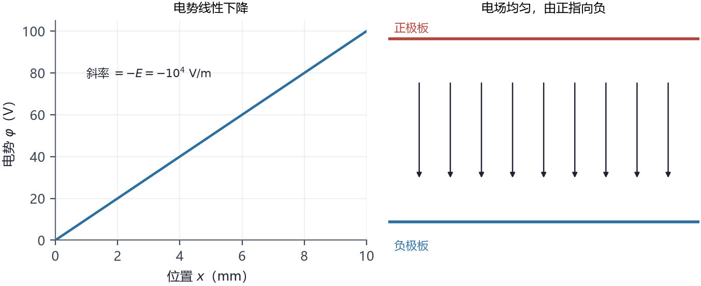
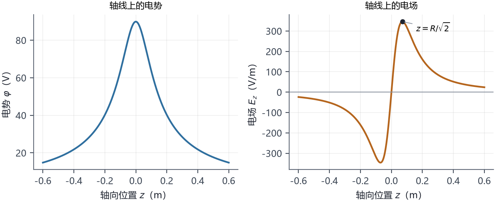
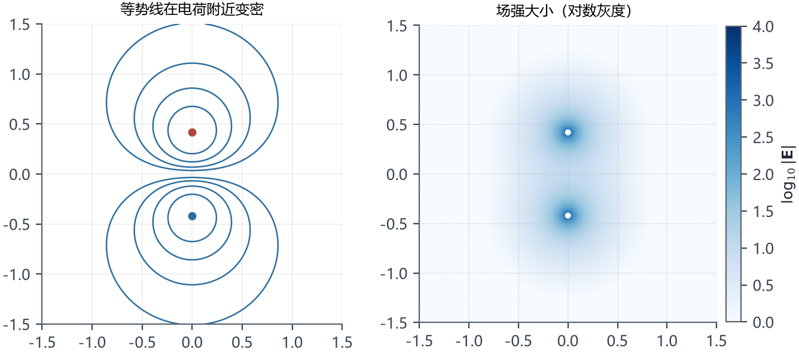

# 第 9 章 电势与场强的微分关系

## 9.1 从等高线看坡度

地形图上的等高线，间隔相同的高度。两条等高线靠得很近的地方，说明同样的高度差落在很短的水平距离上，坡很陡；等高线稀疏的地方，坡缓。爬山的人只要看等高线的疏密，就知道哪边难走。

等势线是电场的"等高线"。两条等势线之间的电势差固定，它们在空间上的间距越小，场强越大。这个关系在第八章末尾用过一次，写成了 $E\approx\Delta\varphi/\Delta l$。这一章把它变成精确的等式，并推广到三维。

精确的等式需要微积分。粗略的关系只给出大小，精确的关系还要给出方向：电场指向电势下降最快的方向，且垂直于等势面。这两条合起来就是

$$\mathbf{E}=-\nabla\varphi . \tag{9.1}$$

这个式子是静电学的核心。它把矢量场 $\mathbf{E}$ 与标量场 $\varphi$ 联系起来，使得求场的问题可以转化为求电势再求梯度。它也是麦克斯韦方程组里法拉第定律在静态情形下的形式，第六篇会从这个式子出发，加上时间导数，得到 $\nabla\times\mathbf{E}=-\partial\mathbf{B}/\partial t$。

## 9.2 一维的推导

先看最简单的情形：电场只有一个方向，比如沿 $x$ 轴，电势只依赖于 $x$。

把单位正电荷从 $x$ 移到 $x+dx$，位移是 $dx\,\hat{\mathbf{x}}$，电场力做的功是 $E_x\,dx$。电势的变化等于外力做功的负值，也就是

$$d\varphi=-E_x\,dx . \tag{9.2}$$

移项：

$$E_x=-\frac{d\varphi}{dx} . \tag{9.3}$$

这就是一维的 (9.1)。它的含义很直接：电场强度等于电势对位置的导数的负值。电势随 $x$ 增加而下降时，$d\varphi/dx<0$，$E_x>0$，电场指向 $+x$，也就是指向电势降低的方向。

举一个具体的例子。平行板电容器的两板相距 $d$，电势差 $U$，板间电势随位置线性变化：

$$\varphi(x)=\varphi_0-\frac{U}{d}x , \tag{9.4}$$

取负极板在 $x=0$、电势为零，正极板在 $x=d$、电势为 $U$，则 $\varphi(x)=Ux/d$，电场

$$E_x=-\frac{d\varphi}{dx}=-\frac{U}{d} . \tag{9.5}$$

负号说明电场指向 $-x$，从正极板指向负极板。大小是 $U/d$，与第七章用高斯定理算出的 $\sigma/\varepsilon_0$ 一致（因为 $U=Ed$，两式互为定义）。

这个例子里电势是线性的，导数是常数，所以电场是均匀的。图 9-1 画了板间的电势分布与电场方向。

把数代进去感受一下数量级。两板相距 $1\ \mathrm{cm}$，电势差 $100\ \mathrm{V}$，则 $E=100/0.01=1\times10^{4}\ \mathrm{V/m}$。这个场强是空气击穿场强的三百分之一，安全。如果间距缩到 $0.1\ \mathrm{mm}$，同样的电压下 $E=1\times10^{6}\ \mathrm{V/m}$，接近击穿，所以高压电容的介质要选耐压高的材料，不能只靠空气。

反过来，如果测得某处的场强是 $3\times10^{6}\ \mathrm{V/m}$，而两点相距 $0.1\ \mathrm{mm}$，那么这两点之间的电势差大约是 $300\ \mathrm{V}$。这个估算在看不到电势分布的时候很有用，它把"场强"这个抽象量翻译成了"电压"，而电压是能用表测的。

## 9.3 三维：方向导数与梯度

三维情形下，电势依赖于三个坐标，$d\varphi$ 由三个偏导数组成：

$$d\varphi=\frac{\partial\varphi}{\partial x}dx+\frac{\partial\varphi}{\partial y}dy+\frac{\partial\varphi}{\partial z}dz . \tag{9.6}$$

这个式子是全微分。它把沿任意方向的微小位移 $d\mathbf{l}=(dx,dy,dz)$ 造成的电势变化写成三项之和。

另一方面，由功的定义，$d\varphi=-\mathbf{E}\cdot d\mathbf{l}=-(E_xdx+E_ydy+E_zdz)$。与 (9.6) 比较，$dx$、$dy$、$dz$ 是任意的，所以三个系数必须分别相等：

$$E_x=-\frac{\partial\varphi}{\partial x},\qquad E_y=-\frac{\partial\varphi}{\partial y},\qquad E_z=-\frac{\partial\varphi}{\partial z} . \tag{9.7}$$

把三个分量合成一个矢量：

$$\mathbf{E}=-\left(\frac{\partial\varphi}{\partial x}\hat{\mathbf{x}}+\frac{\partial\varphi}{\partial y}\hat{\mathbf{y}}+\frac{\partial\varphi}{\partial z}\hat{\mathbf{z}}\right) . \tag{9.8}$$

括号里的量叫电势的梯度，记作 $\nabla\varphi$：

$$\nabla\varphi=\frac{\partial\varphi}{\partial x}\hat{\mathbf{x}}+\frac{\partial\varphi}{\partial y}\hat{\mathbf{y}}+\frac{\partial\varphi}{\partial z}\hat{\mathbf{z}} . \tag{9.9}$$

于是 (9.1) 成立：$\mathbf{E}=-\nabla\varphi$。

$\nabla$ 读作 nabla 或 del，是一个矢量微分算子：

$$\nabla=\hat{\mathbf{x}}\frac{\partial}{\partial x}+\hat{\mathbf{y}}\frac{\partial}{\partial y}+\hat{\mathbf{z}}\frac{\partial}{\partial z} . \tag{9.10}$$

它作用在标量场上得到矢量场（梯度），作用在矢量场上可以得标量场（散度）或矢量场（旋度）。这三种运算在第二十三章会系统讲，现在只需要梯度。

梯度的几何意义是"变化最快的方向"。沿 $d\mathbf{l}$ 的方向，电势的变化率是

$$\frac{d\varphi}{dl}=\nabla\varphi\cdot\hat{\mathbf{l}} , \tag{9.11}$$

$\hat{\mathbf{l}}$ 是位移方向的单位矢量。这个点乘在 $\hat{\mathbf{l}}$ 与 $\nabla\varphi$ 同向时取最大值，等于 $|\nabla\varphi|$。所以梯度指向电势增加最快的方向，电场指向电势下降最快的方向，两者反向。

## 9.4 验证几个已知结果

**点电荷。** $\varphi=kQ/r$，$r=\sqrt{x^2+y^2+z^2}$。求 $\partial\varphi/\partial x$，用链式法则：

$$\frac{\partial\varphi}{\partial x}=kQ\cdot\frac{d}{dr}\left(\frac{1}{r}\right)\cdot\frac{\partial r}{\partial x}=kQ\left(-\frac{1}{r^2}\right)\cdot\frac{x}{r}=-kQ\frac{x}{r^3} . \tag{9.12}$$

同理 $\partial\varphi/\partial y=-kQy/r^3$，$\partial\varphi/\partial z=-kQz/r^3$。三个分量合成：

$$\mathbf{E}=kQ\frac{x\hat{\mathbf{x}}+y\hat{\mathbf{y}}+z\hat{\mathbf{z}}}{r^3}=kQ\frac{\mathbf{r}}{r^3}=\frac{1}{4\pi\varepsilon_0}\frac{Q}{r^2}\hat{\mathbf{r}} . \tag{9.13}$$

与库仑定律一致。

**无限长直线。** $\varphi$ 的形式不是 $k\lambda/r$ 那种简单幂次。用电场反推：$E=\lambda/(2\pi\varepsilon_0r)$ 沿径向，所以 $\partial\varphi/\partial r=-\lambda/(2\pi\varepsilon_0r)$，积分得 $\varphi=-\lambda\ln r/(2\pi\varepsilon_0)+$ 常数。电势按对数变化，不是幂函数，这也是为什么无限长线的电势不能取无穷远为零。

**均匀带电球壳内部。** 球内 $\varphi$ 是常数，梯度为零，电场为零。这与第七章的结论一致。

## 9.5 球坐标与柱坐标

在球坐标里，梯度有两个主要分量（假设场有球对称性，只依赖 $r$）：

$$\nabla\varphi=\frac{\partial\varphi}{\partial r}\hat{\mathbf{r}}+\frac{1}{r}\frac{\partial\varphi}{\partial\theta}\hat{\boldsymbol{\theta}}+\frac{1}{r\sin\theta}\frac{\partial\varphi}{\partial\phi}\hat{\boldsymbol{\phi}} . \tag{9.14}$$

球对称时后两项为零，$\mathbf{E}=-\dfrac{\partial\varphi}{\partial r}\hat{\mathbf{r}}$。

验证点电荷：$\varphi=kQ/r$，$\partial\varphi/\partial r=-kQ/r^2$，$\mathbf{E}=kQ\hat{\mathbf{r}}/r^2$。

注意 $\hat{\boldsymbol{\theta}}$ 与 $\hat{\boldsymbol{\phi}}$ 前面的系数 $1/r$ 与 $1/(r\sin\theta)$。它们来自弧长：角度变化 $d\theta$ 对应的弧长是 $r\,d\theta$，所以"对弧长的导数"等于"对角度的导数除以 $r$"。忘记这两个因子是球坐标里最常见的错误。

柱坐标（$r$ 是到轴的距离，$\phi$ 是绕轴角，$z$ 是轴向）：

$$\nabla\varphi=\frac{\partial\varphi}{\partial r}\hat{\mathbf{r}}+\frac{1}{r}\frac{\partial\varphi}{\partial\phi}\hat{\boldsymbol{\phi}}+\frac{\partial\varphi}{\partial z}\hat{\mathbf{z}} . \tag{9.15}$$

## 9.6 由场求电势

(9.1) 的逆运算是线积分。已知 $\mathbf{E}$，电势差由

$$\varphi_A-\varphi_B=\int_A^B\mathbf{E}\cdot d\mathbf{l} \tag{9.16}$$

给出。因为静电场是保守场，积分与路径无关，可以选最方便的一条路径。

举一个例子。求一个均匀带电圆环轴线上的电势，再求电场。圆环半径 $R$、总电荷 $Q$，轴线上距圆心 $z$ 处的每一点到圆环上各点的距离都是 $\sqrt{R^2+z^2}$，所以

$$\varphi(z)=\frac{1}{4\pi\varepsilon_0}\frac{Q}{\sqrt{R^2+z^2}} . \tag{9.17}$$

这个式子不用积分就算出来了，因为分母是常数。求梯度，只有 $z$ 分量：

$$E_z=-\frac{d\varphi}{dz}=\frac{1}{4\pi\varepsilon_0}\frac{Qz}{\left(R^2+z^2\right)^{3/2}} . \tag{9.18}$$

这正是第六章用矢量积分算出的结果 (5.14)。用先求电势再求导的办法，省掉了矢量分解，也避免了在积分号里处理方向。这个技巧在计算复杂电荷分布的场时非常有用。

## 9.7 等势面密度与场强

回到开头的地形图。设两条相邻等势面的电势差是 $\Delta\varphi$，它们在某点附近的最小间距是 $\Delta n$（沿法线方向量）。电场沿法线，于是

$$E=\frac{|\Delta\varphi|}{\Delta n} . \tag{9.19}$$

这个式子是 (9.3) 的差分形式。它说明等势面越密，场强越大。图 9-3 画了一组等势线与对应的场强大小，可以对照着看：等势线密集的区域，场强的颜色深。

等势面的间距只能给场强的大小，方向要另外判断：垂直于等势面，指向电势低的一侧。两条信息合起来才是完整的场。

## 9.8 两个常见的错误

第一个错误是把 $E=-\nabla\varphi$ 写成 $E=\nabla\varphi$。符号来自"电场力做正功时电势能减少"。如果写成正的，电场就会指向电势升高的方向，与所有实验矛盾。检查的办法是看一个具体情形：正电荷产生的电势处处为正、随距离下降，电场必须向外，也就是指向电势下降的方向。负号不能丢。

第二个错误是把梯度当成标量。$\nabla\varphi$ 是矢量，有三个分量；$|\nabla\varphi|$ 才是大小。在对称性明显的题目里，往往只算一个分量就够，但要知道其他分量为零是因为对称性，而不是因为它们不存在。

还有一个细节：$\partial\varphi/\partial x$ 是"沿 $x$ 方向的变化率"，不是"沿电场方向的变化率"。两者只有在电场恰好沿 $x$ 方向时才相同。要算沿任意方向的变化率，得用 (9.11) 的点乘。

## 9.9 电势与场强的关系为什么重要

这个关系有三重意义。

计算上，它把矢量积分换成标量积分再加一次求导。求电势的积分通常比求场的积分容易，因为不需要分解方向。

概念上，它说明静电场可以由一个标量函数完全确定。给定 $\varphi(x,y,z)$，三个分量的场就全知道了。这不是所有矢量场都有的性质，只有旋度为零的场才有。第六篇会说明，静电场旋度为零，正是因为它可以写成梯度的形式。

结构上，它是麦克斯韦方程组里 $\nabla\times\mathbf{E}=-\partial\mathbf{B}/\partial t$ 的静态版本。加上时间变化之后，$\mathbf{E}$ 不再能写成单纯的梯度，还要加上一个与矢势有关的部分，这个推广在第二十四章会做。

## 9.10 用梯度求偶极子的场

第六章用矢量叠加算了偶极子的场，过程比较长。现在有了电势，可以换一条路：先写电势，再求梯度。这条路的计算量小得多，也可以用来检验第六章的结果。

偶极子的电势由第八章 (8.15) 给出：

$$\varphi=\frac{1}{4\pi\varepsilon_0}\frac{p\cos\theta}{r^{2}} . \tag{9.20}$$

用球坐标的梯度公式 (9.14)。场有轴对称性，不依赖 $\phi$，所以 $E_\phi=0$。径向分量：

$$E_r=-\frac{\partial\varphi}{\partial r}=-\frac{p\cos\theta}{4\pi\varepsilon_0}\cdot\left(-\frac{2}{r^{3}}\right)=\frac{1}{4\pi\varepsilon_0}\frac{2p\cos\theta}{r^{3}} . \tag{9.21}$$

角向分量：

$$E_\theta=-\frac{1}{r}\frac{\partial\varphi}{\partial\theta}=-\frac{1}{r}\cdot\frac{p}{4\pi\varepsilon_0r^{2}}\left(-\sin\theta\right)=\frac{1}{4\pi\varepsilon_0}\frac{p\sin\theta}{r^{3}} . \tag{9.22}$$

两个结果与第六章 (6.20) 完全一致。验算的办法是取两个特殊方向：$\theta=0$ 时 $E_r=2kp/r^3$，$E_\theta=0$；$\theta=\pi/2$ 时 $E_r=0$，$E_\theta=kp/r^3$。轴线与中垂线的结果都对上了。

这个例子说明了电势方法的效率。矢量叠加要处理两个矢量的分量，还要做近似展开；先求电势只需要把两个分母展开一次，求梯度只是两次偏导数。代价是要熟悉球坐标的梯度公式，尤其是那个 $1/r$ 因子。

## 9.11 用势解一个边值问题

电势方法的真正威力在解边值问题。这里用一个完整的例子说明流程。

同轴电缆的内导体半径 $a$、外导体半径 $b$，内导体接电压 $U$，外导体接地。求两导体之间的电势与电场。

两导体之间没有电荷，电势满足拉普拉斯方程。由柱对称，$\varphi$ 只依赖 $r$：

$$\frac{1}{r}\frac{d}{dr}\left(r\frac{d\varphi}{dr}\right)=0 . \tag{9.23}$$

这个方程可以直接积分。两边乘 $r$：

$$\frac{d}{dr}\left(r\frac{d\varphi}{dr}\right)=0 . \tag{9.24}$$

括号里是常数：

$$r\frac{d\varphi}{dr}=C_1\quad\Rightarrow\quad\frac{d\varphi}{dr}=\frac{C_1}{r} . \tag{9.25}$$

再积分一次：

$$\varphi=C_1\ln r+C_2 . \tag{9.26}$$

两个常数由边界条件定。内导体上 $\varphi(a)=U$，外导体上 $\varphi(b)=0$：

$$C_1\ln a+C_2=U,\qquad C_1\ln b+C_2=0 . \tag{9.27}$$

两式相减：

$$C_1\left(\ln a-\ln b\right)=U\quad\Rightarrow\quad C_1=\frac{U}{\ln\left(a/b\right)}=-\frac{U}{\ln\left(b/a\right)} . \tag{9.28}$$

代入第二式求 $C_2$：

$$C_2=-C_1\ln b=\frac{U\ln b}{\ln\left(b/a\right)} . \tag{9.29}$$

于是

$$\varphi(r)=\frac{U}{\ln\left(b/a\right)}\left(\ln b-\ln r\right)=\frac{U}{\ln\left(b/a\right)}\ln\frac{b}{r} . \tag{9.30}$$

检查边界：$r=a$ 时 $\ln(b/a)/\ln(b/a)=1$，$\varphi=U$；$r=b$ 时 $\ln1=0$，$\varphi=0$。正确。

电场由梯度给出，只有径向分量：

$$E_r=-\frac{d\varphi}{dr}=-\frac{U}{\ln\left(b/a\right)}\cdot\left(-\frac{1}{r}\right)=\frac{U}{r\ln\left(b/a\right)} . \tag{9.31}$$

场强按 $1/r$ 衰减，内导体表面最强。这个结果与第七章用高斯定理算的 $E=\lambda/(2\pi\varepsilon_0r)$ 一致：把 $\lambda$ 与 $U$ 的关系代进去就能对上。

这个例子说明边值问题的解法：写方程、由对称性化简、积分两次得通解、用边界条件定常数、求梯度得场。四步，每一步都有依据。

再看一个细节。如果内外导体之间填了两种介质，各占一半角度，那么 $\varphi$ 仍然只依赖 $r$（因为边界条件在角度方向是分段常数，通解仍然可以是 $\ln r$ 的形式），但电场在不同介质里不同，因为 $\mathbf{D}$ 的法向分量要连续。这类问题要用分区求解、边界上拼接，本书不展开。

## 9.12 把电荷搬过去要做多少功

电势的一个直接用途是算功。把电荷 $q$ 从 $A$ 点搬到 $B$ 点，外力至少要做多少功？

如果过程缓慢，动能不变，外力做功等于电势能的增加：

$$W_{\text{外}}=q\left(\varphi_B-\varphi_A\right) . \tag{9.32}$$

这个式子对任意路径成立，因为静电力是保守力，电势差只与两端有关。

举例。两个点电荷 $+Q$ 与 $+q$，初始相距很远，把它们拉到相距 $r$。初始电势能取零，末态电势能 $U=kQq/r$，外力做功 $kQq/r$。这部分能量储存在系统的电场里。

如果是异号电荷，$q<0$，$U=kQq/r<0$，外力做负功：电场自己把它们拉近，外力要"拉住"才能缓慢移动。放手的瞬间，电势能变成动能，两个电荷撞在一起。

这个计算在后面反复出现。第十九章算感应电动势时，能量从磁场转到电路；第二十一章算磁能时，用同样的思路。功与能的账，只要认准"初态、末态、能量差"，中间的路径不用管。

同一个电荷在两个导体之间移动，做功等于 $q$ 乘以两点电势差。这就是加速器的基本原理：给粒子一个几百万伏的电势差，它获得的能量就是几百万电子伏特。直线加速器把多个这样的间隙串起来，每过一个间隙能量增加一次。

## 9.13 完整算一遍：用等势面间距估场强

电势与场强的关系可以用来做数值估算。这里用两个例子走一遍。

**均匀场。** 平行板间电势 $\varphi(x)=100-2000x$（伏特，$x$ 以米为单位）。由 (9.3)：

$$E_x=-\frac{d\varphi}{dx}=2000\ \mathrm{V/m} , \tag{9.33}$$

方向沿 $-x$。用差分核对：取 $x=0.02$ 与 $x=0.03$，两点电势差

$$\Delta\varphi=\varphi(0.03)-\varphi(0.02)=\left(100-60\right)-\left(100-40\right)=-20\ \mathrm{V} . \tag{9.34}$$

间距 $\Delta x=0.01\ \mathrm{m}$，估算

$$E\approx\frac{\left|\Delta\varphi\right|}{\Delta x}=\frac{20}{0.01}=2000\ \mathrm{V/m} , \tag{9.35}$$

与解析值一致。这个例子里电势是线性的，差分与导数严格相等，取任何间距都一样。

**点电荷的场。** $\varphi=kQ/r$，取 $Q=1.0\ \mathrm{nC}$。在 $r=0.30\ \mathrm{m}$ 与 $r=0.31\ \mathrm{m}$ 处：

$$\varphi(0.30)=\frac{8.99\times10^{9}\times1.0\times10^{-9}}{0.30}=29.97\ \mathrm{V} , \tag{9.36}$$

$$\varphi(0.31)=\frac{8.99}{0.31}=29.00\ \mathrm{V} . \tag{9.37}$$

差值 $-0.97\ \mathrm{V}$，除以 $0.01\ \mathrm{m}$：

$$\bar{E}\approx\frac{0.97}{0.01}=97\ \mathrm{V/m} . \tag{9.38}$$

解析值 $E=kQ/r^2=8.99/(0.30^2)=99.9\ \mathrm{V/m}$。差分估算偏低约百分之三，因为电势在这一段不是线性的，割线的斜率小于中点处的切线斜率。

这个误差可以估。对 $\varphi\propto r^{-1}$，二阶导数是 $2kQ/r^3$，差分近似丢掉的是 $\frac{1}{2}\varphi''\Delta r$ 项，相对误差约 $\Delta r/r=0.01/0.30\approx3\%$，与算出的偏差一致。要让误差降到百分之一，步长要取 $0.003\ \mathrm{m}$。

这两个例子说明一个实用的方法：给一张等势线图，量出相邻两条线的间距 $\Delta n$ 与电势差 $\Delta\varphi$，用 $E\approx\Delta\varphi/\Delta n$ 就能估出场强，精度取决于 $\Delta n$ 相对于场变化的尺度有多小。

## 9.14 常见误解

**梯度是一个矢量，不是一个数。** $\nabla\varphi$ 有三个分量，$|\nabla\varphi|$ 才是大小。在球对称问题里只有一个径向分量，容易让人忘记其他方向；一旦场不对称（比如偶极子），角向分量不能丢。第九章第 9.10 节算偶极子时，如果只保留 $E_r$，就会漏掉一半的场。

**梯度给出方向，不只是"最大变化率"。** 梯度指向电势增加最快的方向，电场与之相反。知道这一点，才能判断电场指向哪里。只记住"$E$ 等于电势的变化率"会丢掉方向信息，遇到二维、三维问题时无法定出方向。

**等势面密的地方场强大，但方向要另外判断。** 等势面的疏密只给出 $|\mathbf{E}|$，方向垂直于等势面，指向电势降低的一侧。这两条信息合起来才是完整的场。只看疏密就写 $\mathbf{E}$，等于把一个矢量当成了标量。

**球坐标梯度里的 $1/r$ 不能漏。** $\partial\varphi/\partial\theta$ 是"每弧度"的变化率，不是"每米"的变化率。弧长等于 $r\,d\theta$，所以每米的变化率要除以 $r$。同理，$1/(r\sin\theta)$ 来自沿 $\phi$ 方向的弧长 $r\sin\theta\,d\phi$。这两个因子是球坐标计算中最常见的错误来源。

---

这一章把电势与场强接上了，用的是微积分里最基础的操作：全微分、偏导数、链式法则。三个公式 (9.1)、(9.3)、(9.14) 会在后面反复出现，尤其是球坐标形式，第二十三章讲散度与旋度时会再遇到它。

下一章算电容与电场能量。有了电势，电容的定义 $C=Q/U$ 才有意义；有了场强，能量密度 $\frac{1}{2}\varepsilon_0E^2$ 才能算出来。
