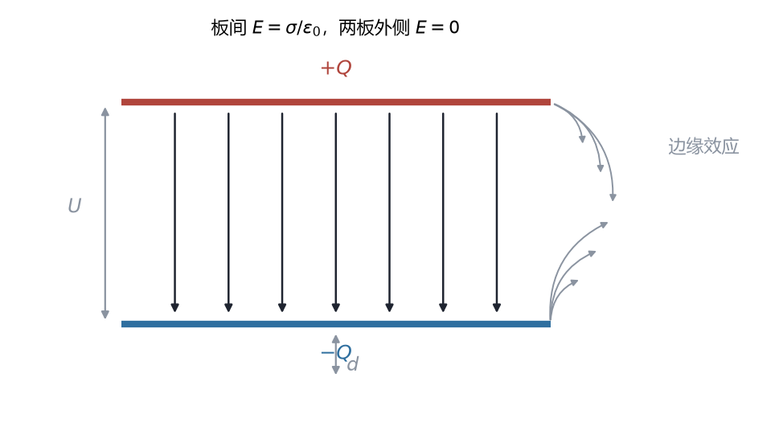
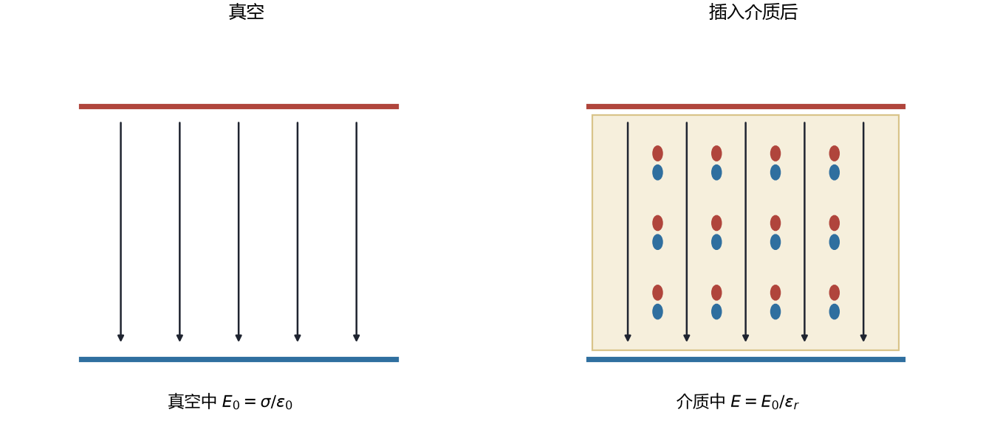
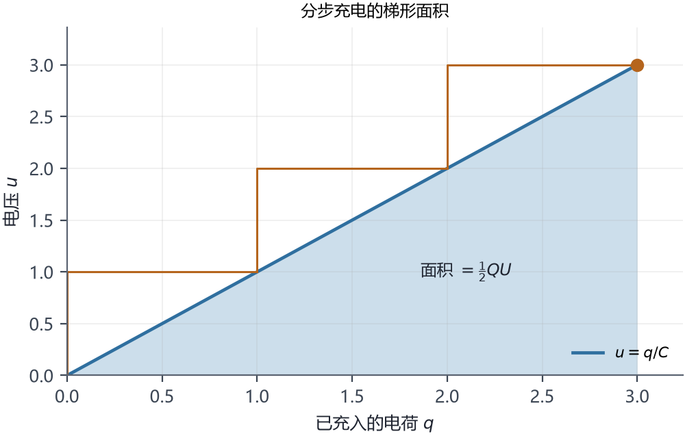

# 第 10 章 电容、电容器与电场能量

## 10.1 两块金属板能存多少电

拿两块金属板，平行放置，中间隔一点距离。把一块接电池正极、一块接负极，两块板上就分别带上等量异号的电荷。断开电池，电荷留在板上。这个过程叫充电。

能存多少电荷？实验发现，同一对板，电压加倍，电荷也加倍，比值不变。换一对面积更大的板，同样的电压下能存更多电荷。把板间距拉大，同样的电压下存的电荷变少。

这些事实可以概括成一个量。定义电容

$$C=\frac{Q}{U} , \tag{10.1}$$

$Q$ 是一块板上的电荷绝对值，$U$ 是两板之间的电势差。电容的单位是法拉，$1\ \mathrm{F}=1\ \mathrm{C/V}$。一法拉很大，实际电容器的单位多是微法（$\mu\mathrm{F}$）、纳法（$\mathrm{nF}$）、皮法（$\mathrm{pF}$）。

电容只由几何形状和介质决定，与充了多少电荷无关。这个性质需要证明：从 (10.1) 看，$Q$ 与 $U$ 成正比才能让 $C$ 是常数。下一节的平行板推导会证明这个正比关系，并且给出比例系数。

## 10.2 平行板电容器

两块面积为 $A$ 的金属板，相距 $d$，$d$ 远小于板的线度。两板带等量异号电荷 $\pm Q$。

电荷在板上均匀分布（忽略边缘），面密度 $\sigma=Q/A$。由第七章，两板之间的场是两块板场的叠加。正板单独产生 $\sigma/(2\varepsilon_0)$，方向背离正板；负板单独产生 $\sigma/(2\varepsilon_0)$，方向指向负板。两板之间两个场同向，相加得

$$E=\frac{\sigma}{\varepsilon_0}=\frac{Q}{\varepsilon_0A} . \tag{10.2}$$

两板之外，两个场反向，相减得零。这与第七章导体表面的结论一致：导体内部的场为零，电荷只在外表面，板间的场由两块板的内表面电荷共同产生。

电势差是场强乘距离，因为场是均匀的：

$$U=Ed=\frac{Qd}{\varepsilon_0A} . \tag{10.3}$$

代入电容的定义：

$$C=\frac{Q}{U}=\frac{\varepsilon_0A}{d} . \tag{10.4}$$

电容与面积成正比，与间距成反比，与电荷量无关。这个式子证实了 $Q$ 与 $U$ 成正比。

代一组数。两块 $10\ \mathrm{cm}\times10\ \mathrm{cm}$ 的板，相距 $1\ \mathrm{mm}$，中间是空气：

$$C=\frac{8.85\times10^{-12}\times0.01}{10^{-3}}=8.85\times10^{-11}\ \mathrm{F}\approx88\ \mathrm{pF} . \tag{10.5}$$

不到一个纳法。要做出微法级的电容，要么把面积做大（卷绕），要么把间距做小（薄膜），要么换介质（$\varepsilon_r$ 大的材料）。

## 10.3 串联与并联

两个电容 $C_1$、$C_2$ 串联。串联的意思是首尾相接，中间那段孤立，总电荷为零。充电时，两端加电压 $U$，两个电容上的电荷相同（因为中间那段孤立，一边得多少，另一边就少多少）：

$$Q_1=Q_2=Q . \tag{10.6}$$

总电压是两段电压之和：

$$U=U_1+U_2=\frac{Q}{C_1}+\frac{Q}{C_2}=Q\left(\frac{1}{C_1}+\frac{1}{C_2}\right) . \tag{10.7}$$

等效电容

$$\frac{1}{C_{\text{串}}}=\frac{1}{C_1}+\frac{1}{C_2}\quad\Rightarrow\quad C_{\text{串}}=\frac{C_1C_2}{C_1+C_2} . \tag{10.8}$$

串联的等效电容小于任何一个，这一点与电阻相反。物理上，串联相当于把板间距加大，电容变小。

并联时，两个电容的两端接在一起，电压相同：

$$U_1=U_2=U . \tag{10.9}$$

总电荷是两者之和：

$$Q=Q_1+Q_2=C_1U+C_2U=\left(C_1+C_2\right)U . \tag{10.10}$$

$$C_{\text{并}}=C_1+C_2 . \tag{10.11}$$

并联相当于把板的面积加大，电容变大。

多个电容的一般规则与电阻相反：串联按倒数相加，并联直接相加。记住这个"相反"能避免大部分错误。

## 10.4 介质

把一块绝缘体插入电容器，电容变大。变大的倍数叫相对介电常数 $\varepsilon_r$，也叫介电常数（相对于真空）：

$$C=\varepsilon_rC_0 , \tag{10.12}$$

$C_0$ 是真空时的电容。空气的 $\varepsilon_r\approx1.0006$，可以当作 1；纸约 3.7，聚酯薄膜约 3.3，陶瓷可以到几百甚至上千，水是 80。

为什么介质会让电容变大？介质在外场中被极化。分子内部的电荷重新分布，形成许多小偶极子，它们产生的场与外场反向，使介质内部的总场减小。场减小了，同样的电荷对应的电势差就变小，由 $C=Q/U$ 得电容变大。

把这件事算清楚。介质中的场是

$$E=\frac{E_0}{\varepsilon_r} , \tag{10.13}$$

$E_0$ 是同样电荷下真空中的场。电势差 $U=Ed=E_0d/\varepsilon_r=U_0/\varepsilon_r$。电荷不变，电压变小 $\varepsilon_r$ 倍，电容变大 $\varepsilon_r$ 倍。

这个推导有一个前提：介质充满两板之间的全部空间。如果只填一部分，场在不同区域不同，要分段算，等效电容介于两个极端之间。

束缚电荷可以算出来。设极化使介质表面出现面电荷密度 $\sigma_b$，靠近正板的一面是负的，靠近负板的一面是正的。介质内部的场由自由电荷与束缚电荷共同产生：

$$E=\frac{\sigma-\sigma_b}{\varepsilon_0} .$$

另一方面 $E=\sigma/(\varepsilon_0\varepsilon_r)$，两式相等，解出

$$\sigma_b=\sigma\left(1-\frac{1}{\varepsilon_r}\right) .$$

$\varepsilon_r=1$ 时 $\sigma_b=0$，没有极化；$\varepsilon_r$ 很大时 $\sigma_b\to\sigma$，束缚电荷几乎完全抵消自由电荷的场。这就是介质提高电容的机制：束缚电荷不减少自由电荷，但它产生的反向场降低了板间的总场强。

介质还有一个限制：击穿。场强超过某个值，介质中的电子被拉出来，形成导电通道，介质失去绝缘性。这个值叫击穿场强，空气约 $3\times10^{6}\ \mathrm{V/m}$，云母约 $10^{8}\ \mathrm{V/m}$，陶瓷介于两者之间。电容器的额定电压由这个值决定，选电容时不能只看电容值，还要看耐压。

## 10.5 充电过程与能量

给电容器充电要做功。设想在某个时刻，电容上已有电荷 $q$，电压 $u=q/C$。再把 $dq$ 的电荷从负极板搬到正极板，外力要克服电场力做功

$$dW=u\,dq=\frac{q}{C}dq . \tag{10.14}$$

从零充到 $Q$，总功

$$W=\int_0^Q\frac{q}{C}dq=\frac{1}{C}\cdot\frac{Q^2}{2}=\frac{Q^2}{2C} . \tag{10.15}$$

这部分功变成了电容器的电场能量。用 $Q=CU$ 换成电压的形式：

$$W=\frac{Q^2}{2C}=\frac{1}{2}CU^2=\frac{1}{2}QU . \tag{10.16}$$

三个表达式等价，看已知哪个量用哪个。

这个结果可以从 $q$-$u$ 图上看出。$u=q/C$ 是一条过原点的直线，$dW=u\,dq$ 是曲线下的一小块面积，总功是直线下的三角形面积，底是 $Q$，高是 $U$，面积 $\frac{1}{2}QU$。图 10-3 画了这条直线与三角形。

注意 $\frac{1}{2}$ 这个因子。它来自"电荷不是一次搬完的"：先搬的电荷面对的电压低，后搬的面对电压高，平均电压是一半。如果误写成 $QU$，就多算了一倍。

## 10.6 电场能量密度

能量储在哪里？在电场里。把平行板的结果拿出来算每单位体积的能量。

平行板的电容 $C=\varepsilon_0A/d$，电压 $U=Ed$，能量

$$W=\frac{1}{2}CU^2=\frac{1}{2}\cdot\frac{\varepsilon_0A}{d}\cdot\left(Ed\right)^2=\frac{1}{2}\varepsilon_0E^2\cdot Ad . \tag{10.17}$$

$Ad$ 是两板之间的体积，场只在这个体积里。除以体积，得能量密度

$$u_E=\frac{1}{2}\varepsilon_0E^2 . \tag{10.18}$$

这个式子不限于平行板。对任意电场分布，能量密度都是 $\frac{1}{2}\varepsilon_0E^2$，总能量是它对全空间积分：

$$W=\int\frac{1}{2}\varepsilon_0E^2\,dV . \tag{10.19}$$

有介质时换成 $\frac{1}{2}\varepsilon E^2$，$\varepsilon=\varepsilon_r\varepsilon_0$。

用一个例子验证 (10.19) 与 (10.16) 一致。半径 $R$ 的导体球，带电荷 $Q$，球外的场 $E=kQ/r^2$。能量密度对球外空间积分：

$$W=\int_R^{\infty}\frac{1}{2}\varepsilon_0\left(\frac{Q}{4\pi\varepsilon_0r^2}\right)^2\cdot4\pi r^2dr . \tag{10.20}$$

整理常数：

$$W=\frac{Q^2}{8\pi\varepsilon_0}\int_R^{\infty}\frac{dr}{r^2}=\frac{Q^2}{8\pi\varepsilon_0}\cdot\frac{1}{R} . \tag{10.21}$$

另一方面，孤立球的电容是 $C=4\pi\varepsilon_0R$（把 (8.13) 的球壳电势代入 $C=Q/\varphi$），能量 $Q^2/(2C)=Q^2/(8\pi\varepsilon_0R)$。两者一致。

这个验证说明能量确实分布在空间里。如果只把能量算在电荷上，就解释不了为什么积分遍及球外的整个空间也能得到同样的结果。场的能量密度是局部量，这是场作为物理对象的一条证据。

## 10.7 球形与圆柱形电容

球形电容：两个同心球壳，半径 $a<b$，中间是介质。第八章算过两壳之间的电势差 (8.24)：

$$U=\frac{Q}{4\pi\varepsilon}\left(\frac{1}{a}-\frac{1}{b}\right) . \tag{10.22}$$

电容

$$C=\frac{Q}{U}=4\pi\varepsilon\frac{ab}{b-a} . \tag{10.23}$$

$b\to\infty$ 时，$ab/(b-a)\to a$，得孤立球的电容 $4\pi\varepsilon a$。

圆柱形电容：同轴导体，内半径 $a$、外半径 $b$，长度 $l\gg b$。两柱之间的场由高斯定理给出 $E=\lambda/(2\pi\varepsilon r)$，电势差

$$U=\int_a^b\frac{\lambda}{2\pi\varepsilon r}dr=\frac{\lambda}{2\pi\varepsilon}\ln\frac{b}{a} . \tag{10.24}$$

电荷 $Q=\lambda l$，电容

$$C=\frac{2\pi\varepsilon l}{\ln\left(b/a\right)} . \tag{10.25}$$

同轴电缆的电容就用这个式子算。单位长度的电容是 $2\pi\varepsilon/\ln(b/a)$，与长度成正比。

三个公式 (10.4)、(10.23)、(10.25) 有一个共同的模式：电容等于 $\varepsilon$ 乘一个纯几何因子。这个因子总是"面积除以距离"的某种形式，具体形状决定了它是 $A/d$、$4\pi ab/(b-a)$ 还是 $2\pi l/\ln(b/a)$。

## 10.8 电容器的实际

电容器在电路里有几种用途，每种对应不同的设计。

储能。闪光灯、除颤器、电磁炮都需要短时间内放出大量能量，电池做不到，电容可以。能量密度 $\frac{1}{2}\varepsilon E^2$ 说明要提高储能，要么提高介电常数，要么提高击穿场强。

滤波。电容对直流是断路，对交流是通路，阻抗 $1/(\omega C)$ 随频率下降。电源里的滤波电容把整流后的脉动电压平滑成接近直流。

耦合与旁路。放大器级间用电容隔直流、通交流；芯片电源脚旁边放一个小电容，把高频噪声旁路到地。

调谐。收音机的选台旋钮就是一个可变电容，改变电容值改变谐振频率。这一点需要电感，第二十一章会讲 LC 振荡。

超级电容是另一类器件，原理是双电层而不是普通介质极化，电容可以达到几千法拉，但耐压只有几伏。它的能量密度比电池低，功率密度比电池高，用在需要快速充放电的场合。

## 10.9 RC 电路：充放电的微分方程

电容与电阻串起来接电源，充电过程不是瞬间完成的。这一节把这个过程解出来，顺便得到一个反直觉的结论：充电过程中有一半能量消耗在电阻上。

电路：电源 $\mathcal{E}$、电阻 $R$、电容 $C$ 串联。设 $t=0$ 时电容上没有电荷，合上开关。

由基尔霍夫回路定律，电源电动势等于电阻上的电压降加电容上的电压：

$$\mathcal{E}=RI+\frac{q}{C} . \tag{10.26}$$

电流是电荷的变化率，$I=dq/dt$，代入：

$$R\frac{dq}{dt}+\frac{q}{C}=\mathcal{E} . \tag{10.27}$$

这是一个一阶线性微分方程。整理成标准形式：

$$\frac{dq}{dt}=\frac{\mathcal{E}}{R}-\frac{q}{RC}=-\frac{1}{RC}\left(q-C\mathcal{E}\right) . \tag{10.28}$$

分离变量：

$$\frac{dq}{q-C\mathcal{E}}=-\frac{dt}{RC} . \tag{10.29}$$

两边积分，从 $t=0$、$q=0$ 开始：

$$\int_0^q\frac{dq'}{q'-C\mathcal{E}}=-\frac{t}{RC} . \tag{10.30}$$

左边的积分是 $\ln\left|q-C\mathcal{E}\right|-\ln\left|-C\mathcal{E}\right|$。因为 $q<C\mathcal{E}$，绝对值可以去掉，符号由比值决定：

$$\ln\frac{C\mathcal{E}-q}{C\mathcal{E}}=-\frac{t}{RC} . \tag{10.31}$$

取指数：

$$C\mathcal{E}-q=C\mathcal{E}\,e^{-t/RC} , \tag{10.32}$$

$$q(t)=C\mathcal{E}\left(1-e^{-t/RC}\right) . \tag{10.33}$$

电荷从零指数增长，最终趋于 $C\mathcal{E}$。时间常数

$$\tau=RC \tag{10.34}$$

决定充电的快慢。$t=\tau$ 时充到 $63\%$，$t=3\tau$ 时充到 $95\%$。

两端的电压 $u_C=q/C=\mathcal{E}(1-e^{-t/RC})$，电流 $I=dq/dt=(\mathcal{E}/R)e^{-t/RC}$。电流在合闸瞬间最大，等于 $\mathcal{E}/R$，然后指数衰减。这个"瞬间大电流"是电容器的特征：它对突然的变化呈现短路。

放电时把电源换成短路线，方程变成

$$R\frac{dq}{dt}+\frac{q}{C}=0\quad\Rightarrow\quad q=q_0e^{-t/RC} . \tag{10.35}$$

电荷指数衰减，电流反向。

## 10.10 一半能量的去向

算一下充电过程的总账。

电源输出的总能量：电源搬运的总电荷是 $Q=C\mathcal{E}$，每单位电荷做功 $\mathcal{E}$，所以

$$W_{\text{源}}=\mathcal{E}Q=C\mathcal{E}^{2} . \tag{10.36}$$

电容储存的能量：

$$W_C=\frac{1}{2}C\mathcal{E}^{2} . \tag{10.37}$$

两者相差一半。另一半去哪了？在电阻上变成了热。

验证一下。电阻的功率 $I^2R$，从 $0$ 到无穷积分：

$$W_R=\int_0^{\infty}I^{2}R\,dt=\int_0^{\infty}\frac{\mathcal{E}^{2}}{R}e^{-2t/RC}dt=\frac{\mathcal{E}^{2}}{R}\cdot\frac{RC}{2}=\frac{1}{2}C\mathcal{E}^{2} . \tag{10.38}$$

正好是一半。

这个结论与 $R$ 的大小无关。$R$ 越小，充电越快，但电流越大，$I^2R$ 的积分不变。即使 $R\to0$，电阻上的损耗也是 $\frac{1}{2}C\mathcal{E}^2$（实际情形中这部分能量会以电磁辐射的形式散掉）。

所以用电容储能有一个效率上限：从固定电压的电源充电，最多只有一半能量进入电容。要高效储能，得用恒流充电或者电感储能变换，这一类问题属于电力电子。

这个"一半"的结论不是电容的特例。任何把能量从"恒定势源"搬到一个"线性储能元件"的过程，都有一半损耗。弹簧、电感都一样。它是线性系统的一个普遍性质。

## 10.11 完整算一遍：同轴电缆的电容与储能

同轴电缆内导体半径 $a=1.0\ \mathrm{mm}$，外导体内半径 $b=4.0\ \mathrm{mm}$，中间介质 $\varepsilon_r=2.3$，长度 $l=1.0\ \mathrm{m}$。

单位长度的电容由 (10.25) 给出，先算分母：

$$\ln\frac{b}{a}=\ln4=1.386 . \tag{10.39}$$

分子：

$$2\pi\varepsilon_0\varepsilon_r l=2\pi\times8.854\times10^{-12}\times2.3\times1.0=1.280\times10^{-10}\ \mathrm{F} . \tag{10.40}$$

相除：

$$C=\frac{1.280\times10^{-10}}{1.386}=9.23\times10^{-11}\ \mathrm{F}\approx92\ \mathrm{pF} . \tag{10.41}$$

每米九十二皮法。这个数值在电缆手册里能查到，量级正确。

接 $U=1.0\ \mathrm{kV}$ 电压，储存的电荷与能量：

$$Q=CU=9.23\times10^{-11}\times10^{3}=9.23\times10^{-8}\ \mathrm{C} , \tag{10.42}$$

$$W=\frac{1}{2}CU^{2}=\frac{1}{2}\times9.23\times10^{-11}\times10^{6}=4.6\times10^{-5}\ \mathrm{J} . \tag{10.43}$$

四十六微焦，很小。电缆的主要用途是传信号，不是储能，所以电容小反而是好事：电容小，对高频信号的容抗大，不会把信号旁路掉。

再算内导体表面的场强。由 (9.31) 的圆柱形电场公式，$E=U/(a\ln(b/a))$：

$$E_{\max}=\frac{1000}{1.0\times10^{-3}\times1.386}=7.2\times10^{5}\ \mathrm{V/m} . \tag{10.44}$$

聚乙烯的击穿场强约 $2\times10^{7}\ \mathrm{V/m}$，安全裕度接近三十倍。如果把电压升到 $30\ \mathrm{kV}$，场强达到 $2.2\times10^{7}\ \mathrm{V/m}$，超过击穿值，电缆会被击穿。

这个计算说明电缆的额定电压由最内层的场强决定，而最内层的场强与内导体半径成反比。增大内导体半径可以降低最大场强，但会减小 $\ln(b/a)$，使电容增大。工程设计在这里有一个折中。

## 10.12 常见误解

**电容与电荷量无关。** $C=Q/U$ 看起来像"电容等于电荷除以电压"，容易读成"电荷越多电容越大"。实际上 $C$ 由几何与介质决定，$Q$ 与 $U$ 同比例变化，比值不变。判断一个电容器"多大"，看的是面积、间距、介质，不是它带了多少电。

**串联时每个电容的电荷相同，电压不同。** 串联的两个电容，中间那段导体是孤立的，一边得到多少电荷，另一边就失去多少，所以两个电容上的电荷量相等。电压按 $U=Q/C$ 分配，电容小的分到的电压高。这就是为什么串联电容可以提高耐压：总电压被分摊。

**插入介质时，保持电压不变还是保持电荷不变，结果不同。** 如果电容接着电源（电压固定），插入介质后 $C$ 变大，$Q=CU$ 变大，电源要额外提供电荷；如果电容断开电源（电荷固定），插入介质后 $C$ 变大，$U=Q/C$ 变小。两种情况能量变化也不同：接电源时电场能量增加，增加的部分由电源提供（还要加上电源做的功），断开时能量减少，减少的部分变成把介质吸入的机械功。判断"哪个量不变"，先看电路是开路还是闭路。

**电容"隔直通交"不是开关。** 直流下电容充满电后电流为零，但充电过程有电流；交流下电流一直存在，大小由容抗决定。它不是一个理想的开关，而是一个频率相关的阻抗。

### 一个常被忽略的细节

电容器的引线也有电感。一个实际的电容器在高频下不是纯电容，而是一个 $L$-$C$-$R$ 串联模型，存在自谐振频率。超过这个频率，电容器呈感性，旁路作用失效。这就是为什么高频电路里要把大电容（电解）与小电容（陶瓷）并联使用：各管一段频率。

第 10.9 节算的 RC 充放电用的是理想电容，忽略了引线电感与介质损耗。在低频、小电流的场合这个近似成立；在开关电源、射频电路里必须用更完整的模型。

---

这一章把电势、场强、能量串起来。电容是几何与介质的函数，能量储在电场里，密度是 $\frac{1}{2}\varepsilon_0E^2$。这个密度公式在第二十一章会以磁场的形式再出现一次，$\frac{1}{2\mu_0}B^2$，两者的形式几乎一样，这是电磁对称性的一次预演。

下一篇讲电流。电流是电荷的运动，运动需要时间，所以前两篇的静电场结果要加上"随时间变化"这一层。第一个要处理的问题是：导线里的电子到底跑多快。
