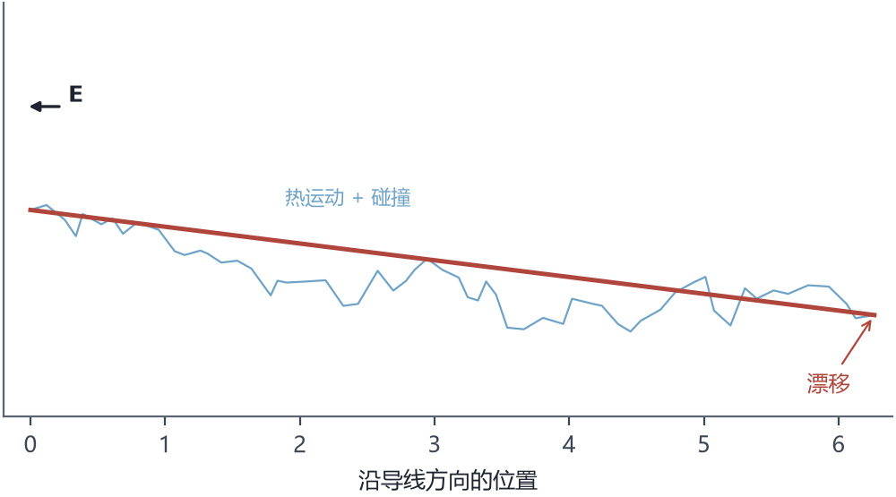
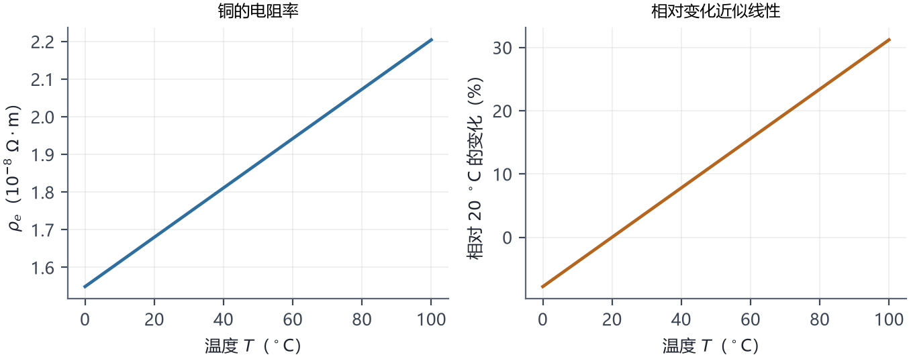
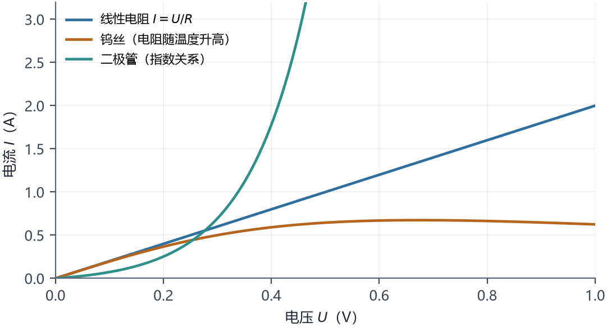

# 第 11 章 电流、电阻与欧姆定律的微观图像

## 11.1 开灯为什么要等一下

按下开关，灯几乎立刻亮起来。如果问"电子从开关跑到灯泡用了多久"，答案会让人吃惊：铜线里电子的平均漂移速度只有每秒零点几毫米，走过一米需要将近一小时。

那为什么灯是立刻亮的？因为合上开关的瞬间，电场以接近光速的速度在导线里建立起来。导线里的自由电子本来就在，只是原来没有统一的推动方向；电场一到，所有电子几乎同时开始定向移动，灯就亮了。这与水管里已经装满水、打开龙头水立刻流出是一个道理：不是水分子从水塔跑到了龙头，而是压力传了过去。

这个区别说明了电流的两层含义：宏观上是一个电荷流动的速率，微观上是一大群电子的统计行为。这一章把两层接起来。

## 11.2 电流与电流密度

电流定义为单位时间通过某个截面的电荷量：

$$I=\frac{dq}{dt} . \tag{11.1}$$

单位是安培，$1\ \mathrm{A}=1\ \mathrm{C/s}$。电流有方向，规定为正电荷流动的方向。在金属里实际运动的是带负电的电子，它们向相反方向漂移，但电流的方向仍按正电荷定义。这个约定是富兰克林时代定下的，比发现电子早了一百多年，改起来代价太大，于是一直沿用。

电流只说明通过一个截面的总电荷，不说明电荷在截面上怎么分布。描述局部要用电流密度：

$$\mathbf{J}=nq\mathbf{v}_d , \tag{11.2}$$

$n$ 是载流子数密度（单位体积多少个），$q$ 是每个载流子的电荷，$\mathbf{v}_d$ 是它们的平均漂移速度。电流是电流密度穿过截面的通量：

$$I=\int_S\mathbf{J}\cdot d\mathbf{S} . \tag{11.3}$$

均匀导线里 $\mathbf{J}$ 与截面垂直且大小处处相同，$I=JA$。

$n$ 的数量级差别很大。铜的自由电子密度是 $8.5\times10^{28}\ \mathrm{m^{-3}}$，一个指甲盖大小的截面上每毫米就有上亿亿个电子。半导体掺杂后 $n$ 可能只有 $10^{20}\ \mathrm{m^{-3}}$，比铜小八个数量级；电解液里载流子是离子，密度又不同。同样一安培的电流，在不同的材料里对应的漂移速度可以差很多。

## 11.3 漂移速度

没有电场时，金属里的自由电子做无规则热运动，平均速度为零。它们不断与晶格中的离子碰撞，每两次碰撞之间的平均时间叫弛豫时间 $\tau$，室温下铜的 $\tau\approx2.5\times10^{-14}\ \mathrm{s}$。

加上电场后，每个电子在两次碰撞之间被加速，获得一个沿电场反方向的速度增量。碰撞之后这个增量丢失（方向随机化），然后再加速。平均下来，电子有一个缓慢的定向速度，这就是漂移速度。

用牛顿第二定律估算。电子在两次碰撞之间受电场力 $eE$，加速度 $a=eE/m_e$，经过时间 $\tau$ 获得的速度是 $a\tau$。取平均（因为有的电子刚碰撞完、有的快碰撞了，平均加速时间是 $\tau/2$ 还是 $\tau$ 取决于模型细节，这里取 $\tau$）：

$$v_d=\frac{eE}{m_e}\tau . \tag{11.4}$$

这就是漂移速度与场强的关系。写成电流密度：

$$J=nev_d=\frac{ne^2\tau}{m_e}E . \tag{11.5}$$

括号里的量只与材料有关，叫电导率：

$$\sigma_e=\frac{ne^2\tau}{m_e} . \tag{11.6}$$

于是

$$\mathbf{J}=\sigma_e\mathbf{E} . \tag{11.7}$$

这是欧姆定律的微观形式。它说明：电流密度与电场成正比，比例系数是电导率。这个线性关系不是显然的，它来自"碰撞损失速度"这个机制。如果电子能自由加速而不碰撞，$v_d$ 会随时间线性增长，电流就不会与电场成正比。

电导率的倒数是电阻率：

$$\rho_e=\frac{1}{\sigma_e}=\frac{m_e}{ne^2\tau} . \tag{11.8}$$

图 11-1 画了电子在导线中的运动：无规的折线加上一个缓慢的整体漂移。

## 11.4 代进数字

铜的参数：$n=8.5\times10^{28}\ \mathrm{m^{-3}}$，$\rho_e=1.68\times10^{-8}\ \Omega\cdot\mathrm{m}$。一根截面积 $1\ \mathrm{mm^2}$ 的导线通 $1\ \mathrm{A}$ 电流，漂移速度是

$$v_d=\frac{I}{neA}=\frac{1}{8.5\times10^{28}\times1.6\times10^{-19}\times10^{-6}}\approx7.4\times10^{-5}\ \mathrm{m/s} . \tag{11.9}$$

每秒零点零七毫米。走一米要三个多小时。

电子的热运动速度由温度决定，室温下约 $1.2\times10^5\ \mathrm{m/s}$（用 $\frac{1}{2}m_ev^2=\frac{3}{2}k_BT$ 估算）。漂移速度比热速度小九个数量级。所以电子在导线里的实际运动是"高速乱窜，整体极缓慢地漂移"。

这个对比解释了一个常见的困惑：为什么电流速度不等于电子速度。电流的"速度"是信号速度，也就是电场建立的速度，接近光速；电子的漂移速度是另一回事。

用 (11.4) 反推弛豫时间，可以核对模型的合理性。$1\ \mathrm{A}$ 的电流在 $1\ \mathrm{mm^2}$ 的铜线里对应的场强是 $E=\rho_eJ=1.68\times10^{-8}\times10^{6}=1.68\times10^{-2}\ \mathrm{V/m}$。代入 $v_d=eE\tau/m_e$：

$$\tau=\frac{v_dm_e}{eE}=\frac{7.4\times10^{-5}\times9.1\times10^{-31}}{1.6\times10^{-19}\times1.68\times10^{-2}}\approx2.5\times10^{-14}\ \mathrm{s} . \tag{11.10}$$

与前面给的数值一致。这个时间对应电子平均自由程约 $3\times10^{-9}\ \mathrm{m}$，几十个原子间距，量级合理。

## 11.5 电阻

把 (11.7) 用到一根均匀导线上。导线长 $L$、截面积 $A$，电流 $I=JA$，场强 $E=U/L$（场在导线里均匀），代入：

$$\frac{I}{A}=\sigma_e\frac{U}{L}\quad\Rightarrow\quad U=\frac{L}{\sigma_eA}I=\frac{\rho_eL}{A}I . \tag{11.11}$$

定义电阻

$$R=\frac{\rho_eL}{A} , \tag{11.12}$$

就得到欧姆定律的宏观形式：

$$U=IR . \tag{11.13}$$

电阻的单位是欧姆，$1\ \Omega=1\ \mathrm{V/A}$。

$R$ 与长度成正比、与截面积成反比，这个关系符合直觉：导线越长，电子遇到的碰撞越多；截面越大，同样电流对应的电流密度越小，场强越小。

电阻率随温度变化。温度升高，晶格振动加剧，电子碰撞更频繁，$\tau$ 变小，$\rho_e$ 变大。金属的电阻率在常温附近近似线性：

$$\rho_e(T)=\rho_{e0}\left[1+\alpha\left(T-T_0\right)\right] , \tag{11.14}$$

$\alpha$ 是温度系数，铜的 $\alpha\approx3.9\times10^{-3}\ \mathrm{K^{-1}}$。图 11-2 画了铜的电阻率随温度的变化，用的是这个线性模型，在 $0$ 到 $100\ ^\circ\mathrm{C}$ 范围内与实测值符合得很好。

温度降到很低时，这个线性关系失效。大多数金属的电阻率趋于一个由杂质和缺陷决定的剩余值；某些材料在临界温度以下电阻突然降为零，这是超导。超导的机制需要量子力学，本书不展开，只提一点：超导体内电场为零，电流可以无损耗地持续。

## 11.6 串联与并联

两个电阻 $R_1$、$R_2$ 串联。串联时电流相同，电压相加：

$$U=U_1+U_2=IR_1+IR_2=I\left(R_1+R_2\right) . \tag{11.15}$$

$$R_{\text{串}}=R_1+R_2 . \tag{11.16}$$

并联时电压相同，电流相加：

$$I=I_1+I_2=\frac{U}{R_1}+\frac{U}{R_2}=U\left(\frac{1}{R_1}+\frac{1}{R_2}\right) . \tag{11.17}$$

$$\frac{1}{R_{\text{并}}}=\frac{1}{R_1}+\frac{1}{R_2}\quad\Rightarrow\quad R_{\text{并}}=\frac{R_1R_2}{R_1+R_2} . \tag{11.18}$$

这两个结果与电容的规则正好相反。记忆的办法是从物理图像出发：串联相当于把导线接长，电阻变大；并联相当于把截面加宽，电阻变小。

## 11.7 欧姆定律的适用范围

欧姆定律是一个经验规律，不是普遍定律。它的成立需要两个条件：材料里有大量可以自由移动的载流子，而且载流子的漂移速度远小于热运动速度（这样碰撞机制占主导，速度与场成正比）。

不满足这两个条件的器件很多。白炽灯的钨丝，电流大时温度升高几百度，电阻率变大好几倍，$U$ 与 $I$ 的关系是一条弯曲的线。二极管的电流与电压是指数关系，反向电压下几乎不导电，正向电压超过阈值后电流急剧上升。气体放电管在击穿前不导电，击穿后电压几乎不变而电流可以任意大，是一条竖直的线。

图 11-3 画了三种 $I$-$U$ 曲线：线性电阻、钨丝、二极管。欧姆定律只对应第一条直线。

## 11.8 电流的连续性

电荷守恒要求电流不能凭空产生或消失。考虑一个闭合曲面，流出的总电流等于内部电荷的减少率：

$$\oint_S\mathbf{J}\cdot d\mathbf{S}=-\frac{dQ_{\text{内}}}{dt} . \tag{11.19}$$

这是电荷守恒的积分形式。在稳恒状态下，内部电荷不变，右边的导数为零，流进等于流出。这就是基尔霍夫节点定律的来源，下一章会用到。

对一根导线，稳恒时各处电流相同。如果不同，某一段的电荷就会累积，这与稳恒矛盾。所以在串联电路里，电流处处相等，这个结论不是假设，而是电荷守恒的推论。

## 11.9 一根导线的电阻

代一组完整的数，把前面几条公式串起来。

一根铜导线，长 $10\ \mathrm{m}$，截面积 $1\ \mathrm{mm^2}$，工作温度 $20\ ^\circ\mathrm{C}$。

电阻率 $\rho_e=1.68\times10^{-8}\ \Omega\cdot\mathrm{m}$，电阻

$$R=\frac{\rho_eL}{A}=\frac{1.68\times10^{-8}\times10}{10^{-6}}=0.168\ \Omega . \tag{11.20}$$

接在 $12\ \mathrm{V}$ 的电源上（假设内阻可忽略），电流

$$I=\frac{U}{R}=\frac{12}{0.168}\approx71\ \mathrm{A} . \tag{11.21}$$

这个电流太大了，导线会烧。实际使用中，同样的导线只允许通过几安培，因为发热限制。

温度升到 $70\ ^\circ\mathrm{C}$ 时，电阻率

$$\rho_e=1.68\times10^{-8}\left[1+3.9\times10^{-3}\times50\right]=1.68\times10^{-8}\times1.195=2.01\times10^{-8} . \tag{11.22}$$

电阻增加约两成，变成 $0.201\ \Omega$。这就是为什么灯泡的冷电阻比热电阻小很多：开灯瞬间电流是稳定后的几倍。

如果再算功率：$1\ \mathrm{A}$ 的电流在 $0.168\ \Omega$ 上产生的热功率是 $I^2R=0.168\ \mathrm{W}$，每米 $0.0168\ \mathrm{W}$。这个热量靠自然对流和辐射散掉，温升不大。电流增到 $10\ \mathrm{A}$，功率变成 $16.8\ \mathrm{W}$，每米 $1.68\ \mathrm{W}$，温升几十度。导线的"载流量"就是在这个意义上定的：不是导线会断，而是绝缘层会老化、接头会氧化。

## 11.10 粗细不均匀的导线

一根导线如果中间细、两头粗，电流在粗细不同的地方是否相同？

稳恒状态下相同。理由来自电荷守恒。取粗细交界处的一个小闭合面，如果流入的电流与流出的不相等，交界处就会有电荷堆积（或减少），电势随之改变，进而改变电流，直到两者相等。所以稳恒时处处电流相同。

电流相同，电流密度不同：细处的截面积小，$J=I/A$ 大；粗处 $J$ 小。由 $\mathbf{J}=\sigma_e\mathbf{E}$，细处的场强大，粗处的场强小。

这个结论有一个直观的推论：导线内部的电荷分布不是均匀的。粗细交界处必须积累一些电荷，才能产生所需的场强分布。这些电荷的数量极少（表面几层原子），但对维持稳恒电流是必要的。

再推一步：既然细处场强大，而场强沿导线积分给出电势差，那么细段的电压降占比就大。这解释了为什么电路中的"接触不良"会发热：接触处的有效截面积很小，局部 $J$ 很大，$J^2/\sigma_e$ 很大，功率集中在那里。插头松动、接线端子氧化，都是这个机制。

## 11.11 电阻率为什么随温度变

第十一章的推导给出 $\rho_e=m_e/(ne^2\tau)$。温度升高时，哪个量在变？

$n$ 几乎不变。金属的自由电子密度由原子密度决定，热膨胀只让它变化千分之几，可以忽略。

$e$、$m_e$ 是常数。

变的是 $\tau$。温度升高，晶格振动加剧，电子被散射得更频繁，$\tau$ 变小。

在高温（室温以上），晶格振动的振幅与 $\sqrt{T}$ 成正比，散射截面与振幅平方成正比，即与 $T$ 成正比。散射概率 $1/\tau\propto T$，所以 $\rho_e\propto T$。这就是线性关系的来源。

在低温，晶格振动减弱，散射主要来自杂质与缺陷，$\tau$ 趋于常数，$\rho_e$ 趋于一个剩余值。这个剩余值可以用来判断金属的纯度：剩余电阻率越低，杂质越少。

更低的温度下，某些金属进入超导态，电阻突然为零。这个转变不能用上面的图像解释，需要库珀对（电子配对）的概念，属于量子多体问题。

用一个简单的模型把线性关系写出来。设 $\rho_e=\rho_{e0}\left[1+\alpha(T-T_0)\right]$，$\alpha$ 是温度系数。铜的 $\alpha=3.9\times10^{-3}\ \mathrm{K^{-1}}$，与 $1/T$ 在室温下的量级一致（$1/293\approx3.4\times10^{-3}$）。这不是巧合：如果 $\rho_e\propto T$，那么在 $T_0$ 附近展开，$\alpha\approx1/T_0$。

## 11.12 完整算一遍：一根 2.5 平方铜线

一根铜导线，截面积 $A=2.5\ \mathrm{mm^2}$，长 $L=20\ \mathrm{m}$，通电流 $I=10\ \mathrm{A}$，温度 $20\ ^\circ\mathrm{C}$。求电阻、电压降、功率、内部场强与漂移速度。

先统一单位：$A=2.5\times10^{-6}\ \mathrm{m^2}$。电阻

$$R=\frac{\rho_eL}{A}=\frac{1.68\times10^{-8}\times20}{2.5\times10^{-6}}=\frac{3.36\times10^{-7}}{2.5\times10^{-6}}=0.134\ \Omega . \tag{11.23}$$

电压降与功率：

$$U=IR=10\times0.134=1.34\ \mathrm{V} , \tag{11.24}$$

$$P=I^{2}R=100\times0.134=13.4\ \mathrm{W} . \tag{11.25}$$

十三瓦，相当于一个节能灯泡，散在二十米长的导线上，摸起来只是微温。

电流密度与场强：

$$J=\frac{I}{A}=\frac{10}{2.5\times10^{-6}}=4.0\times10^{6}\ \mathrm{A/m^{2}} , \tag{11.26}$$

$$E=\rho_eJ=1.68\times10^{-8}\times4.0\times10^{6}=6.7\times10^{-2}\ \mathrm{V/m} . \tag{11.27}$$

核对：$EL=0.067\times20=1.34\ \mathrm{V}$，与 (11.24) 一致。

漂移速度：

$$v_d=\frac{J}{ne}=\frac{4.0\times10^{6}}{8.5\times10^{28}\times1.6\times10^{-19}}=\frac{4.0\times10^{6}}{1.36\times10^{10}}\approx2.9\times10^{-4}\ \mathrm{m/s} . \tag{11.28}$$

每秒零点二九毫米。电子走完这二十米要

$$t=\frac{L}{v_d}=\frac{20}{2.9\times10^{-4}}\approx6.9\times10^{4}\ \mathrm{s}\approx19\ \mathrm{h} . \tag{11.29}$$

十九个小时。而合上开关时，灯几乎瞬间就亮，因为电场以接近光速建立，所有电子几乎同时开始漂移。这两个时间差八个数量级，是理解电流最容易搞混的地方。

再看温升。导线直径 $d=\sqrt{4A/\pi}\approx1.78\ \mathrm{mm}$，表面积

$$S=\pi dL=3.14\times1.78\times10^{-3}\times20\approx0.112\ \mathrm{m^{2}} . \tag{11.30}$$

单位面积散热 $13.4/0.112\approx120\ \mathrm{W/m^2}$。自然对流的散热系数约 $10\ \mathrm{W/(m^2\cdot K)}$，温升约 $12\ \mathrm{K}$。这个估算与"导线摸起来微温"的体验相符，也说明为什么同样截面的导线在管内敷设时要降额：管内散热差，同样的功率对应的温升更高。

## 11.13 常见误解

**电流的传播速度不是电子的漂移速度。** 前者是电场建立的速度，接近光速；后者是电子平均定向移动的速度，毫米每秒量级。把两者混为一谈，就会得出"开灯要等一小时"的荒谬结论。电场在导线里建立的时间由电磁波的速度决定，与电子的运动无关。

**电阻率与电阻不是一回事。** 电阻率是材料的属性，单位 $\Omega\cdot\mathrm{m}$，与尺寸无关；电阻是器件的属性，单位 $\Omega$，由电阻率、长度、截面共同决定。同一根铜线剪成两段，电阻率不变，电阻减半。

**串联电路里电流处处相同，但场强不处处相同。** 电流相同是电荷守恒的结果；场强由 $\mathbf{J}=\sigma_e\mathbf{E}$ 决定，截面积小的地方电流密度大，场强也大。这与"电压均匀分布"的直觉相反：粗细不均匀的导线，细段的电压降占比更大。

**欧姆定律不是"电压越大电流越大"这么简单。** 它要求材料里有大量自由载流子，且漂移速度远小于热速度。白炽灯、二极管、气体放电管都不满足，它们的 $I$-$U$ 曲线是弯的。看到"欧姆定律不成立"不要以为算错了，先检查元件是不是线性的。

### 一句提醒

电阻的测量有两类方法：一类是"比值法"（电桥、分压），一类是"四线法"（开尔文接法）。前者简单，但引线电阻会混入结果；后者用两根线供电、两根线测压，把引线电阻排除在外，适合测毫欧级的小电阻。选择哪种方法，取决于要测的电阻与引线电阻的相对大小。

---

这一章从"灯为什么立刻亮"入手，把电流分成宏观与微观两层。宏观的欧姆定律 $U=IR$ 来自微观的 $\mathbf{J}=\sigma_e\mathbf{E}$，后者又来自"电子在电场中加速、被碰撞打断"这个图像。三条式子 (11.6)、(11.12)、(11.7) 是这一章的全部内容，其余都是它们的推论。

有一个量这一章没有解释：电源为什么能维持一个稳定的电势差。电池内部发生了什么，让电荷从低电势被搬到高电势？这是电动势的问题，下一章处理。
