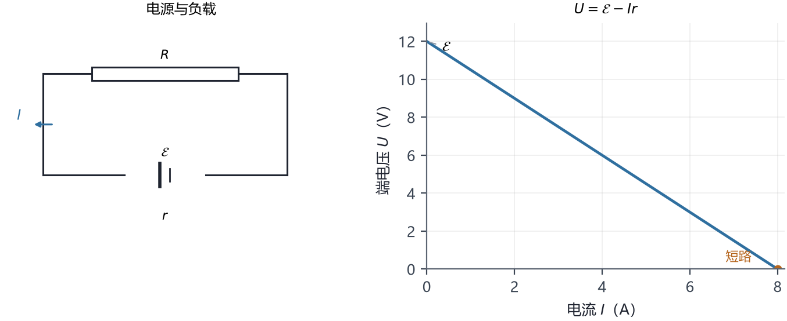
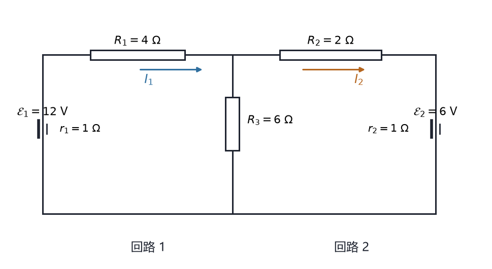
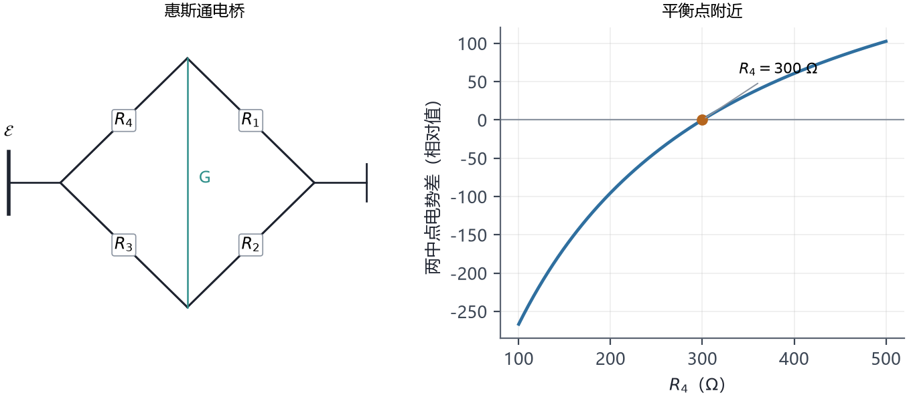

# 第 12 章 电动势、电路与基尔霍夫定律

## 12.1 电流为什么能一直流

一根导线接上电池，电流从正极流出，经过灯泡，回到负极。导线里的电场把正电荷从高电势推向低电势，电荷一路损失电势能，这些能量变成了灯泡的光和热。

电荷回到负极之后，要再被送回正极，否则电池很快就空了。可是正极的电势比负极高，把正电荷从低电势搬到高电势，靠静电力做不到——静电力只会把它推回去。必须有一种非静电的力来做这件事。

这种力叫非静电力。在化学电池里，它是电极与电解液界面上的化学反应产生的力；在发电机里，它是电磁感应产生的力；在光电池里，它是光生载流子的分离。它们的机制不同，但在电路里的作用相同：把正电荷从低电势搬到高电势，维持两极之间的电势差。

## 12.2 电动势

把非静电力对单位正电荷做的功定义为电动势：

$$\mathcal{E}=\int_{\text{电源内部}}\frac{\mathbf{F}_{\text{非静}}}{q}\cdot d\mathbf{l} . \tag{12.1}$$

沿整个闭合回路走一圈，静电力做的功为零（第八章证明过），非静电力做的功就是电动势：

$$\mathcal{E}=\oint\frac{\mathbf{F}_{\text{非静}}+\mathbf{F}_{\text{静}}}{q}\cdot d\mathbf{l} . \tag{12.2}$$

单位是伏特。电动势描述的是电源把其他形式的能量转换成电能的能力，与电源是否接在电路里无关。

这里有一个容易混淆的地方：电动势与端电压不是一回事。端电压是两极之间的电势差，可以用电压表量；电动势是电源内部的非静电力做功，量不出来，只能由开路时的端电压近似得到。差别在于内阻。

## 12.3 内阻

电源内部也有电阻，叫内阻 $r$。电流通过电源内部时，内阻上也有电压降。

设电源的电动势为 $\mathcal{E}$，内阻为 $r$，外接电阻 $R$。电流 $I$ 从负极经电源内部流向正极，非静电力做功 $\mathcal{E}I$ 每单位时间，其中一部分消耗在内阻上 $I^2r$，剩下输出给外电路 $I^2R$：

$$\mathcal{E}I=I^2r+I^2R\quad\Rightarrow\quad\mathcal{E}=I\left(R+r\right) . \tag{12.3}$$

端电压是外电阻上的电压：

$$U=IR=\mathcal{E}-Ir . \tag{12.4}$$

电流越大，端电压越低。图 12-1 画了端电压随电流的变化，是一条斜率为 $-r$ 的直线，截距是 $\mathcal{E}$。

短路时 $R=0$，电流 $I=\mathcal{E}/r$，端电压为零，全部功率消耗在内阻上。一节干电池的 $\mathcal{E}=1.5\ \mathrm{V}$、$r\approx0.3\ \Omega$，短路电流约 $5\ \mathrm{A}$，电池会发热。汽车蓄电池的 $r$ 只有几毫欧，短路电流可达上千安，非常危险，所以正极要加保险。

## 12.4 基尔霍夫节点定律

电路里电流分叉的地方叫节点。节点定律说：流入一个节点的电流之和等于流出的电流之和：

$$\sum I_{\text{入}}=\sum I_{\text{出}} . \tag{12.5}$$

这条定律来自电荷守恒。如果流入多于流出，节点处的电荷会累积，电势升高，很快就会阻止进一步的流入。在稳恒状态下，累积量为零。

第十一章末尾的 (11.19) 是这条定律的一般形式：穿过闭合曲面的总电流等于内部电荷的减少率。取一个把节点包住的小闭合面，稳恒时右边为零，就得到 (12.5)。

## 12.5 基尔霍夫回路定律

沿任意一个闭合回路走一圈，各段电压降的代数和为零：

$$\sum_{\text{回路}}U_i=0 . \tag{12.6}$$

这条定律来自静电场的保守性。沿闭合路径走一圈，电势回到原值，总变化为零。每一段导体的电压降是 $IR$，电源的电压升是 $\mathcal{E}$，把两者统一写成"电压降"，就得到 (12.6)。

具体操作时需要一个符号约定。选定回路的绕行方向，沿绕行方向经过电阻时，电压降取正；经过电源时，从负极到正极（电势升高）取负，从正极到负极取正。按这个约定列方程，解出的电流若为负，说明实际方向与假设相反。

## 12.6 一个双回路电路

看一个具体电路。两个电源、三个电阻，接成两个回路。

回路 1：$\mathcal{E}_1=12\ \mathrm{V}$，$r_1=1\ \Omega$，串联 $R_1=4\ \Omega$，再经过中间支路的 $R_3=6\ \Omega$ 回到起点。

回路 2：$\mathcal{E}_2=6\ \mathrm{V}$，$r_2=1\ \Omega$，串联 $R_2=2\ \Omega$，再经过 $R_3$ 回到起点。

设 $I_1$ 在回路 1 中顺时针，$I_2$ 在回路 2 中顺时针，中间支路的电流取 $I_1-I_2$（从下往上，如果 $I_1>I_2$）。

对回路 1：

$$\mathcal{E}_1-I_1\left(r_1+R_1\right)-\left(I_1-I_2\right)R_3=0 . \tag{12.7}$$

对回路 2：

$$\mathcal{E}_2-I_2\left(r_2+R_2\right)-\left(I_2-I_1\right)R_3=0 . \tag{12.8}$$

代入数值：

$$12-5I_1-6\left(I_1-I_2\right)=0\quad\Rightarrow\quad11I_1-6I_2=12 , \tag{12.9}$$

$$6-3I_2-6\left(I_2-I_1\right)=0\quad\Rightarrow\quad-6I_1+9I_2=6 . \tag{12.10}$$

两个方程两个未知数。由第二式 $I_2=(6+6I_1)/9=(2+2I_1)/3$。代入第一式：

$$11I_1-6\cdot\frac{2+2I_1}{3}=12\quad\Rightarrow\quad11I_1-4-4I_1=12\quad\Rightarrow\quad7I_1=16 . \tag{12.11}$$

$I_1=16/7\approx2.29\ \mathrm{A}$，$I_2=(2+32/7)/3=(46/7)/3\approx2.19\ \mathrm{A}$。中间支路电流 $I_1-I_2\approx0.10\ \mathrm{A}$，方向与假设一致。

验算。回路 1 的电压：$\mathcal{E}_1=12$，内阻与 $R_1$ 上降 $5\times2.29=11.43$，$R_3$ 上降 $6\times0.10=0.57$，总和 $12.00$，对上了。

## 12.7 惠斯通电桥

四个电阻接成菱形，中间接一个检流计，两端接电源。这个装置叫惠斯通电桥，用来精确测量电阻。

设四个桥臂是 $R_1$、$R_2$、$R_3$、$R_4$，电源接在菱形的两个对角，检流计接在另外两个对角。调节其中一个电阻，使检流计读数为零。这时中间支路没有电流，两个对角之间的电势差为零，电桥平衡。

没有电流意味着中间支路可以断开而不影响其他部分。于是电路变成两条并联支路：$R_1$ 与 $R_2$ 串联，$R_3$ 与 $R_4$ 串联。两条支路的电压相同，都是电源电压 $U$。

$R_1$、$R_2$ 支路中点的电势，从电源正端算起，降了 $U\cdot R_1/(R_1+R_2)$；$R_3$、$R_4$ 支路中点降了 $U\cdot R_3/(R_3+R_4)$。两点等电势，两个降相等：

$$\frac{R_1}{R_1+R_2}=\frac{R_3}{R_3+R_4} . \tag{12.12}$$

交叉相乘：

$$R_1\left(R_3+R_4\right)=R_3\left(R_1+R_2\right)\quad\Rightarrow\quad R_1R_4=R_2R_3 . \tag{12.13}$$

平衡条件是"对边电阻的乘积相等"。这个式子可以用来测未知电阻：三个已知，一个未知，平衡时直接算出。

电桥的好处是它把测量转化为"检测零电流"。检流计只需要判断有没有电流，不需要读数准确，所以灵敏度可以做得极高。这是精密测量的常用策略：把"测量一个量"换成"判断一个量为零"。

## 12.8 电源的功率与匹配

电源输出的功率是

$$P=UI=IR\cdot I=I^2R=\frac{\mathcal{E}^2R}{\left(R+r\right)^2} . \tag{12.14}$$

固定 $\mathcal{E}$ 与 $r$，改变 $R$，输出功率有一个最大值。求导：

$$\frac{dP}{dR}=\mathcal{E}^2\frac{\left(R+r\right)^2-2R\left(R+r\right)}{\left(R+r\right)^4}=\mathcal{E}^2\frac{r-R}{\left(R+r\right)^3} . \tag{12.15}$$

令导数为零，得 $R=r$。此时输出功率最大，等于 $\mathcal{E}^2/(4r)$，效率是百分之五十（一半功率消耗在内阻上）。

这个结果叫阻抗匹配。它在通信、音频功放里很重要，因为那些场合追求的是最大功率传输，不是最高效率。输电线路恰好相反：追求效率，要让 $R\gg r$，让内阻上的损耗占比尽量小。

## 12.9 受控源与非线性元件

真实的电路里还有晶体管、运算放大器这类元件，它们的输出电压或电流由别处的电压控制，叫受控源。基尔霍夫定律对它们仍然成立，只是方程不再是线性的，需要用迭代或图解法求解。

非线性元件的处理办法是把它的伏安特性画出来，与负载线求交点。负载线是 $U=\mathcal{E}-Ir$，是一条直线；非线性元件的特性是一条曲线，交点就是工作点。这个图解法在二极管电路、晶体管偏置里常用。

## 12.10 叠加定理

线性电路有一个方便的性质：多个电源共同作用时，可以一次只留一个电源，算出结果，再相加。

原理来自方程的线性。基尔霍夫方程是线性的（电阻是常数），未知电流是电源的线性函数。如果电源 $\mathcal{E}_1$ 单独作用时电流是 $I_1$，$\mathcal{E}_2$ 单独作用时是 $I_2$，那么两个电源同时作用时电流是 $I_1+I_2$。

用的时候要注意：把"其他电源去掉"的意思是电压源短路（电动势为零，变成一根导线），电流源开路（电流为零，断开）。电源的内阻保留。

举一个例子。两个电源并联给同一个电阻供电：$\mathcal{E}_1=12\ \mathrm{V}$、$r_1=2\ \Omega$，$\mathcal{E}_2=6\ \mathrm{V}$、$r_2=1\ \Omega$，负载 $R=3\ \Omega$。

先用节点法。设上节点电势为 $U$，下节点为零。流出上节点的电流之和为零：

$$\frac{U-\mathcal{E}_1}{r_1}+\frac{U-\mathcal{E}_2}{r_2}+\frac{U}{R}=0 . \tag{12.16}$$

代入：

$$\frac{U-12}{2}+\frac{U-6}{1}+\frac{U}{3}=0 . \tag{12.17}$$

通分乘 6：

$$3\left(U-12\right)+6\left(U-6\right)+2U=0\quad\Rightarrow\quad11U=72\quad\Rightarrow\quad U=6.55\ \mathrm{V} . \tag{12.18}$$

再用叠加定理验证。只留 $\mathcal{E}_1$（把 $\mathcal{E}_2$ 短路），$r_2$ 与 $R$ 并联再与 $r_1$ 串联：

$$R_{\text{并}}=\frac{1\times3}{1+3}=0.75\ \Omega,\qquad I_1=\frac{12}{2+0.75}=4.36\ \mathrm{A} . \tag{12.19}$$

$U$ 的分压：$U_1=I_1R_{\text{并}}=3.27\ \mathrm{V}$。

只留 $\mathcal{E}_2$（$\mathcal{E}_1$ 短路），$r_1$ 与 $R$ 并联：

$$R_{\text{并}}'=\frac{2\times3}{2+3}=1.2\ \Omega,\qquad I_2=\frac{6}{1+1.2}=2.73\ \mathrm{A} . \tag{12.20}$$

$$U_2=I_2R_{\text{并}}'=3.27\ \mathrm{V} . \tag{12.21}$$

两者相加：$U=3.27+3.27=6.55\ \mathrm{V}$，与节点法一致。

叠加定理的用处在于把复杂电路拆成几个简单电路。它的限制是只能用于线性电路：二极管、晶体管不满足，不能叠加。

## 12.11 戴维南定理

任何由电阻与电源组成的二端网络，对外都可以等效成一个电压源串联一个电阻。

等效电动势 $\mathcal{E}_{\text{th}}$ 等于开路电压（两端不接负载时的电压）；等效电阻 $R_{\text{th}}$ 等于把所有独立电源置零后，从两端看进去的电阻。

证明的思路：设网络内部有若干电源与电阻，外接一个负载 $R$。由叠加定理，负载电流可以写成两部分之和：一部分由内部电源产生（负载短路时的电流），一部分由负载本身的电源产生。前者对应一个电流源，后者对应一个电阻，两者并联再变换成电压源串联电阻，就得到戴维南等效。

具体算一个。一个 $12\ \mathrm{V}$ 电源串 $4\ \Omega$ 电阻，再并一个 $6\ \Omega$ 电阻，从 $6\ \Omega$ 两端看出去。

开路电压：$6\ \Omega$ 上没有电流（外部开路），所以电压等于电源电压在 $4\ \Omega$ 与 $6\ \Omega$ 之间的分压：

$$\mathcal{E}_{\text{th}}=12\times\frac{6}{4+6}=7.2\ \mathrm{V} . \tag{12.22}$$

等效电阻：把 $12\ \mathrm{V}$ 电源短路，从两端看是两个电阻并联：

$$R_{\text{th}}=\frac{4\times6}{4+6}=2.4\ \Omega . \tag{12.23}$$

于是整个网络对外等效成 $7.2\ \mathrm{V}$ 串 $2.4\ \Omega$。接任何负载，电流都是 $7.2/(2.4+R)$，不用再解原来的电路。

戴维南定理的价值在于"化简"。一个复杂的网络，只要关心某两个端点的行为，就可以换成两元件模型。这个模型在分析传感器、放大器输入输出阻抗、电源内阻时非常有用。

对偶的定理叫诺顿定理：任何二端网络可以等效成一个电流源并联一个电阻。两者可以互相转换，$\mathcal{E}_{\text{th}}=I_{\text{N}}R_{\text{th}}$。

## 12.12 电桥的灵敏度

电桥平衡时中间支路没有电流，但"没有电流"是一个理想判断，实际测量总有微小的不平衡。灵敏度决定了能测出多大的电阻变化。

设四个桥臂中 $R_1$ 有微小变化 $\Delta R_1$，其余不变。两个中点的电势差从零变成

$$\Delta U=U\left(\frac{R_1+\Delta R_1}{R_1+\Delta R_1+R_2}-\frac{R_3}{R_3+R_4}\right) . \tag{12.24}$$

平衡时 $R_1/(R_1+R_2)=R_3/(R_3+R_4)$，把第二项用这个关系替换，再做一阶展开：

$$\Delta U\approx U\frac{R_2}{\left(R_1+R_2\right)^{2}}\Delta R_1 . \tag{12.25}$$

推导：设 $f(R_1)=R_1/(R_1+R_2)$，$df/dR_1=R_2/(R_1+R_2)^2$，所以 $\Delta f\approx\left[df/dR_1\right]\Delta R_1$。

灵敏度是 $\Delta U/\Delta R_1$，正比于电源电压 $U$，反比于 $(R_1+R_2)^2$。要提高灵敏度，可以提高电源电压，或者让四个桥臂的阻值相近（这样分母小）。

但桥臂阻值不能任意小：阻值太小，电源的电流大，发热严重；阻值太大，检流计的内阻相对显著，灵敏度下降。实际电桥取几千欧到几十千欧，配合高输入阻抗的放大器。

惠斯通电桥的测量精度可以到 $10^{-4}$，配合交流电桥与锁相放大器可以到 $10^{-6}$。应变片、热电阻、压阻传感器都把微小的电阻变化转成电压，再用电桥读出。

## 12.13 一个容易犯错的地方

解电路题时最常见的错误不是方程列错，而是符号约定不一致。

回路定律里，沿绕行方向经过电阻时电压降取正，经过电源时从负极到正极取负。如果第一个回路用了顺时针、第二个用了逆时针，列出的方程仍然成立，但公共支路的电流方向要相应调整，否则会重复计算或漏算。

避免的办法是先把所有支路的电流方向标在图上，公共支路的电流写成两个回路电流的差（或和），再逐个回路列方程。方向标错了不要紧，解出来的负号会告诉你；方向没标，方程就无从写起。

节点定律也有类似的问题。把"流入"与"流出"混在一起，方程会写成 $\sum I=0$ 而不是 $\sum I_{\text{入}}=\sum I_{\text{出}}$，两者等价，但要统一。节点法（全部写成流出为零）比混合写法更不容易出错。

## 12.14 完整算一遍：两次负载测内阻

电池的电动势与内阻不能直接用电压表测：电压表有内阻，接上去就有电流，读到的只是端电压。一个简单的办法是换两次负载，联立求解。

一节干电池，先接 $R_1=10\ \Omega$，测得端电压 $U_1=1.45\ \mathrm{V}$；再接 $R_2=4.7\ \Omega$，测得 $U_2=1.40\ \mathrm{V}$。求 $\mathcal{E}$ 与 $r$。

两次的电流：

$$I_1=\frac{U_1}{R_1}=\frac{1.45}{10}=0.145\ \mathrm{A} , \tag{12.26}$$

$$I_2=\frac{U_2}{R_2}=\frac{1.40}{4.7}=0.298\ \mathrm{A} . \tag{12.27}$$

由 $U=\mathcal{E}-Ir$ 写两个方程：

$$1.45=\mathcal{E}-0.145r , \tag{12.28}$$

$$1.40=\mathcal{E}-0.298r . \tag{12.29}$$

两式相减，消去 $\mathcal{E}$：

$$0.05=\left(0.298-0.145\right)r=0.153r , \tag{12.30}$$

$$r=\frac{0.05}{0.153}=0.327\ \Omega . \tag{12.31}$$

代回第一式：

$$\mathcal{E}=1.45+0.145\times0.327=1.45+0.047=1.497\ \mathrm{V}\approx1.50\ \mathrm{V} . \tag{12.32}$$

一节新干电池的电动势 $1.5\ \mathrm{V}$、内阻零点几欧，与结果相符。电池用久了，$\mathcal{E}$ 略降、$r$ 明显增大，这就是"带不动负载"的原因：同样的负载电流下，内阻上的压降变大，端电压掉得快。

用这个方法时有一个要求：两次的负载要差得足够多，否则两个方程的差别很小，解出的 $r$ 对测量误差非常敏感。如果 $R_1$ 与 $R_2$ 接近，$I_1$ 与 $I_2$ 接近，(12.30) 的右边是两个相近数之差，误差被放大。

顺便算一下短路电流。$R=0$ 时 $I=\mathcal{E}/r=1.50/0.327\approx4.6\ \mathrm{A}$，端电压为零，全部功率消耗在内阻上，$I^2r\approx6.9\ \mathrm{W}$。这个功率会把电池加热，长时间短路可能漏液或起火。

## 12.15 常见误解

**电动势不是端电压。** 开路时两者相等（因为没有电流，内阻上没有压降），一旦有电流就不同。电池上标的"1.5 V"是电动势，"1.2 V"的充电电池也是电动势；万用表量到的端电压总是小于或等于它。

**回路定律里电源的符号要看方向。** 沿绕行方向从负极走到正极，电势升高，应记为负的电压降；从正极走到负极，记为正值。符号定错，解出的电流会出现莫名其妙的负号，而且往往两个回路同时错，互相抵消，检查不出来。

**电流方向的假设不影响结果。** 列方程前随便假设一个方向，解出负值就说明实际方向相反。怕出错的办法是先把所有支路的方向标在图上，公共支路写成两个回路电流之差，再逐回路列方程。

**节点定律与回路定律不是两条独立的物理规律。** 前者是电荷守恒，后者是静电场的保守性。对一个有 $n$ 个节点、$b$ 条支路的电路，独立的节点方程有 $n-1$ 个，独立的回路方程有 $b-n+1$ 个，加起来正好等于未知电流数。多列一个方程不会让结果更准，只会让方程组线性相关。

---

这一章把电路的两条基本定律立起来。节点定律来自电荷守恒，回路定律来自静电场的保守性，两者加上元件的伏安关系，足以解任何线性电路。

还剩下一个问题：电流通过电阻时发出的热，微观上是怎么产生的？电子在电场中获得的能量去了哪里？下一章算这件事。
