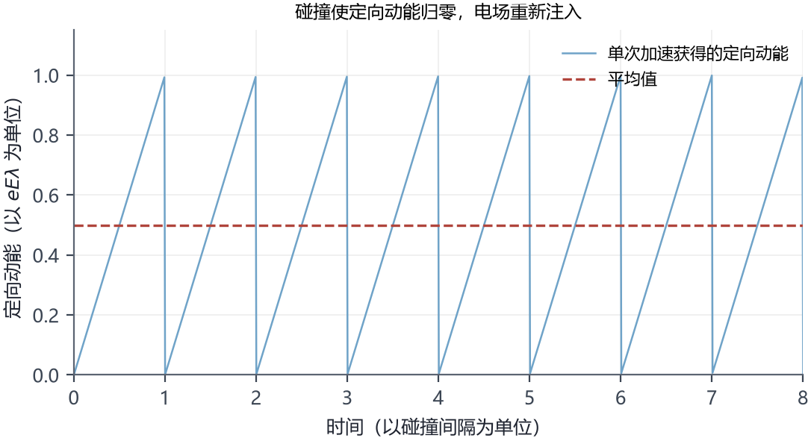
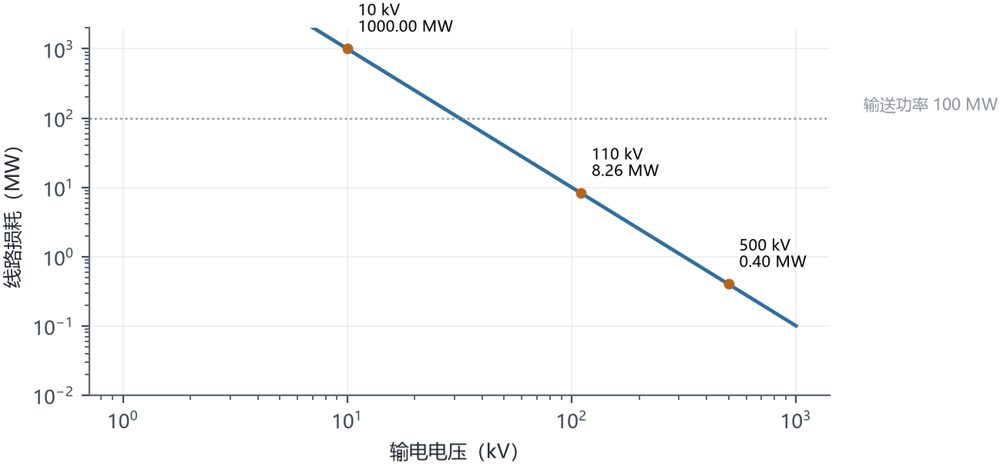
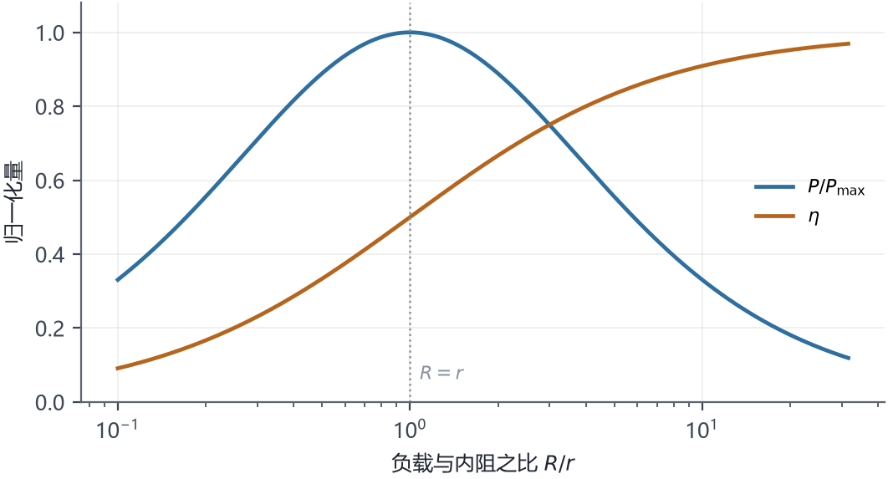

# 第 13 章 焦耳热、电功率与能量转换

## 13.1 一根发热的导线

电流通过电阻，电阻会发热。电炉丝红得发亮，白炽灯的钨丝两千多度，手机充电器摸起来温热。这些热的来源相同：电场把电子加速，电子在碰撞中把获得的动能交给晶格，晶格振动加剧，宏观上就是温度升高。

这一章算两件事：发多少热，以及这些热从哪来。第一件事是电路的功率计算，第二件事把宏观的 $I^2R$ 与微观的电子运动接起来。

## 13.2 电功率

电流通过一段导体，电荷 $dq$ 从电势 $U_1$ 流到 $U_2$，电势能减少 $dq(U_1-U_2)=dq\,U$。这部分能量交给了导体（变成热）或变成了机械功（电动机）。单位时间转移的能量就是功率：

$$P=\frac{dW}{dt}=\frac{dq}{dt}U=UI . \tag{13.1}$$

这个式子对任何元件都成立，不要求欧姆定律。

对纯电阻，$U=IR$，代入：

$$P=UI=I^2R=\frac{U^2}{R} . \tag{13.2}$$

三个形式等价，用哪个看已知什么。已知电流用第一个，已知电压用第三个，分析串联电路时用 $I^2R$（电流相同，功率与电阻成正比），分析并联电路时用 $U^2/R$（电压相同，功率与电阻成反比）。

单位是瓦特。一度电是 $1\ \mathrm{kW\cdot h}=3.6\times10^6\ \mathrm{J}$，一个 $100\ \mathrm{W}$ 的灯泡亮十小时用一度电。

## 13.3 微观图像

电子在电场中获得的功率，可以用第十一章的模型算。

电场对每个电子的力是 $eE$，电子以漂移速度 $v_d$ 运动，单位时间电场对它做的功是 $eEv_d$。单位体积内有 $n$ 个电子，所以单位体积的功率是

$$p=n e E v_d=J E , \tag{13.3}$$

这里用了 $J=nev_d$。这就是焦耳热的功率密度，它是宏观 $P=UI$ 的局部形式。

把 $J=\sigma_eE$ 代入：

$$p=\sigma_eE^2=\rho_eJ^2 . \tag{13.4}$$

对一根长 $L$、截面 $A$ 的均匀导线，乘以体积 $AL$：

$$P=\rho_eJ^2AL=\rho_e\frac{L}{A}I^2=I^2R . \tag{13.5}$$

与 (13.2) 一致。

能量是怎么从电子转到晶格的？电子在两次碰撞之间被电场加速，获得动能 $\frac{1}{2}m_ev_d^2$ 的量级（实际上加速过程从零开始，平均获得的能量是 $eE\lambda$，$\lambda=v_{\text{热}}\tau$ 是平均自由程）。碰撞时这个能量大部分转给晶格离子，电子几乎停下来，再重新加速。所以电子的能量收支是：从电场拿，向晶格交，自己不积累。这个稳态对应的就是稳定的电流与稳定的发热。

注意 $v_d\ll v_{\text{热}}$，所以电子从电场获得的定向动能很小，发热的能量来自电场持续做功，而不是电子本身"跑得快"。这一点常被误解：导线发热不是因为电子撞得快，而是因为碰撞频繁、每次碰撞都从电场重新获得的能量被转走。

## 13.4 焦耳定律

把功率乘时间，得到热量：

$$Q=Pt=I^2Rt . \tag{13.6}$$

这是焦耳在 1841 年通过实验确立的关系，叫焦耳定律。他用不同电流、不同电阻、不同时间做了大量测量，发现产生的热与 $I^2$、$R$、$t$ 都成正比。

这个式子只描述"电能变成热"的部分。如果导体同时在做机械功（电动机），或者同时在发生化学反应（电解），$UI$ 减去这些部分才是热。

## 13.5 输电为什么用高压

发电厂到用户之间要输电，导线有电阻，输电线上的损耗是 $I^2R_{\text{线}}$。输送的功率是 $P=UI$，所以电流 $I=P/U$。代入损耗：

$$P_{\text{损}}=\left(\frac{P}{U}\right)^2R_{\text{线}}=\frac{P^2R_{\text{线}}}{U^2} . \tag{13.7}$$

损耗与电压的平方成反比。输送同样的功率，电压提高十倍，损耗降到百分之一。

代一组数。输送 $100\ \mathrm{MW}$，导线总电阻 $10\ \Omega$。用 $10\ \mathrm{kV}$ 输送，电流 $10^4\ \mathrm{A}$，损耗 $10^8\times10=10^9\ \mathrm{W}$，比输送的功率还大十倍，根本不可行。用 $500\ \mathrm{kV}$ 输送，电流 $200\ \mathrm{A}$，损耗 $4\times10^4\times10=4\times10^5\ \mathrm{W}=0.4\ \mathrm{MW}$，占输送功率的 $0.4\%$。

这就是为什么远距离输电要用超高压。图 13-2 画了损耗随电压的变化。

高压输电的代价是绝缘。电压越高，绝缘子越长，杆塔越大，变电站的变压器要求越高。交流高压还有电容效应与集肤效应，长距离直流输电在这一点上更优，但换流设备昂贵。工程上的选择是这些因素的折中。

## 13.6 电源的输出功率

回到第十二章的问题。电源的电动势 $\mathcal{E}$、内阻 $r$，外接电阻 $R$。总功率是 $\mathcal{E}I$，其中内阻上损耗 $I^2r$，外电路得到 $I^2R$。

$$P_{\text{出}}=I^2R=\frac{\mathcal{E}^2R}{\left(R+r\right)^2} . \tag{13.8}$$

效率

$$\eta=\frac{I^2R}{I^2\left(R+r\right)}=\frac{R}{R+r} . \tag{13.9}$$

$R\gg r$ 时效率接近 1，但输出功率不一定大。$R=r$ 时输出功率最大，效率只有 0.5。这两个目标（最大功率与最高效率）不能同时满足，选哪个取决于应用。

## 13.7 电热的应用与危害

电热的应用很广。电炉、电热水器、电烙铁都是把电能直接变成热，设计上要让发热体电阻适中、耐高温。保险丝反过来用：电流超过额定值时，$I^2R$ 产生的热使熔丝熔化，切断电路。选用保险丝要看额定电流与熔断特性，不能随意加大。

危害也常见。接触不良的接头电阻大，局部发热，可能引起火灾；锂电池内部短路时瞬间放出大量热，可能起火；大功率器件的散热设计不足会过热损坏。这些问题的共同点是 $I^2R$ 中的某一项失控。

白炽灯是一个有趣的例子。钨丝的温度越高，电阻越大（第十一章的 (11.14)），所以开灯瞬间电流比稳定时大十倍左右，很多灯泡是在开灯瞬间烧断的。这个非线性也意味着 $P=U^2/R$ 中的 $R$ 不是常数，算功率要用工作温度下的电阻值。

## 13.8 能量守恒的账

把一段电路的能量账算完。电源把化学能（或其他形式）变成电能，功率 $\mathcal{E}I$；电能通过导线送到负载，功率 $UI$；负载把电能变成热、光、机械功；导线本身也发热，功率 $I^2R_{\text{线}}$。

$$\mathcal{E}I=I^2r+UI , \tag{13.10}$$

$$UI=I^2R_{\text{负载}}+P_{\text{其他}} . \tag{13.11}$$

两式相加，左边是电源的总功率，右边是所有去向之和。能量守恒要求这个等式成立，任何一个环节漏算都会让账不平。

这个记账方式在交流电路里会复杂一些，因为有电感和电容，能量会在电场与磁场之间来回转换，不全是消耗。第二十一章会处理这部分。

## 13.9 一个电热水器的账

用电热的公式算一个实际问题。

电热水器，功率 $2000\ \mathrm{W}$，接 $220\ \mathrm{V}$，把 $50\ \mathrm{L}$ 水从 $20\ ^\circ\mathrm{C}$ 加热到 $60\ ^\circ\mathrm{C}$。要多久？

先算需要的能量。水的比热容 $c_w=4.18\times10^{3}\ \mathrm{J/(kg\cdot K)}$，质量 $50\ \mathrm{kg}$，温差 $40\ \mathrm{K}$：

$$Q=mc_w\Delta T=50\times4.18\times10^{3}\times40=8.36\times10^{6}\ \mathrm{J} . \tag{13.12}$$

加热时间

$$t=\frac{Q}{P}=\frac{8.36\times10^{6}}{2000}=4180\ \mathrm{s}\approx70\ \mathrm{min} . \tag{13.13}$$

一个多小时。实际的热水器会更快，功率通常在 $3000$ 到 $5000\ \mathrm{W}$ 之间，或者容量更小。

再看发热体的电阻。$P=U^2/R$，所以

$$R=\frac{U^{2}}{P}=\frac{220^{2}}{2000}=24.2\ \Omega . \tag{13.14}$$

电流 $I=P/U=9.1\ \mathrm{A}$。这个电流需要 $1.5\ \mathrm{mm^2}$ 以上的铜线，否则导线会过热。插座、开关也要按 $10\ \mathrm{A}$ 以上选。

效率。真实的加热过程中，热量会从水箱散失。散热功率与温差成正比，$P_{\text{loss}}=k(T-T_{\text{环境}})$。水温越高，散热越快，所以加热的净功率随着温度上升而下降。粗略估算，从 $20$ 升到 $60$ 的过程中，平均散热损失约为输入功率的百分之十，实际时间比理论值长约百分之十。

## 13.10 焦耳热的测量

焦耳在 1841 年测量电流发热，用的是量热器：把一段导线浸在水里，通电流一段时间，测水温的升高。

水的质量 $m$、比热容 $c_w$、温升 $\Delta T$，吸收的热量 $Q=mc_w\Delta T$。如果这些热全部来自导线，那么 $Q=I^2Rt$。改变 $I$、$R$、$t$，重复测量，就能验证这个关系。

焦耳发现：热量与电流的平方成正比，与电阻成正比，与时间成正比。三个正比关系分别验证，才能确认公式的形式。

实验的难点在于散热。量热器不可能完全绝热，加热过程中有一部分热散到环境。焦耳的办法是做两组实验：一组加热，一组用同样的温差自然冷却，测冷却速率，用牛顿冷却定律修正散热量。这个修正方法到现在还在用。

现代测量用绝热法：让量热器的温度始终跟随环境温度（用外层的加热套），使温差为零，散热为零。这样测出的热量最准确，误差可以小于千分之一。

## 13.11 导线的载流量

一根导线能通过多大电流，由发热与散热决定。

设导线的电阻 $R=\rho_eL/A$，电流 $I$，发热功率 $I^2R$。散热靠表面对流与辐射，功率近似与表面积 $S$ 和温升 $\Delta T$ 成正比：

$$P_{\text{散}}=hS\Delta T , \tag{13.15}$$

$h$ 是散热系数，自然对流下约 $10\ \mathrm{W/(m^2\cdot K)}$，强制风冷可以到 $100$ 以上。

稳态时发热等于散热：

$$I^{2}\frac{\rho_eL}{A}=hS\Delta T . \tag{13.16}$$

圆柱导线的 $A=\pi r^2$，$S=2\pi rL$。代入：

$$I^{2}\frac{\rho_eL}{\pi r^{2}}=h\cdot2\pi rL\Delta T , \tag{13.17}$$

$$I^{2}=\frac{2\pi^{2}hr^{3}\Delta T}{\rho_e} . \tag{13.18}$$

载流量与半径的 $3/2$ 次方成正比，与允许温升的平方根成正比。这个关系说明：导线越粗，载流能力增长得比截面慢。直径加倍，截面变四倍，载流量只变 $2^{1.5}\approx2.83$ 倍。

实际工程中的载流量表由实验确定，还要考虑敷设方式（管内、墙内、架空）、环境温度、同时使用的导线数。标准里的数值比这个估算保守，留有裕量。

代一组数。半径 $0.8\ \mathrm{mm}$（约 $2\ \mathrm{mm^2}$），允许温升 $30\ \mathrm{K}$，$h=10$：

$$I^{2}=\frac{2\pi^{2}\times10\times\left(0.8\times10^{-3}\right)^{3}\times30}{1.68\times10^{-8}}\approx\frac{2\times9.87\times10\times5.12\times10^{-10}\times30}{1.68\times10^{-8}}\approx18.0 . \tag{13.19}$$

$I\approx4.2\ \mathrm{A}$。实际 $2\ \mathrm{mm^2}$ 铜线的允许电流约 $10\ \mathrm{A}$（管内敷设），比估算大，因为 $h$ 的取值偏保守、允许温升取的是绝缘层的长期耐温。量级是对的：几个安培到十几安培。

这个估算说明为什么大功率设备要用粗线：电流增加一倍，发热增加四倍，而散热只按表面积线性增长，所以必须靠增大截面来降低电流密度。

## 13.12 交流电的功率

直流电路的功率 $P=UI$ 在交流电路里要修正，因为电压与电流可能不同相。

设电压 $u=U_0\sin\omega t$，电流 $i=I_0\sin\left(\omega t-\varphi\right)$，$\varphi$ 是电流落后电压的相位差。瞬时功率

$$p=ui=U_0I_0\sin\omega t\sin\left(\omega t-\varphi\right) . \tag{13.20}$$

用积化和差：

$$p=\frac{U_0I_0}{2}\left[\cos\varphi-\cos\left(2\omega t-\varphi\right)\right] . \tag{13.21}$$

第一项不随时间变，第二项以 $2\omega$ 振荡。平均功率

$$P=\frac{U_0I_0}{2}\cos\varphi=U_{\text{rms}}I_{\text{rms}}\cos\varphi . \tag{13.22}$$

$\cos\varphi$ 叫功率因数。

三种元件的相位关系不同。纯电阻，电流与电压同相，$\varphi=0$，$\cos\varphi=1$，$P=UI$。纯电感，电流落后 $90^\circ$，$\cos\varphi=0$，平均功率为零：电感只储存与释放能量，不消耗。纯电容，电流超前 $90^\circ$，$\cos\varphi=0$，平均功率也为零。

一般负载是电阻与电感的组合（电动机、变压器），$\varphi$ 在 $0$ 到 $90^\circ$ 之间，功率因数小于 1。这时电源要提供比有用功率更大的视在功率 $UI$，多出来的部分在电源与负载之间来回交换，不做功但占用线路容量。

功率因数低会带来两个后果：线路电流大，损耗 $I^2R$ 大；发电机与变压器要按视在功率设计，利用率低。工业上用电容器补偿：在感性负载两端并联电容，电容的超前电流抵消电感的滞后电流，$\varphi$ 变小，功率因数提高。

这个补偿的计算要用到阻抗，本书不展开。但物理图像是清楚的：电感吸收的无功功率被电容提供，不再从电源来回搬运。

## 13.13 完整算一遍：一壶水的电费

电水壶功率 $P=1500\ \mathrm{W}$，装 $1.0\ \mathrm{L}$ 水，从 $20\ ^\circ\mathrm{C}$ 烧到 $100\ ^\circ\mathrm{C}$，热效率 $\eta=0.85$。求时间与耗电。

水的质量取 $1.0\ \mathrm{kg}$，比热容 $c_w=4.18\times10^{3}\ \mathrm{J/(kg\cdot K)}$，温差 $80\ \mathrm{K}$。需要的热量

$$Q=mc_w\Delta T=1.0\times4.18\times10^{3}\times80=3.34\times10^{5}\ \mathrm{J} . \tag{13.23}$$

电水壶实际提供的热量只有电能的百分之八十五，所以需要电能

$$W_{\text{电}}=\frac{Q}{\eta}=\frac{3.34\times10^{5}}{0.85}=3.93\times10^{5}\ \mathrm{J} . \tag{13.24}$$

时间

$$t=\frac{W_{\text{电}}}{P}=\frac{3.93\times10^{5}}{1500}=262\ \mathrm{s}\approx4.4\ \mathrm{min} . \tag{13.25}$$

耗电

$$W_{\text{电}}=3.93\times10^{5}\ \mathrm{J}=\frac{3.93\times10^{5}}{3.6\times10^{6}}\ \mathrm{kW\cdot h}=0.109\ \mathrm{kW\cdot h} . \tag{13.26}$$

按每度电 $0.6$ 元算，烧一壶水约七分钱。

再算电流与电阻。$I=P/U=1500/220=6.8\ \mathrm{A}$，发热体电阻

$$R=\frac{U^{2}}{P}=\frac{220^{2}}{1500}=\frac{48400}{1500}=32.3\ \Omega . \tag{13.27}$$

$6.8\ \mathrm{A}$ 的电流需要 $1.0\ \mathrm{mm^2}$ 以上的铜线，插座与开关按 $10\ \mathrm{A}$ 选。这些都是由同一条 $P=UI$ 推出来的。

实际烧水时，热量会从壶壁散失，散热功率与水温高出环境的温差成正比。水越接近沸点，散热越快，净加热功率越小，所以最后一段升温比开始时慢。上式的 $262$ 秒是"平均效率"意义下的结果，实际时间会略长，通常多百分之十到二十。

## 13.14 常见误解

**$P=U^{2}/R$ 与 $P=I^{2}R$ 用哪个，取决于什么量不变。** 两个灯泡串联，电流相同，用 $I^2R$ 判断谁更亮：电阻大的更亮。两个灯泡并联，电压相同，用 $U^2/R$ 判断：电阻小的更亮。同一个灯泡接在不同电压下，用 $U^2/R$ 方便；同一个电流源驱动不同电阻，用 $I^2R$ 方便。用错了会得出相反结论。

**导线发热不是因为"电子跑得太快"。** 漂移速度只有毫米每秒，电子的动能极小。发热的能量来自电场对电子持续做功、电子把能量交给晶格的过程。导线的功率密度是 $\mathbf{J}\cdot\mathbf{E}$，与漂移速度成正比，但与碰撞频率也成正比；电阻率高的材料碰撞更频繁，同样电流下发热更多。

**"瓦数大就费电"要看使用时间。** 电功率是能量转换的速率，电能是功率乘时间。一个 $2000\ \mathrm{W}$ 的电水壶烧五分钟用 $0.17$ 度电，一个 $20\ \mathrm{W}$ 的灯亮一整天用 $0.48$ 度电。比较耗电要看千瓦时，不是看瓦数。

**输电损耗与电压的平方成反比，不是线性。** 电压提高一倍，损耗降到四分之一（同样的输送功率）。这个平方关系来自两步：电压加倍使电流减半，电流减半又使 $I^2R$ 损耗减到四分之一。忘记其中一步，就会把损耗估成一半。

## 13.15 不同加热方式的效率

同样烧一壶水，不同方式消耗的一次能源差别很大。

电水壶的效率约 $0.85$，指的是电能转成水的热量的比例。若把发电与输电的损耗也算进去，一次能源到水的热量的总效率只有 $0.3$ 左右（燃气发电约 $0.55$，输电与配电损耗约 $0.06$，再乘电水壶的 $0.85$）。

燃气灶烧水的效率约 $0.4$，大量热量随烟气跑掉。所以从一次能源看，电水壶与燃气灶差不多，电水壶略差，但电水壶快、干净、控温准。

电磁炉的效率约 $0.9$，因为它直接让锅体发热，不在空气里烧。微波炉加热水的效率约 $0.6$，因为磁控管本身效率只有 $0.7$ 左右，还有一部分能量加热了腔体。

热泵是另一类：它不"产生"热，而是把热量从低温搬到高温，效率（性能系数）可以到 $3$ 以上。它不能烧开水（温度上不去），但用于取暖时，同样的电能可以搬来三倍的热量。这些数字说明，"效率"要看清比较的是什么：电能转热、一次能源转热、还是搬运热量。

---

这一章的公式只有三个：$P=UI$、$P=I^2R$、$Q=I^2Rt$。它们的来源是电荷在电势差中移动时能量守恒，微观解释是电子从电场获得能量又交给晶格。输电的例子说明一个平方反比关系如何在工程上产生巨大影响。

到此为止，电学部分（电荷、电场、电势、电容、电流、电路）讲完了。下一篇换一个方向：运动电荷与磁场的相互作用。第一件事是磁场本身怎么描述。
