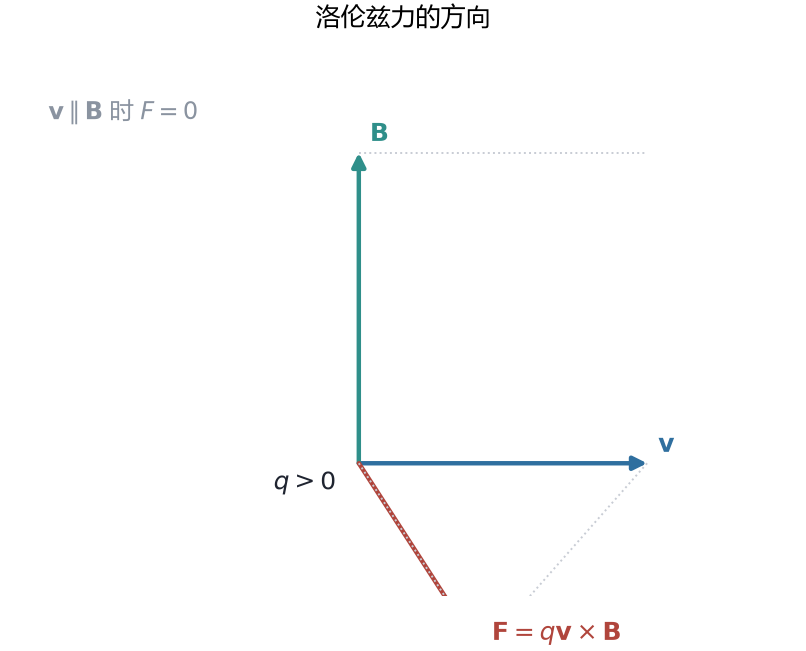
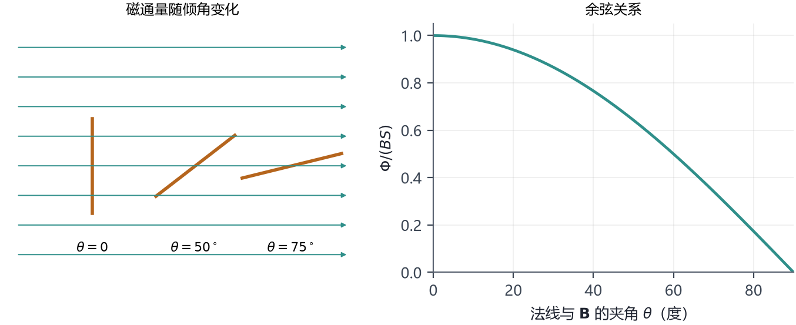
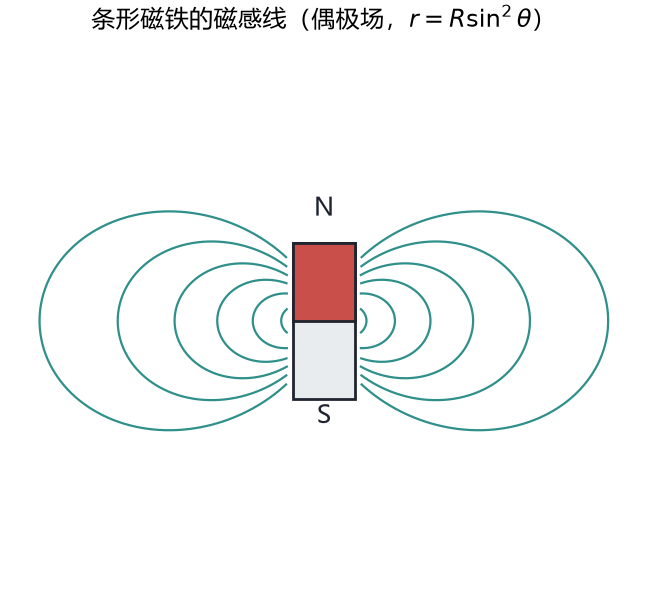
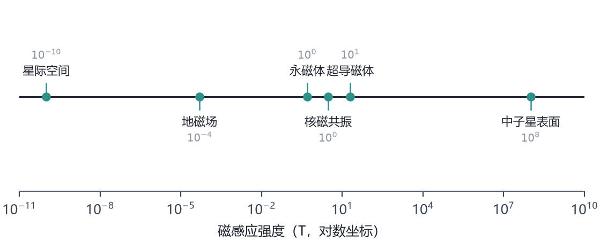

# 第 14 章 磁现象、磁感应强度与磁通量

## 14.1 一块磁铁和一根针

把一根缝衣针在磁铁上摩擦几下，针就能吸起铁屑。把它用细线吊起来，静止时总是一端朝北、一端朝南。这两端叫磁极，朝北的叫北极，朝南的叫南极。同极相斥，异极相吸，与电荷的规律相似。

但磁极与电荷有一个根本区别：电荷可以单独存在，正电荷、负电荷都能孤立地拿出来；磁极不能。把一根条形磁铁从中间掰断，得到的不是两个独立的磁极，而是两根各有南北极的小磁铁。再掰，还是这样。到目前为止，实验没有发现单独存在的磁极，这个事实叫"磁单极不存在"。

这个区别看起来只是一个实验事实，但它在数学上的后果很深。磁感线没有起点也没有终点，必须闭合，所以磁场的散度为零。第二十四章会把这个结论写成 $\nabla\cdot\mathbf{B}=0$，它是麦克斯韦方程组里唯一一个右边为零的方程。

## 14.2 奥斯特的偶然发现

1820 年 4 月，丹麦物理学家奥斯特在一次讲座中把一根通电的导线放在小磁针上方，磁针偏转了。这个现象说明电流周围有磁场，电与磁不是两门独立的学问。

奥斯特的发现传开之后，安培、毕奥、萨伐尔等人很快做了定量研究。安培发现两根平行的通电导线之间有作用力：电流同向时相吸，反向时相斥。这个力与电流的乘积成正比，与距离成反比。

这些实验结果指向一个结论：运动的电荷产生磁场，磁场对运动的电荷施力。静止的电荷之间只有电力，没有磁力；一旦电荷运动，就多出一种力。

## 14.3 磁感应强度

描述磁场要用一个矢量，叫磁感应强度，记作 $\mathbf{B}$。定义的办法与电场类似：放一个试探电荷，让它运动，看它受多大力。

实验发现，运动电荷在磁场中受到的力有三个特点。第一，力的大小与电荷量成正比，与速度成正比。第二，力的方向总与速度垂直，也与磁场方向垂直。第三，存在一个特殊方向，电荷沿这个方向运动时不受力。

由这三条可以定义 $\mathbf{B}$ 的方向与大小。把电荷沿各个方向运动，找到不受力的方向，这个方向就是 $\mathbf{B}$ 的方向（或反向）。然后让电荷以速度 $\mathbf{v}$ 垂直于 $\mathbf{B}$ 运动，测出力 $F$，定义

$$B=\frac{F}{q v} . \tag{14.1}$$

单位是特斯拉，$1\ \mathrm{T}=1\ \mathrm{N\cdot s/(C\cdot m)}=1\ \mathrm{V\cdot s/m^2}$。写成矢量形式：

$$\mathbf{F}=q\mathbf{v}\times\mathbf{B} . \tag{14.2}$$

这个式子同时定义了 $\mathbf{B}$ 的大小和方向。给定 $\mathbf{v}$ 与 $\mathbf{B}$，力由叉乘给出，方向用右手定则：四指从 $\mathbf{v}$ 弯向 $\mathbf{B}$，拇指指向正电荷受力的方向。

三种特殊情况值得记住。$\mathbf{v}\parallel\mathbf{B}$ 时力为零，这是定义方向时用的。$\mathbf{v}\perp\mathbf{B}$ 时力最大，等于 $qvB$。$\mathbf{v}$ 与 $\mathbf{B}$ 斜交时，只有垂直于 $\mathbf{B}$ 的分量起作用，力是 $qvB\sin\theta$。

## 14.4 磁力不做功

磁力永远垂直于速度，这一点带来一个重要推论：磁力不做功。

功是力乘位移，位移的方向就是速度的方向，力与速度垂直，点乘为零：

$$dW=\mathbf{F}\cdot d\mathbf{l}=\mathbf{F}\cdot\mathbf{v}\,dt=0 . \tag{14.3}$$

所以磁场不能改变带电粒子的动能，只能改变它的运动方向。这一点与电场完全不同：电场力可以平行于速度，可以做功，可以改变动能。

这条结论在后面的推导里反复用到。带电粒子在匀强磁场中做圆周运动，速率不变，只有方向在变；磁约束核聚变装置用磁场把等离子体约束在环里，也是因为磁力不做功，不会给粒子加热。

## 14.5 磁通量

与电场一样，磁场也有通量。穿过一个面元的磁通量是

$$d\Phi_B=\mathbf{B}\cdot d\mathbf{S}=B\,dS\cos\theta , \tag{14.4}$$

$\theta$ 是磁场与面元法线的夹角。单位是韦伯，$1\ \mathrm{Wb}=1\ \mathrm{T\cdot m^2}$。

对曲面，通量是积分：

$$\Phi_B=\int_S\mathbf{B}\cdot d\mathbf{S} . \tag{14.5}$$

磁通量在电磁感应里是核心量。第十九章会看到，感应电动势等于磁通量的变化率的负值。这个关系把"磁场变化"与"产生电压"连起来，是发电机、变压器、无线充电的基础。

## 14.6 磁感线闭合

用铁屑撒在磁铁周围，铁屑会排成一条条曲线，这就是磁感线。磁感线上每一点的切线方向是该点的磁场方向。

磁感线与电场线有几条不同的规则。

电场线从正电荷出发，终止于负电荷或无穷远。磁感线没有起点也没有终点，它在磁铁内部从南极指向北极，在外部从北极指向南极，形成闭合回路。

磁感线不相交，这一点与电场线相同，因为每点的磁场只有一个方向。

磁感线密集处磁场强，这一点也相同。

闭合这一条有一个直接推论：穿过任意闭合曲面的磁通量为零。因为每条磁感线进入曲面之后必然还要出来，进去算负、出来算正，成对抵消：

$$\oint_S\mathbf{B}\cdot d\mathbf{S}=0 . \tag{14.6}$$

这就是磁场的高斯定理，与电场的 $\oint\mathbf{E}\cdot d\mathbf{S}=Q/\varepsilon_0$ 对应。右边为零，因为不存在磁单极。

图 14-3 的曲线不是随手画的，它由磁偶极子的场公式计算。把磁铁看成一个磁偶极子，磁矩 $\mathbf{m}$ 沿轴线，远处的场与第六章的电偶极子场形式相同：

$$\mathbf{B}=\frac{\mu_0}{4\pi}\frac{3\left(\mathbf{m}\cdot\hat{\mathbf{r}}\right)\hat{\mathbf{r}}-\mathbf{m}}{r^{3}} . \tag{14.7}$$

场线的方程也与电偶极子相同，$r=R\sin^2\theta$。这个类比不是巧合，第十五章会说明圆环电流在远处的场也是这个形式。

## 14.7 磁场的量级

特斯拉这个单位很大。地磁场约 $5\times10^{-5}\ \mathrm{T}$，也就是 $0.5$ 高斯。一块普通的钕铁硼永磁体表面约 $0.3\text{–}1\ \mathrm{T}$。医院里的核磁共振成像是 $1.5$ 到 $3\ \mathrm{T}$。实验室的超导磁体可以到 $20\ \mathrm{T}$，脉冲磁体短时间能到 $100\ \mathrm{T}$。

天体上的磁场差别更大。太阳表面的黑子约 $0.3\ \mathrm{T}$，中子星的表面磁场可以到 $10^{8}\ \mathrm{T}$。图 14-4 把这些量级排在对数轴上。

## 14.8 地磁场

地球本身是一个磁体。地磁的南极在地理北极附近，地磁的北极在地理南极附近，所以指南针的北极指向地理北方。这个命名有点乱，原因是历史上先有"磁针指北"的事实，后有"同性相斥"的规律，等发现两者矛盾时名字已经用惯了。

地磁场不是固定不变的。磁极的位置在缓慢漂移，过去一百年里北磁极从加拿大北部向西伯利亚方向移动了一千多公里。地质记录显示，地球磁场在历史上多次翻转，南北极互换，间隔从几万年到几十万年不等。翻转的机制来自地核中液态铁的对流，属于地球物理的研究范围。

地磁场对生命有保护作用。太阳风带来的高能带电粒子被地磁场偏转，绕到两极附近才进入大气，形成极光。如果没有地磁场，这些粒子会直接打到地表，对生物造成伤害。

## 14.9 电场与磁场的对比

把两种场放在一起看，相同点和不同点都很清楚。

相同点：都是矢量场，都定义在空间每一点，都对电荷施力，都满足叠加原理，都可以用场线描述。

不同点有四条。电场对静止电荷也有力，磁场只对运动电荷有力。电场线可以不闭合，磁场线必须闭合。电场力可以做功，磁力永远不做功。电场可以由单独的正负电荷产生，磁场只能由运动的电荷（或变化的电场）产生。

这四条不同点里，最后一条最深刻。它意味着磁场不是独立存在的，它总是与电荷的运动联系在一起。第二十五章会看到，连"变化的电场"也能产生磁场，那时磁场与电场就成了同一个东西的两个方面。

## 14.10 磁矩的力矩与势能

一个通电流的线圈在磁场中受力矩。这个结论在第十七章会从安培力推出来，这里先用能量方法给出。

线圈的磁矩 $\mathbf{m}=NI\mathbf{S}$，$\mathbf{S}$ 是面积矢量，方向由右手定则给出。把它放在匀强磁场 $\mathbf{B}$ 中，磁矩与磁场的夹角为 $\theta$。

力矩

$$\boldsymbol{\tau}=\mathbf{m}\times\mathbf{B} , \tag{14.8}$$

大小 $\tau=mB\sin\theta$。它的效果是把磁矩转向与磁场同向。

势能

$$U=-\mathbf{m}\cdot\mathbf{B}=-mB\cos\theta . \tag{14.9}$$

$\theta=0$ 时 $U=-mB$，能量最低，这是稳定平衡；$\theta=\pi$ 时 $U=+mB$，能量最高，不稳定。

这两条与电偶极子的 (6.22)、(6.24) 形式完全一样，只是把 $\mathbf{p}$ 换成 $\mathbf{m}$，把 $\mathbf{E}$ 换成 $\mathbf{B}$。这个对应不是巧合：磁偶极子在远处的场与电偶极子同构，两者在均匀场中的行为也同构。

把数代进去看看力矩的量级。一个 $100$ 匝、面积 $10\ \mathrm{cm^2}$、电流 $1\ \mathrm{A}$ 的线圈，磁矩 $m=100\times10^{-3}\times1=0.1\ \mathrm{A\cdot m^2}$。放在 $0.5\ \mathrm{T}$ 的磁场中，最大力矩 $0.05\ \mathrm{N\cdot m}$。这个力矩能转动一个小指针，但要驱动电机，需要几千匝、几十安培。

## 14.11 磁通量的计算

磁通量的计算比分通量简单，因为不涉及矢量分解之外的技巧，但要注意面积的方向。

一个例子。一个边长 $10\ \mathrm{cm}$ 的正方形线圈，放在 $0.2\ \mathrm{T}$ 的匀强磁场中，线圈平面与磁场成 $30^\circ$ 角。求磁通量。

线圈的法线与磁场的夹角等于平面与磁场夹角的余角，即 $60^\circ$。面积 $S=0.01\ \mathrm{m^2}$。磁通量

$$\Phi=BS\cos60^\circ=0.2\times0.01\times0.5=1\times10^{-3}\ \mathrm{Wb} . \tag{14.10}$$

如果线圈平面平行于磁场，法线垂直于磁场，$\cos90^\circ=0$，磁通量为零。如果平面垂直于磁场，磁通量最大，等于 $BS$。

再看一个不均匀场的例子。一根长直导线通电流 $I$，一个矩形线圈与导线共面，一边距导线 $a$、另一边距导线 $b$，边长 $l$。求穿过线圈的磁通量。

导线产生的磁场 $B=\mu_0I/(2\pi r)$，随距离变化。把线圈分成宽 $dr$ 的细条，每条的面积 $l\,dr$，磁场在该处近似均匀，通量 $d\Phi=B\,l\,dr$。积分：

$$\Phi=\int_a^b\frac{\mu_0I}{2\pi r}l\,dr=\frac{\mu_0Il}{2\pi}\ln\frac{b}{a} . \tag{14.11}$$

这个结果在第十九章算互感时会用到。它说明：即使场不均匀，只要能把面积分成"场近似均匀"的小条，积分就能算出来。

## 14.12 完整算一遍：质子穿过磁场

一个质子以 $v=2.0\times10^{6}\ \mathrm{m/s}$ 垂直进入 $B=0.50\ \mathrm{T}$ 的匀强磁场。求它受到的磁力、加速度，并与重力比较。

质子电荷 $q=1.6\times10^{-19}\ \mathrm{C}$，质量 $m=1.67\times10^{-27}\ \mathrm{kg}$。速度与磁场垂直，$\sin\theta=1$：

$$F=qvB=1.6\times10^{-19}\times2.0\times10^{6}\times0.50=1.6\times10^{-13}\ \mathrm{N} . \tag{14.12}$$

加速度

$$a=\frac{F}{m}=\frac{1.6\times10^{-13}}{1.67\times10^{-27}}=9.6\times10^{13}\ \mathrm{m/s^{2}} . \tag{14.13}$$

质子受到的重力 $mg=1.67\times10^{-27}\times9.8=1.6\times10^{-26}\ \mathrm{N}$，比磁力小十三个数量级。所以在带电粒子的实验里，重力完全可以忽略。

力的方向：速度沿 $+x$，磁场沿 $+z$，$\mathbf{v}\times\mathbf{B}$ 沿 $-y$。质子带正电，力沿 $-y$。这个力垂直于速度，只改变方向，不改变速率；质子会做圆周运动，半径与周期在第十七章算。

再看磁通量的例子。一个面积 $S=50\ \mathrm{cm^2}=5.0\times10^{-3}\ \mathrm{m^2}$ 的线圈，放在 $B=0.40\ \mathrm{T}$ 的匀强磁场中，线圈平面与磁场成 $30^\circ$。法线与磁场的夹角是 $60^\circ$：

$$\Phi=BS\cos60^\circ=0.40\times5.0\times10^{-3}\times0.5=1.0\times10^{-3}\ \mathrm{Wb} . \tag{14.14}$$

一毫韦伯。如果线圈绕自身的一条直径转过 $90^\circ$，磁通量从 $1.0\times10^{-3}\ \mathrm{Wb}$ 变到 $0.40\times5.0\times10^{-3}\times\cos150^\circ=-1.7\times10^{-3}\ \mathrm{Wb}$（法线转到与磁场成 $150^\circ$），变化量 $2.7\times10^{-3}\ \mathrm{Wb}$。这个变化在第十九章会变成一个感应电动势：如果转动用了 $0.01\ \mathrm{s}$，平均电动势约 $0.27\ \mathrm{V}$。

## 14.13 常见误解

**$\mathbf{B}$ 与 $\mathbf{H}$ 不是同一个东西。** $\mathbf{B}$ 是磁感应强度，单位特斯拉，由电流与磁化共同产生；$\mathbf{H}$ 是磁场强度，单位安培每米，只由自由电流决定（在有介质的对称情形下）。真空里两者只差一个 $\mu_0$，所以初学者容易当成同一个量；一旦有铁芯，$\mathbf{B}$ 可以是 $\mu_0\mathbf{H}$ 的几千倍，两者的区别就出来了。第十八章会详细处理。

**磁场对静止电荷没有力。** 洛伦兹力 $\mathbf{F}=q\mathbf{v}\times\mathbf{B}$ 里有速度，$v=0$ 时力为零。这不是说磁场对静止电荷"没有影响"，而是说在静电情形下，磁场不参与力的计算。奥斯特实验里磁针会偏转，是因为磁针内部有运动的电荷（电子），不是静止电荷受力。

**磁感线闭合，不等于磁感线像水流。** 磁感线是为了描述场而画的一族曲线，不是物质在流动。磁铁内部的磁感线从南极指向北极，外部从北极回到南极，形成闭合回路；这条规则表达的是"没有磁单极"，不是"有东西在沿着线跑"。

**$\mathbf{B}$ 的方向用"不受力的方向"定义，用起来要小心。** 电荷沿 $\mathbf{B}$ 方向运动时不受力，但"不受力"也可能出现在场为零的地方。判断方向时要确认该点确实有磁场，再用第二个方向（垂直于 $\mathbf{B}$ 运动时的受力方向）定出正负。

## 14.14 补充：线圈的力矩与能量数值核对

一个 $50$ 匝、面积 $20\ \mathrm{cm^2}$、电流 $0.10\ \mathrm{A}$ 的线圈，放在 $B=0.50\ \mathrm{T}$ 的匀强磁场中，磁矩与磁场成 $30^\circ$。

磁矩

$$m=NIS=50\times0.10\times2.0\times10^{-3}=1.0\times10^{-2}\ \mathrm{A\cdot m^{2}} . \tag{14.15}$$

力矩

$$\tau=mB\sin30^\circ=1.0\times10^{-2}\times0.50\times0.5=2.5\times10^{-3}\ \mathrm{N\cdot m} . \tag{14.16}$$

势能

$$U=-mB\cos30^\circ=-1.0\times10^{-2}\times0.50\times0.866=-4.3\times10^{-3}\ \mathrm{J} . \tag{14.17}$$

把线圈从 $30^\circ$ 转到 $0^\circ$，磁力矩做功等于势能减少：

$$W=-\Delta U=-\left(-5.0\times10^{-3}+4.3\times10^{-3}\right)=7\times10^{-4}\ \mathrm{J} . \tag{14.18}$$

用积分核对：$W=\int_{30^\circ}^{0}\tau\,d\theta$，$\tau=mB\sin\theta$，积分得 $mB(\cos0-\cos30^\circ)=5.0\times10^{-3}\times0.134=6.7\times10^{-4}\ \mathrm{J}$，与上面一致（取整的差别）。

这两个数值说明：小线圈在中等磁场里的力矩是毫牛米量级，能带动指针，带不动机械负载。电动机要输出瓦级功率，需要大得多的磁矩与转速，靠多匝、大电流、强磁场共同实现。

### 磁通量与磁矩的单位核对

$1\ \mathrm{Wb}=1\ \mathrm{T\cdot m^2}$，这个等式把磁通量与磁感应强度连起来。磁矩的单位是 $\mathrm{A\cdot m^2}$，两者量纲不同，不能混用。

可以验一下：磁偶极子在轴线上的场 $B=\mu_0m/(2\pi z^3)$，右边 $\mathrm{(H/m)(A\cdot m^2)/m^3}=\mathrm{H\cdot A/m^2}=\mathrm{T}$（因为 $1\ \mathrm{H\cdot A}=1\ \mathrm{Wb}$，$1\ \mathrm{Wb/m^2}=1\ \mathrm{T}$）。量纲对得上。

### 一句提醒

磁场与电场的公式在形式上高度对称（平方反比、叠加、通量），但有一个不对称：电场有标量势，磁场（静磁情形）只有矢量势。这个不对称来自"没有磁单极"，第二十六章会从方程层面说明这一点。学习时把对称性当记忆线索，把不对称当物理内容，不要为了"对称好看"而硬套电场的公式。

---

这一章定义了磁感应强度，给出了磁力的公式与方向规则，引入了磁通量，说明了磁感线闭合这一事实。公式只有两个：(14.2) 与 (14.6)，前者是磁力的定义，后者是磁单极不存在的数学表述。

下一章算电流产生的磁场。思路与第五章算电场一样：把电流分成小段，每段产生一个小磁场，再叠加。
