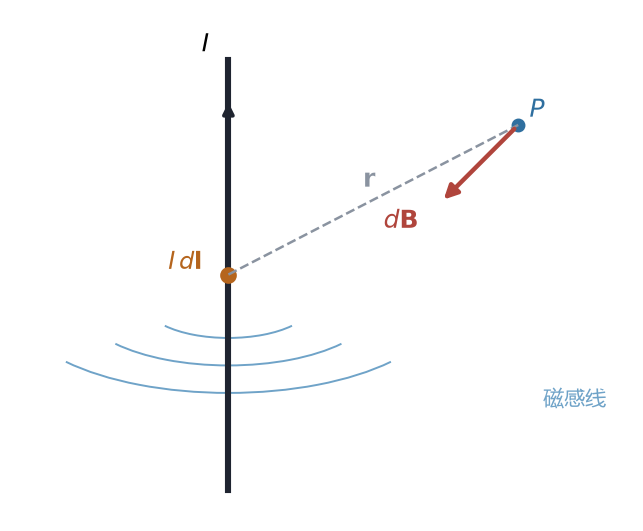
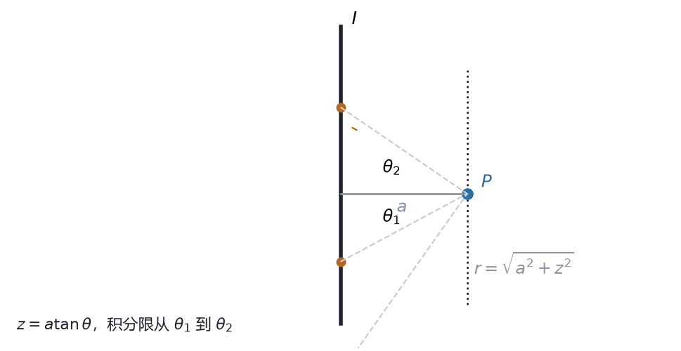
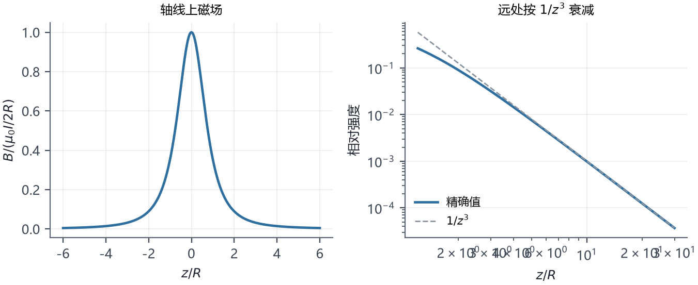

# 第 15 章 电流的磁场：毕奥–萨伐尔定律

## 15.1 把电流切成小段

奥斯特的发现说明电流周围有磁场，接下来的问题是：磁场有多强，方向怎么定，与电流的形状有什么关系。

1820 年，毕奥和萨伐尔测量了不同形状导线产生的磁场。他们的办法是把导线折成各种形状，用小磁针测某点的场，通过改变电流、距离、导线的几何来归纳规律。结论可以写成一个"电流元"的表达式：把导线分成许多小段，每段长 $dl$、电流 $I$，它在空间中某点产生的磁场是

$$d\mathbf{B}=\frac{\mu_0}{4\pi}\frac{I\,d\mathbf{l}\times\hat{\mathbf{r}}}{r^{2}} , \tag{15.1}$$

$d\mathbf{l}$ 是沿电流方向的小矢量，$\mathbf{r}$ 是从电流元指向观察点的位置矢量，$\hat{\mathbf{r}}$ 是它的单位矢量，$r$ 是距离。整个导线的场是所有电流元的场的矢量和：

$$\mathbf{B}=\frac{\mu_0}{4\pi}\int\frac{I\,d\mathbf{l}\times\hat{\mathbf{r}}}{r^{2}} . \tag{15.2}$$

$\mu_0$ 是真空磁导率，

$$\mu_0=4\pi\times10^{-7}\ \mathrm{N/A^2}=1.2566\times10^{-6}\ \mathrm{H/m} . \tag{15.3}$$

2019 年以前这个值是精确的 $4\pi\times10^{-7}$，因为它由安培的定义固定；改版之后安培由基本电荷定义，$\mu_0$ 变成实验值，与 $4\pi\times10^{-7}$ 的差别在小数点后第十位，本书一律取 $4\pi\times10^{-7}$。

这个定律在形式上与库仑定律相似，都是平方反比。区别在于叉乘：磁场的方向垂直于电流元与观察点的连线，而电场的方向沿连线。叉乘带来的是"环流"的性质，磁感线绕电流转圈，不会沿径向发散。

## 15.2 长直导线

一根无限长的直导线，电流 $I$，求距导线 $a$ 处的磁场。

取导线沿 $z$ 轴，观察点在 $x$ 轴上距原点 $a$ 处。电流元 $I\,dz$ 在 $z$ 处，到观察点的矢量是 $\mathbf{r}=a\hat{\mathbf{x}}-z\hat{\mathbf{z}}$，距离 $r=\sqrt{a^2+z^2}$。

叉乘 $d\mathbf{l}\times\hat{\mathbf{r}}$：$d\mathbf{l}=dz\,\hat{\mathbf{z}}$，与 $\hat{\mathbf{r}}$ 叉乘得到沿 $-\hat{\mathbf{y}}$ 方向的矢量，大小是 $dz\cdot a/r$（因为 $\sin\theta=a/r$）。所以磁场方向处处相同，都沿 $-\hat{\mathbf{y}}$（如果电流沿 $+\mathbf{z}$），大小

$$B=\frac{\mu_0I}{4\pi}\int_{-\infty}^{\infty}\frac{a\,dz}{\left(a^{2}+z^{2}\right)^{3/2}} . \tag{15.4}$$

积分要算。令 $z=a\tan\theta$，$dz=a\sec^2\theta\,d\theta$，$a^2+z^2=a^2\sec^2\theta$。上下限从 $z=-\infty$ 到 $\infty$ 对应 $\theta$ 从 $-\pi/2$ 到 $\pi/2$。代入：

$$\int\frac{a\,dz}{\left(a^{2}+z^{2}\right)^{3/2}}=\int\frac{a\cdot a\sec^{2}\theta\,d\theta}{a^{3}\sec^{3}\theta}=\frac{1}{a}\int\cos\theta\,d\theta . \tag{15.5}$$

定积分：

$$\frac{1}{a}\left[\sin\theta\right]_{-\pi/2}^{\pi/2}=\frac{1}{a}\left(1-(-1)\right)=\frac{2}{a} . \tag{15.6}$$

于是

$$B=\frac{\mu_0I}{4\pi}\cdot\frac{2}{a}=\frac{\mu_0I}{2\pi a} . \tag{15.7}$$

这个结果可以用安培环路定理几行算出来（下一章），但用毕奥–萨伐尔定律算一遍有意义：它显示了积分怎么设、三角换元怎么做、为什么结果是 $1/a$。

代一组数。$1\ \mathrm{A}$ 的电流，距导线 $1\ \mathrm{cm}$，$B=4\pi\times10^{-7}\times1/(2\pi\times0.01)=2\times10^{-5}\ \mathrm{T}$，是地磁场的四成。这个量级说明日常电流产生的磁场与地磁场相当，所以小磁针能被导线偏转。

## 15.3 有限长导线

如果导线只从 $z_1$ 延伸到 $z_2$，积分限改成对应的 $\theta_1$、$\theta_2$：

$$B=\frac{\mu_0I}{4\pi a}\left(\sin\theta_2-\sin\theta_1\right) , \tag{15.8}$$

$\theta$ 是从观察点到电流元的连线与导线垂线的夹角。这个式子在计算有限长导线（比如一段直导线、一条边）的场时有用。$z_1\to-\infty$、$z_2\to\infty$ 时 $\sin\theta_2-\sin\theta_1\to2$，回到 (15.7)。

## 15.4 圆环轴线上的场

半径 $R$ 的圆环，电流 $I$，求轴线上距圆心 $z$ 处的磁场。

取圆环在 $xy$ 平面内，轴沿 $z$。电流元 $I\,d\mathbf{l}$ 在环上某点，到轴线上的观察点的矢量 $\mathbf{r}$ 的长度是 $\sqrt{R^2+z^2}$，与轴线的夹角满足 $\cos\alpha=z/\sqrt{R^2+z^2}$。

叉乘的方向：$d\mathbf{l}$ 沿环的切线，$\mathbf{r}$ 从环上指向轴上，两者叉乘得到的方向与轴线成一定角度。把所有电流元的贡献分解成沿轴线的分量与垂直于轴线的分量。由对称性，垂直于轴线的分量两两抵消（直径两端的电流元贡献大小相等、方向相反），只剩轴向分量。

轴向分量的大小是 $dB\cos\alpha$，其中

$$dB=\frac{\mu_0I\,dl}{4\pi\left(R^{2}+z^{2}\right)} . \tag{15.9}$$

积分：

$$B=\frac{\mu_0I}{4\pi\left(R^{2}+z^{2}\right)}\cdot\frac{z}{\sqrt{R^{2}+z^{2}}}\int dl . \tag{15.10}$$

$\int dl=2\pi R$，所以

$$B=\frac{\mu_0I}{4\pi}\cdot\frac{2\pi Rz}{\left(R^{2}+z^{2}\right)^{3/2}}=\frac{\mu_0IR^{2}}{2\left(R^{2}+z^{2}\right)^{3/2}} . \tag{15.11}$$

检查两个极限。$z=0$（圆心）时 $B=\mu_0I/(2R)$。$z\gg R$ 时 $B\approx\mu_0IR^2/(2z^3)$，按 $1/z^3$ 衰减，与电偶极子的场同阶。把磁矩 $m=I\pi R^2$ 代入，$B\approx\mu_0m/(2\pi z^3)$，这正是第十四章 (14.7) 在轴线上的值。

圆心处的场值得单独记：$B=\mu_0I/(2R)$。一个 $1\ \mathrm{A}$、半径 $1\ \mathrm{cm}$ 的圆环，圆心处 $B=6.3\times10^{-5}\ \mathrm{T}$，与地磁场同量级。

## 15.5 叠加的例子

两根平行的长直导线，相距 $d$，电流都向同一方向，各为 $I$。求两导线中点处的磁场。

中点到两根导线的距离都是 $d/2$。左边导线在中点产生的场，方向由右手定则判断：电流向上，场在中点处指向纸面内（假设观察者在导线所在平面的前方）。右边导线在中点产生的场指向纸面外。两者方向相反，大小相等：

$$B_1=B_2=\frac{\mu_0I}{2\pi\left(d/2\right)}=\frac{\mu_0I}{\pi d} . \tag{15.12}$$

合场为零。

这个结果说明两导线之间的中点是一个磁场零点。如果电流反向，两个场同向，中点处 $B=2\mu_0I/(\pi d)$。这个零点在实际中会造成问题：两根平行导线靠得很近时，中间的磁场很弱，附近的敏感电路可能受到不均匀的干扰。

## 15.6 一段圆弧

一段圆心角为 $\varphi$ 的圆弧，半径 $R$，电流 $I$，圆心处的磁场是整圆的 $\varphi/(2\pi)$：

$$B=\frac{\mu_0I}{4\pi R}\varphi , \tag{15.13}$$

$\varphi$ 用弧度。推导与整圆相同，只是 $\int dl=R\varphi$ 而不是 $2\pi R$。这个式子在计算螺线管、环形线圈的场时用得上。

## 15.7 两根平行导线之间的力

两根无限长平行导线，相距 $d$，电流分别为 $I_1$、$I_2$，同向。求每单位长度上的力。

先算导线 1 在导线 2 处产生的磁场：

$$B_1=\frac{\mu_0I_1}{2\pi d} . \tag{15.14}$$

导线 2 的一段长度 $L$ 受安培力

$$F=I_2LB_1=\frac{\mu_0I_1I_2L}{2\pi d} . \tag{15.15}$$

单位长度的力

$$\frac{F}{L}=\frac{\mu_0I_1I_2}{2\pi d} . \tag{15.16}$$

方向：导线 1 在导线 2 处的磁场垂直于两导线所在平面，导线 2 的电流与该磁场叉乘，得到的力指向导线 1。所以同向电流相吸。

反向电流时，力的方向反过来，相斥。这个结论可以用能量方法验证：同向电流的两根导线，磁通量在它们之间的区域叠加增强，系统的磁能随间距减小而减小，所以力倾向于减小间距，即相吸。

这个公式在 2019 年以前是安培的定义基础：两根相距一米的平行导线，每米受力 $2\times10^{-7}\ \mathrm{N}$ 时，电流为一安培。代入 (15.16)，$\mu_0=4\pi\times10^{-7}$，$I_1=I_2=1$，$d=1$，得 $F/L=2\times10^{-7}$，正好。

代一组数。两根导线各通 $10\ \mathrm{A}$，相距 $1\ \mathrm{cm}$：

$$\frac{F}{L}=\frac{4\pi\times10^{-7}\times100}{2\pi\times0.01}=2\times10^{-3}\ \mathrm{N/m} . \tag{15.17}$$

每米两毫牛，很小，但可以用灵敏的天平测出来。短路时电流上千安，这个力就变得可观：母线之间的电动斥力可以达到每米几百牛，所以变电站的母线要用支架固定。

## 15.8 亥姆霍兹线圈

单个圆环的磁场在轴线中部不够均匀。要得到一片均匀区，可以把两个相同的圆环同轴放置，间距等于半径，电流同向。这个装置叫亥姆霍兹线圈。

为什么间距取半径？考虑轴线上一点，两个线圈的场叠加。每个线圈的场在轴线附近可以展开成泰勒级数，一阶项（斜率）在两线圈的中点处符号相反，可以抵消；二阶项也可以抵消，如果间距取特定值。

具体算。半径 $R$ 的圆环在轴线上 $z$ 处的场，由 (15.11)：

$$B(z)=\frac{\mu_0IR^{2}}{2\left(R^{2}+z^{2}\right)^{3/2}} . \tag{15.18}$$

两个线圈分别在 $z=\pm d/2$，中点 $z=0$ 处的场是

$$B(0)=2\cdot\frac{\mu_0IR^{2}}{2\left(R^{2}+d^{2}/4\right)^{3/2}} . \tag{15.19}$$

要求二阶导数在中点为零。对 $B(z)$ 求二阶导，代入 $z=d/2$ 与 $z=-d/2$，令和为零，解得 $d=R$。这个计算比较繁，结论是：间距等于半径时，中点附近直到四阶导都为零，均匀性最好。

亥姆霍兹线圈在实验室里用来产生已知的均匀磁场，用来校准霍尔探头、测量磁矩、做电子荷质比实验。它的均匀区大约在中心 $\pm0.2R$ 的范围内，不均匀度小于百分之一。

这个例子说明一件事：叠加不仅能算场，还能用来"设计"场。通过选择几何参数，让某些展开项抵消，得到想要的分布。相控阵天线、磁共振成像的梯度线圈，用的都是这个思路。

## 15.9 一段半圆导线中心的场

前面的例子都有完整的对称性，这里算一个只有部分对称的。

一段半圆导线，半径 $R$，电流 $I$，求圆心处的磁场。

用毕奥–萨伐尔定律。导线元 $I\,d\mathbf{l}$ 在圆心处，位置矢量 $\mathbf{r}$ 从元指向圆心，大小 $R$；$d\mathbf{l}$ 沿切线，与 $\mathbf{r}$ 垂直（切线垂直于半径）。所以叉乘的大小是 $dl\cdot1$，方向处处相同，都垂直于半圆所在平面。

$$dB=\frac{\mu_0I\,dl}{4\pi R^{2}} . \tag{15.20}$$

分母里没有 $\sin\theta$，因为角度是 $90^\circ$。积分：

$$B=\frac{\mu_0I}{4\pi R^{2}}\int dl=\frac{\mu_0I}{4\pi R^{2}}\cdot\pi R=\frac{\mu_0I}{4R} . \tag{15.21}$$

整圆的圆心场是 $\mu_0I/(2R)$，半圆是它的一半，符合比例。

如果是四分之一圆，场是 $\mu_0I/(8R)$。一般地，圆心角为 $\varphi$ 的圆弧：

$$B=\frac{\mu_0I}{4\pi R}\varphi , \tag{15.22}$$

与第十五章前面的 (15.13) 一致。

再看一个组合。两根直导线与两个半圆组成一个闭合回路（像跑道形状），求中心的场。两条直导线的延长线都过中心，$d\mathbf{l}$ 与 $\mathbf{r}$ 平行，叉乘为零，不贡献。两个半圆贡献相加或相减，取决于电流方向。

如果电流沿跑道一圈，两个半圆的电流方向相反（一个顺时针一个逆时针），它们的场方向相反，互相抵消一部分。半径分别是 $R_1$、$R_2$ 时：

$$B=\frac{\mu_0I}{4}\left(\frac{1}{R_1}-\frac{1}{R_2}\right) . \tag{15.23}$$

这个结果说明：叠加原理用在磁场时，方向的判断比大小更容易出错。每一步都要先定方向，再决定相加还是相减。

## 15.10 磁场的量级估计

毕奥–萨伐尔定律可以用来估计任意电流分布的磁场量级。

特征公式是 $B\sim\mu_0I/(2\pi a)$，$a$ 是观察点到电流的特征距离。这个估计对直导线是精确的，对其他形状只差一个数量级内的因子。

举例。一个 $1\ \mathrm{A}$ 的电流回路，尺寸 $10\ \mathrm{cm}$，在 $10\ \mathrm{cm}$ 处的场约

$$B\sim\frac{4\pi\times10^{-7}\times1}{2\pi\times0.1}=2\times10^{-6}\ \mathrm{T} , \tag{15.24}$$

是地磁场的百分之四。这个量级说明为什么小磁针能探测电流：地磁场是 $5\times10^{-5}\ \mathrm{T}$，实验里的电流磁场与它可比，磁针会明显偏转。

要产生 $1\ \mathrm{T}$ 的场，需要多大的电流？用螺线管，$B=\mu_0nI$，取 $n=10^{4}\ \mathrm{m^{-1}}$（每厘米一百匝），则 $I=B/(\mu_0n)=1/(4\pi\times10^{-7}\times10^{4})\approx80\ \mathrm{A}$。八十安培的电流在细导线里会烧毁，所以实际电磁铁用铁芯（$\mu_r$ 几千）把场放大，电流只需几十毫安到几安培。

## 15.13 完整算一遍：两条导线的相互作用与一个圆环

两条无限长平行直导线，相距 $d=5.0\ \mathrm{cm}$，各通电流 $I_1=I_2=2.0\ \mathrm{A}$，方向相同。求每米长度上的作用力。

由 (15.16)：

$$\frac{F}{L}=\frac{\mu_0I_1I_2}{2\pi d}=\frac{4\pi\times10^{-7}\times2.0\times2.0}{2\pi\times0.05} . \tag{15.25}$$

约掉 $2\pi$：

$$\frac{F}{L}=\frac{2\times10^{-7}\times4.0}{0.05}=\frac{8.0\times10^{-7}}{0.05}=1.6\times10^{-5}\ \mathrm{N/m} . \tag{15.26}$$

每米十六微牛。这个力很小，但用灵敏的扭秤或电子天平可以测出来。作为对比，同样两根导线通 $200\ \mathrm{A}$（短路电流量级），力变成 $1.6\times10^{-1}\ \mathrm{N/m}$，一百六十毫牛每米，二十米长的母线就要承受三牛顿的侧向力，必须用绝缘子固定。

方向：同向电流相吸，反向相斥。判断的办法是先用右手定则定出导线 1 在导线 2 处的磁场，再用 $\mathbf{F}=I\mathbf{L}\times\mathbf{B}$ 定方向，不要凭记忆。

再看圆环。半径 $R=5.0\ \mathrm{cm}$ 的圆环，电流 $I=2.0\ \mathrm{A}$，圆心处的磁场由 (15.11) 在 $z=0$ 给出：

$$B=\frac{\mu_0I}{2R}=\frac{4\pi\times10^{-7}\times2.0}{2\times0.05}=\frac{2.51\times10^{-6}}{0.1}=2.5\times10^{-5}\ \mathrm{T} . \tag{15.27}$$

二十五微特斯拉，约是地磁场的一半。这个量级说明：一个两安培的线圈在中心产生的场与地磁相当，所以做磁场实验时要考虑地磁的干扰，或者用亥姆霍兹线圈抵消。

如果圆环有 $N=50$ 匝，电流仍为 $2.0\ \mathrm{A}$，圆心处的场按匝数倍增：

$$B=\frac{\mu_0NI}{2R}=\frac{4\pi\times10^{-7}\times50\times2.0}{0.1}=1.26\times10^{-3}\ \mathrm{T} . \tag{15.28}$$

一点二六毫特斯拉，是地磁的二十五倍。匝数是提高磁场最直接的手段，这也是电磁铁绕很多匝的原因。

## 15.14 常见误解

**$d\mathbf{B}$ 的方向由叉乘给出，不是"沿着电流方向"。** $d\mathbf{l}\times\hat{\mathbf{r}}$ 垂直于电流元与连线的平面，磁感线绕电流转圈。初学者常把磁场画成从电流"发出"的放射线，这与实际情况（闭合的环）相反。

**电流元不能孤立存在。** 毕奥–萨伐尔定律里的 $I\,d\mathbf{l}$ 是一个数学上的微元，实际电路里没有"只有一段的电流"。这个定律是从闭合回路的实验规律中归纳出来的，用的时候必须对整条回路积分，不能拿一个电流元去算"某点的场"然后声称测得到。

**直导线公式里的 $2\pi$ 不是"周长恰好出现"。** 它来自角度积分：$\oint d\theta=2\pi$。换一种形状，比如一段圆弧，出现的就不是 $2\pi$ 而是圆弧的圆心角。公式里的常数反映的是几何，不是巧合。

**叠加磁场时先定方向，再算大小。** 两个电流元的场可能同向、反向或成任意角度，直接相加大小是错的。正确的做法是分别写出矢量，再做矢量和；如果只关心某一点，可以先把每个场分解到选定的坐标轴上。

## 15.15 补充：跑道形回路中心的场

两根长 $l=20\ \mathrm{cm}$ 的平行直导线，两端用两个半圆连接，内半径 $R_1=5.0\ \mathrm{cm}$、外半径 $R_2=10.0\ \mathrm{cm}$，电流 $I=3.0\ \mathrm{A}$ 沿回路流动。求中心处的磁场。

四条边的贡献分别算。

两条直导线的延长线都通过中心，$d\mathbf{l}$ 与 $\mathbf{r}$ 平行，叉乘为零，贡献为零。

两个半圆的贡献由 (15.20) 给出，圆心角 $\pi$：

$$B_1=\frac{\mu_0I}{4\pi R_1}\pi=\frac{\mu_0I}{4R_1},\qquad B_2=\frac{\mu_0I}{4R_2} . \tag{15.29}$$

方向：电流绕回路一圈，内侧半圆与外侧半圆的电流方向相反，所以两个场方向相反。合场

$$B=\frac{\mu_0I}{4}\left(\frac{1}{R_1}-\frac{1}{R_2}\right) . \tag{15.30}$$

代入数值。$\mu_0I/4=4\pi\times10^{-7}\times3.0/4=9.42\times10^{-7}$。括号内

$$\frac{1}{0.05}-\frac{1}{0.10}=20-10=10\ \mathrm{m^{-1}} . \tag{15.31}$$

$$B=9.42\times10^{-7}\times10=9.4\times10^{-6}\ \mathrm{T} . \tag{15.32}$$

九点四微特斯拉，约是地磁的五分之一。

这个结果说明两件事。直导线的贡献可以精确为零，只要它的延长线过观察点，这一点在计算中经常被忽略。两个半圆的场相减而不是相加，因为回路是闭合的，电流在内侧与外侧的方向相反；如果只看大小相加，会得到 $28\ \mathrm{\mu T}$，差了近三倍。

如果回路不是闭合的（比如只有外半圆与两条直导线，末端开口），电流不连续，静磁场的计算就不适用，必须考虑电荷在开口处的积累。这个问题在第十九章讲感应时会出现，那时用位移电流补上连续性。

### 两条路走同一个结果

长直导线的场用毕奥–萨伐尔定律算过，用安培环路定理也能几行得到（第十六章）。后者取以导线为轴的圆，环量 $B\cdot2\pi r=\mu_0I$，直接解出 $B=\mu_0I/(2\pi r)$。

两条路给出同一个结果，但它们不是互相独立的证明。环路定理的一般形式本身是在已知直导线场的基础上归纳出来的，所以不能用它去"证明"毕奥–萨伐尔定律。逻辑顺序是：毕奥–萨伐尔定律是实验归纳的出发点，环路定理是它的推论，两条路的结果一致说明体系自洽。

做练习时，如果两条路算出的结果不同，通常错在积分限或方向。毕奥–萨伐尔定律里 $d\mathbf{l}$ 与 $\hat{\mathbf{r}}$ 的叉乘有方向，环路定理里回路的绕行方向与电流的正负要配合右手定则。这两处都是符号最容易出错的地方。

---

这一章给出了一条计算磁场的一般方法：把电流分元，用 (15.1) 算每一元的贡献，再矢量叠加。三个例子（直导线、圆环、圆弧）都算到了底，结果是精确的。

下一章给出一条例外的捷径：在对称性足够的情形，不用积分，用安培环路定理就能得到同样的结果。这个定理的地位与高斯定理在电学中的地位相同。
