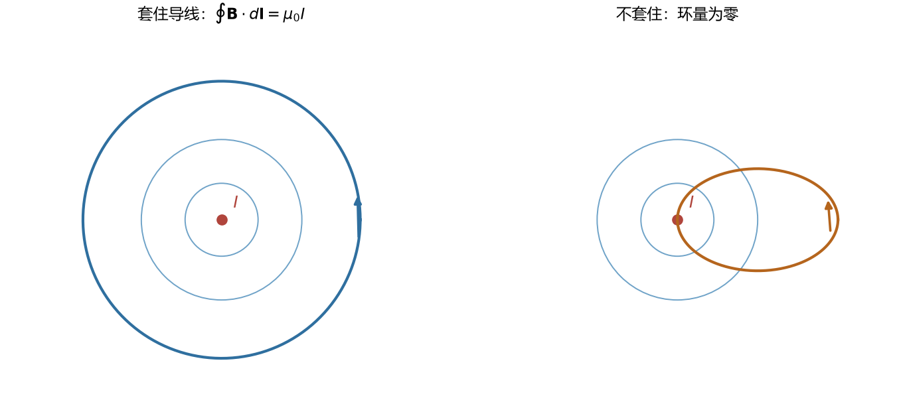
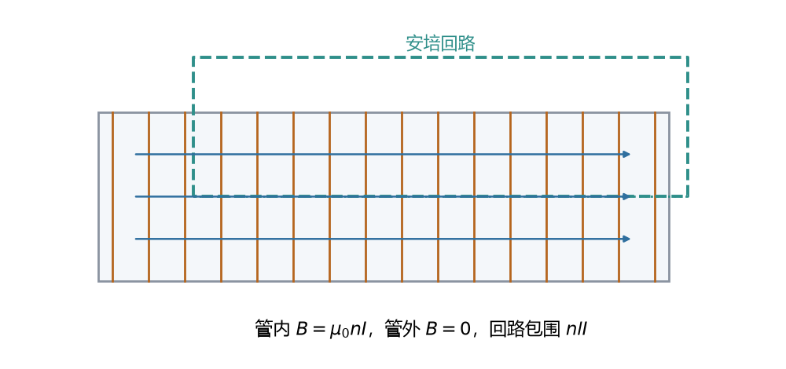
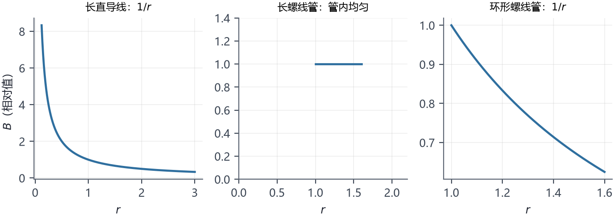

# 第 16 章 安培环路定理

## 16.1 一个似曾相识的因子

长直导线的磁场是 $B=\mu_0I/(2\pi a)$。把它乘以 $2\pi a$：

$$B\cdot2\pi a=\mu_0I . \tag{16.1}$$

左边是磁场大小乘圆周长，也就是磁场沿以导线为圆心、半径 $a$ 的圆周的积分：

$$\oint\mathbf{B}\cdot d\mathbf{l}=B\cdot2\pi a=\mu_0I . \tag{16.2}$$

这个结果与半径无关。换成别的半径，$B$ 变小，周长变大，乘积不变。这个不变性提示了一条定理：磁场沿任意闭合回路的环量，等于 $\mu_0$ 乘以穿过回路的电流。

这正是安培在 1826 年提出的环路定理。它的地位与电学里的高斯定理相同：把面积分或线积分换成一个简单的代数式，省掉积分。

## 16.2 定理的表述

沿任意闭合回路 $L$，磁场的环量等于

$$\oint_L\mathbf{B}\cdot d\mathbf{l}=\mu_0 I_{\text{穿}} , \tag{16.3}$$

$I_{\text{穿}}$ 是穿过以 $L$ 为边界的任意曲面的总电流。电流的正负由右手定则确定：右手四指沿回路方向弯曲，拇指指向的电流为正。

这个定理里有两个"任意"值得强调。回路可以是任意形状，不必是圆；曲面可以是任意以回路为边界的曲面，不必是平面。只要电流穿过了这个曲面，就计入 $I_{\text{穿}}$；没有穿过的不计。

"穿过"这个词需要一点说明。电流是一个有方向的量，穿过曲面时可以朝两个方向。按右手定则定出正方向之后，朝正方向的电流为正，反向为负。如果一根导线穿过曲面两次（比如曲面卷起来），两次的贡献可能抵消。

## 16.3 验证：长直导线

取以导线为轴、半径 $a$ 的圆作回路。圆周上每一点，$\mathbf{B}$ 沿切向，与 $d\mathbf{l}$ 同向，大小处处相同：

$$\oint\mathbf{B}\cdot d\mathbf{l}=B\cdot2\pi a=\frac{\mu_0I}{2\pi a}\cdot2\pi a=\mu_0I . \tag{16.4}$$

与定理一致。

换一个回路，比如一个不包围导线的圆，或者一个形状任意但不套住导线的闭合曲线。这时回路没有包围电流，$I_{\text{穿}}=0$，定理说环量为零。这个结论不显然：回路上每一点的场都不为零，但积分起来正好抵消。

为什么抵消？可以这样看。把回路分成许多小段，每一小段对应的位置矢量扫过一个角度 $d\theta$。直导线的场大小是 $\mu_0I/(2\pi r)$，沿切向的分量是 $B\cos\alpha$，其中 $\alpha$ 是场方向与 $d\mathbf{l}$ 的夹角。几何上可以证明 $dl\cos\alpha=r\,d\theta$（$d\theta$ 是该段对导线所张的角度），于是

$$\mathbf{B}\cdot d\mathbf{l}=\frac{\mu_0I}{2\pi r}\cdot r\,d\theta=\frac{\mu_0I}{2\pi}d\theta . \tag{16.5}$$

沿闭合回路积分，$\oint d\theta$ 是位置矢量绕导线转过的总角度。如果回路不套住导线，绕一圈回到原处，总角度为零；如果套住导线，总角度为 $2\pi$。于是

$$\oint\mathbf{B}\cdot d\mathbf{l}=\frac{\mu_0I}{2\pi}\cdot\left(2\pi\text{ 或 }0\right)=\mu_0I\text{ 或 }0 . \tag{16.6}$$

这与定理一致，而且这个论证对任意形状的回路都成立，不只对圆。

## 16.4 螺线管

一根导线绕成紧密的螺旋，叫螺线管。通电流后，管内产生近似均匀的磁场，方向沿轴。这个装置是最常用的产生均匀磁场的工具。

设螺线管很长（长度远大于直径），单位长度绕 $n$ 匝，电流 $I$。求管内的磁场。

先论证管外的场为零。取一个包围螺线管的长方形回路，一条边在管内沿轴，一条边在管外平行于轴，两条边垂直于轴。管内的场沿轴，与垂直边垂直，那两条边的积分为零；管外的场如果沿轴，同理；如果管外的场沿其他方向，由对称性它只能沿轴或沿径向，径向分量在闭合回路上也抵消。

于是环量是 $(B_{\text{内}}-B_{\text{外}})l$，$l$ 是沿轴那条边的长度。这个回路包围的电流是 $nlI$（因为长度 $l$ 内有 $nl$ 匝，每匝电流 $I$ 穿过回路）。由安培定理：

$$\left(B_{\text{内}}-B_{\text{外}}\right)l=\mu_0nlI . \tag{16.7}$$

还要一个条件才能定出 $B_{\text{内}}$ 与 $B_{\text{外}}$。取另一个回路，两条边都在管外，一条沿轴在近处、一条在远处。这个回路不包围电流（如果它完全在管外，且绕法不套住导线），环量为零：

$$\left(B_{\text{外,近}}-B_{\text{外,远}}\right)l=0 . \tag{16.8}$$

这说明管外的场在轴向上是常数。如果螺线管无限长，管外远处的场必须趋于零（否则整个空间的能量发散），所以管外处处为零。代入 (16.7)：

$$B_{\text{内}}=\mu_0nI . \tag{16.9}$$

管内是均匀场，大小只与单位长度的匝数和电流有关，与管的直径无关。这个结果与实验符合得很好，长直螺线管中部的场确实近似均匀且等于 $\mu_0nI$。

## 16.5 环形螺线管

把导线绕在一个圆环上，叫环形螺线管（或螺绕环）。环的内半径 $a$、外半径 $b$、总匝数 $N$，电流 $I$。

取一个半径为 $r$（$a<r<b$）的圆作回路，圆心在环的中心，回路在环内部。由对称性，环内的场沿圆周的切线方向，大小只与 $r$ 有关。环量是 $B\cdot2\pi r$，包围的电流是 $NI$：

$$B\cdot2\pi r=\mu_0NI\quad\Rightarrow\quad B=\frac{\mu_0NI}{2\pi r} . \tag{16.10}$$

环内的场不是均匀的，靠近内圈强、外圈弱，按 $1/r$ 变化。如果环很薄（$b-a\ll a$），$r\approx a$，场近似均匀，$B\approx\mu_0NI/(2\pi a)=\mu_0nI$，$n=N/(2\pi a)$ 是单位长度的匝数，与长直螺线管的结果一致。

环外的场为零。取一个半径小于 $a$ 的圆作回路，它不包围任何电流（环的导线都在外面），$B=0$；取半径大于 $b$ 的圆，它包围的总电流为零（进去的与出来的抵消），也是 $B=0$。

## 16.6 定理的局限

安培环路定理在稳恒电流下严格成立。电流不稳恒时，它出问题。

考虑一个正在充电的电容器。取一个套住导线的回路，以回路为边界可以做一个穿过导线的曲面，也可以做一个从电容器两板之间穿过的曲面。前者包围电流 $I$，后者包围的电流为零（两板之间没有电荷流动），但两个曲面有同一条边界，环量应该相同。矛盾。

这个矛盾不是数学问题，而是定理本身不完备。麦克斯韦在 1865 年补上了缺失的一项：变化的电场也等效于电流，叫位移电流。补上之后，定理变成

$$\oint\mathbf{B}\cdot d\mathbf{l}=\mu_0\left(I+\varepsilon_0\frac{d\Phi_E}{dt}\right) . \tag{16.11}$$

第二十五章会详细讲这一项是怎么来的，为什么必须加，以及它如何导致电磁波的存在。现在只需要知道：安培环路定理是 (16.11) 在稳恒情形下的特例。

## 16.7 与高斯定理的对照

两条定理的结构相同，都是"把积分换成一个数"。

高斯定理：闭合曲面的通量等于内部电荷除以 $\varepsilon_0$。它处理的是"源的多少"。

安培定理：闭合回路的环量等于穿过回路的电流乘 $\mu_0$。它处理的是"环流的强弱"。

前者的被积函数是 $\mathbf{E}\cdot d\mathbf{S}$，后者的被积函数是 $\mathbf{B}\cdot d\mathbf{l}$。前者用面，后者用线。这种对应在第六篇会变成微分形式：高斯定理对应散度，安培定理对应旋度。

还有一点差别：高斯定理的右边可以是任意电荷分布，安培定理的右边只能是穿过回路的电流。前者是源的度量，后者是涡旋的度量。电场有源无旋（静态），磁场有旋无源，这个对称性在麦克斯韦方程组里表现为两个方程的右边不同。

## 16.8 有限长螺线管

(16.9) 给出的 $B=\mu_0nI$ 是无限长螺线管的结果。真实螺线管有限长，管口附近场会减弱，磁感线从管口散出。

用一个简单的模型估计端部的场。把有限长螺线管看成许多圆环的叠加，轴线上的场由各环的贡献积分得到。这个积分能算，结果是

$$B(z)=\frac{\mu_0nI}{2}\left(\frac{z+l/2}{\sqrt{\left(z+l/2\right)^{2}+R^{2}}}-\frac{z-l/2}{\sqrt{\left(z-l/2\right)^{2}+R^{2}}}\right) , \tag{16.12}$$

$z$ 从管中心量起，$l$ 是管长，$R$ 是半径。

检查几个位置。管中心 $z=0$：

$$B(0)=\mu_0nI\frac{l/2}{\sqrt{l^{2}/4+R^{2}}} . \tag{16.13}$$

$l\gg R$ 时，分母趋于 $l/2$，$B(0)\to\mu_0nI$，回到无限长的结果。

管口 $z=l/2$：

$$B(l/2)=\frac{\mu_0nI}{2}\left(\frac{l}{\sqrt{l^{2}+R^{2}}}-0\right) . \tag{16.14}$$

$l\gg R$ 时趋于 $\mu_0nI/2$。管口的场是管内的一半，这个结论很有用：它说明有限长螺线管的端部场强约为中部的百分之五十。

管外远处的场迅速衰减，按磁偶极子的 $1/z^3$ 规律。所以"管外场为零"是一个近似，只在离管口足够远、且管长足够大时成立。

这些修正对实际设计有影响。做螺线管时，如果要求中部的场均匀到百分之一，管长至少要半径的十倍以上。如果要求整个管内的场都均匀，只能在中间一段使用，或者用多层绕组补偿端部。

## 16.9 磁屏蔽

安培环路定理可以用来解释磁屏蔽。

一个空心的铁磁材料圆筒，放在外磁场中。铁的磁导率 $\mu_r$ 很大（几千），磁感线倾向于走铁。由边界条件，磁感线在铁与空气的界面上折射，进入铁时几乎垂直于界面，于是磁感线绕开空腔，从铁壁里通过。

结果：圆筒内部的磁场比外部弱很多。衰减因子与 $\mu_r$ 和壁厚有关，薄的铁筒可以把场衰减到百分之一，多层结构（坡莫合金）可以衰减到百万分之一。

定量估算。把圆筒看成一个磁路，壁的磁阻远小于空腔的磁阻，磁通量主要走壁。空腔里的磁通量正比于空腔磁阻与总磁阻之比，近似

$$\frac{B_{\text{内}}}{B_{\text{外}}}\approx\frac{t}{\mu_r r} , \tag{16.15}$$

$t$ 是壁厚，$r$ 是半径。$\mu_r=1000$、$t/r=0.1$ 时，比值约 $10^{-4}$。

这个估算说明为什么磁屏蔽要用高磁导率材料、要有一定厚度、要尽量把接缝做严。接缝处的磁阻大，磁通量从缝里漏进去，屏蔽效果急剧下降。光电倍增管、原子钟、心磁图仪都要严格屏蔽地磁场与外界干扰。

注意磁屏蔽与静电屏蔽的机制不同。静电屏蔽靠导体表面的感应电荷，与材料厚度无关；磁屏蔽靠高磁导率的磁路分流，与厚度、材料有关。超导体的磁屏蔽又不一样，它靠迈斯纳效应把磁场完全排出，是最彻底的屏蔽，但需要低温。

## 16.10 完整算一遍：螺线管与环形螺线管

一个长螺线管，单位长度 $n=2000\ \mathrm{m^{-1}}$（每厘米二十匝），电流 $I=3.0\ \mathrm{A}$。管内磁场

$$B=\mu_0nI=4\pi\times10^{-7}\times2000\times3.0=7.54\times10^{-3}\ \mathrm{T}\approx7.5\ \mathrm{mT} . \tag{16.16}$$

七点五毫特斯拉，是地磁的一百五十倍。这个场足以让小磁针明显偏转，也是实验室里产生中等均匀场的常用手段。

若管内插入 $\mu_r=500$ 的铁芯，按 $B=\mu_0\mu_rnI$ 计算：

$$B=500\times7.54\times10^{-3}=3.8\ \mathrm{T} . \tag{16.17}$$

这个值超过了铁的饱和磁感应强度（约 $1.5$ 到 $2\ \mathrm{T}$），实际达不到。铁芯饱和之后，$\mu_r$ 迅速下降，磁通量不再随电流线性增长。设计电磁铁时必须查材料的 $B$-$H$ 曲线，不能直接用常数 $\mu_r$ 乘。

再看环形螺线管。环的平均半径 $r=6.0\ \mathrm{cm}$，总匝数 $N=500$，电流 $I=2.0\ \mathrm{A}$。由 (16.10)：

$$B=\frac{\mu_0NI}{2\pi r}=\frac{4\pi\times10^{-7}\times500\times2.0}{2\pi\times0.06} . \tag{16.18}$$

约掉 $2\pi$：

$$B=\frac{2\times10^{-7}\times1000}{0.06}=\frac{2.0\times10^{-4}}{0.06}=3.3\times10^{-3}\ \mathrm{T} . \tag{16.19}$$

三点三毫特斯拉。与长直螺线管比较：环形螺线管的等效单位长度匝数是 $N/(2\pi r)=500/0.377=1327\ \mathrm{m^{-1}}$，比 $2000$ 小，所以场也小，比例与 $nI$ 一致。

这两个例子说明一个共同点：螺线管内的场只与单位长度的安匝数有关，与管的直径、长度无关（在长管近似的条件下）。要提高场，加匝数或加电流，比加大尺寸有效。

## 16.11 常见误解

**安培环路定理不要求 $\mathbf{B}$ 沿回路大小恒定。** 定理说的是"环量等于 $\mu_0I$"，不是"$B$ 乘以周长等于 $\mu_0I$"。只有当回路上 $B$ 处处相等且与路径平行时，才能把 $B$ 提到积分号外。选回路时要利用对称性，否则积分算不出来。

**螺线管外部的场不严格为零。** "管外 $B=0$"是无限长近似的结果。有限长螺线管的磁感线从管口出来，在外部绕回另一端，管外有场，只是比管内弱得多。管口附近的场约为管内的一半，这个结论在第十六章前面的有限长修正里算过。

**$\mathbf{H}$ 与 $\mathbf{B}$ 的选择要看问题的源。** 已知自由电流、要求介质中的场时，先算 $\mathbf{H}$（因为 $\oint\mathbf{H}\cdot d\mathbf{l}=I_{\text{自由}}$），再由 $\mathbf{B}=\mu\mathbf{H}$ 求 $\mathbf{B}$。直接用 $\oint\mathbf{B}\cdot d\mathbf{l}=\mu_0I$ 会漏掉磁化电流，结果偏小。

**"安培定理可以求任意电流分布的场"是错的。** 它只能求对称性足够的场：长直导线、无限大平面、螺线管、环形螺线管。对一根有限长的导线、一个方形线圈，环路积分算不出来，必须回到毕奥–萨伐尔定律。

## 16.12 补充：从螺线管预估自感

第二十一章会给出螺线管的自感公式，这里先用已算过的磁场做一个预估，说明量级。

螺线管 $n=2000\ \mathrm{m^{-1}}$，长度 $l=0.30\ \mathrm{m}$，截面积 $A=4.0\ \mathrm{cm^2}=4.0\times10^{-4}\ \mathrm{m^2}$。管内磁场 $B=\mu_0nI$，穿过每一匝的磁通量

$$\Phi_B=BA=\mu_0nIA . \tag{16.20}$$

总磁链 $\Psi=N\Phi_B=nl\Phi_B$，自感是磁链除以电流：

$$L=\frac{\Psi}{I}=\mu_0n^{2}lA . \tag{16.21}$$

代入：

$$L=4\pi\times10^{-7}\times\left(2000\right)^{2}\times0.30\times4.0\times10^{-4} . \tag{16.22}$$

分步算：$n^2=4.0\times10^{6}$，$4\pi\times10^{-7}\times4.0\times10^{6}=5.03$，再乘 $0.30\times4.0\times10^{-4}=1.2\times10^{-4}$：

$$L=5.03\times1.2\times10^{-4}=6.0\times10^{-4}\ \mathrm{H}=0.60\ \mathrm{mH} . \tag{16.23}$$

零点六毫亨。这个数值与第二十一章的例题一致，那里用同一个公式算了 $0.25\ \mathrm{mH}$（参数不同）。

若插入 $\mu_r=1000$ 的铁芯，自感增大一千倍，到 $0.6\ \mathrm{H}$。这么大的电感在断电时会产生很高的自感电动势：电流 $1\ \mathrm{A}$ 在 $1\ \mathrm{ms}$ 内降到零，$L\,dI/dt=0.6\times1000=600\ \mathrm{V}$。这就是继电器、接触器线圈断电时打火的原因，也是为什么这类线圈要并联续流二极管。

再看磁能的量级。$I=1\ \mathrm{A}$ 时，$W=\frac{1}{2}LI^2=3\times10^{-4}\ \mathrm{J}$，很小；铁芯版本是 $0.3\ \mathrm{J}$，相当于把三百克物体举高一厘米。电感储能密度不如电容，但能在极短时间内放出，这是它的价值所在。

### 端部的场到底有多大

前面算出长螺线管中部的场 $B=\mu_0nI=7.5\ \mathrm{mT}$（第十六章第 16.10 节）。端部的场约为中部的一半：

$$B_{\text{端}}\approx\frac{1}{2}\mu_0nI=3.8\ \mathrm{mT} . \tag{16.24}$$

这个"一半"的结论只对长管成立（$l\gg R$）。管长与半径可比时，端部场会大于一半，磁感线从管口散出的角度更大。做实验时如果要一段均匀场，只能取管中间的一段，通常不超过管长的三分之一。

这个衰减还解释了为什么螺线管两端的磁感线会"鼓"出来：管内磁通量必须连续，管口的面积不变，但磁感线要散开到外部空间，于是场强下降。管口附近的场梯度最大，用霍尔探头沿轴线测量时能明显看到这条曲线。

### 一个数值核对

中部场 $7.5\ \mathrm{mT}$、端部约 $3.8\ \mathrm{mT}$，两者相差一倍。若把霍尔探头沿轴线从中心移向端部，读数应先缓慢下降，接近管口时快速下降，出管口后按 $1/z^3$ 衰减。这条曲线在实验里很容易测，是检验螺线管是否"足够长"的直接方法：中心到管口的下降若小于百分之五，就可以当作长管处理。

---

这一章给了一条捷径：在对称性足够时，用环量定理直接写出磁场，不必积分。三个例子（直导线、螺线管、环形螺线管）覆盖了大部分实际结构。

下一章处理磁场对电流与运动电荷的作用。那里会用到第十四章定义的洛伦兹力，也会用到这一章算出的磁场分布。
