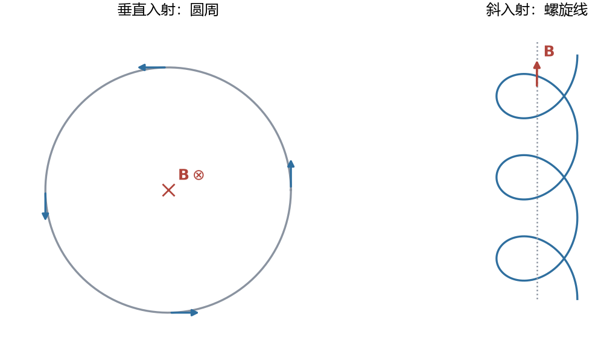
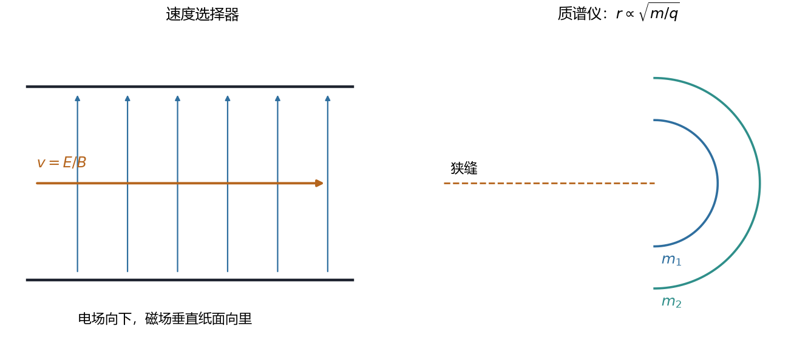
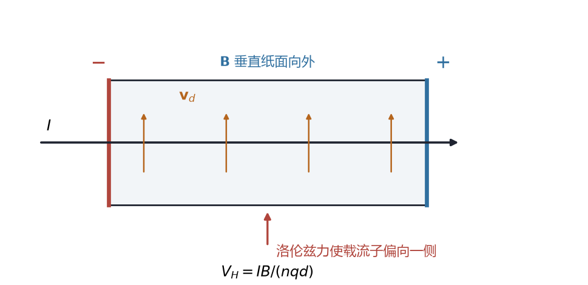

# 第 17 章 磁场对电流与运动电荷的作用

## 17.1 电动机为什么转

一台直流电动机，通电就转。拆开看，转子是一组线圈，定子提供磁场。线圈通电后，两侧的电流方向相反，受到的力也相反，一推一拉，形成力矩，线圈就转起来。

这个现象把两件事连起来：磁场对电流有力的作用，这个力垂直于电流方向。第十四章定义了单个运动电荷受的力，这一章把它用到整根导线上，再反过来处理单个电荷在磁场中的运动轨迹。

## 17.2 安培力

一段长度为 $L$ 的直导线，通电流 $I$，放在匀强磁场 $\mathbf{B}$ 中。导线受力

$$\mathbf{F}=I\mathbf{L}\times\mathbf{B} , \tag{17.1}$$

$\mathbf{L}$ 是沿电流方向的矢量，大小是导线的长度。这就是安培力。

从洛伦兹力推出来。导线里有 $N=nAL$ 个载流子（$n$ 是数密度，$A$ 是截面积），每个载流子带电荷 $q$、以漂移速度 $\mathbf{v}_d$ 运动，受洛伦兹力 $q\mathbf{v}_d\times\mathbf{B}$。总力是这些力的和：

$$\mathbf{F}=nAL\cdot q\mathbf{v}_d\times\mathbf{B} . \tag{17.2}$$

由 $I=nqAv_d$（第十一章），把 $nqA\mathbf{v}_d$ 换成 $I$ 沿导线方向的分量：

$$\mathbf{F}=I\mathbf{L}\times\mathbf{B} . \tag{17.3}$$

推导里假设所有载流子的漂移速度相同，且导线是直的。弯曲导线要分成小段，每段用 $Id\mathbf{l}\times\mathbf{B}$，再积分。

安培力的大小是 $BIL\sin\theta$，$\theta$ 是导线与磁场的夹角。导线平行于磁场时力为零，垂直时最大。

这个力可以做功，这一点与洛伦兹力不同。洛伦兹力作用在单个电荷上，垂直于它的速度，不做功；安培力作用在导线上，导线整体可以沿力的方向移动，力做正功。能量来自电源：载流子在导线里受到的磁力把能量转给了导线，载流子本身的速度方向被磁场改变，额外的能量由电源补充。

## 17.3 线圈的力矩

一个矩形线圈，边长 $a$ 与 $b$，$N$ 匝，通电流 $I$，放在匀强磁场中。线圈平面的法线与磁场的夹角为 $\theta$。

四条边中，与磁场平行的两条边受力，但这两个力大小相等、方向相反，且作用在同一条直线上，互相抵消，不产生力矩。与转轴平行的两条边受力，一个向上、一个向下，形成力偶。

每条边的长度是 $a$，受力 $F=BIa$。两个力的力臂是 $(b/2)\sin\theta$，力矩

$$\tau=2\cdot BIa\cdot\frac{b}{2}\sin\theta=BIab\sin\theta=BIS\sin\theta , \tag{17.4}$$

$S=ab$ 是线圈面积。定义磁矩

$$\mathbf{m}=NI\mathbf{S} , \tag{17.5}$$

$\mathbf{S}$ 的方向由右手定则给出（四指沿电流方向，拇指指向法线）。于是

$$\boldsymbol{\tau}=\mathbf{m}\times\mathbf{B} . \tag{17.6}$$

这个式子的形式与电偶极子的 $\boldsymbol{\tau}=\mathbf{p}\times\mathbf{E}$ 完全一样。磁矩与电偶极矩的类比在磁介质那一章会再用到。

线圈在磁场中的势能也可以类比：

$$U=-\mathbf{m}\cdot\mathbf{B} . \tag{17.7}$$

$\mathbf{m}$ 与 $\mathbf{B}$ 同向时能量最低，这是电动机转子趋向的位置。要让它持续转动，需要换向器在适当的时候改变电流方向，否则线圈会停在平衡位置附近来回摆动。

## 17.4 带电粒子的圆周运动

一个电荷 $q$、质量 $m$ 的粒子，以速度 $\mathbf{v}$ 垂直进入匀强磁场 $\mathbf{B}$。洛伦兹力垂直于速度，大小 $qvB$，提供向心加速度：

$$qvB=\frac{mv^{2}}{r} . \tag{17.8}$$

解出半径

$$r=\frac{mv}{qB} . \tag{17.9}$$

这叫回旋半径。速率越大、质量越大、磁场越弱，半径越大。

周期是周长除以速率：

$$T=\frac{2\pi r}{v}=\frac{2\pi m}{qB} . \tag{17.10}$$

周期与速率无关。这个性质叫等时性，是回旋加速器能工作的基础：粒子每转一圈被加速一次，转圈的频率固定，加速电压的频率也固定，不需要随粒子的速率调整。

回旋的频率

$$f=\frac{qB}{2\pi m} , \tag{17.11}$$

叫回旋频率。对电子，$B=1\ \mathrm{T}$ 时 $f\approx28\ \mathrm{GHz}$；对质子，$f\approx15\ \mathrm{MHz}$。这两个数值在电子自旋共振与核磁共振里出现。

如果速度与磁场不垂直，把速度分解成平行与垂直两个分量。平行分量不受力，匀速前进；垂直分量做圆周运动。两者合成是一条螺旋线，螺距是 $v_\parallel T=2\pi mv_\parallel/(qB)$。

## 17.5 三个应用

**速度选择器。** 让电场与磁场垂直叠加，电场力 $qE$ 与磁力 $qvB$ 方向相反。只有当 $qE=qvB$，即 $v=E/B$ 时，粒子才能直线通过。速率不同的粒子会偏向一侧被挡板吸收。这个装置给出一个只由场强决定的速度筛选。

**质谱仪。** 粒子先被电场加速，获得动能 $qU=\frac{1}{2}mv^2$，然后进入磁场做圆周运动。由 $r=mv/(qB)$ 与 $v=\sqrt{2qU/m}$，得

$$r=\frac{1}{B}\sqrt{\frac{2mU}{q}} . \tag{17.12}$$

半径与 $\sqrt{m/q}$ 成正比。同一种电荷、不同质量的离子打在同一点上会分开，由落点的位置可以算出质量。这是测量同位素丰度的基本方法。

**回旋加速器。** 两个半圆形电极（D 形盒）加交变电压，粒子在缝隙处被加速，在盒内做圆周运动。由于周期与速率无关，交变电压的频率固定为 $qB/(2\pi m)$，粒子每转一圈被加速两次，半径逐渐增大，最终从边缘引出。能量受限于相对论效应：速率接近光速时质量增大，周期变长，与固定频率失谐。现代加速器改用同步加速器解决这个问题。

## 17.6 霍尔效应

1879 年，霍尔发现：把一块通电流的金属片放在磁场中，磁场垂直于片面，金属片的两侧会出现电势差。这个现象叫霍尔效应，它给出了测量载流子浓度的直接方法。

设金属片的厚度为 $d$（沿磁场方向），宽度为 $w$（沿横向），电流 $I$ 沿长度方向，磁场 $B$ 垂直于片面。

载流子以漂移速度 $v_d$ 运动，受洛伦兹力 $qv_dB$，方向横向。这个力把载流子推向一侧，那一侧积累电荷，直到产生的横向电场 $E_H$ 的力与磁力平衡：

$$qE_H=qv_dB\quad\Rightarrow\quad E_H=v_dB . \tag{17.13}$$

横向电势差

$$V_H=E_Hw=v_dBw . \tag{17.14}$$

用 $I=nqAv_d=nq(wd)v_d$ 消去 $v_d$：

$$v_d=\frac{I}{nqwd}\quad\Rightarrow\quad V_H=\frac{IB}{nqd} . \tag{17.15}$$

横向电压与电流、磁场成正比，与厚度、载流子密度成反比。定义霍尔系数

$$R_H=\frac{1}{nq} , \tag{17.16}$$

则 $V_H=R_HIB/d$。测出 $V_H$、$I$、$B$、$d$，就能算出 $R_H$，进而算出 $n$。

霍尔系数的符号还能判断载流子的正负。金属中载流子是电子，$q=-e$，$R_H<0$；某些半导体中载流子表现为正电荷（空穴），$R_H>0$。这个发现当时让人意外，因为人们以为导电的总是电子。

霍尔效应在工程上用途很广。霍尔传感器测量磁场、转速、位置，手机里的电子罗盘就是一个三轴霍尔传感器。量子霍尔效应是另一个话题，它给出电阻的精确量子化，用于定义电阻标准。

## 17.7 磁约束

磁场对带电粒子的作用可以用来约束等离子体。在托卡马克装置里，环形磁场让带电粒子沿磁感线做螺旋运动，绕在环里不出来。磁力不做功，不会给粒子加热，但能阻止它们碰到器壁。

约束的原理来自回旋运动。粒子在垂直于磁场的方向做小圈运动，回旋半径 $r=mv_\perp/(qB)$。磁场越强，半径越小，粒子被"绑"在磁感线上。沿磁场方向粒子自由运动，所以磁感线要闭合，否则粒子会沿磁感线跑掉。托卡马克的磁感线是闭合的螺旋线，同时有环向场与极向场，形状像一个绕了好几圈的弹簧。

## 17.8 回旋加速器的能量上限

回旋加速器靠"周期与速率无关"这个性质工作。这个性质只在非相对论情形下成立，粒子能量高了之后会失效。

由 (17.10)，周期 $T=2\pi m/(qB)$。相对论中质量随速率增加：

$$m=\frac{m_0}{\sqrt{1-v^{2}/c^{2}}}=\gamma m_0 . \tag{17.17}$$

速率增大，$\gamma$ 增大，周期变长。如果加速电压的频率固定，粒子与电场的相位就会失配，越到后面加速越无效，最终停止加速。

失配的判据是周期变化达到一个可观的比例。设 $\gamma$ 增加到 $1.1$，周期变长百分之十，通常在几十圈之后相位就完全错开。对应的动能为

$$E_k=\left(\gamma-1\right)m_0c^{2}=0.1\times938\ \mathrm{MeV}\approx94\ \mathrm{MeV}\quad\text{（质子）}. \tag{17.18}$$

所以普通回旋加速器的质子能量上限约一百兆电子伏。要达到更高能量，必须让频率随粒子能量同步变化，这就是同步回旋加速器（频率调制）与同步加速器（磁场与频率同时调制）的思路。

现代大型加速器（如大型强子对撞机）用的是同步加速器，粒子在固定半径的环里运动，磁场随能量升高而增强，频率也同步调整。质子能量可以达到 $6.5\ \mathrm{TeV}$，比回旋加速器高四个数量级。

这个例子说明一个常见的模式：一个巧妙的想法在一段范围内有效，超出范围后必须修改。修改的方向通常由"哪个近似失效"决定。这里失效的是 $v\ll c$。

## 17.9 汤姆孙测定比荷

1897 年，汤姆孙用磁场与电场测出了阴极射线的荷质比，从而发现了电子。

装置的核心是一对平行板（产生电场）与一对磁极（产生磁场），两者正交，电子束从中间穿过，打在荧光屏上。

先只加电场，电子偏转，偏转量给出加速度，从而给出 $e/m$ 与速度的组合。再加磁场，调整磁场使电子束回到原点，此时电场力与磁力平衡：

$$eE=evB\quad\Rightarrow\quad v=\frac{E}{B} . \tag{17.19}$$

这一步得到了速度。

然后去掉磁场，只留电场，测偏转。设板长 $l$，电子在板间飞行时间 $t=l/v$，横向加速度 $a=eE/m$，出射时的横向速度 $v_y=at$，偏转角

$$\tan\theta=\frac{v_y}{v}=\frac{eEl}{mv^{2}} . \tag{17.20}$$

测出 $\theta$、$E$、$l$、$v$，就能算出 $e/m$：

$$\frac{e}{m}=\frac{v^{2}\tan\theta}{El} . \tag{17.21}$$

汤姆孙得到的结果是 $1.7\times10^{11}\ \mathrm{C/kg}$ 的量级（现代值 $1.759\times10^{11}$），比电解得到的氢离子比荷大一千八百多倍。这个巨大的差别说明阴极射线的粒子质量极小，不是离子，而是后来被称为电子的新粒子。

这个实验的方法论值得注意：它不直接测电荷，也不直接测质量，而是测两者的比值，再用别的实验（密立根油滴）测出电荷，从而得到质量。物理测量常常这样：直接测不到的量，通过组合测量间接得到。

## 17.10 完整算一遍：电子的回旋半径与周期

一个电子以 $v=1.0\times10^{7}\ \mathrm{m/s}$ 垂直进入 $B=1.0\times10^{-2}\ \mathrm{T}$ 的磁场。求回旋半径、周期与回旋频率。

电子质量 $m_e=9.11\times10^{-31}\ \mathrm{kg}$，电荷 $e=1.6\times10^{-19}\ \mathrm{C}$。半径由 (17.9)：

$$r=\frac{m_ev}{eB}=\frac{9.11\times10^{-31}\times1.0\times10^{7}}{1.6\times10^{-19}\times1.0\times10^{-2}} . \tag{17.22}$$

分子 $9.11\times10^{-24}$，分母 $1.6\times10^{-21}$：

$$r=\frac{9.11\times10^{-24}}{1.6\times10^{-21}}=5.7\times10^{-3}\ \mathrm{m}=5.7\ \mathrm{mm} . \tag{17.23}$$

五点七毫米。这个尺度说明为什么阴极射线管、电子显微镜里的磁场只要毫特斯拉量级就能把电子束弯得很厉害。

周期

$$T=\frac{2\pi r}{v}=\frac{2\pi\times5.7\times10^{-3}}{1.0\times10^{7}}=3.6\times10^{-9}\ \mathrm{s}=3.6\ \mathrm{ns} . \tag{17.24}$$

用 (17.10) 核对：

$$T=\frac{2\pi m_e}{eB}=\frac{2\pi\times9.11\times10^{-31}}{1.6\times10^{-19}\times10^{-2}}=\frac{5.72\times10^{-30}}{1.6\times10^{-21}}=3.6\times10^{-9}\ \mathrm{s} , \tag{17.25}$$

一致。注意 (17.10) 里没有 $v$，所以同一个磁场下所有电子的周期相同，无论快慢。

回旋频率

$$f=\frac{1}{T}=2.8\times10^{8}\ \mathrm{Hz}=280\ \mathrm{MHz} . \tag{17.26}$$

这个频率在射频波段。电子回旋共振加热（ECRH）在托卡马克里用这个频率的微波加热等离子体中的电子，磁场强度由 $f=eB/(2\pi m_e)$ 反推：要 $170\ \mathrm{GHz}$ 就需要 $B\approx6\ \mathrm{T}$。

如果速度有平行于磁场的分量，轨迹变成螺旋线。设 $v_\parallel=0.6\times10^{7}$、$v_\perp=0.8\times10^{7}$（总速率仍是 $10^{7}$），螺距

$$p=v_\parallel T=0.6\times10^{7}\times3.6\times10^{-9}=2.2\times10^{-2}\ \mathrm{m}=2.2\ \mathrm{cm} . \tag{17.27}$$

半径由垂直分量决定：$r=m_ev_\perp/(eB)=4.6\ \mathrm{mm}$。

## 17.11 常见误解

**洛伦兹力不做功，但可以改变能量分配。** 单个电荷在纯磁场中速率不变，动能不变。但安培力可以做功：导线整体移动时，磁场对导线做功，能量来自电源。区别在于"单个电荷"与"导体整体"：导体里的电荷受磁力偏向一侧，积累的电荷产生电场，电场对电荷做功，能量在电场与机械运动之间转换。

**霍尔电压的符号能判断载流子种类，但不能只看符号下结论。** 金属中载流子是电子，霍尔系数为负；某些半导体中表现为正（空穴）。但如果材料里两种载流子同时存在，符号由浓度与迁移率的组合决定，可能出现反常。测霍尔系数要配合电导率测量，才能定出载流子浓度与迁移率。

**回旋半径与速率成正比，回旋频率与速率无关。** 这两个结论经常被记混。加速器里粒子越来越快，半径越来越大（要同步增大磁场把它约束在固定轨道上），但每圈的时间不变（非相对论情形）。相对论修正之后，周期随能量增大，这是回旋加速器的能量上限来源。

**速度选择器选择的是速率，不是速度。** $v=E/B$ 只约束速率，方向由狭缝决定。如果粒子斜着进入，电场力与磁力不再共线，无法完全平衡，会被挡板吸收。所以速度选择器前面通常有一段准直光阑。

### 速度选择器与质谱仪的数值

速度选择器的电场 $E=2.0\times10^{4}\ \mathrm{V/m}$、磁场 $B=5.0\times10^{-2}\ \mathrm{T}$，正交放置。能直线通过的粒子速率

$$v=\frac{E}{B}=\frac{2.0\times10^{4}}{5.0\times10^{-2}}=4.0\times10^{5}\ \mathrm{m/s} . \tag{17.28}$$

四十万米每秒，约为光速的千分之一，非相对论近似成立。

通过选择器后进入 $B'=0.20\ \mathrm{T}$ 的磁场做半圆运动，半径

$$r=\frac{mv}{qB'} . \tag{17.29}$$

对单电荷离子，$v$ 与 $q$ 固定，$r\propto m$。若测得 $r=5.0\ \mathrm{cm}$，

$$m=\frac{qB'r}{v}=\frac{1.6\times10^{-19}\times0.20\times0.05}{4.0\times10^{5}}=\frac{1.6\times10^{-21}}{4.0\times10^{5}}=4.0\times10^{-27}\ \mathrm{kg} . \tag{17.30}$$

用原子质量单位换算：$4.0\times10^{-27}/1.66\times10^{-27}=2.4\ \mathrm{u}$，接近氘核或三价碳的同位素（质荷比相同）。质谱仪就是这样通过半径反推质量的。

分辨率取决于半径的测量精度。由 $r\propto\sqrt{m/q}$（能量给定的情形）或 $r\propto m$（速度给定的情形），两种情形的分辨率公式不同。本书前面用的是先加速后偏转的版本（$r\propto\sqrt{m}$），这里用的是先选速再偏转的版本（$r\propto m$）。装置不同，公式不同，这一点在读仪器说明时要看清。

### 回旋周期与加速器频率的匹配

回旋加速器的高频电压频率必须等于粒子的回旋频率 $f=qB/(2\pi m)$，否则粒子每次到达缝隙时电场方向不对，得不到加速。对质子、$B=1.5\ \mathrm{T}$：

$$f=\frac{1.6\times10^{-19}\times1.5}{2\pi\times1.67\times10^{-27}}=\frac{2.4\times10^{-19}}{1.05\times10^{-26}}=2.3\times10^{7}\ \mathrm{Hz} , \tag{17.31}$$

即 $23\ \mathrm{MHz}$。这个频率落在短波波段，用普通的射频功放就能产生。

设计时要留裕量：磁场的实际值与标称值可能差千分之一，频率要能微调，否则几十圈之后相位就错开了。这也是为什么回旋加速器的磁铁要做得很大、很均匀：磁场的不均匀会导致不同位置的周期不同，束流发散。

相对论效应使周期随能量增大，这是普通回旋加速器的能量上限来源（第 17.8 节算过约 $94\ \mathrm{MeV}$）。超过这个能量，必须让频率随半径变化，或者改用同步加速器。

---

这一章把磁力用在两处：整根导线（安培力、力矩）与单个粒子（洛伦兹力、回旋运动）。核心公式是 (17.1)、(17.6)、(17.9)、(17.10)、(17.15)。它们都来自同一个洛伦兹力，区别只在于求和的对象不同。

下一章处理磁介质。前面的讨论都在真空中，一旦有铁、镍这类材料，磁场会被显著放大，需要引入新的量来描述。
