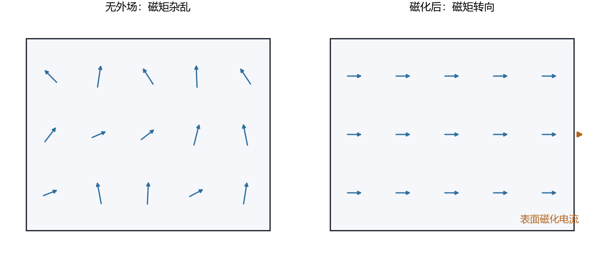
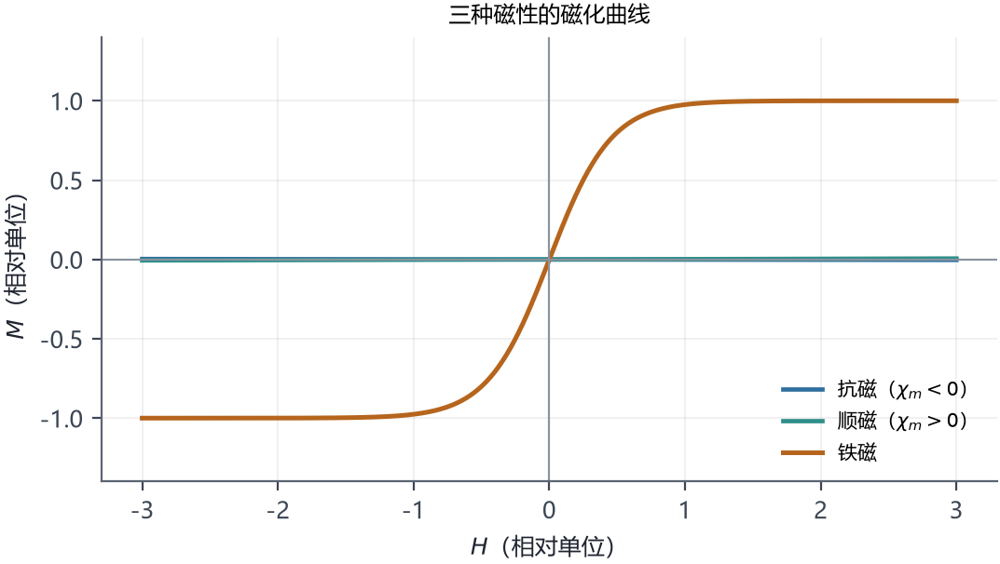
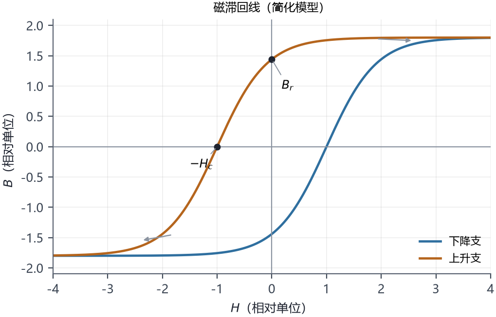

# 第 18 章 磁介质、磁化与磁场强度 H

## 18.1 铁为什么会被吸过去

磁铁能吸铁，不能吸铜、铝、塑料。铁本身不带磁，为什么会被吸？

把铁靠近磁铁，铁内部的微小磁矩在磁场作用下转向，排列整齐，整块铁就变成一个磁体，靠近磁铁的一端出现异名磁极，被吸引。这个过程叫磁化。

磁化的程度可以用一个宏观量描述。介质里的磁矩总和除以体积，叫磁化强度：

$$\mathbf{M}=\frac{\sum\mathbf{m}_i}{V} , \tag{18.1}$$

单位是安培每米，与 $\mathbf{H}$ 相同。它描述单位体积内有多少定向排列的磁矩。

磁化会产生"磁化电流"：介质表面出现一圈等效电流，与线圈里的电流类似。磁化电流也产生磁场，与原来的磁场叠加。所以介质中的总磁场是外场加上磁化产生的场，比真空中的大得多。

## 18.2 磁场强度 H

把总磁场分成两部分：外场（由自由电流产生）与磁化场（由磁化产生）。为了方便，引入一个辅助量，使得它的源只有自由电流。

定义磁场强度

$$\mathbf{H}=\frac{\mathbf{B}}{\mu_0}-\mathbf{M} , \tag{18.2}$$

反过来

$$\mathbf{B}=\mu_0\left(\mathbf{H}+\mathbf{M}\right) . \tag{18.3}$$

$\mathbf{H}$ 的意义在于：它的环路积分只与自由电流有关，

$$\oint\mathbf{H}\cdot d\mathbf{l}=I_{\text{自由}} , \tag{18.4}$$

磁化电流被吸收进了 $\mathbf{M}$ 里。这条式子在解介质问题时很方便，因为自由电流是已知的（线圈里通了多少电流），磁化电流是未知的。

对线性介质，磁化强度与磁场强度成正比：

$$\mathbf{M}=\chi_m\mathbf{H} , \tag{18.5}$$

$\chi_m$ 是磁化率，无量纲。代入 (18.3)：

$$\mathbf{B}=\mu_0\left(1+\chi_m\right)\mathbf{H}=\mu_0\mu_r\mathbf{H} , \tag{18.6}$$

$$\mu_r=1+\chi_m \tag{18.7}$$

是相对磁导率。铁磁材料的 $\mu_r$ 可以到几千甚至几十万，这就是为什么铁芯能把磁场放大几百倍。

## 18.3 三种磁性

所有物质都有磁性，只是强弱与机制不同。

**抗磁。** 磁化率为负，$\chi_m$ 约 $-10^{-5}$。外场使原子内部的电子轨道运动发生变化，产生一个与外场反向的磁矩。所有物质都有抗磁性，但在其他磁性更强时被掩盖。铜、水、铋是典型的抗磁体。

**顺磁。** 磁化率为正，$\chi_m$ 约 $10^{-5}$ 到 $10^{-3}$。原子有固有磁矩，无外场时热运动使它们杂乱排列，宏观不显磁性；外场使它们部分转向，产生同向的磁化。铝、铂、氧气是顺磁体。温度升高，热运动加剧，磁化减弱，磁化率与温度成反比（居里定律）。

**铁磁。** 磁化率很大，可以到 $10^{5}$。铁、钴、镍及其合金属于这一类。铁磁性的来源不是单个原子的磁矩，而是原子磁矩之间的交换相互作用，它使相邻的磁矩自发平行排列。这种相互作用是量子效应，不能用经典图像解释。

铁磁体内部划分成许多小区域，每个区域内的磁矩方向一致，叫磁畴。没有外场时，各磁畴的方向杂乱，宏观上不显磁性。加上外场，磁畴的边界移动，与外场同向的磁畴长大，反向的缩小，宏观磁化迅速增强。磁畴的存在可以用显微技术直接观察到（粉纹法）。

温度升高到某个值时，热运动破坏了磁畴的有序排列，铁磁性消失，变成顺磁性。这个温度叫居里温度，铁是 $770\ ^\circ\mathrm{C}$，钴是 $1115\ ^\circ\mathrm{C}$，镍是 $358\ ^\circ\mathrm{C}$。

## 18.4 磁滞

铁磁体的磁化不是 $H$ 的单值函数。把 $H$ 从零增大，$M$ 沿一条曲线上升，最后饱和；把 $H$ 减小，$M$ 不沿原路返回，而是滞后。$H$ 降到零时，$M$ 还有一个剩余值，叫剩磁；要使 $M$ 降为零，必须加一个反向的场，这个反向场的大小叫矫顽力。

$M$ 随 $H$ 变化的闭合曲线叫磁滞回线。它的形状由材料决定。

软磁材料的回线窄，矫顽力小，容易磁化也容易退磁。变压器铁芯、电动机定子用软磁材料（硅钢、坡莫合金），因为它们在交变场中反复磁化，回线面积小意味着每次循环的能量损耗小。

硬磁材料的回线宽，矫顽力大，磁化后不易退磁。永磁体用硬磁材料（钕铁硼、铁氧体、铝镍钴），它们能长期保持磁性。

磁滞回线包围的面积等于每单位体积每循环消耗的能量，这部分能量变成热。变压器发热的一部分来自这里，叫磁滞损耗。频率越高，损耗越大，所以高频变压器要用铁氧体，它的回线很窄。

## 18.5 边界条件

介质与介质的分界面上，磁场的行为有两条规则，可以从高斯定理与安培定理推出来。

法向分量连续。取一个跨过界面的扁药盒，高度趋于零，侧面通量为零。磁通量守恒要求两个底面的通量相等：

$$B_{1n}=B_{2n} . \tag{18.8}$$

切向分量跳变。取一个跨过界面的小矩形回路，两条长边平行于界面，短边趋于零。环量等于 $\mu_0$ 乘以穿过的自由电流。如果没有面电流，切向分量连续：

$$H_{1t}=H_{2t} . \tag{18.9}$$

如果有面电流（比如超导体表面或理想导体表面），切向分量跳变，跳变量等于面电流密度。

这两条规则在第二十四章会与电场、电位移的边界条件一起系统整理。它们决定了磁感线在界面上的折射：从铁（$\mu_r$ 大）进入空气（$\mu_r\approx1$），磁感线几乎垂直于界面射出，因为 $B_n$ 连续而 $H_t$ 连续，$B_t=\mu H_t$ 在铁里大得多，所以铁的磁感线更"贴"着界面走。

## 18.6 磁路

铁芯能把磁场集中在一条路径里，这个性质可以用来设计磁路。一个闭合铁芯上绕 $N$ 匝线圈，通电流 $I$，铁芯的平均长度 $l$、截面积 $A$、磁导率 $\mu$。

由 (18.4)，沿铁芯的环路积分 $Hl=NI$。磁通量 $\Phi=BA=\mu HA$。消去 $H$：

$$\Phi=\frac{NI}{l/(\mu A)} . \tag{18.10}$$

定义磁阻

$$\mathcal{R}=\frac{l}{\mu A} , \tag{18.11}$$

则

$$\Phi=\frac{NI}{\mathcal{R}} . \tag{18.12}$$

这个式子的形式与欧姆定律 $I=U/R$ 完全一样：磁通量对应电流，磁动势 $NI$ 对应电压，磁阻对应电阻。磁路可以像电路一样串并联计算，气隙的磁阻很大（$\mu_r\approx1$），一小段气隙就能显著降低磁通。

这个类比在电机、变压器、电磁铁的设计里到处使用。它的局限是铁磁材料的 $\mu$ 不是常数（有饱和与磁滞），所以磁路计算通常是迭代的，先假设一个 $\mu$，算出 $\Phi$，再查材料的 $B$-$H$ 曲线修正。

## 18.7 一个带气隙的磁路

磁路计算最有用的地方是处理气隙。电机、电磁铁、继电器的磁路里都有一段空气隙，气隙的磁阻远大于铁芯，往往决定了整个磁路的磁通量。

一个铁芯，平均长度 $l=0.30\ \mathrm{m}$，截面积 $A=1.0\times10^{-3}\ \mathrm{m^2}$，相对磁导率 $\mu_r=2000$。绕 $N=500$ 匝，通电流 $I=1\ \mathrm{A}$。气隙长度 $\delta=1\ \mathrm{mm}$。

铁芯的磁阻

$$\mathcal{R}_{\text{铁}}=\frac{l-\delta}{\mu_r\mu_0A}=\frac{0.299}{2000\times4\pi\times10^{-7}\times10^{-3}}\approx1.19\times10^{5}\ \mathrm{H^{-1}} . \tag{18.13}$$

气隙的磁阻

$$\mathcal{R}_{\text{气}}=\frac{\delta}{\mu_0A}=\frac{10^{-3}}{4\pi\times10^{-7}\times10^{-3}}\approx7.96\times10^{5}\ \mathrm{H^{-1}} . \tag{18.14}$$

总磁阻 $9.15\times10^{5}$。注意气隙只有一毫米，磁阻却是铁芯的六倍多，因为 $\mu_r$ 差了两千倍。

磁通量

$$\Phi=\frac{NI}{\mathcal{R}}=\frac{500}{9.15\times10^{5}}\approx5.5\times10^{-4}\ \mathrm{Wb} . \tag{18.15}$$

磁感应强度

$$B=\frac{\Phi}{A}=0.55\ \mathrm{T} . \tag{18.16}$$

如果没有气隙，磁通量会是 $500/1.19\times10^{5}=4.2\times10^{-3}\ \mathrm{Wb}$，$B=4.2\ \mathrm{T}$。这个值远超铁的饱和磁感应强度（约 $1.5$ 到 $2\ \mathrm{T}$），所以实际上达不到，铁会饱和。

这个计算说明两件事。气隙会大幅降低磁通量，这是为什么磁路要尽量闭合；但气隙也让磁通量与电流的关系更线性，因为气隙的磁阻是常数，而铁的磁导率随 $B$ 变化。需要线性响应的场合（比如电感、变压器）反而要留一点气隙。

## 18.8 铁芯的损耗

交变磁场中的铁芯有两种损耗：磁滞损耗与涡流损耗。

磁滞损耗等于磁滞回线包围的面积乘以频率。每循环单位体积损耗的能量是 $\oint H\,dB$，回线的面积。软磁材料的回线窄，损耗小。硅钢的回线面积比纯铁小，这就是变压器铁芯用硅钢的原因。

涡流损耗由感应电流产生。交变磁通在铁芯里感应出涡流，涡流的焦耳热是损耗。单位体积的涡流损耗近似

$$p_{\text{涡}}\propto\frac{B_{\max}^{2}f^{2}d^{2}}{\rho_e} , \tag{18.17}$$

$d$ 是铁芯片的厚度，$\rho_e$ 是电阻率，$f$ 是频率。与厚度的平方成正比，所以铁芯要做得薄；与电阻率成反比，所以硅钢里加硅（提高电阻率）；与频率的平方成正比，所以高频要用铁氧体（电阻率极高，接近绝缘）。

工程上把两种损耗合成一个经验公式（斯坦梅茨公式）：

$$p=k_hfB_{\max}^{1.6}+k_ef^{2}B_{\max}^{2} , \tag{18.18}$$

$k_h$、$k_e$ 是材料常数，由实验测定。这个公式在电机与变压器的设计中用来估算铁损，配合铜损（绕组电阻的 $I^2R$）算出总损耗与温升。

这个例子说明经验公式在工程里的地位：它没有严格的理论推导，但在特定范围内足够准，而且参数容易测。物理书里讲的是机制，工程手册里给的是拟合，两者不矛盾，只是目的不同。

## 18.9 完整算一遍：铁芯里的三个量

一个环形铁芯，平均磁路长度 $l=0.40\ \mathrm{m}$，截面积 $A=2.0\times10^{-3}\ \mathrm{m^2}$，相对磁导率 $\mu_r=5000$，绕 $N=500$ 匝。要使铁芯中的磁感应强度达到 $B=1.2\ \mathrm{T}$，需要多大电流？

由 $B=\mu_0\mu_rH$ 反解：

$$H=\frac{B}{\mu_0\mu_r}=\frac{1.2}{4\pi\times10^{-7}\times5000} . \tag{18.19}$$

分母 $4\pi\times10^{-7}\times5000=6.28\times10^{-3}$，所以

$$H=\frac{1.2}{6.28\times10^{-3}}=1.9\times10^{2}\ \mathrm{A/m} . \tag{18.20}$$

由安培环路定理 $Hl=NI$：

$$I=\frac{Hl}{N}=\frac{1.9\times10^{2}\times0.40}{500}=0.153\ \mathrm{A} . \tag{18.21}$$

一百五十三毫安。这个电流很小，因为铁芯把磁场放大了五千倍。

磁化强度由 (18.2) 反解：

$$M=\frac{B}{\mu_0}-H=\frac{1.2}{1.257\times10^{-6}}-1.9\times10^{2} . \tag{18.22}$$

第一项

$$\frac{1.2}{1.257\times10^{-6}}=9.55\times10^{5}\ \mathrm{A/m} , \tag{18.23}$$

减去 $190$，几乎不变：

$$M\approx9.55\times10^{5}\ \mathrm{A/m} . \tag{18.24}$$

磁化强度比 $H$ 大五千倍，说明介质里的磁矩贡献远大于自由电流的贡献。等效的磁化电流面密度等于 $M$：

$$K=M\approx9.6\times10^{5}\ \mathrm{A/m} , \tag{18.25}$$

即铁芯表面每米有接近一百万安培的等效环流。

对比没有铁芯的情形。同样要 $B=1.2\ \mathrm{T}$，需要

$$H=\frac{B}{\mu_0}=9.55\times10^{5}\ \mathrm{A/m} , \tag{18.26}$$

$$I=\frac{Hl}{N}=\frac{9.55\times10^{5}\times0.40}{500}=764\ \mathrm{A} . \tag{18.27}$$

七百六十四安培，是前者的五千倍。这就是铁芯的价值：用很小的励磁电流产生很强的磁场。

还要检查铁芯是否饱和。$B=1.2\ \mathrm{T}$ 接近硅钢的饱和值（约 $1.5$ 到 $2.0\ \mathrm{T}$），$\mu_r$ 在这个工作点已经不是常数，实际需要的电流会比按 $5000$ 算出的大一些。设计时要查材料的 $B$-$H$ 曲线，按工作点取 $\mu_r$。

## 18.10 常见误解

**$\mathbf{B}$ 与 $\mathbf{H}$ 的区别不是"一个是实际的，一个是辅助的"。** 两者都是描述磁场的物理量，$\mathbf{B}$ 与磁通量、洛伦兹力直接相关（$\mathbf{F}=q\mathbf{v}\times\mathbf{B}$），$\mathbf{H}$ 与自由电流直接相关（$\oint\mathbf{H}\cdot d\mathbf{l}=I_{\text{自由}}$）。在介质问题里先算 $\mathbf{H}$ 方便，在受力与感应问题里用 $\mathbf{B}$。把它们当成"同一个量的两种单位"会在介质问题里出错。

**铁不一定能屏蔽磁场。** 铁的屏蔽靠高磁导率把磁通量"引走"，但铁会饱和。强磁场下铁芯饱和，$\mu_r$ 掉到几十，屏蔽效果急剧下降。低频磁场可以用厚铁屏蔽，高频磁场要用高电导率的铜或铝（靠涡流抵消），超导体则靠迈斯纳效应完全排磁。

**$\mu_r$ 不是材料的常数。** 铁磁材料的 $\mu_r$ 随 $B$ 变化，从初始的几百升到峰值几千，饱和后又降到接近 1。用常数 $\mu_r$ 算出的结果只在特定工作点附近成立。磁路计算通常要迭代：先假设 $\mu_r$，算出 $B$，查曲线修正，再算。

**磁化电流不是"真的电流"。** 它是对大量分子环流的宏观等效，没有电荷在宏观尺度上迁移，也不产生焦耳热。它产生的磁场与自由电流产生的磁场在效果上不可区分，这是为什么引入 $\mathbf{H}$ 时可以把它们分开记账。

## 18.11 再算一遍：磁屏蔽的衰减

一个铁磁圆筒，半径 $r=5.0\ \mathrm{cm}$，壁厚 $t=1.0\ \mathrm{mm}$，$\mu_r=5000$。用 (18.14) 估算内部场与外部场之比：

$$\frac{B_{\text{内}}}{B_{\text{外}}}\approx\frac{t}{\mu_r r}=\frac{1.0\times10^{-3}}{5000\times0.05}=\frac{1.0\times10^{-3}}{250}=4.0\times10^{-6} . \tag{18.28}$$

外部 $5\times10^{-5}\ \mathrm{T}$ 的地磁场，内部降到 $2\times10^{-10}\ \mathrm{T}$，比地磁小五个数量级。这个估算假设圆筒无限长、接缝理想，实际会差几个数量级。

把壁厚加倍到 $2\ \mathrm{mm}$，衰减因子也加倍到 $8\times10^{-6}$，只改善一倍。公式里是线性关系，不是平方，所以靠加厚来提高屏蔽效率很慢。换材料更有效：坡莫合金的 $\mu_r$ 可以到 $10^{5}$，同样的厚度能多衰减二十倍。

接缝是另一个问题。圆筒如果有缝，磁通量从缝里漏进去，等效磁阻由缝的宽度决定，屏蔽效果可能掉到十分之一。实际屏蔽箱的门要做成搭接式，接缝处加弹片压紧。

## 18.12 再算一遍：磁化曲线上的工作点

一个铁芯的 $B$-$H$ 曲线可以近似用

$$B=\frac{\mu_0\mu_rH}{1+H/H_s} \tag{18.29}$$

描述，$H_s$ 是饱和特征场强。取 $\mu_r=5000$、$H_s=100\ \mathrm{A/m}$，求 $H=50\ \mathrm{A/m}$ 时的 $B$ 与等效 $\mu_r$。

分母 $1+50/100=1.5$。分子 $\mu_0\mu_rH=4\pi\times10^{-7}\times5000\times50=0.314$。相除：

$$B=\frac{0.314}{1.5}=0.21\ \mathrm{T} . \tag{18.30}$$

等效相对磁导率

$$\mu_{r,\text{eff}}=\frac{B}{\mu_0H}=\frac{0.21}{4\pi\times10^{-7}\times50}=\frac{0.21}{6.28\times10^{-5}}=3.3\times10^{3} . \tag{18.31}$$

只有标称值 $5000$ 的百分之六十六。$H$ 越大，等效 $\mu_r$ 越小：$H=500\ \mathrm{A/m}$ 时分母 $6$，$B=1.26\ \mathrm{T}$，$\mu_{r,\text{eff}}\approx2.0\times10^{3}$；$H=2000$ 时 $B\approx1.9\ \mathrm{T}$，$\mu_{r,\text{eff}}\approx760$。

这个模型说明：铁芯的"放大倍数"不是常数，工作点越高，放大倍数越低。设计电磁铁时，如果要线性响应，就要把工作点选在曲线的陡峭段；如果要最大磁通量，就要接受饱和后的低增量磁导率。

### 三个磁性材料的数

**抗磁体（水）。** 磁化率 $\chi_m=-9.0\times10^{-6}$，所以 $\mu_r=1+\chi_m=0.999991$。在 $H=1.0\times10^{5}\ \mathrm{A/m}$ 的场中，磁化强度

$$M=\chi_mH=-9.0\times10^{-6}\times1.0\times10^{5}=-0.90\ \mathrm{A/m} . \tag{18.32}$$

负号表示与外场反向。这个量级极小，只有专门设计的实验（比如用超导量子干涉仪）才测得出来。

**顺磁体（铝）。** $\chi_m=2.2\times10^{-5}$，同样的场中 $M=2.2\ \mathrm{A/m}$，方向与外场相同。顺磁性与抗磁性在同一材料里同时存在，顺磁性占优时表现为正的磁化率。

**铁磁体（铁）。** 在弱场中 $\chi_m$ 可以到几千，$M$ 远大于 $H$。但 $\chi_m$ 不是常数：随着 $H$ 增大，$M$ 趋于饱和（约 $1.7\times10^{6}\ \mathrm{A/m}$，对应 $B\approx2.1\ \mathrm{T}$）。

这三个数字放在一起，可以看出三种磁性的量级差别：抗磁与顺磁的 $M$ 只有几个安培每米，铁磁的 $M$ 是百万量级。差了六个数量级，所以有铁芯时，磁化电流完全主导了磁场。

### 磁化强度与磁化电流的关系

磁化强度 $M$ 与等效的磁化电流面密度 $K$ 数值相等（单位都是 $\mathrm{A/m}$），方向沿介质表面的切向。这个关系容易记混：$M$ 是"单位体积的磁矩"，$K$ 是"单位长度的电流"，两者的量纲相同（$\mathrm{A\cdot m^2/m^3}=\mathrm{A/m}$），所以数值相等不是巧合。

用第 18.9 节的数：铁芯 $M=9.6\times10^{5}\ \mathrm{A/m}$，磁化电流面密度也是 $9.6\times10^{5}\ \mathrm{A/m}$。这个电流沿铁芯表面绕行，与励磁线圈的电流方向相同（顺磁时），所以它加强了磁场。

---

这一章引入了 $\mathbf{H}$ 与 $\mathbf{M}$ 两个量，把介质的影响从自由电流里分离出来。三条关系 (18.2)、(18.4)、(18.6) 是磁介质问题的基本工具。

到此为止，静磁学讲完了。下一篇处理"变化"：磁通量变化会产生电动势，这个发现把电与磁真正连成一个整体。
