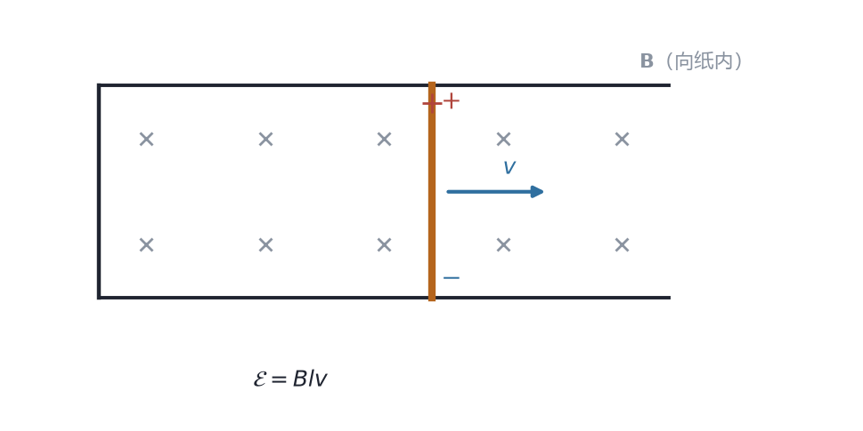
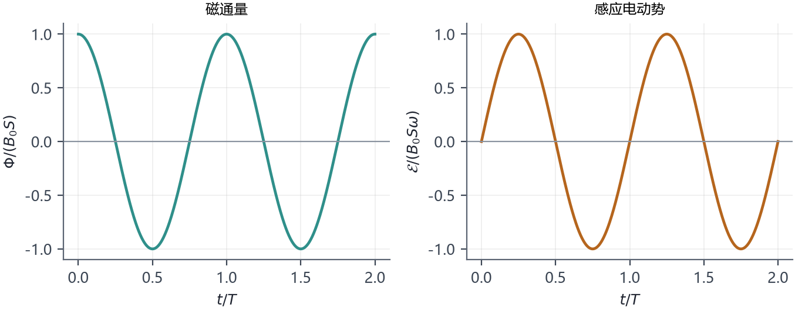
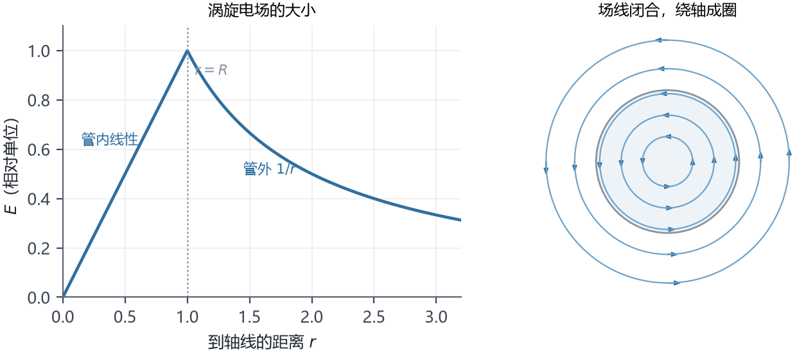

# 第 19 章 法拉第电磁感应定律

## 19.1 磁铁插进线圈

1831 年 8 月，法拉第做了一个实验。他把一根条形磁铁插进一个绕在纸筒上的线圈，线圈两端接一个灵敏的电流计。磁铁不动时，指针不动；磁铁插进去的瞬间，指针偏转；磁铁停在线圈里，指针回到零；把磁铁拔出来，指针向反方向偏转。

他换了各种做法。用另一个通电线圈代替磁铁，通断电流的瞬间，线圈里也有感应电流。把两个线圈绕在同一个铁环上，一个通断电流，另一个产生感应电流。把线圈在磁场中转动，也有感应电流。

这些实验有一个共同点：只有当穿过线圈的磁通量发生变化时才有感应电流。磁通量大但不变，没有电流；磁通量小但变化快，电流大。

法拉第把这个规律写成一句话：感应电动势正比于磁通量的变化率。这句话后来被写成公式，成为电磁学里最重要的一条关系。

## 19.2 法拉第定律

$$\mathcal{E}=-\frac{d\Phi_B}{dt} . \tag{19.1}$$

负号表示感应电动势的方向总是阻碍磁通量的变化，这是楞次定律的内容，下一章专门讲。现在先看大小。

对 $N$ 匝线圈，每匝都穿过同样的磁通量，感应电动势是单匝的 $N$ 倍：

$$\mathcal{E}=-N\frac{d\Phi_B}{dt} . \tag{19.2}$$

磁通量 $\Phi_B=\int\mathbf{B}\cdot d\mathbf{S}$，可以因为三个原因变化：磁场本身变强或变弱，线圈的面积变化，线圈与磁场的相对取向变化。三种情况都产生感应电动势，但微观机制不同。

前两种（磁场变、面积变）可以用洛伦兹力解释，叫动生电动势；第三种（磁场本身随时间变）不能用洛伦兹力解释，需要引入涡旋电场，叫感生电动势。法拉第定律把两种情形统一在一个公式里，但机制要分开讲。

## 19.3 动生电动势

一根长为 $l$ 的导体棒，在匀强磁场 $\mathbf{B}$ 中以速度 $\mathbf{v}$ 运动，$\mathbf{v}$、$\mathbf{B}$、棒三者互相垂直。求棒两端的电动势。

棒里的自由电子随棒一起运动，速度 $\mathbf{v}$，受洛伦兹力

$$\mathbf{F}_m=-e\mathbf{v}\times\mathbf{B} . \tag{19.3}$$

这个力把电子推向棒的一端，另一端留下正电荷，棒内产生一个电场 $\mathbf{E}$。电场力与磁力方向相反，当两者平衡时，电荷不再移动：

$$-e\mathbf{E}=-e\mathbf{v}\times\mathbf{B}\quad\Rightarrow\quad\mathbf{E}=\mathbf{v}\times\mathbf{B} . \tag{19.4}$$

这个电场的两端电势差就是电动势。场强大小 $E=vB$，沿棒的长度积分：

$$\mathcal{E}=El=vBl . \tag{19.5}$$

这就是动生电动势的公式。

用磁通量的办法也能得到同样的结果。设想棒在一个 U 形导轨上滑动，导轨与棒围成一个回路，面积 $S=lx$，$x$ 是棒到导轨底部的距离。磁通量 $\Phi=Blx$，变化率

$$\frac{d\Phi}{dt}=Bl\frac{dx}{dt}=Blv . \tag{19.6}$$

取绝对值就是 $\mathcal{E}=Blv$，与洛伦兹力的推导一致。

动生电动势的推广形式是

$$\mathcal{E}=\oint\left(\mathbf{v}\times\mathbf{B}\right)\cdot d\mathbf{l} , \tag{19.7}$$

沿整个回路积分。这个式子的含义是：回路上每一小段如果以速度 $\mathbf{v}$ 运动，就贡献一份动生电动势。对静止的导线，这个积分为零。

## 19.4 感生电动势与涡旋电场

现在考虑导线不动、磁场随时间变化的情形。导线里的电荷不动，洛伦兹力 $qv\times B$ 为零，推不出电动势。但实验上确实有感应电流，说明存在一种不是由电荷产生的电场。

麦克斯韦把这种场叫涡旋电场（或感生电场）。它的场线是闭合的，不像静电场那样从电荷出发。沿闭合回路的积分不为零，等于磁通量的变化率：

$$\oint\mathbf{E}\cdot d\mathbf{l}=-\frac{d\Phi_B}{dt} . \tag{19.8}$$

这是法拉第定律的积分形式，也是麦克斯韦方程组的第二个方程。它说明：变化的磁场产生电场，这个电场是有旋的。

涡旋电场与静电场的区别有三条。静电场由电荷产生，涡旋电场由变化的磁场产生；静电场的环量为零，涡旋电场的环量等于磁通量变化率；静电场的场线起于正电荷、止于负电荷，涡旋电场的场线闭合。

在导体内部，涡旋电场驱动电荷流动，形成感应电流。在真空中，涡旋电场仍然存在，只是没有电荷可驱动。这一点很重要：它意味着电磁场可以脱离电荷独立存在，第二十七章的电磁波就是这种场。

## 19.5 两种机制的统一

同一个实验，换一个参照系看，机制会变。

一根棒在磁场中运动，在实验室参照系里看，棒里的电荷受洛伦兹力，产生动生电动势。如果跟着棒一起运动，棒静止，磁场也没有变（假设磁场在空间均匀且不随时间变），那电动势从哪来？

在随棒运动的参照系里，电荷静止，不受磁力。但运动的观察者会看到一个电场：由洛伦兹变换，磁场在有相对运动的参照系里会"变出"一个电场，$\mathbf{E}'=\mathbf{v}\times\mathbf{B}$（低速近似）。这个电场驱动电荷，产生同样的电动势。

所以动生与感生不是两种物理，而是同一个电磁场在不同参照系下的表现。法拉第定律 (19.1) 之所以能把两者统一，是因为磁通量的变化率这个量在参照系变换下保持不变（至少在一阶近似下）。

这个统一在狭义相对论里被彻底化，电场与磁场成为同一个张量的分量。本书不展开相对论，但要知道：法拉第定律的形式之所以这么简洁，背后是相对论不变性。

## 19.6 两个例子

**转动的棒。** 一根长为 $l$ 的导体棒，一端在轴心，以角速度 $\omega$ 在垂直于磁场的平面内转动。棒上距轴 $r$ 处的一小段速度是 $v=\omega r$，动生电动势

$$d\mathcal{E}=Bv\,dr=B\omega r\,dr . \tag{19.9}$$

积分：

$$\mathcal{E}=\int_0^lB\omega r\,dr=\frac{1}{2}B\omega l^2 . \tag{19.10}$$

这个装置叫法拉第圆盘（如果用圆盘代替棒），是最早的发电机模型。

**变化的磁场。** 一个半径 $R$ 的圆形线圈，处在均匀磁场中，磁场按 $B=B_0\cos\omega t$ 变化。磁通量 $\Phi=\pi R^2B_0\cos\omega t$，感应电动势

$$\mathcal{E}=-\frac{d\Phi}{dt}=\pi R^2B_0\omega\sin\omega t . \tag{19.11}$$

电动势也是正弦的，振幅与频率成正比。频率越高，同样的磁通量变化产生越大的电动势，这是变压器只能用于交流的原因。

## 19.7 感应电场的量级

涡旋电场的强度一般不大。一个 $1000$ 匝的线圈，面积 $10\ \mathrm{cm^2}$，磁场以 $1\ \mathrm{T/s}$ 的速率变化，感应电动势是

$$\mathcal{E}=N\frac{d\Phi}{dt}=1000\times10^{-3}\times1=1\ \mathrm{V} . \tag{19.12}$$

这个电动势不大，但足以被测量。要得到高电压，就得增加匝数、增大面积或加快变化率。点火线圈用一万匝以上，配合快速断电流，能产生上万伏的电压，击穿火花塞的间隙。

在高频下，同样的磁通量变化率可以产生很强的电场。微波炉的磁控管产生 $2.45\ \mathrm{GHz}$ 的振荡，腔内的电场可以达到几千伏每厘米，足以加热食物中的水分子。

## 19.8 长螺线管内的涡旋电场

磁场变化产生的电场，可以用一个具体的例子算出来。

一个长螺线管，半径 $R$，单位长度 $n$ 匝，电流按 $I=I_0\cos\omega t$ 变化。管内磁场均匀，$B=\mu_0nI$，方向沿轴。

由对称性，涡旋电场沿圆周方向，大小只与到轴的距离 $r$ 有关。取同轴的圆作回路，半径 $r<R$。

磁通量 $\Phi=B\cdot\pi r^2$，变化率 $\pi r^2\,dB/dt$。由法拉第定律：

$$E\cdot2\pi r=-\pi r^{2}\frac{dB}{dt} . \tag{19.13}$$

$$E=-\frac{r}{2}\frac{dB}{dt} . \tag{19.14}$$

代入 $B=\mu_0nI_0\cos\omega t$：

$$E=\frac{\mu_0nI_0\omega r}{2}\sin\omega t . \tag{19.15}$$

电场随半径线性增长，在管壁达到最大。方向：磁场增强时，涡旋电场的方向由楞次定律判断，绕轴成一圈，试图产生一个反向的磁场。

管外（$r>R$），回路包围的磁通量固定为 $B\pi R^2$，不再随 $r$ 增长：

$$E\cdot2\pi r=-\pi R^{2}\frac{dB}{dt}\quad\Rightarrow\quad E=-\frac{R^{2}}{2r}\frac{dB}{dt} . \tag{19.16}$$

按 $1/r$ 衰减。

这个结果有一个重要特征：涡旋电场在管内有旋，管外也有旋（场线是闭合的圆），它的场线不闭合在电荷上，而是绕磁通量区域转圈。这与静电场的场线完全不同。

涡旋电场的物理效应用处很多。电子感应加速器（betatron）用它加速电子：变化的磁场既提供加速的电场，又提供约束电子做圆周运动的磁场，两者由同一个线圈产生，自动满足 $2:1$ 的条件。变压器铁芯里的涡流、感应加热、金属探测器，都是它的体现。

## 19.9 感应电场的能量

涡旋电场也携带能量。它的能量密度是 $\frac{1}{2}\varepsilon_0E^2$，与静电场一样。

在螺线管的例子里，电能与磁能互相转换。电流增大时，磁能增加，电能减少（电场在减小）；电流减小时反过来。这个交换不需要电荷移动，完全是场的能量在转换。

这一点与电感不同。电感的能量储存在磁场里，电流变化时能量在电源与磁场之间转换；涡旋电场的能量在电场与磁场之间转换，中间不经过电源。两者的区别在于是否存在电荷的运动。

如果螺线管里有导体，涡旋电场会驱动电流，能量最终变成焦耳热。这就是感应加热的原理：把金属放进交变磁场，涡流加热金属。频率越高，集肤深度越浅，加热越集中在表面。

## 19.10 完整算一遍：线圈里的感应电动势

一个 $N=200$ 匝的线圈，截面积 $S=50\ \mathrm{cm^2}=5.0\times10^{-3}\ \mathrm{m^2}$，处在垂直于线圈平面的磁场中。磁感应强度在 $0.10\ \mathrm{s}$ 内从零均匀增加到 $0.40\ \mathrm{T}$。求感应电动势、接 $10\ \Omega$ 电阻时的电流、功率与通过的总电荷。

磁通量的变化量

$$\Delta\Phi=B_2S-B_1S=0.40\times5.0\times10^{-3}-0=2.0\times10^{-3}\ \mathrm{Wb} . \tag{19.17}$$

变化率

$$\frac{\Delta\Phi}{\Delta t}=\frac{2.0\times10^{-3}}{0.10}=2.0\times10^{-2}\ \mathrm{Wb/s} . \tag{19.18}$$

电动势的大小

$$\mathcal{E}=N\frac{\Delta\Phi}{\Delta t}=200\times2.0\times10^{-2}=4.0\ \mathrm{V} . \tag{19.19}$$

四伏。这个电压足以点亮小灯泡，也能被普通万用表测到。

接 $R=10\ \Omega$ 的电阻（线圈自身电阻忽略）：

$$I=\frac{\mathcal{E}}{R}=\frac{4.0}{10}=0.40\ \mathrm{A} , \tag{19.20}$$

$$P=I^{2}R=0.16\times10=1.6\ \mathrm{W} . \tag{19.21}$$

持续时间 $0.10\ \mathrm{s}$，总能量

$$W=P\Delta t=1.6\times0.10=0.16\ \mathrm{J} . \tag{19.22}$$

总电荷

$$q=I\Delta t=0.40\times0.10=0.040\ \mathrm{C} . \tag{19.23}$$

也可以直接用 $q=N\Delta\Phi/R$ 算：$200\times2.0\times10^{-3}/10=0.040\ \mathrm{C}$，一致。这个式子叫冲击电流计原理：测出通过的总电荷，就能反推磁通量的变化，与变化快慢无关。

能量从哪来？磁场增强需要外部装置（比如另一个线圈的电流）做功，做的功一部分变成电阻上的焦耳热，一部分用来建立磁场。如果磁场是由永磁体移动产生的，能量来自推动磁铁的机械功。

再算一个：转动的棒。长 $l=0.30\ \mathrm{m}$ 的导体棒绕一端以 $\omega=100\ \mathrm{rad/s}$ 在 $B=0.50\ \mathrm{T}$ 的垂直磁场中转动，电动势由 (19.10)：

$$\mathcal{E}=\frac{1}{2}B\omega l^{2}=\frac{1}{2}\times0.50\times100\times0.090=2.25\ \mathrm{V} . \tag{19.24}$$

如果转速提高到 $300\ \mathrm{rad/s}$（约每秒四十八转），电动势变成 $6.75\ \mathrm{V}$，与 $\omega$ 成正比。

## 19.11 常见误解

**感应电动势里"谁在动"要看参照系。** 磁铁动、线圈动、磁场本身变化，三种情形在实验室系里看起来不同，但法拉第定律 (19.1) 对三者都成立。动生电动势用洛伦兹力解释，感生电动势用涡旋电场解释，两者在参照系变换下互相转化。判断时不要纠结"是动生还是感生"，先算磁通量的变化率。

**电动势不是端电压。** 线圈有电阻，接上负载后端电压小于电动势。开路时端电压等于电动势，这是测量电动势的常用方法（用高内阻的电压表）。

**感应电流的方向由磁通量变化的方向决定，不是由磁场的方向决定。** 磁场很强但不变，没有感应电流；磁场很弱但变化快，感应电流可能很大。判断时先问"磁通量在增加还是减少"，再问"感应磁场要往哪个方向才能阻碍这个变化"，最后用右手定则定电流方向。

**法拉第定律的负号不是"电流方向为负"的意思。** 它表达的是楞次定律：感应电动势的方向使感应电流产生的磁通量阻碍原磁通量的变化。符号约定与回路绕行方向有关，不同教材可能取相反的约定，但物理结论相同。

## 19.12 再算一遍：两个线圈的互感

两个线圈同轴放置，$N_1=1000$ 匝、$N_2=100$ 匝，截面积都是 $A=4.0\ \mathrm{cm^2}$，长度都是 $l=0.20\ \mathrm{m}$。耦合系数取 $k=0.80$。求互感，并算初级电流以 $2.0\ \mathrm{A/ms}$ 变化时次级的感应电动势。

先算两个自感。由 (21.4)，$n_1=N_1/l=5000\ \mathrm{m^{-1}}$：

$$L_1=\mu_0n_1^{2}lA=4\pi\times10^{-7}\times2.5\times10^{7}\times0.20\times4.0\times10^{-4} . \tag{19.25}$$

分步：$4\pi\times10^{-7}\times2.5\times10^{7}=31.4$，$0.20\times4.0\times10^{-4}=8.0\times10^{-5}$：

$$L_1=31.4\times8.0\times10^{-5}=2.5\times10^{-3}\ \mathrm{H} . \tag{19.26}$$

同理 $n_2=500\ \mathrm{m^{-1}}$，$n_2^2$ 是 $n_1^2$ 的百分之一：

$$L_2=2.5\times10^{-5}\ \mathrm{H} . \tag{19.27}$$

互感

$$M=k\sqrt{L_1L_2}=0.80\times\sqrt{2.5\times10^{-3}\times2.5\times10^{-5}} . \tag{19.28}$$

乘积 $6.25\times10^{-8}$，开方 $2.5\times10^{-4}$，乘 $0.80$：

$$M=2.0\times10^{-4}\ \mathrm{H}=0.20\ \mathrm{mH} . \tag{19.29}$$

次级电动势

$$\mathcal{E}_2=M\frac{dI_1}{dt}=2.0\times10^{-4}\times2.0\times10^{3}=0.40\ \mathrm{V} . \tag{19.30}$$

零点四伏。如果初级的电流变化率提高到 $20\ \mathrm{A/ms}$，电动势变成四伏，足以驱动一个逻辑电路。

这个例子说明互感的应用与危害：变压器利用它传递能量，而相邻的导线之间也有互感，快速变化的电流会在邻近回路里感应出噪声。布线时把敏感的模拟线与大电流的开关线分开、交叉成直角，就是为了减小 $k$。

### 涡旋电场的量级

用第 19.10 节的数据：$N=200$ 匝、$S=5.0\times10^{-3}\ \mathrm{m^2}$ 的线圈，磁场在 $0.10\ \mathrm{s}$ 内从 $0$ 增到 $0.40\ \mathrm{T}$，$dB/dt=4.0\ \mathrm{T/s}$。

如果线圈是半径 $R=5.0\ \mathrm{cm}$ 的圆环，环内的涡旋电场由 (19.13) 在 $r=R$ 处给出：

$$E=\frac{R}{2}\frac{dB}{dt}=\frac{0.05}{2}\times4.0=0.10\ \mathrm{V/m} . \tag{19.31}$$

零点一伏每米。这个场很小，但如果环内有一段导体，它会驱动电流。设导体的电阻是 $R_c=0.50\ \Omega$，环的周长 $2\pi R=0.314\ \mathrm{m}$，感应电动势

$$\mathcal{E}=E\cdot2\pi R=0.10\times0.314=0.031\ \mathrm{V} , \tag{19.32}$$

电流 $I=\mathcal{E}/R_c=0.063\ \mathrm{A}$，功率 $I^2R_c=2.0\times10^{-3}\ \mathrm{W}$。这就是涡流损耗的一个具体数值：磁场变化率 $4\ \mathrm{T/s}$、线圈几厘米、导体电阻半欧，功率在毫瓦量级。

把导体的电阻降到 $0.005\ \Omega$（粗铜环），电流变成 $6.3\ \mathrm{A}$，功率 $0.2\ \mathrm{W}$。这解释了为什么变压器的铁芯要做成薄片并用高电阻率的硅钢：降低涡流路径的电导，把功率损耗压下去。

反过来，感应加热就是要让涡流大：用高电导率的金属、高频的磁场，让 $dB/dt$ 很大，涡流把金属表面瞬间加热。同样的公式，目标不同，设计就相反。

### 冲击电流计为什么能测磁通量

接在感应线圈上的冲击电流计，测的是通过它的总电荷 $q$。由 $I=\mathcal{E}/R$ 与 $\mathcal{E}=N\,d\Phi/dt$：

$$q=\int I\,dt=\frac{N}{R}\int\frac{d\Phi}{dt}dt=\frac{N}{R}\Delta\Phi . \tag{19.33}$$

积分中 $d\Phi/dt$ 与 $dt$ 抵消，结果只与磁通量的总变化量有关，与变化快慢无关。这就是冲击电流计的原理，也是它比普通电流表更适合测磁通量的原因：普通表读的是瞬时电流，快速变化的电流来不及响应，读数会偏小。

用第 19.10 节的数核对：$N=200$、$\Delta\Phi=2.0\times10^{-3}\ \mathrm{Wb}$、$R=10\ \Omega$，$q=200\times2.0\times10^{-3}/10=0.040\ \mathrm{C}$，与直接用 $I\Delta t$ 算的 $0.040\ \mathrm{C}$ 一致。

---

这一章把"变化的磁场"与"电动势"接上了。公式只有一个 (19.1)，但它包含三种情形：磁场变、面积变、取向变。动生电动势用洛伦兹力解释，感生电动势用涡旋电场解释，两者在参照系变换下统一。

负号还没有解释。它不是一个无关紧要的符号，而是能量守恒的要求。下一章专门处理它。
