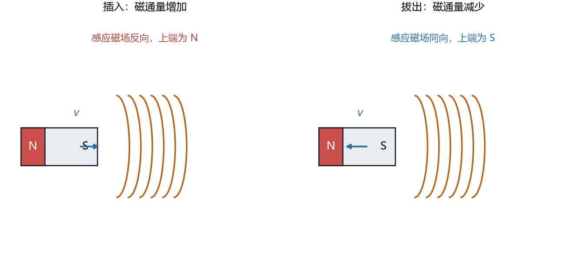
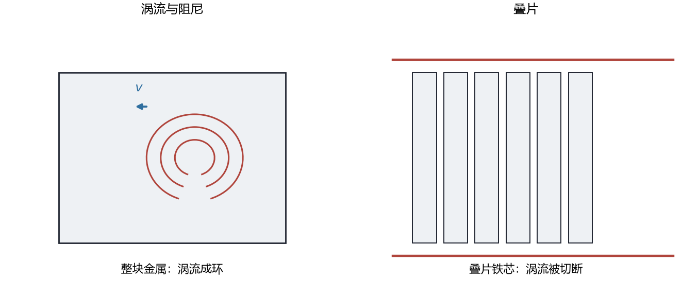
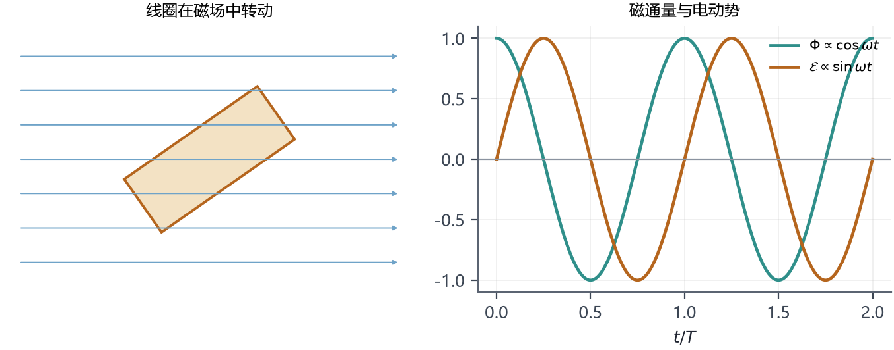

# 第 20 章 楞次定律、涡流与能量

## 20.1 那个负号

法拉第定律里有一个负号：

$$\mathcal{E}=-\frac{d\Phi_B}{dt} . \tag{20.1}$$

这个负号不是书写习惯，它决定了感应电流的方向。如果把它去掉，整个电磁学就会与能量守恒矛盾。

看一个具体的判断。把磁铁的 N 极插进线圈，穿过线圈的磁通量增加，方向向右。感应电流产生的磁场必须阻碍这个增加，所以它要指向左，也就是与磁铁的磁场反向。线圈靠近磁铁的一端变成 N 极，与磁铁的 N 极相斥，阻碍磁铁继续插入。要把磁铁推进去，必须克服这个斥力做功，做的功变成感应电流的能量，最终变成热。

如果反过来，感应电流产生的磁场与磁铁同向，磁铁会被吸引，自动加速进入线圈，动能增加，电流也增加，两者互相促进，能量凭空增长。这违反能量守恒，所以负号必须存在。

楞次在 1834 年把这个规律总结成一句话：感应电流的方向，总是使感应电流产生的磁场阻碍原磁通量的变化。

## 20.2 判断的步骤

判断感应电流方向有一套固定流程，与第三章的受力分析类似。

第一步，确定原磁场的方向与穿过回路的磁通量的增减。磁通量是在增加还是在减少？

第二步，确定感应磁场的方向。如果原磁通量在增加，感应磁场要与之反向；在减少，要与之同向。

第三步，用右手螺旋定则确定电流方向。右手四指沿电流方向弯曲，拇指指向感应磁场的方向。

这三步做完，方向就定了。用的时候不必想能量，只按规则判断，结果自动符合能量守恒。

## 20.3 涡流

前面讨论的感应电流都在导线里，因为导线为电荷提供了通路。整块的金属里也能产生感应电流，叫涡流。

把一块金属板放在磁场中，让磁场穿过它并且随时间变化，或者让金属板在磁场中运动，板内就会出现一圈一圈的电流，形状像水中的漩涡。

涡流有几个效应。

**阻尼。** 一块铜板在磁铁两极之间摆动，会很快停下来。原因是板内产生涡流，涡流又受磁场的安培力，方向与板的运动相反，阻碍运动。这个阻尼不接触、不摩擦，叫电磁阻尼。电表的指针、天平横梁常用它来快速稳定。

**加热。** 高频交变磁场可以让金属内部产生强大的涡流，涡流的焦耳热把金属加热。感应炉炼钢、高频淬火都用这个原理。频率越高，涡流越集中在表面（集肤效应），加热深度越浅。

**损耗。** 变压器的铁芯处在交变磁场中，铁芯里也有涡流，白白发热。减少的办法是把铁芯做成一片一片的硅钢片，片与片之间绝缘，涡流的路径被切断，电阻增大，损耗降低。频率越高，铁芯越要用薄片或铁氧体。

把一块金属完全放在磁场里，让磁场变化，涡流的路径是最外圈。要彻底避免，只能用绝缘材料代替金属。这就是为什么高频线圈的骨架用塑料或陶瓷。

## 20.4 发电机

发电机的原理是把机械能变成电能，用的就是电磁感应。

最简单的模型是一个矩形线圈在匀强磁场中匀速转动。线圈面积 $S$，$N$ 匝，磁场 $B$，角速度 $\omega$。线圈平面的法线与磁场的夹角随时间变化：

$$\theta=\omega t . \tag{20.2}$$

磁通量

$$\Phi=NBS\cos\omega t . \tag{20.3}$$

感应电动势

$$\mathcal{E}=-\frac{d\Phi}{dt}=NBS\omega\sin\omega t . \tag{20.4}$$

电动势是正弦的，最大值 $\mathcal{E}_0=NBS\omega$。

这个结果解释了几件事。转速越高，电动势越大；磁场越强、匝数越多、面积越大，电动势越大。要发出 $50\ \mathrm{Hz}$ 的交流电，转速必须是每秒 $50$ 转（一对磁极），或者用多对磁极降低转速。水轮发电机转速低，磁极对数多；汽轮发电机转速高（$3000\ \mathrm{r/min}$），一对磁极就够。

实际的发电机用电磁铁代替永磁体，转子绕组通直流电产生磁场，定子绕组输出交流电。这样磁场可以调节，输出电压可控。

## 20.5 反电动势与电动机

电动机通电就转，转起来之后它同时也在发电。转子绕组在磁场中转动，切割磁感线，产生感应电动势。这个电动势的方向与外加电压相反，叫反电动势。

对直流电动机，反电动势

$$\mathcal{E}_{\text{反}}=k\omega , \tag{20.5}$$

$k$ 是常数，与绕组、磁极有关。电流由外加电压与反电动势之差决定：

$$I=\frac{U-\mathcal{E}_{\text{反}}}{R} . \tag{20.6}$$

启动瞬间转速为零，反电动势为零，电流最大，等于 $U/R$。这个电流可以是额定电流的十几倍，所以大功率电动机要加启动电阻或软启动器。转起来之后，反电动势增大，电流减小，这是电动机的自动调节机制：负载增大时转速下降，反电动势减小，电流增大，输出力矩增大。

这个机制也解释了为什么电动机不能空转过久：负载太轻时转速升高，反电动势接近外加电压，电流很小，但机械损耗（轴承摩擦、风阻）还在，效率下降。

## 20.6 电磁感应的应用

电磁感应几乎支撑了现代电力系统。发电、变压、输电，全都依赖它。

变压器是两个线圈绕在同一个铁芯上，一个接交流电源（初级），一个接负载（次级）。初级线圈的电流产生交变磁通，磁通穿过次级线圈，产生感应电动势。由法拉第定律，两线圈的电动势之比等于匝数之比：

$$\frac{\mathcal{E}_1}{\mathcal{E}_2}=\frac{N_1}{N_2} . \tag{20.7}$$

理想变压器不损耗能量，$\mathcal{E}_1I_1=\mathcal{E}_2I_2$，所以电流之比与匝数成反比。升压变压器匝数多的一侧电压高、电流小，这正是第十三章讲的输电原理所需要的。

无线充电也用电磁感应。发射线圈通高频交流电，产生交变磁场，接收线圈在这个磁场中产生感应电动势，给电池充电。两个线圈之间没有导线，靠磁场耦合，效率在近距离可以达到百分之八十以上。距离一远，磁通量迅速下降，效率变差。

## 20.7 涡流制动的定量估计

一块金属板在磁场中运动，涡流产生的阻尼力有多大？这个估计能说明阻尼的机制，也能解释为什么铜管里的磁铁下落得那么慢。

设金属板以速度 $v$ 穿过磁场区域，区域的特征尺寸 $a$（磁极的宽度），磁感应强度 $B$。

涡流的大小由法拉第定律估计。板上的一个回路的磁通量约 $Ba^2$，穿过的时间约 $a/v$，所以磁通量变化率约

$$\frac{d\Phi}{dt}\sim\frac{Ba^{2}}{a/v}=Bav . \tag{20.8}$$

感应电动势 $\mathcal{E}\sim Bav$。回路的电阻 $R\sim\rho_e\cdot\dfrac{2a}{a\delta}=\dfrac{2\rho_e}{\delta}$，$\delta$ 是板的厚度。

涡流 $I\sim\mathcal{E}/R\sim Bav\delta/(2\rho_e)$。

阻尼力由安培力给出，$F\sim BIa$，代入：

$$F\sim\frac{B^{2}a^{2}v\delta}{2\rho_e} . \tag{20.9}$$

力与速度成正比，比例系数

$$k\sim\frac{B^{2}a^{2}\delta}{2\rho_e} . \tag{20.10}$$

运动方程 $m\,dv/dt=-kv$，解是 $v=v_0e^{-t/\tau}$，$\tau=m/k$。

代一组数。铜板厚 $5\ \mathrm{mm}$，磁极宽 $5\ \mathrm{cm}$，$B=0.5\ \mathrm{T}$，铜的 $\rho_e=1.68\times10^{-8}$：

$$k\sim\frac{0.25\times2.5\times10^{-3}\times5\times10^{-3}}{2\times1.68\times10^{-8}}\approx93\ \mathrm{N\cdot s/m} . \tag{20.11}$$

一块 $100\ \mathrm{g}$ 的板，$\tau=0.1/93\approx1\ \mathrm{ms}$，几乎立刻停住。

这说明涡流阻尼非常有效，而且与速度成正比，速度越大阻尼越大，最终趋于一个恒定的终端速度（如果重力在拉它）。铜管里磁铁的下落就是这个机制：磁铁的运动在管壁里激起涡流，涡流产生的力与磁铁速度成正比，重力与阻尼平衡，磁铁匀速下落。

如果铜管上开一道竖缝，涡流的回路被切断，阻尼大幅下降，磁铁会掉得快。这个实验能直接验证"涡流需要闭合回路"这一点。

## 20.8 交流电的波形与有效值

发电机产生的电动势是正弦的。实际电网的波形接近正弦，但带有谐波，因为负载不是纯线性。

正弦电压 $u=U_0\sin\omega t$ 的"大小"怎么描述？峰值 $U_0$ 不便于算功率，因为功率与电压的平方成正比，随时间变化。

定义有效值（均方根值）：

$$U_{\text{rms}}=\sqrt{\frac{1}{T}\int_0^{T}u^{2}dt} . \tag{20.12}$$

对正弦波：

$$\frac{1}{T}\int_0^{T}U_0^{2}\sin^{2}\omega t\,dt=U_0^{2}\cdot\frac{1}{2} . \tag{20.13}$$

（因为 $\sin^2$ 在一个周期内的平均值是 $1/2$。）所以

$$U_{\text{rms}}=\frac{U_0}{\sqrt{2}}\approx0.707U_0 . \tag{20.14}$$

家用 $220\ \mathrm{V}$ 是有效值，峰值 $311\ \mathrm{V}$。这个定义的好处是：电阻上的平均功率可以直接用有效值算，$P=U_{\text{rms}}I_{\text{rms}}$，与直流的公式一致。

非正弦波形的有效值要用定义积分算。方波的有效值等于峰值，三角波等于峰值除以 $\sqrt{3}$。万用表测非正弦波时读数可能不准，因为多数表按正弦的峰值或平均值标定，换算系数对别的波形不成立。

## 20.9 完整算一遍：一台发电机

一台发电机，$N=100$ 匝，线圈面积 $S=0.020\ \mathrm{m^2}$，磁极的磁感应强度 $B=0.50\ \mathrm{T}$，转速 $n=3000\ \mathrm{r/min}$。求电动势的峰值与有效值。

角速度

$$\omega=2\pi n=2\pi\times\frac{3000}{60}=2\pi\times50=314\ \mathrm{rad/s} . \tag{20.15}$$

峰值由 (20.4)：

$$\mathcal{E}_0=NBS\omega=100\times0.50\times0.020\times314 . \tag{20.16}$$

分步算：$100\times0.50=50$，$50\times0.020=1.0$，乘 $314$：

$$\mathcal{E}_0=314\ \mathrm{V} . \tag{20.17}$$

有效值

$$\mathcal{E}_{\text{rms}}=\frac{314}{\sqrt{2}}=222\ \mathrm{V} . \tag{20.18}$$

这与家用电压 $220\ \mathrm{V}$ 几乎一样。这不是巧合：电网的频率是 $50\ \mathrm{Hz}$，转速与极对数配合使 $\omega=2\pi\times50$，线圈参数按需要的电压设计。$3000\ \mathrm{r/min}$ 正好是每秒五十转，一对磁极，输出 $50\ \mathrm{Hz}$。

频率

$$f=\frac{\omega}{2\pi}=50\ \mathrm{Hz} , \tag{20.19}$$

周期 $T=20\ \mathrm{ms}$。

再看变压器。初级 $N_1=1000$ 匝接 $220\ \mathrm{V}$，次级 $N_2=50$ 匝。由 (20.7)：

$$U_2=U_1\frac{N_2}{N_1}=220\times\frac{50}{1000}=11\ \mathrm{V} . \tag{20.20}$$

次级接 $5.5\ \Omega$ 的负载，电流

$$I_2=\frac{U_2}{R}=\frac{11}{5.5}=2.0\ \mathrm{A} , \tag{20.21}$$

输出功率 $22\ \mathrm{W}$。理想变压器输入功率等于输出功率，所以初级电流

$$I_1=\frac{P}{U_1}=\frac{22}{220}=0.10\ \mathrm{A} . \tag{20.22}$$

用匝数比核对：$I_1/I_2=N_2/N_1=0.05$，$0.10/2.0=0.05$，一致。

实际变压器的效率约 $0.9$ 到 $0.98$，初级电流要比理想值大百分之几。小型变压器效率低，大型电力变压器效率高。

## 20.10 常见误解

**楞次定律不是"感应电流总是阻碍运动"。** 它阻碍的是磁通量的变化。磁铁插入时线圈排斥磁铁，看起来像"阻碍运动"，那是因为运动正是磁通量变化的原因。如果磁通量的变化由别的原因引起（比如另一个线圈的电流变化），感应电流阻碍的是那个变化，与机械运动无关。

**涡流不总是有害的。** 变压器铁芯里的涡流是损耗，要抑制；感应加热、电磁制动、金属探测器里的涡流是功能，要利用。同一现象的两面，取决于设计目标。

**发电机与电动机是同一个装置的两个方向。** 通电就转是电动机，转动就发电是发电机。反电动势的存在说明两者同时发生：电动机在转的时候也在发电，只是反电动势的方向与外加电压相反，净电流由两者之差决定。

**交流电的"220 V"是有效值，不是峰值。** 峰值是 $311\ \mathrm{V}$，绝缘设计、电容耐压都要按峰值考虑。用万用表测交流电压，读数通常是有效值（真有效值表）或按正弦标定的平均值（普通表），非正弦波形的读数可能偏差很大。

## 20.11 再算一遍：变压器与输电线

一台单相变压器，容量 $S=1.0\ \mathrm{kVA}$，初级 $220\ \mathrm{V}$、次级 $22\ \mathrm{V}$。求两边的额定电流与匝数比。

匝数比

$$\frac{N_1}{N_2}=\frac{220}{22}=10 . \tag{20.23}$$

额定电流（按视在功率算）：

$$I_1=\frac{S}{U_1}=\frac{1000}{220}=4.5\ \mathrm{A} , \tag{20.24}$$

$$I_2=\frac{S}{U_2}=\frac{1000}{22}=45\ \mathrm{A} . \tag{20.25}$$

次级电流是初级的十倍，与匝数比相反。次级绕组要用更粗的导线，否则 $I^2R$ 损耗太大。

用这个变压器给 $1.0\ \mathrm{kW}$ 的负载供电，负载电流 $45\ \mathrm{A}$，负载电阻

$$R=\frac{U_2}{I_2}=\frac{22}{45}=0.49\ \Omega . \tag{20.26}$$

从初级看进去的等效电阻

$$R_1=R\left(\frac{N_1}{N_2}\right)^{2}=0.49\times100=49\ \Omega . \tag{20.27}$$

核对：$U_1/I_1=220/4.5=49\ \Omega$，一致。

再看输电线。发电厂输出 $P=100\ \mathrm{MW}$，用 $220\ \mathrm{kV}$ 输送，线路总电阻 $R_{\text{线}}=5.0\ \Omega$。电流

$$I=\frac{P}{U}=\frac{1.0\times10^{8}}{2.2\times10^{5}}=455\ \mathrm{A} . \tag{20.28}$$

线路损耗

$$P_{\text{损}}=I^{2}R_{\text{线}}=455^{2}\times5.0=2.07\times10^{5}\times5.0=1.03\times10^{6}\ \mathrm{W}\approx1.0\ \mathrm{MW} , \tag{20.29}$$

占输送功率的百分之一。如果改用 $22\ \mathrm{kV}$ 输送，电流增大十倍，损耗增大一百倍，达到 $100\ \mathrm{MW}$，与输送功率相同，输电失去意义。

这两个例子说明了变压器的两个作用：变换电压以匹配负载，变换阻抗以匹配前级；以及高压输电的经济性来自 $I^2R$ 中的电流可以被电压"摊薄"。

## 20.12 再算一遍：涡流制动的终端速度

一块磁铁在竖直铜管中下落，管壁厚度 $\delta=2.0\ \mathrm{mm}$，磁铁在管壁处产生的场 $B=0.30\ \mathrm{T}$，磁极尺寸 $a=2.0\ \mathrm{cm}$。求终端速度。

由 (20.10) 的估算，阻尼系数

$$k\sim\frac{B^{2}a^{2}\delta}{2\rho_e}=\frac{0.09\times4.0\times10^{-4}\times2.0\times10^{-3}}{2\times1.68\times10^{-8}} . \tag{20.30}$$

分子 $0.09\times4.0\times10^{-4}=3.6\times10^{-5}$，乘 $2.0\times10^{-3}$ 得 $7.2\times10^{-8}$。分母 $3.36\times10^{-8}$：

$$k\approx2.1\ \mathrm{N\cdot s/m} . \tag{20.31}$$

磁铁质量取 $m=20\ \mathrm{g}=0.020\ \mathrm{kg}$，重力 $mg=0.196\ \mathrm{N}$。终端速度由 $mg=kv$ 给出：

$$v=\frac{0.196}{2.1}=9.3\times10^{-2}\ \mathrm{m/s}\approx9\ \mathrm{cm/s} . \tag{20.32}$$

每秒九厘米。一米长的管子要十几秒才落到底，与实验中观察到的"缓慢滑落"相符。

如果换成铝管，电阻率是铜的 1.6 倍，$k$ 降到约 $1.3$，终端速度变成 $15\ \mathrm{cm/s}$，明显更快。如果管壁开竖缝，涡流回路被切断，$k$ 大幅下降，磁铁几乎自由落体。这三个对比都可以在课堂上做，是楞次定律最直观的演示。

### 集肤深度

交变电流在导体里不是均匀分布的，越靠近表面电流密度越大。特征深度叫集肤深度：

$$\delta=\sqrt{\frac{2}{\omega\mu\sigma_e}} . \tag{20.33}$$

铜的 $\sigma_e=6.0\times10^{7}\ \mathrm{S/m}$，$\mu=\mu_0=4\pi\times10^{-7}\ \mathrm{H/m}$。

工频 $50\ \mathrm{Hz}$，$\omega=314$：

$$\delta=\sqrt{\frac{2}{314\times4\pi\times10^{-7}\times6.0\times10^{7}}}=\sqrt{\frac{2}{2.37\times10^{4}}}=\sqrt{8.4\times10^{-5}}=9.2\times10^{-3}\ \mathrm{m} . \tag{20.34}$$

九点二毫米。这个深度大于常见的导线半径（几毫米），所以工频下电流基本是均匀的。

频率 $100\ \mathrm{kHz}$，$\omega=6.28\times10^{5}$：

$$\delta=\sqrt{\frac{2}{6.28\times10^{5}\times7.54\times10^{-1}}}=\sqrt{\frac{2}{4.73\times10^{7}}}=2.1\times10^{-4}\ \mathrm{m} , \tag{20.35}$$

零点二一毫米。这个深度小于导线半径，电流集中在表面一层，有效截面积减小，等效电阻增大。

集肤效应解释了为什么高频线圈要用多股细线（利兹线）或者空心铜管：把导体分成许多互相绝缘的细丝，每根细丝的直径小于集肤深度，电流就能均匀分布。也解释了为什么高频感应加热只加热工件表面：热量集中在集肤深度以内。

### 发电机的损耗从哪来

一台 $10\ \mathrm{kW}$ 的发电机，输入机械功率 $12\ \mathrm{kW}$，效率约 $83\%$。损耗分四块：绕组的铜损 $I^2R$、铁芯的铁损（磁滞与涡流）、机械损耗（轴承摩擦与风阻）、励磁损耗。

铜损与负载电流的平方成正比，负载越重越大；铁损与磁感应强度、频率有关，与负载基本无关（只要电压不变）；机械损耗与转速有关。这三类损耗的分离方法叫"空载试验"与"短路试验"：空载时测出的功率主要是铁损与机械损耗，短路时测出的主要是铜损。

这些测试的思路与第十二章测内阻的两次负载法一样：改变一个条件，让某一类损耗单独显现，再解方程。工程上的测量很少能"直接读出一个量"，多半是设计几种工况，联立求解。

---

这一章解释了法拉第定律的负号，给出了判断感应电流方向的楞次定律，讨论了涡流的三种效应，并推导了发电机的电动势。核心式子 (20.4) 与 (20.7) 是交流电技术的基础。

感应现象里有一个量还没有定义：线圈自己产生的磁场变化，会不会在自己身上产生电动势？答案是会，这就是自感，下一章处理。
