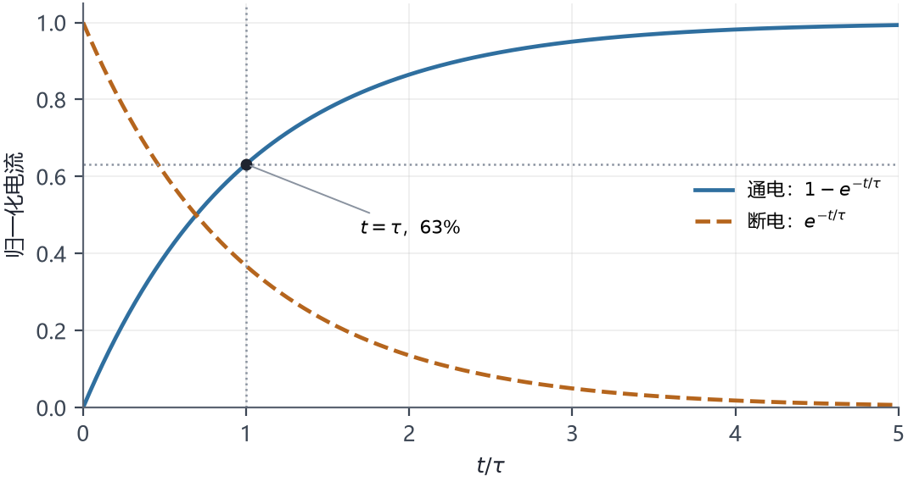
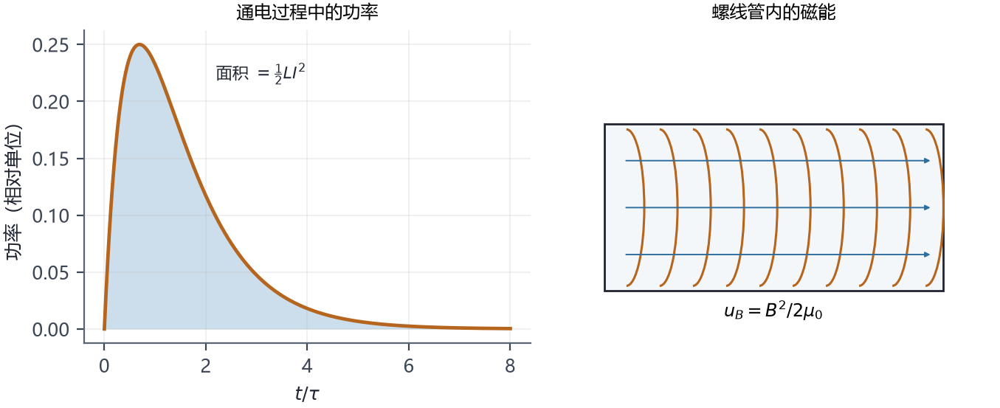
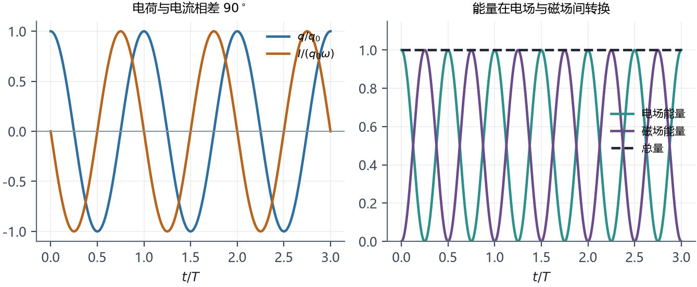

# 第 21 章 自感、互感与磁场能量

## 21.1 拉闸时的火花

一个绕了几百匝的线圈接在直流电源上，电流稳定后突然断开开关。开关处会跳出一个小火花，有时能把人手电一下。

断开之后电源已经不供电，电流应该立刻变成零，火花从哪来？线圈里的电流不能突变，它要维持一会儿，这个"维持"靠的是线圈自己产生的感应电动势。

这个现象叫自感。线圈通电时产生磁场，磁场穿过线圈本身，磁通量随电流变化。电流变化，磁通量变化，就产生感应电动势。这个电动势的方向总是阻碍电流的变化：电流增大时它反向，电流减小时它同向。

## 21.2 自感系数

线圈的磁通量与电流成正比（在无铁芯的情形下）：

$$\Phi_B=LI , \tag{21.1}$$

$L$ 是自感系数，单位亨利，$1\ \mathrm{H}=1\ \mathrm{Wb/A}=1\ \mathrm{V\cdot s/A}$。

由法拉第定律，自感电动势

$$\mathcal{E}_L=-N\frac{d\Phi_B}{dt}=-L\frac{dI}{dt} . \tag{21.2}$$

对 $N$ 匝线圈，$\Phi_B$ 是穿过每一匝的磁通量，$N\Phi_B$ 是总磁链。把 $L$ 定义成总磁链除以电流，公式就不用写 $N$ 了。

自感系数由线圈的几何决定，与电流无关（无铁芯时）。线圈越长、匝数越多、截面积越大，自感越大；有铁芯时 $L$ 大得多，因为 $\mu_r$ 很大。

## 21.3 螺线管的自感

长螺线管，长度 $l$、截面积 $A$、单位长度 $n$ 匝，总匝数 $N=nl$。管内磁场 $B=\mu_0nI$，穿过每匝的磁通量 $\Phi_B=BA=\mu_0nIA$。总磁链

$$N\Phi_B=nl\cdot\mu_0nIA=\mu_0n^{2}lAI . \tag{21.3}$$

自感

$$L=\frac{N\Phi_B}{I}=\mu_0n^{2}lA=\mu_0n^{2}V , \tag{21.4}$$

$V=lA$ 是螺线管内部的体积。有铁芯时乘 $\mu_r$。

代一组数。$n=1000\ \mathrm{m^{-1}}$（每厘米十匝），$l=0.2\ \mathrm{m}$，$A=10^{-3}\ \mathrm{m^2}$：

$$L=4\pi\times10^{-7}\times10^{6}\times0.2\times10^{-3}\approx2.5\times10^{-4}\ \mathrm{H}=0.25\ \mathrm{mH} . \tag{21.5}$$

亨利的单位很大，常见的电感是毫亨、微亨。要做出 $1\ \mathrm{H}$ 的电感，需要几千匝绕在铁芯上。

## 21.4 LR 电路

一个电感 $L$、一个电阻 $R$、一个电源 $\mathcal{E}$ 串联。合上开关，电流从零开始增长。

由基尔霍夫回路定律：

$$\mathcal{E}-L\frac{dI}{dt}-RI=0 . \tag{21.6}$$

这是一个一阶线性微分方程。整理：

$$\frac{dI}{dt}=\frac{\mathcal{E}-RI}{L} . \tag{21.7}$$

分离变量：

$$\frac{dI}{\mathcal{E}-RI}=\frac{dt}{L} . \tag{21.8}$$

两边积分，从 $t=0$ 时 $I=0$ 到 $t$ 时 $I$：

$$\int_0^I\frac{dI'}{\mathcal{E}-RI'}=\int_0^t\frac{dt'}{L} . \tag{21.9}$$

左边的积分换元 $u=\mathcal{E}-RI'$，$du=-R\,dI'$：

$$\int\frac{dI'}{\mathcal{E}-RI'}=-\frac{1}{R}\ln\left(\mathcal{E}-RI'\right) . \tag{21.10}$$

代入上下限：

$$-\frac{1}{R}\left[\ln\left(\mathcal{E}-RI\right)-\ln\mathcal{E}\right]=\frac{t}{L} . \tag{21.11}$$

整理：

$$\ln\frac{\mathcal{E}-RI}{\mathcal{E}}=-\frac{R}{L}t . \tag{21.12}$$

取指数：

$$\mathcal{E}-RI=\mathcal{E}e^{-Rt/L} . \tag{21.13}$$

解出电流：

$$I=\frac{\mathcal{E}}{R}\left(1-e^{-Rt/L}\right) . \tag{21.14}$$

电流从零指数增长，最终趋于 $\mathcal{E}/R$。特征时间

$$\tau=\frac{L}{R} \tag{21.15}$$

叫时间常数。$t=\tau$ 时电流达到最终值的 $63\%$（因为 $1-e^{-1}=0.632$），$t=3\tau$ 时达到 $95\%$。

时间常数可以很大。一个 $1\ \mathrm{H}$ 的电感串 $10\ \Omega$ 的电阻，$\tau=0.1\ \mathrm{s}$，电流要零点几秒才稳定。这就是为什么大电感电路不能瞬间断开：电流被"拖住"了。

## 21.5 断电

把电源断开，回路变成电感与电阻的闭合回路（假设开关把电源短路）：

$$-L\frac{dI}{dt}-RI=0\quad\Rightarrow\quad\frac{dI}{dt}=-\frac{R}{L}I . \tag{21.16}$$

分离变量积分：

$$I=I_0e^{-Rt/L} . \tag{21.17}$$

电流指数衰减。这个电流由电感维持，能量来自电感储存的磁能。

如果开关断开时电路没有闭合路径，电流被迫迅速降到零，$dI/dt$ 很大，自感电动势 $-L\,dI/dt$ 可以达到几千伏。这个电压加在开关的间隙上，把空气击穿，形成火花。汽车点火线圈就是利用这个原理：初级线圈断电，次级线圈感应出上万伏的高压，击穿火花塞间隙。

保护电路的办法是在电感两端并联一个二极管（续流二极管），给电流一条通路，让它慢慢衰减，不产生高压。

## 21.6 互感

两个线圈靠近，一个线圈的电流变化会在另一个线圈中产生感应电动势。这个效应叫互感。

线圈 1 的电流 $I_1$ 产生的磁场穿过线圈 2 的磁通量 $\Phi_{21}$，与 $I_1$ 成正比：

$$\Phi_{21}=M_{21}I_1 . \tag{21.18}$$

线圈 2 中的感应电动势

$$\mathcal{E}_2=-M_{21}\frac{dI_1}{dt} . \tag{21.19}$$

可以证明 $M_{12}=M_{21}=M$，这个量叫互感系数，单位也是亨利。证明要用到磁场的互易性（一个电流产生的穿过另一个回路的磁通量，等于反过来），这里直接引用结论。

互感的大小与两个线圈的几何、相对位置、铁芯有关。两个线圈完全耦合（磁通全部穿过对方）时，$M=\sqrt{L_1L_2}$；一般情形写成

$$M=k\sqrt{L_1L_2} , \tag{21.20}$$

$k$ 是耦合系数，$0\le k\le1$。变压器的 $k$ 接近 1，松散耦合的线圈 $k$ 可能只有 0.1。

互感是变压器的物理基础。它也有害处：电路里两个相邻的电感会互相干扰，布线时要把它们分开或垂直放置，减小耦合。

## 21.7 磁场的能量

给电感通电要做功。在电流从零增长到 $I$ 的过程中，电源要克服自感电动势做功：

$$W=\int_0^t\mathcal{E}_L I\,dt=\int_0^t L\frac{dI}{dt}I\,dt=\int_0^I LI'\,dI'=\frac{1}{2}LI^{2} . \tag{21.21}$$

这部分能量储存在磁场里。断电时它通过电阻释放出来，变成热。

与电容的能量 $\frac{1}{2}CU^2$ 对比，形式相同：电感对应电容，电流对应电压。

把螺线管的自感 (21.4) 代入：

$$W=\frac{1}{2}\mu_0n^{2}V I^{2} . \tag{21.22}$$

管内磁场 $B=\mu_0nI$，所以 $nI=B/\mu_0$，代入：

$$W=\frac{1}{2}\mu_0\left(\frac{B}{\mu_0}\right)^{2}V=\frac{B^{2}}{2\mu_0}V . \tag{21.23}$$

除以体积，得磁能密度

$$u_B=\frac{B^{2}}{2\mu_0} . \tag{21.24}$$

有介质时写成 $B^2/(2\mu)$ 或 $\frac{1}{2}\mu H^2$。这个式子的形式与电场能量密度 $\frac{1}{2}\varepsilon_0E^2$ 对称，两者的和为

$$u=\frac{1}{2}\varepsilon_0E^{2}+\frac{B^{2}}{2\mu_0} . \tag{21.25}$$

这就是电磁场的总能量密度。第二十七章会用它算电磁波的能量。

## 21.8 电感的量级与应用

电感的储能密度不如电容与电池。一个 $1\ \mathrm{H}$、$1\ \mathrm{A}$ 的电感储能 $0.5\ \mathrm{J}$，同体积的电容可以储几百焦。电感的优势是功率密度高，能瞬间放出大电流，所以感应炮、电磁弹射用线圈而不是电容。

电感在电路里主要用于滤波与储能变换。开关电源的核心是一个电感，它把能量从输入搬到输出，通过控制开关的通断比例调节输出电压。这个过程中电感电流连续，能量在磁场与负载之间来回传递。

## 21.9 LC 振荡

一个电容与一个电感接成回路，没有电源、没有电阻。把电容充电后闭合开关，会发生什么？

电容上的电荷通过电感放电，电流增大；电流在电感里建立磁场，自感电动势阻碍电流增大；电荷放完时电流最大，磁场能量最大；然后电感维持电流继续流动，给电容反向充电；电荷反向到最大时电流为零，磁场能量全部转回电场。如此往复。

写方程。设电容上的电荷为 $q$，电流 $I=dq/dt$（取放电方向为正）。回路上没有电源，基尔霍夫定律给出

$$\frac{q}{C}+L\frac{dI}{dt}=0 . \tag{21.26}$$

代入 $I=dq/dt$：

$$L\frac{d^{2}q}{dt^{2}}+\frac{q}{C}=0\quad\Rightarrow\quad\frac{d^{2}q}{dt^{2}}=-\frac{1}{LC}q . \tag{21.27}$$

这是一个简谐振动方程。它的解是

$$q=q_0\cos\left(\omega t+\phi\right),\qquad\omega=\frac{1}{\sqrt{LC}} . \tag{21.28}$$

验证：求两次导，$d^2q/dt^2=-\omega^2q$，代入 (21.27)，需要 $\omega^2=1/(LC)$，与 (21.28) 一致。

电流

$$I=\frac{dq}{dt}=-q_0\omega\sin\left(\omega t+\phi\right) . \tag{21.29}$$

电荷与电流相位差 $90^\circ$：电荷最大时电流为零，电荷为零时电流最大。

能量在电场与磁场之间来回转换：

$$W=\frac{q^{2}}{2C}+\frac{1}{2}LI^{2} . \tag{21.30}$$

代入解，$q^2/(2C)=\left(q_0^2/2C\right)\cos^2$，$LI^2/2=\left(q_0^2\omega^2L/2\right)\sin^2=\left(q_0^2/2C\right)\sin^2$，相加得 $q_0^2/(2C)$，是常数。

振荡频率

$$f=\frac{1}{2\pi\sqrt{LC}} . \tag{21.31}$$

这个式子说明：$L$ 与 $C$ 越大，频率越低。收音机的调谐回路就是改变电容（可变电容）来改变频率，选中不同的电台。中波广播的频率是 $530$ 到 $1600\ \mathrm{kHz}$，对应的 $LC$ 乘积在 $10^{-11}$ 到 $10^{-10}\ \mathrm{s^2}$ 量级。

## 21.10 阻尼振荡

真实的 LC 回路总有电阻。加上电阻后，方程变成

$$L\frac{d^{2}q}{dt^{2}}+R\frac{dq}{dt}+\frac{q}{C}=0 . \tag{21.32}$$

这是一个阻尼振动方程。解的形式取决于阻尼的大小。

定义阻尼系数 $\gamma=R/(2L)$ 与固有频率 $\omega_0=1/\sqrt{LC}$。当 $\gamma<\omega_0$（欠阻尼）：

$$q=q_0e^{-\gamma t}\cos\left(\omega t+\phi\right),\qquad\omega=\sqrt{\omega_0^{2}-\gamma^{2}} . \tag{21.33}$$

振幅指数衰减，频率略低于固有频率。当 $\gamma>\omega_0$（过阻尼），解是两个指数衰减的叠加，不振荡。当 $\gamma=\omega_0$（临界阻尼），衰减最快，也不振荡。

临界阻尼条件 $R=2\sqrt{L/C}$。这个值在电路设计中用来抑制振铃：如果开关电源的输出滤波有 LC，突加负载时会振荡，串一个合适的电阻（或用有损电感）可以让它快速稳定而不振荡。

这个方程与力学里的阻尼振子完全同构：$L$ 对应质量，$R$ 对应阻尼系数，$1/C$ 对应弹簧常数。这个对应关系在分析机械振动与电磁振荡时可以互相借用，是"同构"的一个典型例子。

## 21.11 变压器

互感最有用的应用是变压器。两个线圈绕在同一个铁芯上，初级接交流电源，次级接负载。

铁芯把磁通量约束在一条路径里，两个线圈几乎共享全部磁通（耦合系数 $k\approx1$）。设初级 $N_1$ 匝、次级 $N_2$ 匝，铁芯中的磁通量 $\Phi$。

由法拉第定律，两个线圈的感应电动势

$$\mathcal{E}_1=-N_1\frac{d\Phi}{dt},\qquad\mathcal{E}_2=-N_2\frac{d\Phi}{dt} . \tag{21.34}$$

相除：

$$\frac{\mathcal{E}_1}{\mathcal{E}_2}=\frac{N_1}{N_2} . \tag{21.35}$$

电压比等于匝数比。

理想变压器不损耗能量，输入功率等于输出功率：

$$\mathcal{E}_1I_1=\mathcal{E}_2I_2\quad\Rightarrow\quad\frac{I_1}{I_2}=\frac{N_2}{N_1} . \tag{21.36}$$

升压时电压升高、电流降低，降压时反过来。这个关系是第十三章"高压输电"的基础：发电厂用升压变压器把电压升到几十万伏，到了用户端再用降压变压器降到 220 V。

初级线圈的电流由负载决定，不是由电源决定。负载越大（电阻越小），次级电流越大，反射到初级的电流也越大。从初级看进去，变压器把负载电阻变换成

$$R_{1}=R_{2}\left(\frac{N_1}{N_2}\right)^{2} . \tag{21.37}$$

这个关系叫阻抗变换，在音频放大器里用来匹配扬声器与输出级。

实际变压器有损耗：铜损（绕组电阻）、铁损（磁滞与涡流）。效率高的电力变压器可以到 98% 以上，小型的开关电源变压器只有 80% 到 90%。

变压器只能用于交流。直流下磁通量不变，次级没有感应电动势，而且初级电流只受绕组电阻限制，会烧毁。这一点在实验里要特别注意。

## 21.12 完整算一遍：一个 0.1 mH 电感

一个电感 $L=0.10\ \mathrm{mH}$，通电流 $I=1.0\ \mathrm{A}$。求储存的磁能；再用螺线管参数核对这个电感值。

磁能

$$W=\frac{1}{2}LI^{2}=\frac{1}{2}\times1.0\times10^{-4}\times1.0^{2}=5.0\times10^{-5}\ \mathrm{J}=50\ \mathrm{\mu J} . \tag{21.38}$$

五十微焦。这个能量很小，但可以在极短时间内释放：如果断电时间 $1\ \mathrm{\mu s}$，平均功率

$$P\sim\frac{W}{\Delta t}=\frac{5.0\times10^{-5}}{1.0\times10^{-6}}=50\ \mathrm{W} , \tag{21.39}$$

自感电动势

$$\mathcal{E}=L\frac{\Delta I}{\Delta t}=1.0\times10^{-4}\times\frac{1.0}{1.0\times10^{-6}}=100\ \mathrm{V} . \tag{21.40}$$

一百伏，足以在开关处打一个小火花。

核对电感值。设这个电感是 $N=200$ 匝、截面积 $A=2.5\ \mathrm{cm^2}=2.5\times10^{-4}\ \mathrm{m^2}$、长 $l=0.10\ \mathrm{m}$ 的空心螺线管。由 (21.4)，$n=N/l=2000\ \mathrm{m^{-1}}$：

$$L=\mu_0n^{2}lA=4\pi\times10^{-7}\times4.0\times10^{6}\times0.10\times2.5\times10^{-4} . \tag{21.41}$$

分步：$4\pi\times10^{-7}\times4.0\times10^{6}=5.03$，$0.10\times2.5\times10^{-4}=2.5\times10^{-5}$：

$$L=5.03\times2.5\times10^{-5}=1.26\times10^{-4}\ \mathrm{H}\approx0.13\ \mathrm{mH} . \tag{21.42}$$

与题目给的 $0.10\ \mathrm{mH}$ 同量级，差别来自端部效应（有限长螺线管的实际电感略小于长管公式）。

## 21.13 完整算一遍：LR 电路的时间常数

一个 $L=0.10\ \mathrm{H}$ 的电感与 $R=10\ \Omega$ 的电阻串联，接 $\mathcal{E}=10\ \mathrm{V}$ 的电源（内阻忽略）。求时间常数、稳态电流、以及电流达到稳态值 $63\%$ 与 $95\%$ 的时间。

时间常数

$$\tau=\frac{L}{R}=\frac{0.10}{10}=1.0\times10^{-2}\ \mathrm{s}=10\ \mathrm{ms} . \tag{21.43}$$

稳态电流

$$I_\infty=\frac{\mathcal{E}}{R}=\frac{10}{10}=1.0\ \mathrm{A} . \tag{21.44}$$

由 (21.14)，$t=\tau$ 时

$$I=1.0\times\left(1-e^{-1}\right)=1.0\times0.632=0.63\ \mathrm{A} , \tag{21.45}$$

这就是"达到稳态值 $63\%$"的时间，即 $10\ \mathrm{ms}$。

$t=3\tau=30\ \mathrm{ms}$ 时

$$I=1.0\times\left(1-e^{-3}\right)=1.0\times0.950=0.95\ \mathrm{A} , \tag{21.46}$$

达到 $95\%$。

核对初始斜率：$t=0$ 时 $dI/dt=\mathcal{E}/L=10/0.10=100\ \mathrm{A/s}$。如果按这个斜率一直增长，达到 $1\ \mathrm{A}$ 需要 $10\ \mathrm{ms}$，正好是 $\tau$。时间常数的物理意义就是"按初始斜率增长到稳态值所需的时间"。

把 $L$ 换成 $1.0\ \mathrm{H}$，$\tau=0.10\ \mathrm{s}$，达到 $95\%$ 要 $0.30\ \mathrm{s}$。这就是为什么大电感电路的电流建立很慢，也是开关电源要用高频的原因：频率高，周期短，必须用小电感，否则每个周期内电流来不及建立。

## 21.14 常见误解

**电感"阻碍电流"其实是阻碍电流的变化。** 稳态电流通过电感时没有任何阻碍（理想电感电阻为零），只有电流变化时才产生自感电动势。所以"电感对直流相当于短路，对交流相当于开路"这句话只在稳态意义下成立：直流稳态时阻抗为零，频率越高感抗 $\omega L$ 越大。

**自感电动势的方向由电流的变化方向决定，不是由电流的方向决定。** 电流增大时，自感电动势与电流反向；电流减小时，与电流同向。判断时先看 $dI/dt$ 的符号，再定方向。

**磁能储存在磁场里，不在电流里。** 电流只是建立磁场的条件。断电后电流消失，但磁场能量要通过感应电流释放出来，最终变成热或辐射。这也解释了为什么断开电感电路会打火：能量必须有去处。

**变压器不能变换直流。** 直流下磁通量不变，次级没有感应电动势；同时初级电流只受绕组电阻限制，会过大烧毁。变压器只能用于交流，或者用于开关电源里高频斩波后的脉冲。

### 一个完整的开关过程

电感 $L=0.20\ \mathrm{H}$、电阻 $R=20\ \Omega$ 串联，接 $12\ \mathrm{V}$ 电源。求稳态电流，以及通电 $20\ \mathrm{ms}$ 时的电流。

时间常数

$$\tau=\frac{L}{R}=\frac{0.20}{20}=1.0\times10^{-2}\ \mathrm{s}=10\ \mathrm{ms} . \tag{21.47}$$

稳态电流

$$I_\infty=\frac{\mathcal{E}}{R}=\frac{12}{20}=0.60\ \mathrm{A} . \tag{21.48}$$

$t=20\ \mathrm{ms}=2\tau$ 时，指数因子 $e^{-2}=0.135$：

$$I=0.60\times\left(1-0.135\right)=0.60\times0.865=0.52\ \mathrm{A} . \tag{21.49}$$

已经达到稳态的百分之八十七。

此时电感上的电压 $L\,dI/dt$：对 (21.14) 求导，$dI/dt=(\mathcal{E}/L)e^{-t/\tau}$，$t=2\tau$ 时

$$\frac{dI}{dt}=\frac{12}{0.20}\times0.135=60\times0.135=8.1\ \mathrm{A/s} , \tag{21.50}$$

$$U_L=L\frac{dI}{dt}=0.20\times8.1=1.6\ \mathrm{V} . \tag{21.51}$$

电阻上的电压 $IR=0.52\times20=10.4\ \mathrm{V}$。两者相加 $1.6+10.4=12.0\ \mathrm{V}$，等于电源电压。这个核对说明回路定律在暂态也成立：任意时刻，三个电压的代数和为零。

储能此时为

$$W=\frac{1}{2}LI^{2}=\frac{1}{2}\times0.20\times0.52^{2}=2.7\times10^{-2}\ \mathrm{J} , \tag{21.52}$$

而稳态储能是 $\frac{1}{2}\times0.20\times0.60^2=3.6\times10^{-2}\ \mathrm{J}$。两者的差别就是还没建立的那部分磁场。

### 磁能与电感的测量

电感值可以用谐振法测：把电感与一个已知电容接成 LC 回路，测谐振频率，由 $f=1/(2\pi\sqrt{LC})$ 反解 $L$。这个方法比直接测 $L\,dI/dt$ 准，因为频率的测量精度很高。

用上面的数：$L=0.20\ \mathrm{H}$、$C=100\ \mathrm{pF}$，谐振频率

$$f=\frac{1}{2\pi\sqrt{0.20\times1.0\times10^{-10}}}=\frac{1}{2\pi\times4.47\times10^{-6}}=\frac{1}{2.81\times10^{-5}}=3.6\times10^{4}\ \mathrm{Hz} . \tag{21.53}$$

三十六千赫。这个频率落在音频范围，用示波器或频率计都能测准。

如果实测频率是 $36.2\ \mathrm{kHz}$，反解

$$L=\frac{1}{4\pi^{2}f^{2}C}=\frac{1}{4\pi^{2}\times1.31\times10^{9}\times1.0\times10^{-10}}=\frac{1}{5.17}=0.193\ \mathrm{H} , \tag{21.54}$$

与标称值差百分之三点五，可能是电感的分布电容与引线电感造成的。真实的电感在谐振频率附近不是纯电感，测量时要考虑寄生参数。这一点与实际电容器的自谐振是同一类问题。

### 互感耦合的符号

两个线圈的互感电动势方向取决于绕向与相对位置。变压器设计时，初级与次级用不同的绕法（同向绕或反向绕），输出的相位会差 $180^\circ$。电路图上的同名端标记（小圆点）就是用来标明相位的：同名端电位同相。

如果接反了，两个次级绕组串联时电压相减而不是相加，输出电压可能接近零。这种故障在变压器、音频输出变压器里很常见，检查的办法是用示波器看两路波形是否反相。

互感系数 $M$ 本身取正值，符号体现在 $M\,dI/dt$ 前的正负号上，由绕向与参考方向决定。写方程时先约定两个线圈的电流正方向与磁通量的正方向，再把 $M$ 的符号定下来，避免一路错到底。

---

这一章补上了电磁感应里"自己感应自己"的部分。自感系数只由几何决定，LR 电路的时间常数 $L/R$ 决定电流变化的快慢，磁能密度 $B^2/2\mu_0$ 与电场能量密度对称。

到此为止，四个电磁定律的积分形式都有了：高斯定理（电场）、磁场高斯定理、安培环路定理、法拉第定律。第六篇把这些积分形式改写成微分形式，补上位移电流，得到完整的麦克斯韦方程组。
