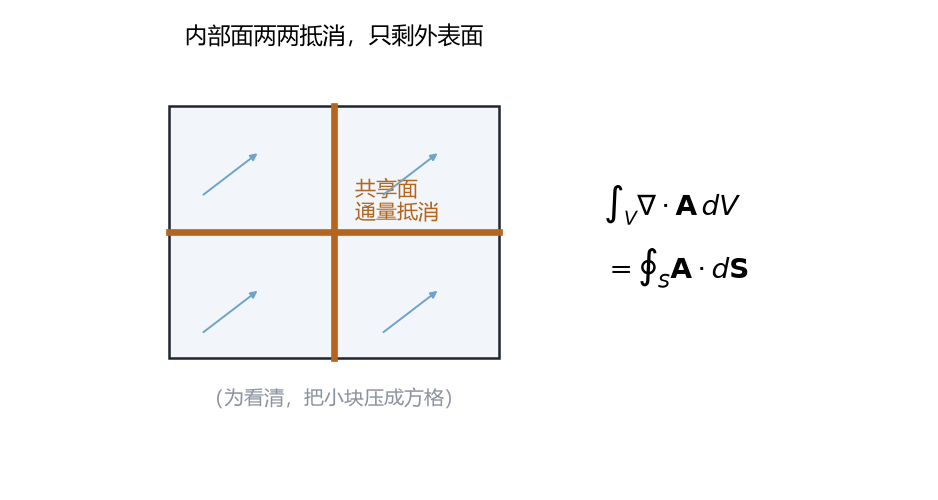
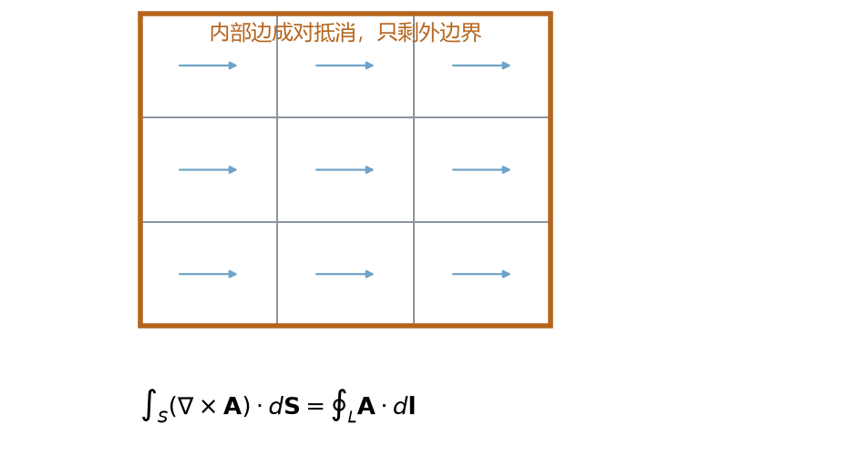
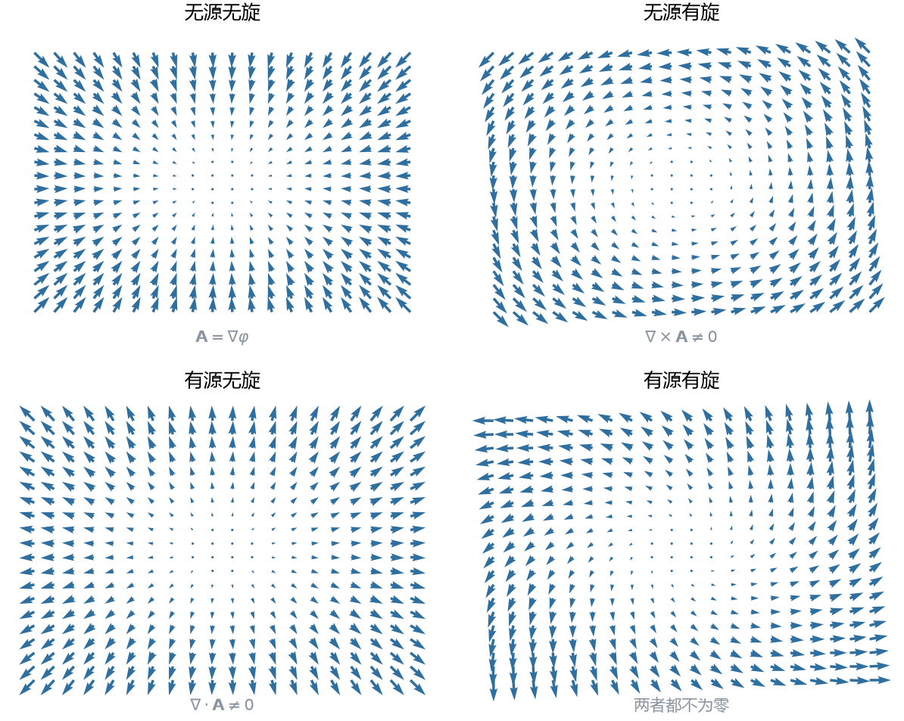

# 第 22 章 矢量场：通量、环量与两个积分定理

## 22.1 从整体到局部

前面五篇得到的每一条定律都是积分形式：对曲面求通量，对回路求环量。这种写法适合有对称性的问题，但不回答一个局部的问题：空间某一点的电场，由什么决定？

拿高斯定理来说。$\oint\mathbf{E}\cdot d\mathbf{S}=Q/\varepsilon_0$ 说的是"整个闭合曲面的通量等于内部电荷除以 $\varepsilon_0$"。它没有说"某一点的场与那里的电荷密度有什么关系"。要看局部关系，得把曲面缩小到一点，让积分变成微分。

这个转换需要两个数学定理：高斯定理与斯托克斯定理。它们把面积分、线积分换成体积分、面积分，从而把"整体的量"与"局部的量"联系起来。

## 22.2 标量场与矢量场

空间中每一点对应一个数，叫标量场。温度分布、电势分布、压强分布都是标量场，记作 $\varphi(\mathbf{r})$ 或 $f(x,y,z)$。

空间中每一点对应一个矢量，叫矢量场。电场、磁场、流速都是矢量场，记作 $\mathbf{A}(\mathbf{r})=(A_x,A_y,A_z)$。

描述标量场的变化用梯度 $\nabla\varphi$，它给出变化最快的方向。描述矢量场有两种方式：一是看它从哪里"发散"（散度），二是看它怎么"旋转"（旋度）。这两种方式对应两个积分定理。

## 22.3 通量与高斯定理

矢量场穿过一个面元的通量是 $\mathbf{A}\cdot d\mathbf{S}$，穿过曲面的通量是

$$\Phi_A=\int_S\mathbf{A}\cdot d\mathbf{S} . \tag{22.1}$$

对闭合曲面，法线取外法线。

高斯定理（数学形式）说：穿过闭合曲面的通量，等于散度在曲面所围体积内的积分：

$$\oint_S\mathbf{A}\cdot d\mathbf{S}=\int_V\nabla\cdot\mathbf{A}\,dV . \tag{22.2}$$

这个定理怎么来的？把体积分成许多小立方体，每个小立方体边长 $h$，体积 $\Delta V=h^3$。

看一个小立方体。它有六个面，通量是六个面的贡献之和。相邻两个小立方体共享一个面，它们的法线方向相反，所以在这个共享面上，一个的通量是正的，另一个是负的，正好抵消。

把整个体积内所有小立方体的通量加起来，内部的面两两抵消，只剩下最外层的面。所以所有小立方体的通量之和等于整个体积表面的通量。

另一方面，每个小立方体的通量可以用散度表示。散度定义为

$$\nabla\cdot\mathbf{A}=\lim_{\Delta V\to0}\frac{1}{\Delta V}\oint_{\partial V}\mathbf{A}\cdot d\mathbf{S} , \tag{22.3}$$

$\partial V$ 是小立方体的表面。所以每个小立方体的通量约等于 $\left(\nabla\cdot\mathbf{A}\right)\Delta V$。求和并取极限，得到

$$\oint_S\mathbf{A}\cdot d\mathbf{S}=\int_V\nabla\cdot\mathbf{A}\,dV . \tag{22.4}$$

这个论证的关键是"内部面互相抵消"。它把"边界上的积分"与"内部的微分"连起来，是高斯定理的直观证明。

## 22.4 环量与斯托克斯定理

矢量场沿一条曲线的积分叫线积分，沿闭合曲线的叫环量：

$$\Gamma=\oint_L\mathbf{A}\cdot d\mathbf{l} . \tag{22.5}$$

斯托克斯定理说：沿闭合回路的环量，等于旋度在回路所围曲面上的通量：

$$\oint_L\mathbf{A}\cdot d\mathbf{l}=\int_S\left(\nabla\times\mathbf{A}\right)\cdot d\mathbf{S} . \tag{22.6}$$

证明的思路与高斯定理一样，用拼贴。

把曲面分成许多小面元。每个小面元有自己的边界，是一条小回路。相邻两个小面元共享一条边，它们的绕行方向相反（因为每个小面元的边界都按同一右手定则取向），所以在这条共享边上的线积分互相抵消。

把所有小面元的环量加起来，内部的边抵消，只剩下最外圈的边界，也就是整个曲面的边界 $L$。

另一方面，每个小面元的环量可以用旋度表示。旋度的法向分量定义为

$$\left(\nabla\times\mathbf{A}\right)\cdot\hat{\mathbf{n}}=\lim_{\Delta S\to0}\frac{1}{\Delta S}\oint_{\partial S}\mathbf{A}\cdot d\mathbf{l} , \tag{22.7}$$

$\hat{\mathbf{n}}$ 是小面元的法线，方向由右手定则与边界绕行方向配合。所以每个小面元的环量约等于 $\left(\nabla\times\mathbf{A}\right)\cdot\hat{\mathbf{n}}\Delta S$，求和并取极限得到 (22.6)。

## 22.5 两个定理的用途

在电磁学里，这两个定理各有分工。

高斯定理用于"有源"的场。电场的散度与电荷密度成正比，用高斯定理把 $\oint\mathbf{E}\cdot d\mathbf{S}$ 换成 $\int\rho/\varepsilon_0\,dV$，两边的被积函数相等，就得到 $\nabla\cdot\mathbf{E}=\rho/\varepsilon_0$。

斯托克斯定理用于"有旋"的场。磁场的旋度与电流密度成正比，用法拉第定律得到的涡旋电场也有旋度，用斯托克斯定理把 $\oint\mathbf{B}\cdot d\mathbf{l}$ 换成 $\int\left(\nabla\times\mathbf{B}\right)\cdot d\mathbf{S}$，得到 $\nabla\times\mathbf{B}=\mu_0\mathbf{J}$。

这两个定理还有一个共同点：它们都要求场足够光滑。如果场在某些点不连续（比如点电荷所在的位置），定理要分段使用，或者用广义函数处理。本书的推导都假设在连续区域内部，边界上的情形单独讨论。

## 22.6 场的分类

按散度与旋度是否为零，矢量场分成四类。这个分类对理解麦克斯韦方程组的结构很有帮助。

无源无旋。散度为零，旋度也为零。这种场在单连通区域内可以写成标量场的梯度，$\mathbf{A}=\nabla\varphi$，叫保守场。静电场在没有电荷的区域属于这一类。

有源无旋。散度不为零，旋度为零。静电场在有电荷的区域属于这一类，源是电荷。

无源有旋。散度为零，旋度不为零。稳恒电流产生的磁场属于这一类，旋度的源是电流。涡旋电场也属于这一类，旋度的源是变化的磁场。

有源有旋。一般的时变场，既有电荷作为散度的源，也有电流与变化的场作为旋度的源。

这个分类有一个限制：场的分解在拓扑上不总是全局可行的。比如一根无限长载流导线，磁场在导线外的区域散度为零、旋度为零，但它不能写成某个标量场的梯度，因为绕着导线走一圈环量不为零。这种情形需要把区域挖掉导线，或者用多值函数。本书不深入拓扑问题，只在需要时提醒一句。

## 22.7 从积分到微分

回到开头的问题。积分形式的定律描述的是"整体"，微分形式描述的是"局部"。两者的转换靠两个定理，转换的结果是四个微分方程，加上一个连续性方程。

这个转换在物理上意味着什么？它意味着电磁场的行为可以由每一点的局部量决定：这一点的电荷密度决定这一点的电场散度，这一点的电流密度与电场变化率决定这一点的磁场旋度。不需要知道远处的分布，只需要知道局部的源。这是场论的基本思想，也是为什么麦克斯韦方程组能写成偏微分方程。

## 22.8 用散度定理验算

抽象的定理用一次具体计算来检验。

矢量场 $\mathbf{A}=x\hat{\mathbf{x}}+y\hat{\mathbf{y}}+z\hat{\mathbf{z}}$，求它在单位立方体 $0\le x,y,z\le1$ 表面上的通量。

先算左边的面积分。六个面：

$x=1$ 的面：法线 $+\hat{\mathbf{x}}$，$\mathbf{A}\cdot\hat{\mathbf{n}}=x=1$，通量 $1$。
$x=0$ 的面：法线 $-\hat{\mathbf{x}}$，$\mathbf{A}\cdot\hat{\mathbf{n}}=-x=0$，通量 $0$。
$y$ 方向两个面：同理，$1$ 与 $0$。
$z$ 方向两个面：同理，$1$ 与 $0$。

总通量 $1+0+1+0+1+0=3$。

再算右边的体积分。散度

$$\nabla\cdot\mathbf{A}=\frac{\partial x}{\partial x}+\frac{\partial y}{\partial y}+\frac{\partial z}{\partial z}=3 . \tag{22.8}$$

体积是 $1$，积分是 $3$。两边相等。

这个例子太简单，换一个不均匀的场。$\mathbf{A}=x^2\hat{\mathbf{x}}$，立方体同上。

$x=1$ 面：$\mathbf{A}\cdot\hat{\mathbf{n}}=x^2=1$，通量 $1$。
$x=0$ 面：$0$。
其余四个面法线与 $\mathbf{A}$ 垂直，通量为零。

总通量 $1$。

散度 $\partial(x^2)/\partial x=2x$，体积分

$$\int_0^1\int_0^1\int_0^1 2x\,dx\,dy\,dz=2\cdot\frac{1}{2}\cdot1\cdot1=1 . \tag{22.9}$$

两边相等。

这两个例子说明定理的用法：算面积分要分面、判法线方向、算点乘；算体积分要算散度、做三重积分。两条路的结果必须相同，如果不同，多半是法线方向或散度算错了。做题时可以用这个办法自查。

## 22.9 场线方程

场线是处处与场相切的曲线。它的微分方程是

$$\frac{d\mathbf{r}}{ds}\parallel\mathbf{A}\quad\Rightarrow\quad\frac{dx}{A_x}=\frac{dy}{A_y}=\frac{dz}{A_z} . \tag{22.10}$$

这个方程组一般不好解，但在有对称性的情形下可以化为可分离的方程。

偶极子的场线在第六章解过：$dr/E_r=r\,d\theta/E_\theta$，代入 $E_r=2kp\cos\theta/r^3$、$E_\theta=kp\sin\theta/r^3$，得

$$\frac{dr}{r}=\frac{2\cos\theta}{\sin\theta}d\theta . \tag{22.11}$$

积分：

$$\ln r=2\ln\sin\theta+\text{常数}\quad\Rightarrow\quad r=R\sin^{2}\theta . \tag{22.12}$$

这是一族曲线，每条对应一个 $R$。它们都是闭合的，从正电荷出发绕到负电荷。

长直导线的场线更简单：$B$ 沿圆周方向，场线就是以导线为轴的圆，$r=$ 常数。这个结果从对称性直接看出，不需要解方程。

场线方程与流线方程形式相同。流体的速度场、热流密度场、电流密度场，场线的含义都是"沿着这个方向走，通量最大"。这个统一性让不同领域的图可以互相借用：电场线与流线、磁感线与流线，画法一样，解释不同。

## 22.10 用斯托克斯定理验算

与散度定理一样，斯托克斯定理也可以用一个具体例子验证。

矢量场 $\mathbf{A}=-y\hat{\mathbf{x}}+x\hat{\mathbf{y}}$，曲面取 $xy$ 平面内半径 $R$ 的圆盘，边界是圆周。

先算环量。在圆周上，$\mathbf{A}$ 沿切向，大小等于 $\sqrt{x^2+y^2}=R$，方向与逆时针绕行一致。所以

$$\oint\mathbf{A}\cdot d\mathbf{l}=R\cdot2\pi R=2\pi R^{2} . \tag{22.13}$$

再算旋度。$\partial A_y/\partial x=1$，$\partial A_x/\partial y=-1$，所以

$$\left(\nabla\times\mathbf{A}\right)_z=1-\left(-1\right)=2 , \tag{22.14}$$

沿 $z$ 方向，与圆盘法线同向。面积分

$$\int_S2\,dS=2\pi R^{2} . \tag{22.15}$$

两边相等。

这个场的物理意义是刚体旋转的速度场。绕 $z$ 轴以角速度 $\omega$ 旋转的物体，速度 $\mathbf{v}=\boldsymbol{\omega}\times\mathbf{r}=(-\omega y,\omega x,0)$，与 $\mathbf{A}$ 同构，旋度是 $2\boldsymbol{\omega}$。所以旋度等于角速度的两倍，这就是"旋度描述旋转"的定量含义。

再验证一个：$\mathbf{A}=y\hat{\mathbf{x}}$，均匀剪切流。旋度的 $z$ 分量

$$\left(\nabla\times\mathbf{A}\right)_z=\frac{\partial A_y}{\partial x}-\frac{\partial A_x}{\partial y}=0-1=-1 . \tag{22.16}$$

取单位正方形回路，逆时针绕行，逐边算 $\oint=\int A_x\,dx+A_y\,dy$。下边 $y=0$，$x$ 从 $0$ 到 $1$，$\int0\cdot dx=0$；右边 $x=1$，$A_y=0$，贡献为零；上边 $y=1$，$x$ 从 $1$ 到 $0$，贡献 $\int_1^0 1\cdot dx=-1$；左边 $x=0$，贡献为零。

总环量 $-1$。面积分是 $-1\times1=-1$，两边相等。

这个例子说明符号约定的重要性：绕行方向、法线方向、$dx$ 的走向，三者必须一致，否则会差一个负号。

## 22.11 完整算一遍：用两个定理核对同一个场

取矢量场 $\mathbf{A}=x^{2}\hat{\mathbf{x}}+y^{2}\hat{\mathbf{y}}+z^{2}\hat{\mathbf{z}}$，区域取边长 $a$ 的立方体 $0\le x,y,z\le a$。分别用面积分与体积分算通量，核对高斯定理。

先算散度：

$$\nabla\cdot\mathbf{A}=2x+2y+2z . \tag{22.17}$$

体积分

$$\int_V\left(2x+2y+2z\right)dV=2\int_0^a\!\!\int_0^a\!\!\int_0^a\left(x+y+z\right)dx\,dy\,dz . \tag{22.18}$$

每一项对另外两个变量积分给出 $a^2$，所以

$$\int_V2x\,dV=2a^{2}\int_0^ax\,dx=2a^{2}\cdot\frac{a^{2}}{2}=a^{4} . \tag{22.19}$$

三项相同，总和

$$\int_V\nabla\cdot\mathbf{A}\,dV=3a^{4} . \tag{22.20}$$

再算面积分。$x=a$ 的面：法线 $+\hat{\mathbf{x}}$，$\mathbf{A}\cdot\hat{\mathbf{n}}=a^2$，面积 $a^2$，通量 $a^4$。$x=0$ 的面：$A_x=0$，通量零。$y$、$z$ 方向同理，各贡献 $a^4$。总面积分

$$\oint_S\mathbf{A}\cdot d\mathbf{S}=3a^{4} . \tag{22.21}$$

两边相等。

取 $a=2\ \mathrm{m}$，两边都是 $3\times2^4=48$（单位取决于 $\mathbf{A}$ 的量纲）。这个例子简单到可以口算，正适合用来验证对定理的理解：散度是"每单位体积的通量"，均匀散度时总面积分就是散度乘体积。

再核对斯托克斯定理。取 $\mathbf{A}=z\hat{\mathbf{x}}$，曲面取 $xy$ 平面内边长 $a$ 的正方形，$z=0$ 处。

旋度：$\left(\nabla\times\mathbf{A}\right)_y=\partial A_x/\partial z=1$，其他分量为零。所以旋度沿 $+y$，与曲面法线（$+z$）垂直，面积分为零。

环量：四条边都在 $z=0$ 平面内，$\mathbf{A}=0\cdot\hat{\mathbf{x}}=0$，环量为零。两边相等。

如果曲面换成一块倾斜的平面（同一条边界），旋度与法线的点积会变，但面积分的结果仍是零，因为旋度与 $y$ 方向平行，而任何以该正方形为边界的曲面的法线都在 $xz$ 平面里变化…… 这里要小心：曲面法线不一定是 $z$ 方向，但只要旋度垂直于法线的平均方向，积分可能不为零。正确结论是：斯托克斯定理对任意以 $L$ 为边界的曲面都成立，环量为零时面积分必为零，所以旋度必须与所有这类曲面的法线垂直，即旋度沿 $y$ 方向，与 $L$ 所在平面平行。这个推理可以反过来用来判断环量与旋度的关系。

## 22.12 常见误解

**散度为零不等于场为零。** 均匀场的散度为零，但场不为零；载流导线外的磁场散度为零，场也不为零。散度只描述"源"，不描述"大小"。

**旋度为零不等于场线是直线。** 点电荷的场旋度为零，场线是直的；但两个电荷的场旋度也为零（静电场总是无旋），场线却是弯的。旋度为零说的是"沿任意闭合回路环量为零"，与场线的形状无关。

**积分定理要求场足够光滑。** 高斯定理与斯托克斯定理都假设场在区域内连续可微。遇到点电荷、面电流、理想导体表面这类奇异性，要把区域挖掉奇异点，或者在界面上单独用边界条件。直接对含奇点的区域套定理会得到无意义的结果。

**两个定理不能互换使用。** 高斯定理把闭合曲面的通量换成体积分，斯托克斯定理把闭合回路的环量换成面积分。用错对象（比如对回路用高斯定理）不会报错，但得到的式子没有物理意义。

### 用散度定理估一个电荷分布

一个半径 $R=0.10\ \mathrm{m}$ 的球体内均匀分布电荷 $Q=1.0\ \mu\mathrm{C}$。求球心与球面处的散度。

体电荷密度

$$\rho=\frac{Q}{\frac{4}{3}\pi R^{3}}=\frac{1.0\times10^{-6}}{4.19\times10^{-3}}=2.39\times10^{-4}\ \mathrm{C/m^{3}} . \tag{22.22}$$

由高斯定理的微分形式，球内散度处处相同：

$$\nabla\cdot\mathbf{E}=\frac{\rho}{\varepsilon_0}=\frac{2.39\times10^{-4}}{8.854\times10^{-12}}=2.7\times10^{7}\ \mathrm{V/m^{2}} . \tag{22.23}$$

球外散度为零（无电荷）。

现在核对：把球内的散度乘以球体积，应该等于球面上的通量。

$$\left(\nabla\cdot\mathbf{E}\right)\cdot\frac{4}{3}\pi R^{3}=2.7\times10^{7}\times4.19\times10^{-3}=1.13\times10^{5}\ \mathrm{V\cdot m} . \tag{22.24}$$

球面通量：球面处的场

$$E=\frac{1}{4\pi\varepsilon_0}\frac{Q}{R^{2}}=\frac{8.99\times10^{9}\times1.0\times10^{-6}}{0.01}=8.99\times10^{5}\ \mathrm{V/m} , \tag{22.25}$$

乘以面积 $4\pi R^2=0.126\ \mathrm{m^2}$：

$$\Phi=8.99\times10^{5}\times0.126=1.13\times10^{5}\ \mathrm{V\cdot m} . \tag{22.26}$$

两边相等。这个核对把"局部量"（散度）与"整体量"（通量）连起来，是理解高斯定理最直接的方式：散度不是抽象的定义，它乘以体积就是通量。

### 场线的几何意义

场线的疏密与场的强弱成正比，这一点对二维和三维都成立。但"疏密"要按垂直于场线的方向量，不是按任意方向。

以点电荷为例，穿过半径 $r$ 的球面的场线总数固定，所以单位面积的线数按 $1/r^2$ 下降，与场强一致。如果画的是平面图（只画一个截面），单位长度上的线数按 $1/r$ 下降，这是截面的几何，不是场的真实衰减。看图时要分清是"三维密度"还是"二维截面密度"。

同样的道理，等势线的间距在二维图上是 $1/r$ 的，而实际的等势面间距在三维里是球面之间的距离，两者一致；但等势线的"密度"与场强的关系要用三维的梯度去算。二维绘图容易让人把截面当成立体，做定量估算时要把这一层补回来。

### 一句提醒

散度与旋度是局部量，通量与环量是整体量。做题时先看题目给的是哪一类：给"某点的电荷密度"就用散度，给"包围的总电荷"就用通量。两者由高斯定理连接，转换时别忘了积分区域要包含全部源。

---

这一章只讲数学，没有新的物理。两个定理 (22.2) 与 (22.6) 是下一篇的工具，下一章定义梯度、散度、旋度这三个算子，把定理里的符号算成具体的偏导数。
