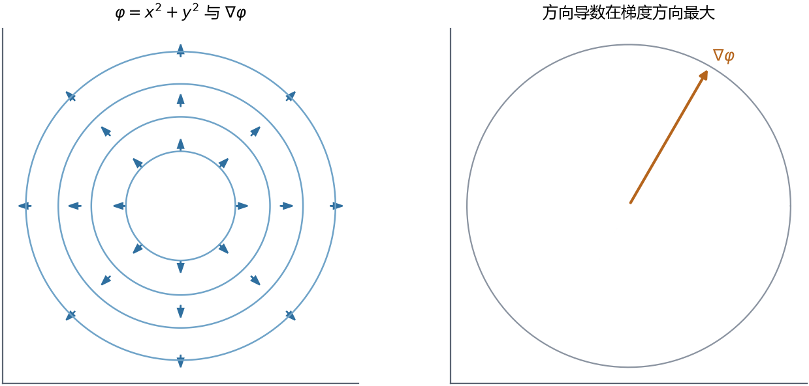
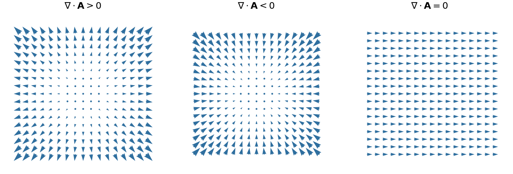
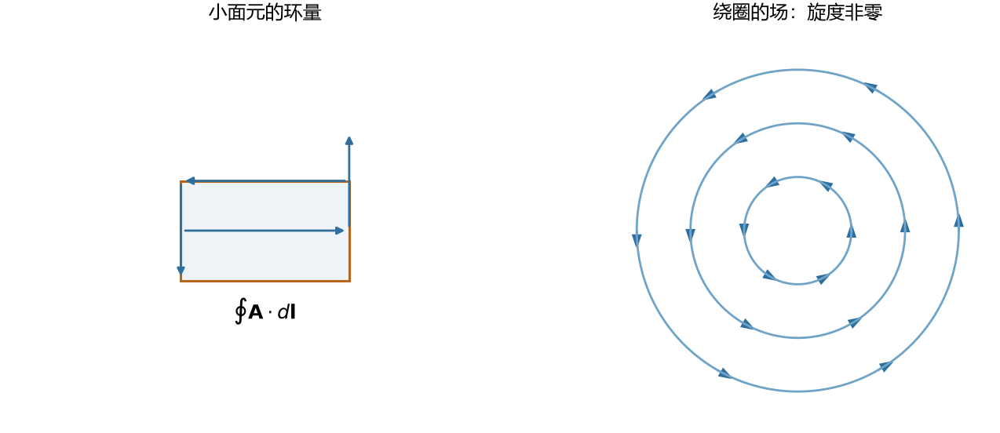

# 第 23 章 梯度、散度、旋度

## 23.1 一个算子，三种用法

第九章引入了 $\nabla$：

$$\nabla=\hat{\mathbf{x}}\frac{\partial}{\partial x}+\hat{\mathbf{y}}\frac{\partial}{\partial y}+\hat{\mathbf{z}}\frac{\partial}{\partial z} . \tag{23.1}$$

它像一个矢量，但分量是微分算子。它作用在标量场上得到一个矢量（梯度），与矢量场点乘得到一个标量（散度），与矢量场叉乘得到一个矢量（旋度）。

三种运算对应三种物理问题。标量场在哪里变化最快？矢量场在哪里有源？矢量场在哪里有涡旋？这三问的答案分别由梯度、散度、旋度给出。

## 23.2 梯度

对标量场 $\varphi$，梯度是

$$\nabla\varphi=\frac{\partial\varphi}{\partial x}\hat{\mathbf{x}}+\frac{\partial\varphi}{\partial y}\hat{\mathbf{y}}+\frac{\partial\varphi}{\partial z}\hat{\mathbf{z}} . \tag{23.2}$$

它是矢量，指向 $\varphi$ 增加最快的方向，大小等于那个方向上的变化率。第九章用它算过电场，那里 $\mathbf{E}=-\nabla\varphi$。

梯度的几何图像是"垂直于等值面"。等值面是 $\varphi$ 为常数的曲面，沿等值面移动 $\varphi$ 不变，所以变化最快的方向必须垂直于等值面。这一点在第八章证明过。

## 23.3 散度

散度定义为通量的体密度：

$$\nabla\cdot\mathbf{A}=\lim_{V\to0}\frac{1}{V}\oint_S\mathbf{A}\cdot d\mathbf{S} . \tag{23.3}$$

它的物理意义是"这一点有多少源"。散度为正，说明场线从这里发出；为负，说明场线在这里汇聚；为零，说明穿过的场线数与穿出的相等。

在直角坐标里，散度有一个具体表达式。取一个边长为 $dx$、$dy$、$dz$ 的小立方体，中心在 $(x,y,z)$。先算 $x$ 方向两个面的通量。

右面的法线是 $+\hat{\mathbf{x}}$，面积 $dy\,dz$，场在 $x+dx/2$ 处的 $x$ 分量是

$$A_x\left(x+\frac{dx}{2}\right)\approx A_x+\frac{\partial A_x}{\partial x}\frac{dx}{2} . \tag{23.4}$$

通量是 $\left(A_x+\frac{\partial A_x}{\partial x}\frac{dx}{2}\right)dy\,dz$。左面的法线是 $-\hat{\mathbf{x}}$，场在 $x-dx/2$ 处，通量是 $-\left(A_x-\frac{\partial A_x}{\partial x}\frac{dx}{2}\right)dy\,dz$。两面之和：

$$\frac{\partial A_x}{\partial x}dx\,dy\,dz . \tag{23.5}$$

三个方向加起来，总通量是

$$\left(\frac{\partial A_x}{\partial x}+\frac{\partial A_y}{\partial y}+\frac{\partial A_z}{\partial z}\right)dx\,dy\,dz . \tag{23.6}$$

除以体积 $dx\,dy\,dz$：

$$\nabla\cdot\mathbf{A}=\frac{\partial A_x}{\partial x}+\frac{\partial A_y}{\partial y}+\frac{\partial A_z}{\partial z} . \tag{23.7}$$

这个推导的要点是泰勒展开只保留一阶项。高阶项在除以体积后含 $dx$ 等因子，取极限时消失。

散度的例子。点电荷的场 $\mathbf{E}=kQ\mathbf{r}/r^3$，在 $r\neq0$ 处散度为零，在原点处发散。这个"在原点发散、别处为零"的结构正是"电荷是一个点源"的数学表达。第二十四章会把这个关系写成 $\nabla\cdot\mathbf{E}=\rho/\varepsilon_0$，$\rho$ 在原点是一个 delta 函数。

## 23.4 旋度

旋度定义为环量的面密度：

$$\left(\nabla\times\mathbf{A}\right)\cdot\hat{\mathbf{n}}=\lim_{S\to0}\frac{1}{S}\oint_L\mathbf{A}\cdot d\mathbf{l} , \tag{23.8}$$

$L$ 是小面元 $S$ 的边界，$\hat{\mathbf{n}}$ 是面元的法线，方向由右手定则与 $L$ 的绕向配合。

物理意义是"这一点有多少涡旋"。旋度不为零的地方，场线会绕圈；旋度为零的地方，场线不形成闭合回路。

直角坐标的表达式可以用一个小矩形推出来。取 $xy$ 平面内的矩形，边长 $dx$、$dy$，中心在原点，算它沿逆时针方向的环量。

下边：$y=-dy/2$，沿 $+x$ 方向走 $dx$，被积函数是 $A_x$，积分约 $A_x(x,y-dy/2)dx$。上边：沿 $-x$ 方向，贡献 $-A_x(x,y+dy/2)dx$。两条边之和：

$$-\frac{\partial A_x}{\partial y}dy\,dx . \tag{23.9}$$

右边：$x=+dx/2$，沿 $+y$ 方向，贡献 $A_y(x+dx/2,y)dy$。左边：沿 $-y$，贡献 $-A_y(x-dx/2,y)dy$。两条边之和：

$$\frac{\partial A_y}{\partial x}dx\,dy . \tag{23.10}$$

总环量

$$\left(\frac{\partial A_y}{\partial x}-\frac{\partial A_x}{\partial y}\right)dx\,dy . \tag{23.11}$$

除以面积 $dx\,dy$，得到旋度的 $z$ 分量：

$$\left(\nabla\times\mathbf{A}\right)_z=\frac{\partial A_y}{\partial x}-\frac{\partial A_x}{\partial y} . \tag{23.12}$$

另外两个分量由轮换得到：

$$\left(\nabla\times\mathbf{A}\right)_x=\frac{\partial A_z}{\partial y}-\frac{\partial A_y}{\partial z},\qquad\left(\nabla\times\mathbf{A}\right)_y=\frac{\partial A_x}{\partial z}-\frac{\partial A_z}{\partial x} . \tag{23.13}$$

三个分量可以写成一个行列式：

$$\nabla\times\mathbf{A}=\begin{vmatrix}\hat{\mathbf{x}}&\hat{\mathbf{y}}&\hat{\mathbf{z}}\\ \dfrac{\partial}{\partial x}&\dfrac{\partial}{\partial y}&\dfrac{\partial}{\partial z}\\ A_x&A_y&A_z\end{vmatrix} . \tag{23.14}$$

按第一行展开，注意中间项要变号，就得到上面三个分量。这个行列式只是记忆工具，不是严格的行列式（元素是算子）。

旋度的例子。一根沿 $z$ 轴的载流导线，磁场 $\mathbf{B}=\mu_0I/(2\pi r)\hat{\boldsymbol{\phi}}$。在导线外的区域，旋度为零（可以验证，虽然场线是圆，但场的大小随 $r$ 变化恰好抵消了环量的体密度）；在导线内部，旋度不为零，等于 $\mu_0\mathbf{J}$。这个"只在有电流的地方有旋度"的结构，是安培环路定理的微分形式。

## 23.5 球坐标与柱坐标

球坐标下的散度与旋度：

$$\nabla\cdot\mathbf{A}=\frac{1}{r^{2}}\frac{\partial}{\partial r}\left(r^{2}A_r\right)+\frac{1}{r\sin\theta}\frac{\partial}{\partial\theta}\left(\sin\theta\,A_\theta\right)+\frac{1}{r\sin\theta}\frac{\partial A_\phi}{\partial\phi} , \tag{23.15}$$

$$\left(\nabla\times\mathbf{A}\right)_r=\frac{1}{r\sin\theta}\left[\frac{\partial}{\partial\theta}\left(\sin\theta\,A_\phi\right)-\frac{\partial A_\theta}{\partial\phi}\right] . \tag{23.16}$$

其余两个分量形式更繁，需要时查手册。柱坐标：

$$\nabla\cdot\mathbf{A}=\frac{1}{r}\frac{\partial}{\partial r}\left(rA_r\right)+\frac{1}{r}\frac{\partial A_\phi}{\partial\phi}+\frac{\partial A_z}{\partial z} . \tag{23.17}$$

这些公式里的 $1/r$、$1/r^2$、$\sin\theta$ 来自坐标系的度量。球坐标的面积元、体积元随位置变化，微分算子必须把这些变化算进去，否则结果不对。这是球坐标计算最容易出错的地方。

验证一个：点电荷的场 $A_r=kQ/r^2$，其余分量为零。球坐标散度：

$$\nabla\cdot\mathbf{A}=\frac{1}{r^{2}}\frac{\partial}{\partial r}\left(r^{2}\cdot\frac{kQ}{r^{2}}\right)=\frac{1}{r^{2}}\frac{\partial\left(kQ\right)}{\partial r}=0 . \tag{23.18}$$

在 $r\neq0$ 处散度为零，与"没有电荷的地方没有源"一致。

## 23.6 两个恒等式

**梯度的旋度为零。**

$$\nabla\times\left(\nabla\varphi\right)=0 . \tag{23.19}$$

证明只需算 $z$ 分量：

$$\left(\nabla\times\nabla\varphi\right)_z=\frac{\partial}{\partial x}\left(\frac{\partial\varphi}{\partial y}\right)-\frac{\partial}{\partial y}\left(\frac{\partial\varphi}{\partial x}\right)=0 . \tag{23.20}$$

两个混合偏导数相等（只要二阶偏导连续），所以差为零。另外两个分量同理。

物理含义：梯度场没有涡旋。静电场是梯度的负值，所以静电场无旋。这与第八章的 $\oint\mathbf{E}\cdot d\mathbf{l}=0$ 是同一件事。

**旋度的散度为零。**

$$\nabla\cdot\left(\nabla\times\mathbf{A}\right)=0 . \tag{23.21}$$

展开：

$$\nabla\cdot\left(\nabla\times\mathbf{A}\right)=\frac{\partial}{\partial x}\left(\frac{\partial A_z}{\partial y}-\frac{\partial A_y}{\partial z}\right)+\frac{\partial}{\partial y}\left(\frac{\partial A_x}{\partial z}-\frac{\partial A_z}{\partial x}\right)+\frac{\partial}{\partial z}\left(\frac{\partial A_y}{\partial x}-\frac{\partial A_x}{\partial y}\right) . \tag{23.22}$$

六项两两配对：$\partial^2A_z/\partial x\partial y$ 与 $-\partial^2A_z/\partial y\partial x$ 抵消，其余同理。总和为零。

物理含义：旋度场没有源。磁场是旋度场（下一章会写成 $\mathbf{B}=\nabla\times\mathbf{A}$），所以磁场的散度为零，这与"没有磁单极"一致。

这两个恒等式在第二十四章会用来检查麦克斯韦方程组的自洽性。

## 23.7 拉普拉斯算子

两个 $\nabla$ 点乘，得到拉普拉斯算子：

$$\nabla^{2}=\nabla\cdot\nabla=\frac{\partial^{2}}{\partial x^{2}}+\frac{\partial^{2}}{\partial y^{2}}+\frac{\partial^{2}}{\partial z^{2}} . \tag{23.23}$$

它作用在标量场上得到一个标量。静电场的电势满足拉普拉斯方程 $\nabla^2\varphi=0$（无电荷区域）或泊松方程 $\nabla^2\varphi=-\rho/\varepsilon_0$（有电荷区域）。这两个方程是解静电场边值问题的出发点，本书只提到，不展开解法。

球坐标下：

$$\nabla^{2}\varphi=\frac{1}{r^{2}}\frac{\partial}{\partial r}\left(r^{2}\frac{\partial\varphi}{\partial r}\right)+\frac{1}{r^{2}\sin\theta}\frac{\partial}{\partial\theta}\left(\sin\theta\frac{\partial\varphi}{\partial\theta}\right)+\frac{1}{r^{2}\sin^{2}\theta}\frac{\partial^{2}\varphi}{\partial\phi^{2}} . \tag{23.24}$$

## 23.8 球坐标的旋度

球坐标的旋度三个分量：

$$\left(\nabla\times\mathbf{A}\right)_r=\frac{1}{r\sin\theta}\left[\frac{\partial}{\partial\theta}\left(\sin\theta\,A_\phi\right)-\frac{\partial A_\theta}{\partial\phi}\right] , \tag{23.25}$$

$$\left(\nabla\times\mathbf{A}\right)_\theta=\frac{1}{r}\left[\frac{1}{\sin\theta}\frac{\partial A_r}{\partial\phi}-\frac{\partial}{\partial r}\left(rA_\phi\right)\right] , \tag{23.26}$$

$$\left(\nabla\times\mathbf{A}\right)_\phi=\frac{1}{r}\left[\frac{\partial}{\partial r}\left(rA_\theta\right)-\frac{\partial A_r}{\partial\theta}\right] . \tag{23.27}$$

这些因子看起来零乱，来源是坐标的度量：$\hat{\boldsymbol{\theta}}$ 方向的弧长元是 $r\,d\theta$，$\hat{\boldsymbol{\phi}}$ 方向的是 $r\sin\theta\,d\phi$。旋度是"环量除以面积"，面积元随位置变化，导数外面就要相应补上 $r$ 与 $\sin\theta$。

验证一个：一个沿 $z$ 轴的均匀磁场 $\mathbf{B}=B_0\hat{\mathbf{z}}$，在球坐标里 $B_r=B_0\cos\theta$，$B_\theta=-B_0\sin\theta$，$B_\phi=0$。用 (23.27) 算 $\phi$ 分量：

$$\left(\nabla\times\mathbf{B}\right)_\phi=\frac{1}{r}\left[\frac{\partial}{\partial r}\left(r\cdot\left(-B_0\sin\theta\right)\right)-\frac{\partial}{\partial\theta}\left(B_0\cos\theta\right)\right] . \tag{23.28}$$

第一项对 $r$ 求导得 $-B_0\sin\theta$，第二项得 $B_0\sin\theta$（因为 $\partial\cos\theta/\partial\theta=-\sin\theta$，前面有负号）。两项相加为零。

另外两个分量也零（场不依赖 $\phi$，$B_\phi=0$）。所以均匀磁场的旋度为零，符合"没有电流的地方磁场无旋"。

## 23.9 用算子算一个具体场

点电荷的电场 $\mathbf{E}=kQ\,\hat{\mathbf{r}}/r^2$。算它的旋度与散度。

旋度：由球对称，场只有径向分量，且只依赖 $r$。看 (23.27)：

$$\left(\nabla\times\mathbf{E}\right)_\phi=\frac{1}{r}\left[\frac{\partial}{\partial r}\left(rE_\theta\right)-\frac{\partial E_r}{\partial\theta}\right]=\frac{1}{r}\left[0-0\right]=0 . \tag{23.29}$$

$E_\theta=0$，$E_r$ 不依赖 $\theta$，所以为零。另外两个分量同理（不依赖 $\phi$，$E_\phi=0$）。所以点电荷的场无旋。

这个结果说明静电场可以写成梯度的形式。反过来，任何无旋场在单连通区域内都能写成梯度，这是矢量分析的一条定理。

散度：由 (23.15)，

$$\nabla\cdot\mathbf{E}=\frac{1}{r^{2}}\frac{\partial}{\partial r}\left(r^{2}\cdot\frac{kQ}{r^{2}}\right)=\frac{1}{r^{2}}\frac{\partial\left(kQ\right)}{\partial r}=0 . \tag{23.30}$$

在 $r\neq0$ 处为零。这与"没有电荷的地方电场的散度为零"一致。在 $r=0$ 处，场发散，散度不能用普通函数描述，要用 delta 函数：$\nabla\cdot\left(\hat{\mathbf{r}}/r^2\right)=4\pi\delta^{3}(\mathbf{r})$。

把这个关系代入，得

$$\nabla\cdot\mathbf{E}=kQ\cdot4\pi\delta^{3}\left(\mathbf{r}\right)=\frac{Q}{\varepsilon_0}\delta^{3}\left(\mathbf{r}\right) , \tag{23.31}$$

与 $\nabla\cdot\mathbf{E}=\rho/\varepsilon_0$ 一致，因为点电荷的电荷密度正是 $Q\delta^3(\mathbf{r})$。这是麦克斯韦第一方程在点电荷情形下的严格写法。

delta 函数在这里不是数学游戏。它把"点电荷"这个理想化模型写成了密度，使微分方程在原点也有意义。没有它，微分形式在点电荷处失效，只能退回到积分形式。物理上所有的电荷都是分布的，delta 只是一个极限，但它让公式在理想化模型下也自洽。

## 23.10 拉普拉斯方程与泊松方程

把 $\mathbf{E}=-\nabla\varphi$ 代入高斯定理 $\nabla\cdot\mathbf{E}=\rho/\varepsilon_0$：

$$\nabla\cdot\left(-\nabla\varphi\right)=\frac{\rho}{\varepsilon_0}\quad\Rightarrow\quad\nabla^{2}\varphi=-\frac{\rho}{\varepsilon_0} . \tag{23.32}$$

这叫泊松方程。没有电荷的地方 $\rho=0$，变成拉普拉斯方程：

$$\nabla^{2}\varphi=0 . \tag{23.33}$$

这两个方程是静电学的基本方程。它们把"求电场"变成"解一个二阶偏微分方程"，边界条件由导体的电势或电荷给定。

用球坐标验证点电荷。球对称时只保留径向项：

$$\nabla^{2}\varphi=\frac{1}{r^{2}}\frac{d}{dr}\left(r^{2}\frac{d\varphi}{dr}\right) . \tag{23.34}$$

把 $\varphi=kQ/r$ 代入。先算 $r^2d\varphi/dr=r^2\cdot(-kQ/r^2)=-kQ$，这是常数，对 $r$ 求导为零。所以 $\nabla^2\varphi=0$ 在 $r\neq0$ 处成立。

在 $r=0$ 处，情况不同。用积分形式：把拉普拉斯方程在第一式两边对一个小球体积分：

$$\int_V\nabla^{2}\varphi\,dV=\oint_S\nabla\varphi\cdot d\mathbf{S}=\oint_S\left(-\mathbf{E}\right)\cdot d\mathbf{S}=-\frac{Q}{\varepsilon_0} . \tag{23.35}$$

左边第一个等号用了散度定理（$\nabla\varphi$ 是矢量场），第二个等号用了高斯定理。所以

$$\int_V\nabla^{2}\varphi\,dV=-\frac{Q}{\varepsilon_0} , \tag{23.36}$$

体积趋于零时，被积函数必须是 $-Q/\varepsilon_0$ 乘以 delta 函数。这与 $\rho=Q\delta^3(\mathbf{r})$ 一致。

**边界条件的类型。** 解泊松方程需要边界条件，常见三种。

狄利克雷条件：边界上给定电势，$\varphi|_S=f$。导体接固定电压就属于这一类。

诺伊曼条件：边界上给定法向导数，$\partial\varphi/\partial n|_S=g$。这相当于给定表面电荷密度，因为 $E_n=-\partial\varphi/\partial n=\sigma/\varepsilon_0$。

混合条件：一部分边界给电势，一部分给电荷。

静电学的唯一性定理说：给定边界上的电势（或给定导体上的总电荷），区域内的解是唯一的。这条定理保证了解边值问题的方法（分离变量、镜像法、数值法）都得到同一个答案，也解释了为什么静电屏蔽有效：导体表面是等势面，内部没有电荷时解只能是常数。

## 23.11 完整算一遍：给定电势求场

设电势 $\varphi=x^{2}y$（单位伏特，坐标以米计）。求电场、散度，并判断哪里可能有电荷。

梯度：

$$\nabla\varphi=2xy\,\hat{\mathbf{x}}+x^{2}\,\hat{\mathbf{y}} , \tag{23.37}$$

电场

$$\mathbf{E}=-\nabla\varphi=-2xy\,\hat{\mathbf{x}}-x^{2}\,\hat{\mathbf{y}} . \tag{23.38}$$

在点 $(1,2,0)$：$E_x=-2\times1\times2=-4\ \mathrm{V/m}$，$E_y=-1\ \mathrm{V/m}$，大小 $\sqrt{17}=4.1\ \mathrm{V/m}$，指向第三象限。

散度：

$$\nabla\cdot\mathbf{E}=\frac{\partial\left(-2xy\right)}{\partial x}+\frac{\partial\left(-x^{2}\right)}{\partial y}=-2y+0=-2y . \tag{23.39}$$

在 $(1,2,0)$ 处散度为 $-4\ \mathrm{V/m^2}$。由高斯定理的微分形式，

$$\rho=\varepsilon_0\nabla\cdot\mathbf{E}=8.854\times10^{-12}\times\left(-4\right)=-3.5\times10^{-11}\ \mathrm{C/m^{3}} . \tag{23.40}$$

负电荷密度，三十五个皮库每立方米。这个数值小得测不出来，但它说明：只要电势不是拉普拉斯方程的解，就一定有电荷分布。反过来说，在无电荷区域，电势必须满足 $\nabla^2\varphi=0$。

核对旋度：

$$\left(\nabla\times\mathbf{E}\right)_z=\frac{\partial E_y}{\partial x}-\frac{\partial E_x}{\partial y}=-2x-\left(-2x\right)=0 . \tag{23.41}$$

旋度为零，符合"静电场无旋"。这不是碰巧：任何形如 $-\nabla\varphi$ 的场，旋度恒为零。

再看 $y=0$ 平面：散度为零，没有电荷。$y>0$ 区域散度为负（负电荷），$y<0$ 区域散度为正（正电荷）。电荷分布关于 $y=0$ 反对称，这与电势 $\varphi=x^2y$ 关于 $y$ 的奇对称一致。

## 23.12 常见误解

**$\nabla^2$ 是标量算子，作用在标量场上得到标量。** 它不是"梯度的散度"的简写而已：$\nabla^2\mathbf{A}$ 对矢量场也有定义（逐分量作用），但那是另一个运算。把 $\nabla^2$ 当成矢量会把量纲和分量搞混。

**散度是标量，旋度是矢量。** 两者都描述场的"局部结构"，但散度只有一个数（有源无源、多强），旋度有三个分量（绕哪个轴转、转多快）。写 $\nabla\cdot\mathbf{E}=4$ 是对的，写 $\nabla\times\mathbf{E}=4$ 是错的（除非是某个分量的值）。

**球坐标的因子不是装饰。** $\frac{1}{r^2}\frac{\partial}{\partial r}(r^2A_r)$ 里的 $r^2$ 来自球面面积元，$\frac{1}{r\sin\theta}\frac{\partial}{\partial\theta}(\sin\theta A_\theta)$ 里的 $\sin\theta$ 来自纬圈的弧长。漏掉任何一个，算出的散度或旋度都是错的，而且在均匀场里可能碰巧对，一旦场不均匀就露馅。

**无旋场不一定能写成 $-\nabla\varphi$，要加"单连通"条件。** 载流导线外部的磁场无旋，但不能写成某个标量场的梯度，因为绕导线一圈的环量不为零。这种区域不是单连通的（中间有个洞）。这个例外在实际问题里很重要，处理它需要把区域挖开或者用矢量势。

### 三个算子的量纲

梯度把标量场变成矢量场，量纲是"物理量除以长度"：$\nabla\varphi$ 的单位是 $\mathrm{V/m}$，正是场强的单位。

散度把矢量场变成标量场，量纲是"物理量除以长度"：$\nabla\cdot\mathbf{A}$ 的单位是 $A$ 的单位除以米。

旋度也是"物理量除以长度"：$\nabla\times\mathbf{A}$ 的单位与 $\nabla\cdot\mathbf{A}$ 相同，但它有三个分量。

三者量纲相同，这不是巧合：它们都是"空间导数"，描述场在单位长度上的变化。二阶算子 $\nabla^2$ 的量纲是"物理量除以长度的平方"。

用量纲检查一个式子：$\nabla\cdot\mathbf{E}=\rho/\varepsilon_0$。左边 $\mathrm{V/m^2}$，右边 $\mathrm{(C/m^3)/(F/m)}=\mathrm{C/(F\cdot m^2)}=\mathrm{V/m^2}$，一致。如果哪天把 $\rho$ 写成面电荷密度 $\sigma$，量纲立刻不对，这就是量纲检查的价值。

### 为什么拉普拉斯方程的解这么"光滑"

拉普拉斯方程 $\nabla^2\varphi=0$ 的解有一个性质：区域内不能有极大值或极小值，极值只能出现在边界上。这条性质叫极值原理，它保证了边值问题的解唯一，也解释了为什么静电平衡的导体内部电势是常数（边界是等势面，内部无电荷，解只能是常数）。

从物理上看，这意味着电场不可能在无电荷的区域自发地"聚"成一个峰值。场线的弯曲、场的强弱，都由边界上的电荷与电势决定。这也是为什么静电屏蔽有效：把区域用导体包起来，边界上的电势固定，内部的解就被钉死了。

数值求解时，这条性质对应一个迭代算法：把每个格点的电势取成四个邻居的平均值，反复迭代，最终收敛到拉普拉斯方程的解。松弛法的收敛速度与网格大小有关，实际计算要用多重网格加速。

### 用拉普拉斯方程核对一个解

平行板之间没有电荷，电势应满足一维拉普拉斯方程

$$\frac{d^{2}\varphi}{dx^{2}}=0 . \tag{23.42}$$

通解是线性函数 $\varphi=Ax+B$。设 $x=0$ 处 $\varphi=0$、$x=d$ 处 $\varphi=U$，得 $B=0$、$A=U/d$：

$$\varphi=\frac{U}{d}x . \tag{23.43}$$

二阶导数为零，满足方程。电场 $E_x=-d\varphi/dx=-U/d$，恒定。

这个例子说明边值问题的一般结构：方程给出解的形式（通解），边界条件定出常数。二维、三维的通解更复杂（分离变量后是三角函数、贝塞尔函数、勒让德多项式），但"通解 + 边界条件"的思路不变。

如果两板之间有一层体电荷，方程变成泊松方程 $\varphi''=-\rho/\varepsilon_0$，通解多一个二次项：

$$\varphi=-\frac{\rho}{2\varepsilon_0}x^{2}+Ax+B . \tag{23.44}$$

场强随位置线性变化，这就是空间电荷限制电流（真空管里电子云）的基本方程。二次项的存在直接反映了电荷的存在：没有它，电势只能是线性的。

### 拉普拉斯算子为什么出现在这么多地方

同一形式 $\nabla^2\varphi=0$ 出现在静电势、稳态温度分布、无旋不可压缩流动、引力势里。原因不是巧合：这些都是"通量守恒 + 线性本构"的系统，守恒律写成散度形式，本构关系把通量与势的梯度连起来，代入就得到拉普拉斯方程。

在静电里，通量是电位移，本构是 $\mathbf{D}=\varepsilon\mathbf{E}$，势的梯度是 $-\mathbf{E}$；在热传导里，通量是热流，本构是傅里叶定律 $\mathbf{q}=-k\nabla T$；在流动里，通量是速度，本构是速度势。三者数学同构，所以解一个就等于解了三个。

这也是为什么"电解槽模拟"能用来研究静电场：导电液里的电流分布满足同一个方程，电势的等值线就是静电场的等势线。

---

这一章把三个算子定义清楚，给出了直角坐标下的表达式与两个恒等式的证明。这些内容本身是数学，但它们与电磁定律一一对应：梯度对应电势与电场的关系，散度对应高斯定理，旋度对应安培定理与法拉第定律。

下一章把四条积分定律逐条转成微分形式，四个方程就齐了。
