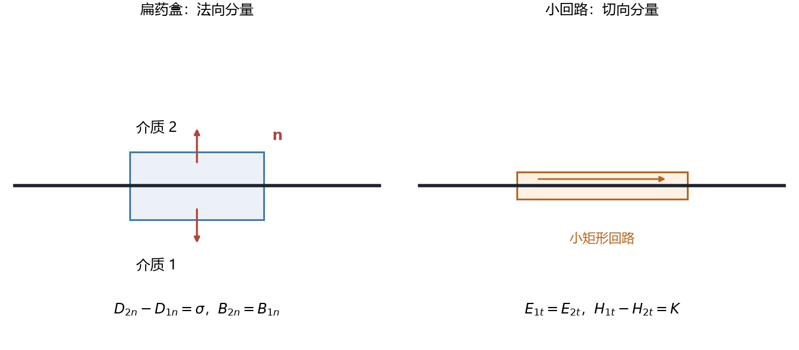
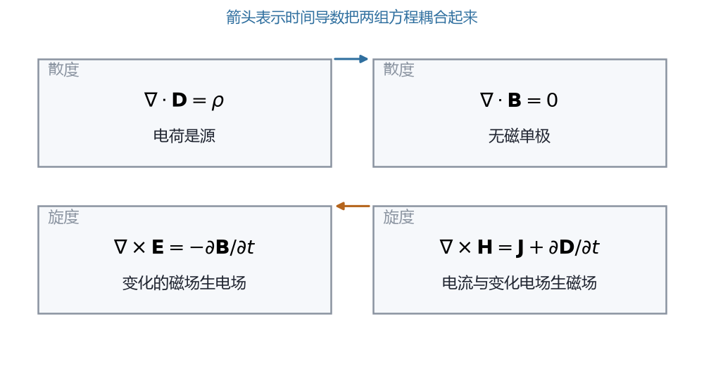

# 第 24 章 微分形式的电磁定律

## 24.1 转换的步骤

把一条积分形式的定律转成微分形式，步骤固定。

第一步，把面积分或线积分用高斯定理、斯托克斯定理换成体积分或面积分。

第二步，把等式右边也写成同样的积分（体积分或面积分）。

第三步，因为积分区域是任意的，两边的被积函数必须相等。

这个步骤的合法性依赖"任意"这一点。如果等式对任意体积都成立，被积函数就得处处相等，否则可以找一个很小的体积，使积分不为零而右边为零，产生矛盾。

## 24.2 电场的散度

高斯定理：

$$\oint_S\mathbf{E}\cdot d\mathbf{S}=\frac{Q_{\text{内}}}{\varepsilon_0} . \tag{24.1}$$

电荷用体密度表示，$Q_{\text{内}}=\int_V\rho\,dV$。左边用高斯定理换成体积分：

$$\int_V\nabla\cdot\mathbf{E}\,dV=\frac{1}{\varepsilon_0}\int_V\rho\,dV . \tag{24.2}$$

对任意体积成立，被积函数相等：

$$\nabla\cdot\mathbf{E}=\frac{\rho}{\varepsilon_0} . \tag{24.3}$$

这是麦克斯韦方程组的第一个方程。它的含义是：电场的源是电荷。正电荷是源（散度为正），负电荷是汇（散度为负）。在没有电荷的地方，散度为零。

有介质时，把 $\mathbf{E}$ 换成电位移 $\mathbf{D}=\varepsilon\mathbf{E}$：

$$\nabla\cdot\mathbf{D}=\rho_{\text{自由}} . \tag{24.4}$$

## 24.3 磁场的散度

磁通量守恒：

$$\oint_S\mathbf{B}\cdot d\mathbf{S}=0 . \tag{24.5}$$

用高斯定理：

$$\int_V\nabla\cdot\mathbf{B}\,dV=0 . \tag{24.6}$$

对任意体积成立：

$$\nabla\cdot\mathbf{B}=0 . \tag{24.7}$$

这是第二个方程。它的含义是：磁场没有源，不存在磁单极。磁感线必须闭合，不能从某点发出。

## 24.4 电场的旋度

法拉第定律的积分形式：

$$\oint_L\mathbf{E}\cdot d\mathbf{l}=-\frac{d}{dt}\int_S\mathbf{B}\cdot d\mathbf{S} . \tag{24.8}$$

左边用斯托克斯定理换成面积分：

$$\int_S\left(\nabla\times\mathbf{E}\right)\cdot d\mathbf{S}=-\int_S\frac{\partial\mathbf{B}}{\partial t}\cdot d\mathbf{S} . \tag{24.9}$$

右边的导数移进积分号，因为积分区域固定，只有 $\mathbf{B}$ 随时间变，所以全导数变成偏导数。对任意曲面成立：

$$\nabla\times\mathbf{E}=-\frac{\partial\mathbf{B}}{\partial t} . \tag{24.10}$$

这是第三个方程。它的含义是：变化的磁场产生有旋的电场。负号来自楞次定律，保证能量守恒。

## 24.5 磁场的旋度

安培环路定理的积分形式（稳恒情形）：

$$\oint_L\mathbf{B}\cdot d\mathbf{l}=\mu_0\int_S\mathbf{J}\cdot d\mathbf{S} . \tag{24.11}$$

用斯托克斯定理：

$$\int_S\left(\nabla\times\mathbf{B}\right)\cdot d\mathbf{S}=\mu_0\int_S\mathbf{J}\cdot d\mathbf{S} . \tag{24.12}$$

$$\nabla\times\mathbf{B}=\mu_0\mathbf{J} . \tag{24.13}$$

这是第四个方程的稳恒形式。它说：电流是磁场旋度的源。

这个方程在非稳恒情形下不自洽，第二十五章会补上位移电流项。补上之后变成

$$\nabla\times\mathbf{B}=\mu_0\mathbf{J}+\mu_0\varepsilon_0\frac{\partial\mathbf{E}}{\partial t} , \tag{24.14}$$

或者用 $\mathbf{H}$ 与 $\mathbf{D}$：

$$\nabla\times\mathbf{H}=\mathbf{J}_{\text{自由}}+\frac{\partial\mathbf{D}}{\partial t} . \tag{24.15}$$

## 24.6 边界条件

微分形式要求场可微，在介质界面上场往往不连续，微分方程在那里失效。界面上的行为要用边界条件描述，它们由积分形式在界面两侧的极限得到。

**法向分量。** 取一个跨过界面的扁药盒，两个底面平行于界面、面积 $A$，高度 $h\to0$。侧面的通量趋于零（面积是 $2\pi rh$ 或周长乘 $h$），只剩两个底面：

$$\oint\mathbf{D}\cdot d\mathbf{S}=\left(D_{2n}-D_{1n}\right)A=\sigma_{\text{自由}}A . \tag{24.16}$$

所以

$$D_{2n}-D_{1n}=\sigma_{\text{自由}} , \tag{24.17}$$

法线从介质 1 指向介质 2。没有自由面电荷时，$D_n$ 连续。对磁场，右边为零：

$$B_{2n}-B_{1n}=0\quad\Rightarrow\quad B_{2n}=B_{1n} . \tag{24.18}$$

磁场的法向分量总是连续的。

**切向分量。** 取一个跨过界面的小矩形回路，两条长边平行于界面、长度 $l$，两条短边垂直于界面、长度 $h\to0$。短边的贡献趋于零。环量：

$$\oint\mathbf{E}\cdot d\mathbf{l}=\left(E_{1t}-E_{2t}\right)l . \tag{24.19}$$

右边是磁通量的变化率。矩形的面积 $lh\to0$，磁通量趋于零（只要 $\mathbf{B}$ 有限），所以右边为零：

$$E_{1t}=E_{2t} . \tag{24.20}$$

电场的切向分量连续。

对磁场，右边是 $\mu_0$ 乘以穿过的电流。如果界面上有面电流密度 $\mathbf{K}$（单位长度上的电流），穿过矩形的电流是 $Kl$：

$$\left(H_{1t}-H_{2t}\right)l=K l\quad\Rightarrow\quad H_{1t}-H_{2t}=K . \tag{24.21}$$

没有面电流时 $H_t$ 连续。

把四条边界条件列在一起：

$$D_{2n}-D_{1n}=\sigma,\qquad B_{2n}=B_{1n},\qquad E_{1t}=E_{2t},\qquad H_{1t}-H_{2t}=K . \tag{24.22}$$

它们决定了场在界面上的折射与反射。光学里的反射定律、折射定律都从这四条推出来。

## 24.7 介质中的方程组

把四个微分方程写成介质中的形式，用 $\mathbf{E}$、$\mathbf{B}$、$\mathbf{D}$、$\mathbf{H}$ 四个量：

$$\nabla\cdot\mathbf{D}=\rho_{\text{自由}} , \tag{24.23}$$

$$\nabla\cdot\mathbf{B}=0 , \tag{24.24}$$

$$\nabla\times\mathbf{E}=-\frac{\partial\mathbf{B}}{\partial t} , \tag{24.25}$$

$$\nabla\times\mathbf{H}=\mathbf{J}_{\text{自由}}+\frac{\partial\mathbf{D}}{\partial t} . \tag{24.26}$$

配上本构关系

$$\mathbf{D}=\varepsilon\mathbf{E},\qquad\mathbf{B}=\mu\mathbf{H},\qquad\mathbf{J}=\sigma_e\mathbf{E} , \tag{24.27}$$

四个方程加三个本构关系，构成一个封闭的系统。给定电荷与电流，可以解出四个场量。

这组方程的形式在真空与介质中相同，区别只在本构关系。真空里 $\varepsilon=\varepsilon_0$、$\mu=\mu_0$；均匀介质里它们是常数；非均匀介质里它们随位置变；各向异性介质里它们是张量。

## 24.8 还差一项

到这里，四个方程已经有了三个半。第四个（安培定律）只对稳恒电流成立，非稳恒时缺一项。

这一项的缺失可以用一个简单的例子暴露。一个正在充电的电容器，取一个套住导线的回路，以回路为边界可以做两个曲面：一个穿过导线，一个从两板之间穿过。前者包围电流 $I$，后者包围的电流为零。但两个曲面的边界相同，环量应该相同，矛盾。

这个矛盾在 1861 到 1865 年间被麦克斯韦解决。他引入的项叫位移电流，形式是 $\varepsilon_0\partial\mathbf{E}/\partial t$。加上它之后，矛盾消失，而且从方程组里能解出电磁波。下一章讲这件事。

## 24.9 坡印廷定理

能量守恒在电磁场里的微分形式叫坡印廷定理。它可以由麦克斯韦方程组直接推出来，不依赖任何新假设。

从第四章的功率密度出发：单位体积内电磁场对电荷做的功率是 $\mathbf{J}\cdot\mathbf{E}$。这个量可以是正的（电场加速电荷，场失去能量）或负的（电荷减速，场得到能量）。

把它用场量表示。由安培定律（含位移电流）：

$$\mathbf{J}=\frac{1}{\mu_0}\nabla\times\mathbf{B}-\varepsilon_0\frac{\partial\mathbf{E}}{\partial t} . \tag{24.28}$$

代入功率密度，取负号（表示场对电荷做功，场能量减少）：

$$-\mathbf{J}\cdot\mathbf{E}=-\frac{1}{\mu_0}\mathbf{E}\cdot\left(\nabla\times\mathbf{B}\right)+\varepsilon_0\mathbf{E}\cdot\frac{\partial\mathbf{E}}{\partial t} . \tag{24.29}$$

处理第一项。用矢量恒等式

$$\nabla\cdot\left(\mathbf{E}\times\mathbf{B}\right)=\mathbf{B}\cdot\left(\nabla\times\mathbf{E}\right)-\mathbf{E}\cdot\left(\nabla\times\mathbf{B}\right) , \tag{24.30}$$

所以

$$-\mathbf{E}\cdot\left(\nabla\times\mathbf{B}\right)=\nabla\cdot\left(\mathbf{E}\times\mathbf{B}\right)-\mathbf{B}\cdot\left(\nabla\times\mathbf{E}\right) . \tag{24.31}$$

再用法拉第定律 $\nabla\times\mathbf{E}=-\partial\mathbf{B}/\partial t$：

$$-\mathbf{B}\cdot\left(\nabla\times\mathbf{E}\right)=\mathbf{B}\cdot\frac{\partial\mathbf{B}}{\partial t}=\frac{1}{2}\frac{\partial B^{2}}{\partial t} . \tag{24.32}$$

第二项也可以改写：$\varepsilon_0\mathbf{E}\cdot\partial\mathbf{E}/\partial t=\frac{1}{2}\varepsilon_0\partial E^2/\partial t$。

把这些代回 (24.29)：

$$-\mathbf{J}\cdot\mathbf{E}=\frac{1}{\mu_0}\nabla\cdot\left(\mathbf{E}\times\mathbf{B}\right)+\frac{1}{2\mu_0}\frac{\partial B^{2}}{\partial t}+\frac{1}{2}\varepsilon_0\frac{\partial E^{2}}{\partial t} . \tag{24.33}$$

把后两项合起来，用能量密度 $u=\frac{1}{2}\varepsilon_0E^2+B^2/(2\mu_0)$，并把第一项移到左边：

$$-\mathbf{J}\cdot\mathbf{E}-\nabla\cdot\left(\frac{\mathbf{E}\times\mathbf{B}}{\mu_0}\right)=\frac{\partial u}{\partial t} . \tag{24.34}$$

这个式子的含义很清楚。左边第一项是场对电荷做功的功率密度（能量从场流出），第二项是坡印廷矢量的散度（能量从这一点流走）。右边是能量密度的增加率。三项合起来就是：能量的减少等于流出加消耗。

写成积分形式：

$$-\frac{d}{dt}\int_Vu\,dV=\int_V\mathbf{J}\cdot\mathbf{E}\,dV+\oint_S\mathbf{S}\cdot d\mathbf{S} . \tag{24.35}$$

体积内电磁能的减少率，等于对电荷做功的功率加上从表面流出的能流。这就是电磁学的能量守恒。

坡印廷定理的一个重要推论：能量不是通过导线传输的，而是通过导线周围的场传输的。一根同轴电缆，能量从内导体与外导体之间的电场与磁场中流过，坡印廷矢量指向负载。导线本身只起引导场的作用。

这个图像初看奇怪，但可以验证。同轴电缆里 $\mathbf{E}$ 沿径向、$\mathbf{B}$ 沿圆周方向，$\mathbf{E}\times\mathbf{B}$ 沿轴向，指向负载。能流密度 $EB/\mu_0$ 乘以截面积，等于 $UI$，正是传输的功率。

## 24.10 全反射与表面波

边界条件能推出一个反直觉的现象：光从密介质射向疏介质，入射角超过临界角时完全不进入第二种介质。

由折射定律 $n_1\sin\theta_1=n_2\sin\theta_2$。$n_1>n_2$ 时 $\sin\theta_2>\sin\theta_1$，入射角增大到某个值时 $\sin\theta_2=1$，折射角 $90^\circ$：

$$\sin\theta_c=\frac{n_2}{n_1} . \tag{24.36}$$

$\theta_c$ 叫临界角。玻璃到空气，$n_1=1.5$、$n_2=1$，$\theta_c=\arcsin(0.667)\approx41.8^\circ$。

入射角超过临界角，折射定律无解（$\sin\theta_2>1$），光全部反射。这叫全反射。

全反射不是"没有场进入第二种介质"。用边界条件解出来的结果是：第二种介质里的场是

$$\mathbf{E}_2\propto e^{-\kappa x}e^{i\left(k_y y-\omega t\right)} , \tag{24.37}$$

$x$ 是垂直界面的方向。场沿 $x$ 指数衰减，衰减长度约 $\lambda/(2\pi)$ 量级。这种场叫隐失波（evanescent wave），它不传输能量，但存在。

隐失波可以用实验探测：把另一块玻璃靠近到波长量级的距离，光会"隧穿"过去，这叫受抑全反射。光纤里的光也是全反射传播，包层的折射率低于纤芯，光在界面上不断全反射。

全反射的另一个应用是棱镜。直角棱镜的斜边可以让光全反射，改变光路方向，比镀银镜面损耗小。双筒望远镜、潜望镜都用这个原理。

这个例子说明边界条件的作用：它不仅给出反射与折射的强度，还预言了"透射波不存在但场存在"这种情形。这在几何光学里是看不到的，必须用波动方程。

## 24.11 方程组的量纲检查

四个方程两边的量纲必须一致。检查一遍，可以发现符号错误。

高斯定理：$\nabla\cdot\mathbf{E}$ 的量纲是 $\mathrm{V/m^2}$，$\rho/\varepsilon_0$ 的量纲是 $\mathrm{(C/m^3)/(F/m)}=\mathrm{C/(F\cdot m^2)}$。由 $1\ \mathrm{F}=1\ \mathrm{C/V}$，等于 $\mathrm{V/m^2}$。一致。

磁场高斯定理：两边都是 $\mathrm{T/m}$。一致。

法拉第定律：$\nabla\times\mathbf{E}$ 是 $\mathrm{V/m^2}$，$\partial\mathbf{B}/\partial t$ 是 $\mathrm{T/s}=\mathrm{V/m^2}$（因为 $1\ \mathrm{T}=1\ \mathrm{V\cdot s/m^2}$）。一致。

安培定律：$\nabla\times\mathbf{B}$ 是 $\mathrm{T/m}$。右边 $\mu_0\mathbf{J}$ 是 $\mathrm{(H/m)(A/m^2)}=\mathrm{H\cdot A/m^3}$。由 $1\ \mathrm{H}=1\ \mathrm{V\cdot s/A}$，等于 $\mathrm{V\cdot s/m^3}=\mathrm{T/m}$。第二项 $\mu_0\varepsilon_0\partial\mathbf{E}/\partial t$ 是 $\mathrm{(s^2/m^2)(V/(m\cdot s))}=\mathrm{V\cdot s/m^3}$。三项量纲一致。

这种检查花不了几分钟，能拦下大部分推导错误。特别是 $c$ 与 $\varepsilon_0\mu_0$ 的位置写错时，量纲检查会立刻发现：把 $\partial\mathbf{E}/\partial t$ 前的系数写成 $\mu_0$ 或 $\varepsilon_0$ 单独一个，量纲就不对了。

## 24.12 完整算一遍：两种介质界面上的折射

两种介质，$\varepsilon_1=2\varepsilon_0$、$\varepsilon_2=4\varepsilon_0$，都是非磁性的（$\mu=\mu_0$），界面上没有自由电荷。电场在介质 1 中与界面法线成 $\theta_1=45^\circ$。求介质 2 中的方向。

用两条边界条件：$E_{1t}=E_{2t}$，$D_{2n}=D_{1n}$。

设介质 1 中的场大小为 $E_1$，则

$$E_{1t}=E_1\sin\theta_1,\qquad D_{1n}=\varepsilon_1E_1\cos\theta_1 . \tag{24.38}$$

介质 2 中记为 $E_2$、$\theta_2$：

$$E_{2t}=E_2\sin\theta_2=E_1\sin\theta_1 , \tag{24.39}$$

$$D_{2n}=\varepsilon_2E_2\cos\theta_2=\varepsilon_1E_1\cos\theta_1 . \tag{24.40}$$

两式相除，消去 $E_1$、$E_2$：

$$\frac{\varepsilon_2\tan\theta_2}{\varepsilon_1\tan\theta_1}=1\quad\Rightarrow\quad\frac{\tan\theta_2}{\tan\theta_1}=\frac{\varepsilon_1}{\varepsilon_2} . \tag{24.41}$$

代入数值：$\tan\theta_1=1$，$\varepsilon_1/\varepsilon_2=0.5$，

$$\tan\theta_2=0.5\quad\Rightarrow\quad\theta_2=26.6^\circ . \tag{24.42}$$

场线向界面法线方向偏折。介电常数大的介质里，场线更"竖直"。

这也解释了为什么介质中的电场比真空中弱：法向分量被 $D_n$ 连续约束住，$E_n=D_n/\varepsilon$ 变小；切向分量不变。总场强变小，方向偏向法线。

再看磁场的对应情形。$\mu_1=1\mu_0$、$\mu_2=1000\mu_0$，界面上没有面电流。由 $B_{1n}=B_{2n}$、$H_{1t}=H_{2t}$：

$$\frac{\tan\theta_2}{\tan\theta_1}=\frac{\mu_2}{\mu_1}=1000 . \tag{24.43}$$

$\theta_1=45^\circ$ 时 $\tan\theta_2=1000$，$\theta_2\approx89.94^\circ$，几乎平行于界面。这就是为什么铁芯能把磁感线"吸"到与表面平行：磁感线进入铁之后几乎贴着界面走，很少穿出去。

注意两式的比值方向相反：电场是 $\varepsilon_1/\varepsilon_2$，磁场是 $\mu_2/\mu_1$。这个差别来自边界条件的配对方式：$E_t$ 连续、$D_n$ 连续，而 $H_t$ 连续、$B_n$ 连续。把两对条件记混，折射方向就会算反。

## 24.13 常见误解

**$\mathbf{D}$ 与 $\mathbf{E}$ 谁连续要看分量。** 法向是 $D_n$ 连续（无自由面电荷时），切向是 $E_t$ 连续。不要记成"$\mathbf{D}$ 连续"或"$\mathbf{E}$ 连续"，必须带方向。

**$\sigma$ 是自由面电荷，不包括束缚电荷。** 介质极化产生的束缚电荷已经包含在 $\varepsilon$ 里，边界条件 $\mathbf{D}_{2n}-\mathbf{D}_{1n}=\sigma$ 中的 $\sigma$ 只算自由电荷（导体上的、外部注入的）。如果把束缚电荷也算进去，会重复计算。

**边界条件只在界面上成立，不分界面附近的场。** 界面上场不连续，微分方程在那里失效，必须用边界条件；离开界面之后，场在各自的介质里满足麦克斯韦方程组，两边分别求解，再在界面上拼接。

**全反射时"没有折射波"不等于"介质 2 里没有场"。** 隐失波存在于界面附近，沿垂直方向指数衰减，不传输能量。它与"场完全为零"不同，实验上可以通过受抑全反射探测到。

### 界面上的反射率

垂直入射时，反射率由两种介质的波阻抗决定：

$$R=\left(\frac{\eta_2-\eta_1}{\eta_2+\eta_1}\right)^{2} . \tag{24.44}$$

对非磁性介质，$\eta=\eta_0/n$，代入得

$$R=\left(\frac{n_1-n_2}{n_1+n_2}\right)^{2} . \tag{24.45}$$

空气到玻璃（$n_1=1.0$、$n_2=1.5$）：

$$R=\left(\frac{1.0-1.5}{1.0+1.5}\right)^{2}=\left(-0.2\right)^{2}=0.04 . \tag{24.46}$$

百分之四。一块普通玻璃窗每个表面反射百分之四，两面加起来约百分之八，这就是为什么隔着玻璃看东西会看到自己的倒影，也是镜头要镀增透膜的原因。

镀一层折射率 $\sqrt{n_1n_2}\approx1.22$、厚度四分之一波长的膜，两个界面的反射光相位差 $180^\circ$，互相抵消，反射率可以降到百分之一以下。这个计算要用到多层界面的边界条件，本书不展开，但原理就是本章的四条边界条件。

注意反射率与入射角有关。斜入射时还要区分偏振：平行于入射面的分量（p 偏振）在布儒斯特角处反射率为零，垂直分量（s 偏振）始终有反射。这就是偏振太阳镜能减少水面眩光的原因。

### 边界条件的记忆办法

四条边界条件可以按"法向配 D 和 B，切向配 E 和 H"来记：法向是 $D$ 跳变 $\sigma$、$B$ 连续；切向是 $E$ 连续、$H$ 跳变 $K$。为什么这样配？因为它们分别来自高斯定理（面）与安培/法拉第定律（回路），而高斯定理约束法向通量，回路定律约束切向环量。

记错时可以用一个极端情形检验：真空中放一块理想导体，内部场为零。由 $E_t$ 连续，导体表面的切向电场为零，这与"导体表面是等势面"一致；由 $D_n=\sigma$，表面电荷密度等于法向电位移。两条都能对上，说明配对没错。

### 一个平行板电容器的边界条件核对

平行板电容器，板间距离 $d=2.0\ \mathrm{mm}$，电压 $U=200\ \mathrm{V}$。求板上的面电荷密度，并用边界条件核对。

场强

$$E=\frac{U}{d}=\frac{200}{2.0\times10^{-3}}=1.0\times10^{5}\ \mathrm{V/m} . \tag{24.47}$$

导体表面的边界条件是 $D_n=\sigma$（导体内部场为零，只有外侧有通量）。空气的 $D=\varepsilon_0E$，所以

$$\sigma=\varepsilon_0E=8.854\times10^{-12}\times1.0\times10^{5}=8.85\times10^{-7}\ \mathrm{C/m^{2}} . \tag{24.48}$$

每平方米零点八八微库。若板的面积 $A=0.010\ \mathrm{m^2}$，总电荷

$$Q=\sigma A=8.85\times10^{-9}\ \mathrm{C} , \tag{24.49}$$

电容 $C=Q/U=8.85\times10^{-9}/200=4.4\times10^{-11}\ \mathrm{F}=44\ \mathrm{pF}$，与 $C=\varepsilon_0A/d=8.85\times10^{-12}\times0.01/0.002=44\ \mathrm{pF}$ 一致。

现在插入一块厚 $1.0\ \mathrm{mm}$、$\varepsilon_r=4$ 的介质板，贴着下极板。电压仍为 $200\ \mathrm{V}$（接电源）。空气层厚 $1.0\ \mathrm{mm}$，介质层厚 $1.0\ \mathrm{mm}$。

由 $D$ 的法向连续（界面上无自由电荷），两层中的 $D$ 相同：

$$D=\varepsilon_0E_{\text{空}}=\varepsilon_0\varepsilon_rE_{\text{介}} . \tag{24.50}$$

电压是两层电压之和：

$$U=E_{\text{空}}d_1+E_{\text{介}}d_2=E_{\text{空}}\left(d_1+\frac{d_2}{\varepsilon_r}\right) . \tag{24.51}$$

代入：$200=E_{\text{空}}\left(1.0\times10^{-3}+0.25\times10^{-3}\right)=E_{\text{空}}\times1.25\times10^{-3}$，得 $E_{\text{空}}=1.6\times10^{5}\ \mathrm{V/m}$，$E_{\text{介}}=4.0\times10^{4}\ \mathrm{V/m}$。

核对 $D$：$\varepsilon_0E_{\text{空}}=8.85\times10^{-12}\times1.6\times10^{5}=1.42\times10^{-6}\ \mathrm{C/m^2}$，$\varepsilon_0\varepsilon_rE_{\text{介}}=8.85\times10^{-12}\times4\times4.0\times10^{4}=1.42\times10^{-6}$，相等。

这个例子说明：加介质后同样电压下场强分布改变，$D$ 连续而 $E$ 跳变。如果改用"电荷固定"（断开电源），则 $D$ 不变、$E$ 不变，电压会下降，两种情况结论相反，判断前先看电源是否连接。

### 为什么边界条件只有四条

四个麦克斯韦方程，每个在界面上给出一条条件：高斯定理给 $D_n$ 的跳变，磁场高斯定理给 $B_n$ 的连续，安培定律给 $H_t$ 的跳变，法拉第定律给 $E_t$ 的连续。

这四条已经完备：界面上场的切向与法向分量共六个，四条条件加两个"场在界面两侧分别满足方程"的约束，正好定解。多一条会矛盾，少一条解不唯一。

这四条也解释了为什么电磁波在界面上会分成反射与折射两束：入射波、反射波、折射波共三个未知振幅，四条边界条件（每种偏振只用得上两条独立条件）给出两个方程，加上振幅关系，正好解出反射系数与透射系数。菲涅尔公式就是这样来的。

---

这一章把四条积分定律转成了微分形式，给出了边界条件。转换本身只是套用两个定理，但它带来了一个观念上的变化：电磁场的行为由每一点的局部量决定，不再需要看整体的积分。

下一章补上最后一项，四个方程就完整了。
