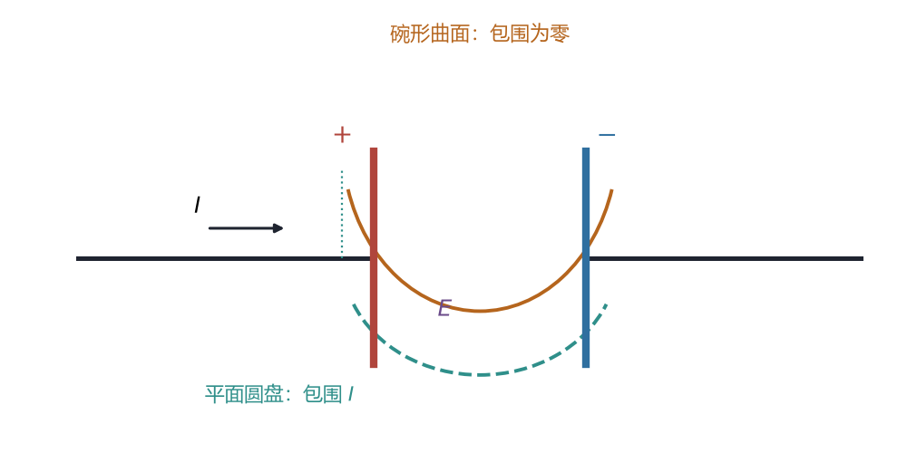
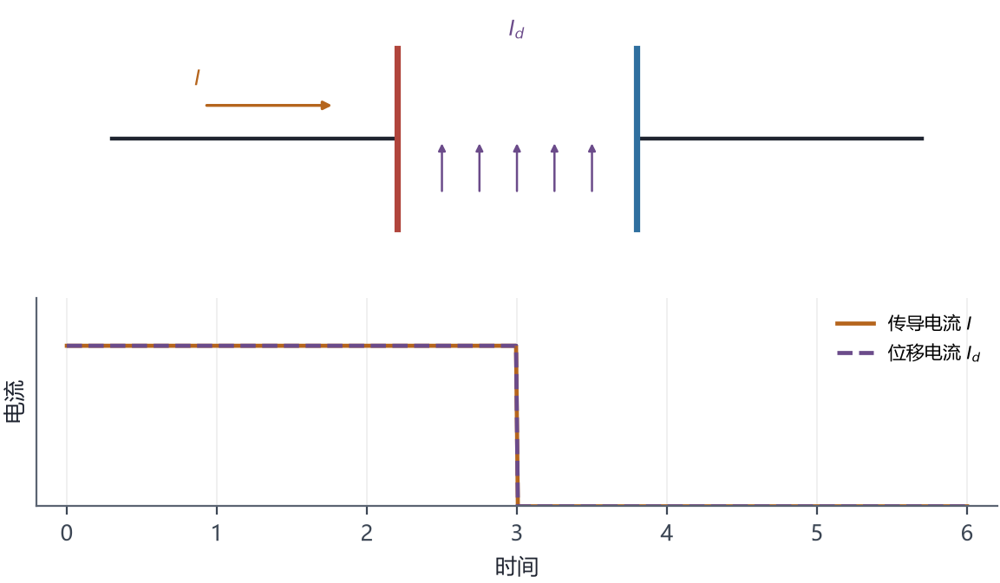
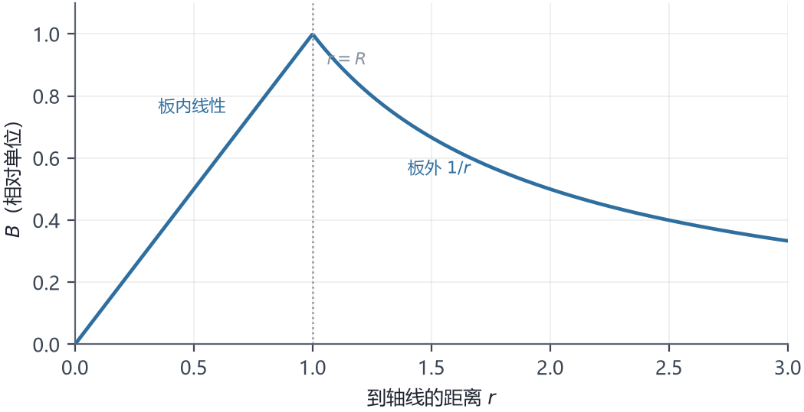

# 第 25 章 位移电流

## 25.1 一个不自洽的方程

安培环路定理说

$$\oint_L\mathbf{B}\cdot d\mathbf{l}=\mu_0 I_{\text{穿}} , \tag{25.1}$$

$I_{\text{穿}}$ 是穿过以 $L$ 为边界的曲面的电流。这个定理在导线电路里工作得很好，但遇到电容器就出问题。

一个平行板电容器正在充电，导线中的电流 $I$ 流入正极板。取一个套住导线的圆形回路 $L$，回路上每一点的磁场可以用 (25.1) 算出来。

问题在"以 $L$ 为边界的曲面"这句话。曲面可以选成平面圆盘，穿过导线，包围电流 $I$；也可以选成一个碗形曲面，绕过电容器，从两板之间穿过。两个曲面有同一条边界 $L$，但包围的电流不同：前者是 $I$，后者是零（两板之间没有电荷流动）。

同一个回路，同一个积分 $\oint\mathbf{B}\cdot d\mathbf{l}$，却得到两个不同的值。这不是计算错误，而是定理本身不完备。

## 25.2 电荷守恒的要求

要修好这个矛盾，得从电荷守恒出发。

电荷守恒的微分形式是

$$\nabla\cdot\mathbf{J}+\frac{\partial\rho}{\partial t}=0 . \tag{25.2}$$

它说：某一点电流密度的散度（流出的净电流）等于那里电荷密度的减少率。这个式子是电荷守恒的局部表述，第二十二章的积分形式 (11.19) 与它等价。

把高斯定理 $\nabla\cdot\mathbf{E}=\rho/\varepsilon_0$ 代入：

$$\nabla\cdot\mathbf{J}+\frac{\partial}{\partial t}\left(\varepsilon_0\nabla\cdot\mathbf{E}\right)=0 . \tag{25.3}$$

偏导数与散度可以交换顺序（对光滑场），提出来：

$$\nabla\cdot\left(\mathbf{J}+\varepsilon_0\frac{\partial\mathbf{E}}{\partial t}\right)=0 . \tag{25.4}$$

括号里的量散度为零，这是关键。

回头看安培定律的微分形式 $\nabla\times\mathbf{B}=\mu_0\mathbf{J}$。两边取散度：

$$\nabla\cdot\left(\nabla\times\mathbf{B}\right)=\mu_0\nabla\cdot\mathbf{J} . \tag{25.5}$$

左边由恒等式 (23.21) 恒为零，所以要求 $\nabla\cdot\mathbf{J}=0$。这个条件只在稳恒时成立，充电时 $\nabla\cdot\mathbf{J}\neq0$，等式矛盾。

修的办法很自然：把右边换成散度为零的组合。由 (25.4)，$\mathbf{J}+\varepsilon_0\partial\mathbf{E}/\partial t$ 的散度为零，就取它：

$$\nabla\times\mathbf{B}=\mu_0\left(\mathbf{J}+\varepsilon_0\frac{\partial\mathbf{E}}{\partial t}\right) . \tag{25.6}$$

第二项

$$\mathbf{J}_d=\varepsilon_0\frac{\partial\mathbf{E}}{\partial t} \tag{25.7}$$

叫位移电流密度。它没有电荷的移动，但它在产生磁场这一点上与传导电流等效。

## 25.3 电容器中的位移电流

在平行板电容器里算一下位移电流的大小。

两板之间没有电荷流动，$\mathbf{J}=0$。电场 $E=\sigma/\varepsilon_0=Q/(\varepsilon_0A)$，方向从正板指向负板。充电时 $Q$ 增加，$E$ 增加，变化率

$$\frac{\partial E}{\partial t}=\frac{1}{\varepsilon_0A}\frac{dQ}{dt}=\frac{I}{\varepsilon_0A} . \tag{25.8}$$

位移电流密度

$$J_d=\varepsilon_0\frac{\partial E}{\partial t}=\frac{I}{A} . \tag{25.9}$$

乘上面积，位移电流

$$I_d=J_dA=I . \tag{25.10}$$

正好等于导线中的传导电流。所以"穿过碗形曲面的电流"其实是 $I$，与穿过圆盘的相同，矛盾消失。

这个结果不是巧合。位移电流的定义就是为了让总电流连续：在导线里是传导电流，在两板之间是位移电流，两者相等，形成一条连续的"电流"。

用电压表示更直观。电容器 $Q=CU$，$I=dQ/dt=C\,dU/dt$。位移电流 $I_d=C\,dU/dt$，与充电电流相同。

## 25.4 间隙中的磁场

位移电流也会产生磁场。这一点可以用一个具体的计算验证。

平行板电容器是圆形的，半径 $R$，正在充电，板间电场均匀，$E$ 垂直于板。取一个与板同轴、半径 $r<R$ 的圆作回路，回路上磁场沿切向，大小只与 $r$ 有关。

由 (25.6)，环量等于 $\mu_0$ 乘以穿过圆面的位移电流：

$$B\cdot2\pi r=\mu_0\varepsilon_0\frac{\partial E}{\partial t}\cdot\pi r^{2} . \tag{25.11}$$

解出

$$B=\frac{\mu_0\varepsilon_0r}{2}\frac{\partial E}{\partial t} . \tag{25.12}$$

磁场随半径线性增长，在板边缘达到最大。这个磁场不是由任何电荷的运动产生的，它完全来自变化的电场。

在板外（$r>R$），穿过的位移电流是 $\varepsilon_0\partial E/\partial t\cdot\pi R^2$，不再随 $r$ 增长：

$$B=\frac{\mu_0\varepsilon_0R^{2}}{2r}\frac{\partial E}{\partial t} . \tag{25.13}$$

按 $1/r$ 衰减，像一个线电流的场。

## 25.5 位移电流的物理意义

位移电流这一项不是数学技巧，它有物理内容。

第一，它保证了电荷守恒。加上它之后，安培定律与连续性方程相容，不会出现"电流凭空消失"的矛盾。

第二，它使电磁场可以脱离电荷传播。在真空中没有电荷、没有电流，但变化的电场可以产生磁场，变化的磁场又产生电场，两者互相激发，形成向外传播的波。这一点在第二十七章会详细推导。

第三，它预言了电磁波的速度。把位移电流代入真空中的方程组，得到的波动方程速度是 $1/\sqrt{\varepsilon_0\mu_0}$，等于光速。这个预言在 1888 年被赫兹的实验证实。

麦克斯韦在 1861 年的论文《论物理力线》里第一次提出这个概念，当时他用的是一个力学以太模型，把位移电流解释为以太的"弹性位移"。1865 年的论文《电磁场的动力学理论》把它写成方程，不再依赖具体的力学模型。这个从模型到方程的转变，是物理学史上的一次重要转折：场的规律可以不依赖机制而独立表述。

## 25.6 一个常见的误解

位移电流叫"电流"，但它不是电荷的流动。真空中的位移电流没有任何电荷在动，它只是电场的变化率。

这个名称容易让人以为电场变化"相当于"电荷移动。从产生磁场的效果看，两者等效；从物理机制看，完全不同。传导电流伴随着焦耳热、化学效应、电荷的迁移；位移电流没有这些。位移电流不产生焦耳热，因为它的"载体"不是可以碰撞的粒子。

这也解释了为什么高频电路里电容器能"通"交流：交流电不断改变极性，板间的电场不断变化，位移电流不断产生，电路看起来是闭合的。频率越高，$dE/dt$ 越大，位移电流越大，"通路"效果越好。直流则相反，电场不变，位移电流为零，电容器是断路。

## 25.7 完整的安培定律

把位移电流加进去，安培定律的完整形式是

$$\oint_L\mathbf{B}\cdot d\mathbf{l}=\mu_0\left(I+\varepsilon_0\frac{d\Phi_E}{dt}\right) , \tag{25.14}$$

微分形式

$$\nabla\times\mathbf{B}=\mu_0\mathbf{J}+\mu_0\varepsilon_0\frac{\partial\mathbf{E}}{\partial t} . \tag{25.15}$$

有介质时，把 $\mathbf{B}$ 换成 $\mathbf{H}$，$\mathbf{E}$ 换成 $\mathbf{D}$：

$$\nabla\times\mathbf{H}=\mathbf{J}_{\text{自由}}+\frac{\partial\mathbf{D}}{\partial t} . \tag{25.16}$$

## 25.8 高频下的位移电流

位移电流在低频时可以忽略，在高频时占主导。算一个例子看分界在哪。

平行板电容器，面积 $A=0.01\ \mathrm{m^2}$，间距 $d=1\ \mathrm{mm}$，电容

$$C=\frac{\varepsilon_0A}{d}=\frac{8.85\times10^{-12}\times0.01}{10^{-3}}=8.85\times10^{-11}\ \mathrm{F} . \tag{25.17}$$

接交流电压 $u=U_0\sin\omega t$。电荷 $q=Cu$，电流

$$I=\frac{dq}{dt}=C\frac{du}{dt}=CU_0\omega\cos\omega t . \tag{25.18}$$

振幅 $I_0=CU_0\omega$。取 $U_0=100\ \mathrm{V}$，$f=50\ \mathrm{Hz}$：

$$I_0=8.85\times10^{-11}\times100\times2\pi\times50\approx2.8\times10^{-6}\ \mathrm{A} , \tag{25.19}$$

微安级。同样电压在 $1\ \mathrm{MHz}$ 时：

$$I_0\approx5.6\times10^{-2}\ \mathrm{A} , \tag{25.20}$$

五十六毫安，能点亮小灯泡。

容抗是

$$X_C=\frac{1}{\omega C} , \tag{25.21}$$

频率越高，容抗越小。这是"电容通交流"的定量表述。

这个例子给出一个实用的判据：低频电路分析里，除非专门研究电容，位移电流可以忽略；射频与微波必须用完整的方程组。

## 25.9 位移电流与电磁波

真空里没有电荷，也没有传导电流。安培定律只剩位移电流项：

$$\nabla\times\mathbf{B}=\mu_0\varepsilon_0\frac{\partial\mathbf{E}}{\partial t} , \tag{25.22}$$

法拉第定律：

$$\nabla\times\mathbf{E}=-\frac{\partial\mathbf{B}}{\partial t} . \tag{25.23}$$

两个方程互相耦合：变化的电场生磁场，变化的磁场生电场。这个循环不需要物质参与，可以在真空中自我维持。

想象某个区域的电场开始变化，它产生磁场；磁场变化又产生电场；新电场继续变化，又产生磁场。扰动向外传播，速度由 $\mu_0\varepsilon_0$ 决定。

如果没有位移电流，循环就断了：真空中 $\mathbf{J}=0$，磁场不能由电场变化产生，波无法传播。所以位移电流不是可有可无的修正，而是电磁波存在的必要条件。

麦克斯韦 1861 年引入它时没有任何实验证据，他是在检查方程自洽性时发现必须加这一项的。从数学自洽推出物理存在，这是理论物理的典范。

## 25.10 完整算一遍：充电中的电容器

平行板电容器，面积 $A=1.0\times10^{-2}\ \mathrm{m^2}$，间距 $d=1.0\ \mathrm{mm}$，中间是空气。电容

$$C=\frac{\varepsilon_0A}{d}=\frac{8.85\times10^{-12}\times1.0\times10^{-2}}{1.0\times10^{-3}}=8.85\times10^{-11}\ \mathrm{F}\approx88.5\ \mathrm{pF} . \tag{25.24}$$

用 $1.0\ \mathrm{mA}$ 的恒流源充电。电压上升率

$$\frac{dU}{dt}=\frac{I}{C}=\frac{1.0\times10^{-3}}{8.85\times10^{-11}}=1.13\times10^{7}\ \mathrm{V/s}\approx11\ \mathrm{V/\mu s} . \tag{25.25}$$

板间电场 $E=U/d$，变化率

$$\frac{dE}{dt}=\frac{1}{d}\frac{dU}{dt}=\frac{1.13\times10^{7}}{1.0\times10^{-3}}=1.13\times10^{10}\ \mathrm{V/(m\cdot s)} . \tag{25.26}$$

位移电流密度

$$J_d=\varepsilon_0\frac{dE}{dt}=8.85\times10^{-12}\times1.13\times10^{10}=0.10\ \mathrm{A/m^{2}} . \tag{25.27}$$

核对：导线里的传导电流密度 $J=I/A=1.0\times10^{-3}/1.0\times10^{-2}=0.10\ \mathrm{A/m^2}$，与 $J_d$ 相等。位移电流总量 $J_dA=1.0\ \mathrm{mA}$，等于充电电流。这就是第二十五章前面那个结论的数值版本。

间隙里的磁场。取半径 $r=3.0\ \mathrm{cm}$ 的圆（小于板半径），由 (25.12)：

$$B=\frac{\mu_0\varepsilon_0r}{2}\frac{dE}{dt} . \tag{25.28}$$

分步算：$\mu_0\varepsilon_0=4\pi\times10^{-7}\times8.85\times10^{-12}=1.11\times10^{-17}$，乘 $r/2=0.015$ 得 $1.67\times10^{-19}$，乘 $1.13\times10^{10}$：

$$B=1.9\times10^{-9}\ \mathrm{T} . \tag{25.29}$$

一点九纳特斯拉，比地磁小四个数量级。这个场很弱，但用磁通门磁强计或超导量子干涉仪可以测到。实验上验证位移电流的磁效应，正是通过这类精密测量完成的。

充电时间。电压从零升到 $1.0\ \mathrm{kV}$ 需要

$$t=\frac{U}{dU/dt}=\frac{1000}{1.13\times10^{7}}=8.8\times10^{-5}\ \mathrm{s}=88\ \mathrm{\mu s} . \tag{25.30}$$

在这个时间尺度上，位移电流与传导电流的磁效应都不可忽略，必须用完整的麦克斯韦方程组。

## 25.11 常见误解

**位移电流不是电荷的移动。** 真空中的位移电流只是电场的变化率，没有任何带电粒子在动。它之所以叫"电流"，是因为它在产生磁场这一点上与传导电流等效。传导电流有焦耳热、有化学效应，位移电流都没有。

**位移电流不产生焦耳热。** 焦耳热来自电荷在电场中定向移动时与晶格的碰撞，位移电流没有可碰撞的载流子。把 $J_d^2/\sigma$ 当成热功率是错的，因为 $J_d$ 不对应任何电导。

**"电容器隔直流"说的是稳态。** 直流接上电容，充电过程中有电流，充满后电流为零。所以严格说电容"隔稳态直流"，不隔暂态。开关动作的瞬间，电容对突变呈现短路（电压不能突变），电流由外电路的电阻限制。

**位移电流项不是"只在电容器里才有"。** 任何电场随时间变化的地方都有位移电流，包括真空、介质、导体内部。电容器只是最容易看清的例子，因为那里传导电流为零，位移电流独自承担了磁场的源。电磁波之所以能在真空中传播，正是靠这一项。

**安培定律补上位移电流后，仍然只在准静态近似下用积分形式方便。** 严格地说，(25.14) 对任意时变场都成立，但当场的分布复杂时，环路积分难以计算，要回到微分形式或数值求解。

## 25.12 再算一遍：金属里的位移电流有多小

位移电流在真空与介质里重要，在金属里几乎可以忽略。算一下比值。

金属铜的电导率 $\sigma_e=6.0\times10^{7}\ \mathrm{S/m}$。设电场按 $E=E_0\cos\omega t$ 变化，传导电流密度与位移电流密度的振幅分别是

$$J_c=\sigma_eE_0,\qquad J_d=\varepsilon_0\omega E_0 . \tag{25.31}$$

比值

$$\frac{J_d}{J_c}=\frac{\varepsilon_0\omega}{\sigma_e} . \tag{25.32}$$

代入 $\omega=2\pi\times10^{6}\ \mathrm{rad/s}$（$1\ \mathrm{MHz}$）：

$$\frac{J_d}{J_c}=\frac{8.85\times10^{-12}\times6.28\times10^{6}}{6.0\times10^{7}}=\frac{5.56\times10^{-5}}{6.0\times10^{7}}=9.3\times10^{-13} . \tag{25.33}$$

万亿分之一。所以在金属里，直到频率高到 $10^{17}\ \mathrm{Hz}$（X 射线量级），位移电流都远小于传导电流，可以忽略。

让两者相等的频率

$$f=\frac{\sigma_e}{2\pi\varepsilon_0}=\frac{6.0\times10^{7}}{2\pi\times8.85\times10^{-12}}=1.1\times10^{18}\ \mathrm{Hz} , \tag{25.34}$$

对应波长约 $0.3\ \mathrm{nm}$，已经在 X 射线的范围。这个频率叫等离子体频率的量级，超过它，金属对电磁波变得透明（因为电子来不及响应）。

这个计算解释了一个常见的区分：在导体里，电流主要由自由电荷的移动承担；在绝缘体与真空里，没有自由电荷，电流只能由位移电流承担。微波炉的腔体是金属，电磁波进不去（趋肤深度只有微米级），但腔体上的缝隙可以让位移电流"续"过去，这就是微波泄漏的机制之一。

## 25.13 为什么补丁只能是这个形式

麦克斯韦要修的方程是 $\nabla\times\mathbf{B}=\mu_0\mathbf{J}$。取散度，左边恒为零，右边要求 $\nabla\cdot\mathbf{J}=0$，而连续性方程给出 $\nabla\cdot\mathbf{J}=-\partial\rho/\partial t$，一般不为零。

修的办法是在右边加一项 $\mathbf{X}$，使 $\nabla\cdot\left(\mathbf{J}+\mathbf{X}\right)=0$。由连续性方程与高斯定理，

$$\nabla\cdot\mathbf{J}=-\frac{\partial\rho}{\partial t}=-\varepsilon_0\frac{\partial}{\partial t}\left(\nabla\cdot\mathbf{E}\right)=-\nabla\cdot\left(\varepsilon_0\frac{\partial\mathbf{E}}{\partial t}\right) , \tag{25.35}$$

所以 $\mathbf{X}=\varepsilon_0\partial\mathbf{E}/\partial t$ 满足要求。

这个形式是不是唯一的？在只要求"散度匹配"的意义下，可以加任何散度为零的矢量场。但物理上还要满足：静态时退化为安培定律（$\mathbf{X}$ 含时间导数，静态时为零）、与参照系变换相容、与能量守恒一致。这些条件把 $\mathbf{X}$ 定成了 $\varepsilon_0\partial\mathbf{E}/\partial t$，没有别的选择。

这个推导说明：位移电流不是猜出来的，而是被电荷守恒"逼"出来的。麦克斯韦的高明之处在于，他不仅补上了这一项，还意识到它意味着电磁波的存在。

## 25.14 再算一遍：高频下的电容器

一个 $C=100\ \mathrm{pF}$ 的电容，接在频率 $f=100\ \mathrm{MHz}$ 的信号源上。求容抗，并与 $1\ \mathrm{k\Omega}$ 的电阻比较。

容抗

$$X_C=\frac{1}{2\pi fC}=\frac{1}{2\pi\times1.0\times10^{8}\times1.0\times10^{-10}} . \tag{25.36}$$

分母 $2\pi\times10^{8}\times10^{-10}=6.28\times10^{-2}$：

$$X_C=\frac{1}{0.0628}=15.9\ \Omega . \tag{25.37}$$

十六欧，比 $1\ \mathrm{k\Omega}$ 的电阻小六十多倍。在分压电路里，这个电容几乎把高频信号短路到地，起旁路作用。

如果频率降到 $1\ \mathrm{MHz}$，容抗变成 $1.59\ \mathrm{k\Omega}$，与电阻可比，旁路效果就差了。这就是为什么电路板上每个芯片的电源脚旁边要放一个小电容：它的容抗在芯片工作的频率范围内很小，把电源上的高频噪声引到地。

再看位移电流的量级。电压振幅 $U_0=10\ \mathrm{V}$，板间距 $d=0.10\ \mathrm{mm}$。电场振幅

$$E_0=\frac{U_0}{d}=\frac{10}{1.0\times10^{-4}}=1.0\times10^{5}\ \mathrm{V/m} . \tag{25.38}$$

变化率振幅 $\omega E_0=2\pi\times10^{8}\times10^{5}=6.3\times10^{13}\ \mathrm{V/(m\cdot s)}$。位移电流密度

$$J_d=\varepsilon_0\omega E_0=8.85\times10^{-12}\times6.3\times10^{13}=560\ \mathrm{A/m^{2}} . \tag{25.39}$$

五百六十安每平方米。这个电流密度相当大，但它是"虚"的：没有电荷真的在板间移动，只是电场在快速变化。它产生的磁场可以用 (25.12) 算，量级是毫特斯拉，足以干扰附近的敏感电路。

这两个计算说明：在高频电路里，位移电流不是可以忽略的小项，它与传导电流同等重要，甚至更大。分析射频电路时，必须把每一段导线、每一个间隙都当成分布参数来处理，不能只用集总元件的模型。

### 介质中的两个电流差一个相位

在介质中，电场 $E=E_0\cos\omega t$ 同时驱动两种电流：传导电流 $J_c=\sigma_eE$，与电场同相；位移电流 $J_d=\varepsilon\,dE/dt=-\varepsilon\omega E_0\sin\omega t$，比电场超前 $90^\circ$。

两者的比值 $\varepsilon\omega/\sigma_e$ 叫损耗角正切，衡量介质"更像导体还是更像绝缘体"。微波炉里，水的损耗角正切在 $2.45\ \mathrm{GHz}$ 附近很大，电磁波的能量迅速转成热；而同频率下陶瓷的损耗角正切很小，所以陶瓷碗不会被加热。

这解释了微波炉的一个常见现象：食物热了，碗不热。不是微波"选择"了食物，而是材料的损耗角正切不同，吸收的能量不同。

### 位移电流的一项实验证据

高频下电容器"导电"的实验，本质上就是位移电流的证据：交流电压加在电容两端，回路里有电流，但电荷没有穿过介质。用磁探头测电容间隙的磁场，可以测到与电流对应的值，而且位置分布符合 (25.12) 的 $B\propto r$（管内）与 $B\propto1/r$（管外）。这个实验比直接测位移电流密度容易，因为它只要求探头的灵敏度达到纳特斯拉量级。

这一项补上之后，四个方程终于自洽。下一章把它们并排写出来，检查一致性。
