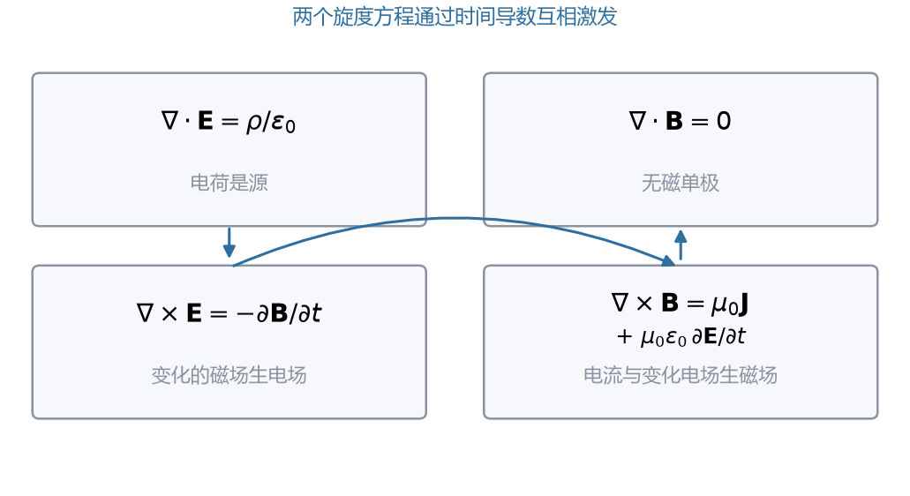
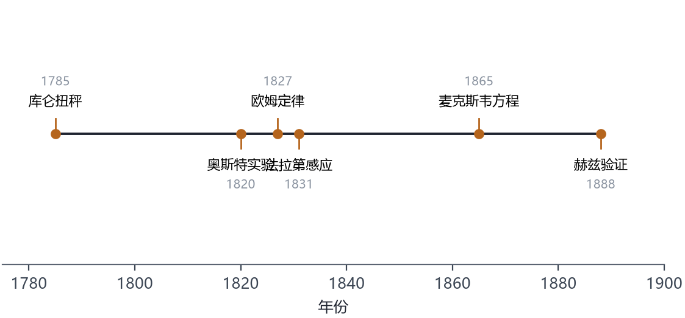

# 第 26 章 麦克斯韦方程组

## 26.1 四个方程

把前面得到的四条定律并排写出来。真空中的微分形式：

$$\nabla\cdot\mathbf{E}=\frac{\rho}{\varepsilon_0} , \tag{26.1}$$

$$\nabla\cdot\mathbf{B}=0 , \tag{26.2}$$

$$\nabla\times\mathbf{E}=-\frac{\partial\mathbf{B}}{\partial t} , \tag{26.3}$$

$$\nabla\times\mathbf{B}=\mu_0\mathbf{J}+\mu_0\varepsilon_0\frac{\partial\mathbf{E}}{\partial t} . \tag{26.4}$$

积分形式：

$$\oint_S\mathbf{E}\cdot d\mathbf{S}=\frac{Q}{\varepsilon_0} , \tag{26.5}$$

$$\oint_S\mathbf{B}\cdot d\mathbf{S}=0 , \tag{26.6}$$

$$\oint_L\mathbf{E}\cdot d\mathbf{l}=-\frac{d\Phi_B}{dt} , \tag{26.7}$$

$$\oint_L\mathbf{B}\cdot d\mathbf{l}=\mu_0I+\mu_0\varepsilon_0\frac{d\Phi_E}{dt} . \tag{26.8}$$

介质中的形式用 $\mathbf{D}$、$\mathbf{H}$：

$$\nabla\cdot\mathbf{D}=\rho_{\text{自由}} , \tag{26.9}$$

$$\nabla\cdot\mathbf{B}=0 , \tag{26.10}$$

$$\nabla\times\mathbf{E}=-\frac{\partial\mathbf{B}}{\partial t} , \tag{26.11}$$

$$\nabla\times\mathbf{H}=\mathbf{J}_{\text{自由}}+\frac{\partial\mathbf{D}}{\partial t} . \tag{26.12}$$

配上本构关系 $\mathbf{D}=\varepsilon\mathbf{E}$、$\mathbf{B}=\mu\mathbf{H}$、$\mathbf{J}=\sigma_e\mathbf{E}$，方程组封闭。

四条方程各有来源。第一条来自库仑定律与高斯定理，第二条来自磁单极不存在，第三条来自法拉第定律，第四条来自安培环路定理加位移电流。其中只有第三条与第四条里的时间导数项是"新"的，其余都是前面几篇已经得到的结果。

## 26.2 每条方程在说什么

第一条：电场的散度等于电荷密度除以 $\varepsilon_0$。电荷是电场的源。场线从正电荷发出、终止于负电荷。这条方程包含了库仑定律的全部内容。

第二条：磁场的散度为零。没有磁单极，磁感线闭合。这条方程排除了"磁荷"的存在，也保证了磁通量守恒。

第三条：电场的旋度等于磁场变化率的负值。变化的磁场产生涡旋电场。负号是楞次定律，保证能量守恒。这条方程包含了电磁感应。

第四条：磁场的旋度等于电流密度加位移电流密度（乘 $\mu_0$）。电流与变化的电场都产生磁场。这是唯一一条被麦克斯韦修改过的方程。

四条方程里有三个"源"：电荷 $\rho$、电流 $\mathbf{J}$、变化的场。前两个是物质，第三个是场自身。场能作为自己的源，这是电磁波能脱离电荷传播的原因。

## 26.3 自洽性

四个方程必须互相兼容，不能推出矛盾。检查的办法是取旋度的散度、散度的旋度，看是否与别的方程冲突。

**对第三条取散度。**

$$\nabla\cdot\left(\nabla\times\mathbf{E}\right)=-\frac{\partial}{\partial t}\left(\nabla\cdot\mathbf{B}\right) . \tag{26.13}$$

左边由恒等式 (23.21) 为零。右边要为零，必须 $\partial\left(\nabla\cdot\mathbf{B}\right)/\partial t=0$，即 $\nabla\cdot\mathbf{B}$ 不随时间变。第二条方程说它恒为零，所以右边为零，等式成立。两条方程相容。

**对第四条取散度。**

$$\nabla\cdot\left(\nabla\times\mathbf{B}\right)=\mu_0\nabla\cdot\mathbf{J}+\mu_0\varepsilon_0\frac{\partial}{\partial t}\left(\nabla\cdot\mathbf{E}\right) . \tag{26.14}$$

左边为零。把第一条代入：

$$0=\mu_0\nabla\cdot\mathbf{J}+\mu_0\varepsilon_0\frac{\partial}{\partial t}\left(\frac{\rho}{\varepsilon_0}\right)=\mu_0\left(\nabla\cdot\mathbf{J}+\frac{\partial\rho}{\partial t}\right) . \tag{26.15}$$

括号里正是连续性方程 (25.2)。所以第四条方程加上第一条，自动给出电荷守恒。这不是额外假设，而是方程组的推论。

这个检查说明了位移电流项的必要性。如果没有它，第四条取散度会得到 $\nabla\cdot\mathbf{J}=0$，与充电过程矛盾。有了它，电荷守恒自动满足。

**再看一个。** 第一条与第三条联立，可以推出波动方程（下一章）；第二条与第四条联立，也能推出波动方程。两个波动方程必须一致，这要求 $c=1/\sqrt{\varepsilon_0\mu_0}$ 是同一个值。它们确实一致，这是方程组内部和谐的一个证据。

## 26.4 本构关系

四个方程里有四个场量 $\mathbf{E}$、$\mathbf{B}$、$\mathbf{D}$、$\mathbf{H}$，加上源 $\rho$、$\mathbf{J}$，共六个未知量，方程只有四个（前两个是标量方程，后两个是矢量方程，共八个标量方程）。加上本构关系才能求解。

最简单的本构关系是线性的、各向同性的、瞬时的：

$$\mathbf{D}=\varepsilon\mathbf{E},\qquad\mathbf{B}=\mu\mathbf{H},\qquad\mathbf{J}=\sigma_e\mathbf{E} . \tag{26.16}$$

$\varepsilon$、$\mu$、$\sigma_e$ 是标量常数。真空里 $\varepsilon=\varepsilon_0$、$\mu=\mu_0$、$\sigma_e=0$。

更复杂的情形需要更复杂的本构关系。各向异性介质（晶体）里 $\varepsilon$ 是张量，$\mathbf{D}$ 与 $\mathbf{E}$ 不同向。色散介质里 $\varepsilon$ 依赖频率，不同频率的波传播速度不同。非线性介质里 $\mathbf{D}$ 与 $\mathbf{E}$ 不是正比关系（强光下的倍频效应）。铁磁材料的 $\mu$ 不是常数，有磁滞。

这些复杂情形不改变麦克斯韦方程组的形式，只改变本构关系。方程组是普遍的，本构关系是材料的具体性质。

## 26.5 历史

四个方程不是一个人写出来的，它们积累了近一百年。

1785 年，库仑用扭秤确立平方反比。1820 年，奥斯特发现电流的磁效应，安培、毕奥、萨伐尔在几个月内给出定量规律。1826 年，欧姆给出电阻定律。1831 年，法拉第发现电磁感应。1834 年，楞次给出感应电流方向的规律。1841 年，焦耳测量电流的热效应。

这些规律彼此独立，没有人知道它们之间有统一的联系。

1861 到 1862 年，麦克斯韦发表《论物理力线》，提出位移电流的概念，并用一个力学以太模型推导出电磁波的存在。1865 年，他发表《电磁场的动力学理论》，把规律写成二十个方程（用四元数记号），并明确指出光就是电磁波。1873 年，他的《电磁通论》把这些内容系统化。

麦克斯韦的原始形式有二十个方程，因为四元数记号把矢量分量拆开了。1884 年，赫维赛德与吉布斯把矢量分析引入，化简成今天的四个方程。赫维赛德还独立地得到了位移电流项。

1888 年，赫兹用火花隙产生电磁波，用谐振环接收，测出波长与传播速度，证实了麦克斯韦的预言。他在实验报告里写道：这些实验似乎证明了光与电的联系。

## 26.6 与其他定律的关系

麦克斯韦方程组不是四条独立的新定律，它把前面的规律统一起来。

库仑定律是第一条方程在球对称情形下的解。高斯定理是第一条的积分形式。安培环路定理是第四条在稳恒情形下的形式。法拉第定律是第三条的积分形式。磁场的高斯定理是第二条。

反过来说，从四个方程可以推出前面所有的静电、静磁结论。这是一个理论成熟的标志：少数几条普遍规律，包含了大量特殊情形。

方程组还预言了前面没有的东西：电磁波。这不是从实验归纳出来的，而是从方程推出来的。这种"先有理论预言、后有实验证实"的模式，是物理学在十九世纪后期开始形成的。

## 26.7 方程的美与局限

四个方程有一种结构上的对称。两个散度方程描述源，两个旋度方程描述涡旋。电场有源（电荷）无旋（静态），磁场无源（无磁单极）有旋（电流）。如果把磁单极放进去，方程会变得更对称，但实验上找不到磁单极，所以保持现在的不对称形式。

这种不对称还有一个来源：电场与磁场在洛伦兹变换下混合，电荷与电流也混合。在相对论的四维记号下，四个方程可以写成两个张量方程，对称性更明显。本书不用四维记号，但要知道：现在这种分开写的形式是三维语言的结果，不是物理本质的不对称。

方程组的局限也要说清楚。它是经典理论，不包含量子效应。在原子尺度，电场与磁场要量子化，变成光子；在极高场强下（超过施温格极限 $1.3\times10^{18}\ \mathrm{V/m}$），真空本身会激发出正负电子对，方程组失效。这些内容属于量子电动力学。

在宏观尺度，方程组极其成功。从无线电波到 X 射线，从电路设计到天线工程，从雷达到光纤，全都建立在它上面。它的预言精度在多数情形下超过任何实验的测量能力。

## 26.8 势与规范

由 $\nabla\cdot\mathbf{B}=0$，磁场可以写成另一个矢量场的旋度：

$$\mathbf{B}=\nabla\times\mathbf{A} , \tag{26.17}$$

$\mathbf{A}$ 叫磁矢势。代入法拉第定律：

$$\nabla\times\mathbf{E}=-\nabla\times\frac{\partial\mathbf{A}}{\partial t} , \tag{26.18}$$

$$\nabla\times\left(\mathbf{E}+\frac{\partial\mathbf{A}}{\partial t}\right)=0 . \tag{26.19}$$

括号里的量旋度为零，可写成梯度，取负号：

$$\mathbf{E}=-\nabla\varphi-\frac{\partial\mathbf{A}}{\partial t} . \tag{26.20}$$

静态时第二项为零，回到 $\mathbf{E}=-\nabla\varphi$。

用势表示之后，两个齐次方程自动满足，剩下两个非齐次方程给出 $\mathbf{A}$ 与 $\varphi$ 的波动方程。四个一阶方程变成两个二阶方程，数学上更容易处理。

**规范自由。** 做变换

$$\mathbf{A}'=\mathbf{A}+\nabla\chi,\qquad\varphi'=\varphi-\frac{\partial\chi}{\partial t} , \tag{26.21}$$

代入 (26.17)：

$$\nabla\times\mathbf{A}'=\mathbf{B}+\nabla\times\nabla\chi=\mathbf{B} , \tag{26.22}$$

因为梯度的旋度恒为零。代入 (26.20)：

$$\mathbf{E}'=-\nabla\varphi+\nabla\frac{\partial\chi}{\partial t}-\frac{\partial\mathbf{A}}{\partial t}-\nabla\frac{\partial\chi}{\partial t}=\mathbf{E} . \tag{26.23}$$

场不变，势变了。势有冗余，不同的势描述同一个物理。

固定这个冗余要用一个附加条件。洛伦兹规范 $\nabla\cdot\mathbf{A}+\mu_0\varepsilon_0\partial\varphi/\partial t=0$ 使 $\mathbf{A}$ 与 $\varphi$ 满足对称的波动方程，适合辐射问题；库仑规范 $\nabla\cdot\mathbf{A}=0$ 适合静态问题。

规范自由在量子场论里变成基本原理：电磁相互作用的形式由 $U(1)$ 规范对称性决定。起点就是 (26.21)。

## 26.9 四维形式

电场与磁场在相对论里合成一个张量：

$$F^{\mu\nu}=\begin{pmatrix}0&-E_x/c&-E_y/c&-E_z/c\\ E_x/c&0&-B_z&B_y\\ E_y/c&B_z&0&-B_x\\ E_z/c&-B_y&B_x&0\end{pmatrix} . \tag{26.24}$$

四个方程写成两个张量方程：

$$\partial_\mu F^{\mu\nu}=\mu_0J^{\nu},\qquad\partial_\mu\tilde{F}^{\mu\nu}=0 . \tag{26.25}$$

第一个包含高斯定理与安培定律，第二个包含磁场高斯定理与法拉第定律。电荷与电流合成四维矢量 $J^\nu=(c\rho,\mathbf{J})$，连续性方程变成 $\partial_\mu J^\mu=0$。

三维形式里那些不对称的地方，在四维形式下只是同一个张量的不同分量。不对称来自我们分开看电场与磁场，不是物理本质。

## 26.10 完整算一遍：把平面波代回方程

设电场 $\mathbf{E}=E_0\cos\left(kz-\omega t\right)\hat{\mathbf{x}}$，磁场 $\mathbf{B}=B_0\cos\left(kz-\omega t\right)\hat{\mathbf{y}}$。验证它们满足真空中的四个方程，并定出 $B_0$ 与 $E_0$ 的关系。

**散度。** $E_x$ 只依赖 $z$，$\partial E_x/\partial x=0$，其他分量为零：

$$\nabla\cdot\mathbf{E}=\frac{\partial E_x}{\partial x}+\frac{\partial E_y}{\partial y}+\frac{\partial E_z}{\partial z}=0 . \tag{26.26}$$

同理 $\nabla\cdot\mathbf{B}=0$。两条散度方程满足。

**法拉第定律的 $y$ 分量。** 旋度的 $y$ 分量是 $\partial E_x/\partial z-\partial E_z/\partial x$，只有第一项：

$$\frac{\partial E_x}{\partial z}=-kE_0\sin\left(kz-\omega t\right) . \tag{26.27}$$

右边 $-\partial B_y/\partial t$：

$$-\frac{\partial B_y}{\partial t}=-\omega B_0\sin\left(kz-\omega t\right) . \tag{26.28}$$

两边相等，要求

$$-kE_0=-\omega B_0\quad\Rightarrow\quad B_0=\frac{k}{\omega}E_0=\frac{E_0}{c} . \tag{26.29}$$

这就是 $B=E/c$ 的来源：它来自法拉第定律，不是额外假设。

**安培定律的 $x$ 分量。** 旋度的 $x$ 分量是 $\partial B_z/\partial y-\partial B_y/\partial z=-\partial B_y/\partial z$：

$$-\frac{\partial B_y}{\partial z}=kB_0\sin\left(kz-\omega t\right) . \tag{26.30}$$

右边 $\mu_0\varepsilon_0\partial E_x/\partial t$：

$$\mu_0\varepsilon_0\left(-\omega E_0\sin\left(kz-\omega t\right)\right) . \tag{26.31}$$

两边相等，要求

$$kB_0=-\mu_0\varepsilon_0\omega E_0 . \tag{26.32}$$

把 $B_0=E_0/c$ 与 $\mu_0\varepsilon_0=1/c^2$ 代入：左边 $kE_0/c$，右边 $-\omega E_0/c^2$。两边同乘 $c/E_0$，得 $k=-\omega/c$。负号说明这个解对应沿 $-z$ 传播的波，与我们假设的 $+z$ 方向不一致。

这个符号问题来自相位的写法。如果取 $\mathbf{B}=-B_0\cos\left(kz-\omega t\right)\hat{\mathbf{y}}$（即 $\mathbf{B}$ 反向），安培定律给出 $k=\omega/c$，与 $+z$ 传播一致。物理上 $\mathbf{E}\times\mathbf{B}$ 必须指向传播方向：$\hat{\mathbf{x}}\times\left(-\hat{\mathbf{y}}\right)=-\hat{\mathbf{z}}$，也不对。

正确的组合是：$\mathbf{E}$ 沿 $+\hat{\mathbf{x}}$、$\mathbf{B}$ 沿 $+\hat{\mathbf{y}}$ 时，波沿 $+\hat{\mathbf{z}}$ 传播，且相位应写成 $\cos\left(\omega t-kz\right)$ 而不是 $\cos\left(kz-\omega t\right)$。两种写法只差一个整体符号，但求导时的符号会不同。这个细节说明：波的相位约定必须与传播方向、$\mathbf{E}\times\mathbf{B}$ 的方向三者一起核对，否则会出现"波往反方向跑"的错误。

## 26.11 完整算一遍：平面波的能量

接上面的波，取 $E_0=100\ \mathrm{V/m}$。求磁场振幅、能量密度、强度。

$$B_0=\frac{E_0}{c}=\frac{100}{3.0\times10^{8}}=3.3\times10^{-7}\ \mathrm{T} . \tag{26.33}$$

电场能量密度（峰值）

$$u_E=\frac{1}{2}\varepsilon_0E_0^{2}=\frac{1}{2}\times8.85\times10^{-12}\times10^{4}=4.4\times10^{-8}\ \mathrm{J/m^{3}} . \tag{26.34}$$

磁场能量密度

$$u_B=\frac{B_0^{2}}{2\mu_0}=\frac{\left(3.3\times10^{-7}\right)^{2}}{2\times4\pi\times10^{-7}}=\frac{1.1\times10^{-13}}{2.51\times10^{-6}}=4.4\times10^{-8}\ \mathrm{J/m^{3}} . \tag{26.35}$$

两者相等，符合 (27.25) 的结论。

强度（时间平均）

$$I=\frac{1}{2}\varepsilon_0cE_0^{2}=4.4\times10^{-8}\times3.0\times10^{8}=13\ \mathrm{W/m^{2}} . \tag{26.36}$$

十三瓦每平方米。这个强度比阳光（$1361\ \mathrm{W/m^2}$）弱两个数量级，属于较强的无线电波或微波。

核对能量守恒：单位体积的能量以速度 $c$ 流过，能流密度 $S=uc$。峰值时 $u=8.8\times10^{-8}$，$S=8.8\times10^{-8}\times3\times10^{8}=26\ \mathrm{W/m^2}$，是平均值 $13$ 的两倍（因为 $\cos^2$ 的峰值是平均值的两倍）。这与 (27.28) 一致。

## 26.12 常见误解

**四个方程不是四条独立的定律。** 它们是一个整体：两个散度方程约束初始条件，两个旋度方程决定演化。给定某一时刻的场与源，四个方程联合决定之后所有的场。单独拿一条出来用，往往需要额外的对称性假设。

**真空与介质的区别只在本构关系。** 方程的形式相同，把 $\varepsilon_0$ 换成 $\varepsilon$、$\mu_0$ 换成 $\mu$ 即可（有自由电荷时用 $\mathbf{D}$、$\mathbf{H}$）。不要以为介质里"多了一条方程"或"少了一条方程"。

**位移电流项不是"电容器里的电流"。** 它在任何电场变化的地方都存在，包括真空。电容器只是让传导电流为零、位移电流独自显现的例子。

**方程组的解不唯一，要加边界条件。** 麦克斯韦方程组是偏微分方程，给定源之后还需要边界条件（导体表面的电势、无穷远处的衰减、界面的连续性）才能定出唯一的场。这就是为什么天线、腔体、波导的问题要专门设计边界。

## 26.13 再算一遍：波阻抗

真空中的平面波，电场与磁场的振幅之比是一个常数：

$$\eta_0=\frac{E_0}{B_0}=c=\frac{E_0}{H_0}=\sqrt{\frac{\mu_0}{\varepsilon_0}} . \tag{26.37}$$

最后一步用了 $B_0=\mu_0H_0$。代入数值：

$$\eta_0=\sqrt{\frac{4\pi\times10^{-7}}{8.854\times10^{-12}}}=\sqrt{1.419\times10^{5}} . \tag{26.38}$$

开方：

$$\eta_0=377\ \Omega . \tag{26.39}$$

这个数叫真空波阻抗，约 $120\pi$ 欧姆。

它的用处是直接给出功率。平面波的强度

$$S=\frac{E_0^{2}}{2\eta_0} , \tag{26.40}$$

与 (27.29) 等价（因为 $1/\eta_0=\varepsilon_0c$）。取 $E_0=100\ \mathrm{V/m}$：

$$S=\frac{10^{4}}{2\times377}=13.3\ \mathrm{W/m^{2}} , \tag{26.41}$$

与前面用 $\frac{1}{2}\varepsilon_0cE_0^2$ 算的 $13\ \mathrm{W/m^2}$ 一致（取整差别）。

波阻抗的概念在天线工程里很有用。自由空间的阻抗是 $377\ \Omega$，半波偶极天线的辐射电阻约 $73\ \Omega$，两者不匹配，所以要加巴伦（balun）做阻抗变换。如果不匹配，一部分功率会反射回发射机，驻波比升高，效率下降。

介质中的波阻抗

$$\eta=\sqrt{\frac{\mu}{\varepsilon}}=\frac{\eta_0}{\sqrt{\varepsilon_r\mu_r}} . \tag{26.42}$$

水的 $\varepsilon_r\approx80$（低频），$\eta\approx377/9=42\ \Omega$。阻抗低意味着同样的电场对应的磁场更强，这也是水下电磁波衰减快的原因之一。

## 26.14 常见误解

**四个方程里的 $\mathbf{E}$ 与 $\mathbf{B}$ 不是"两个独立的场"。** 在时变情形下它们互相耦合，换参照系会混合。写成两个矢量只是为了在三维语言里方便，本质上是一个电磁场张量的分量。

**真空中的波速由 $\varepsilon_0$ 与 $\mu_0$ 决定，不是"光速的巧合"。** 这两个常数是电学与磁学实验测出来的，它们的组合给出速度，说明光就是电磁波。这是麦克斯韦方程的预言，后来被赫兹的实验证实。

**方程组不能决定场的绝对大小，只能决定相对关系。** 给定源与边界条件才能定解。自由空间里的平面波可以有任何振幅，振幅由源决定，方程只给出 $E/B=c$ 这个比例。

### 清点未知量与方程

真空中的麦克斯韦方程组含六个未知量：$\mathbf{E}$ 的三个分量、$\mathbf{B}$ 的三个分量（如果源 $\rho$、$\mathbf{J}$ 给定）。

四个方程提供八个标量方程（两个散度各一个，两个旋度各三个），但其中两个是约束，不是独立的演化方程。真正的独立演化方程是六个：两个旋度方程各三个分量，给出一阶时间导数，可以对时间推进。

多出来的两个散度方程不独立：对旋度方程取散度，可以推出散度方程的时间导数为零。所以只要初始时刻满足两个散度方程，之后永远满足。

这个清点说明：方程组是"过度确定"的，但过度得恰到好处。如果少一个方程，解不唯一；如果多一个独立的方程，一般无解。电磁理论的优美，有一部分就来自这种精确的匹配。

---

这一章把四个方程放在一起，检查了自洽性，交代了历史。方程组本身还没有被"解"过，下一章做一件具体的事：在没有电荷、没有电流的真空里，解出它的波动解，算出波速，然后认出这个速度就是光速。
