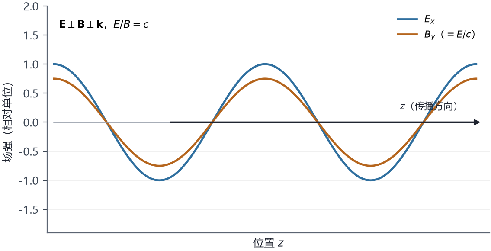
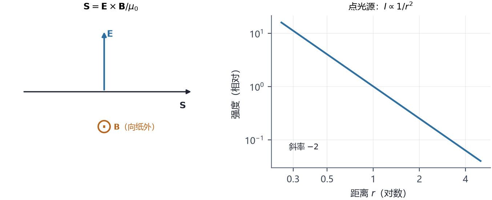
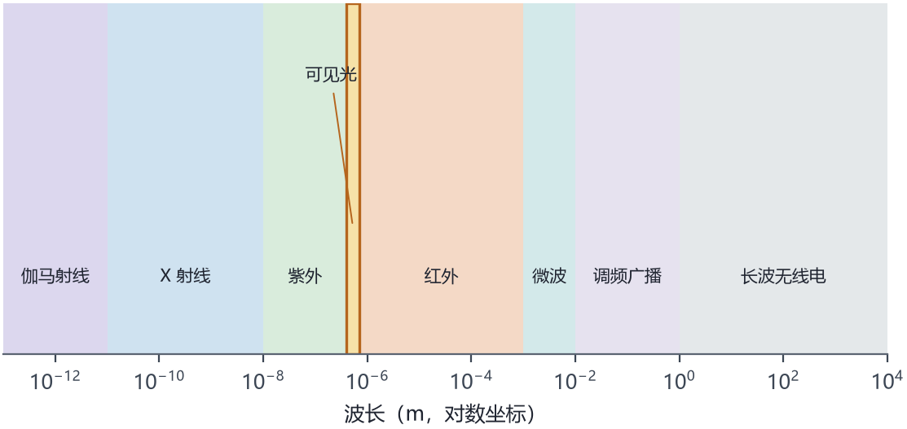
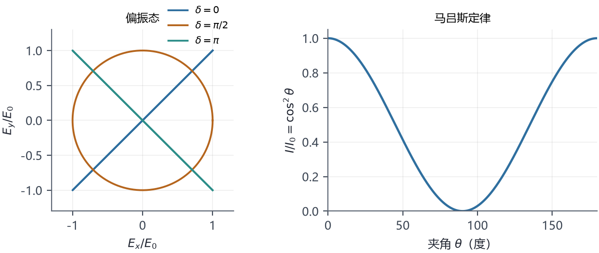

# 第 27 章 电磁波、光速与能流

## 27.1 真空中的方程组

把麦克斯韦方程组用在没有电荷、没有电流的空间：

$$\nabla\cdot\mathbf{E}=0 , \tag{27.1}$$

$$\nabla\cdot\mathbf{B}=0 , \tag{27.2}$$

$$\nabla\times\mathbf{E}=-\frac{\partial\mathbf{B}}{\partial t} , \tag{27.3}$$

$$\nabla\times\mathbf{B}=\mu_0\varepsilon_0\frac{\partial\mathbf{E}}{\partial t} . \tag{27.4}$$

四个方程的右边都没有源。场可以存在，但不由电荷产生。它们从哪来？答案是：从别处的场传来。这就是波。

## 27.2 推出波动方程

对第三个方程两边取旋度：

$$\nabla\times\left(\nabla\times\mathbf{E}\right)=-\frac{\partial}{\partial t}\left(\nabla\times\mathbf{B}\right) . \tag{27.5}$$

左边用矢量恒等式

$$\nabla\times\left(\nabla\times\mathbf{E}\right)=\nabla\left(\nabla\cdot\mathbf{E}\right)-\nabla^{2}\mathbf{E} . \tag{27.6}$$

这个恒等式可以逐分量验证，它的结构是"旋度的旋度等于梯度的散度减拉普拉斯"。由 (27.1)，$\nabla\cdot\mathbf{E}=0$，第一项为零，左边等于 $-\nabla^2\mathbf{E}$。

右边把 (27.4) 代入：

$$-\frac{\partial}{\partial t}\left(\mu_0\varepsilon_0\frac{\partial\mathbf{E}}{\partial t}\right)=-\mu_0\varepsilon_0\frac{\partial^{2}\mathbf{E}}{\partial t^{2}} . \tag{27.7}$$

两边合起来：

$$-\nabla^{2}\mathbf{E}=-\mu_0\varepsilon_0\frac{\partial^{2}\mathbf{E}}{\partial t^{2}} , \tag{27.8}$$

$$\nabla^{2}\mathbf{E}=\mu_0\varepsilon_0\frac{\partial^{2}\mathbf{E}}{\partial t^{2}} . \tag{27.9}$$

这是三维的波动方程。

对磁场做同样的操作。对第四个方程取旋度，用 (27.2) 消去 $\nabla(\nabla\cdot\mathbf{B})$，代入第三个方程：

$$\nabla^{2}\mathbf{B}=\mu_0\varepsilon_0\frac{\partial^{2}\mathbf{B}}{\partial t^{2}} . \tag{27.10}$$

两个场满足同一个方程，速度相同。

标准波动方程的形式是

$$\nabla^{2}f=\frac{1}{v^{2}}\frac{\partial^{2}f}{\partial t^{2}} , \tag{27.11}$$

$v$ 是波速。对比 (27.9)：

$$\frac{1}{v^{2}}=\mu_0\varepsilon_0\quad\Rightarrow\quad v=\frac{1}{\sqrt{\mu_0\varepsilon_0}} . \tag{27.12}$$

## 27.3 算出这个速度

代入数值。$\varepsilon_0=8.8541878128\times10^{-12}\ \mathrm{F/m}$，$\mu_0=4\pi\times10^{-7}\ \mathrm{H/m}$。

先算乘积：

$$\varepsilon_0\mu_0=8.854\times10^{-12}\times1.2566\times10^{-6}=1.1127\times10^{-17}\ \mathrm{s^2/m^2} . \tag{27.13}$$

取倒数再开方：

$$v=\frac{1}{\sqrt{1.1127\times10^{-17}}}=\frac{1}{3.3356\times10^{-9}}=2.998\times10^{8}\ \mathrm{m/s} . \tag{27.14}$$

用精确值算，结果是 $299792458\ \mathrm{m/s}$，与光速的定义值完全一致。

这个一致性是十九世纪物理学最重要的发现之一。光速是用光学方法独立测出的，与电学常数毫无关系；而 $\varepsilon_0$ 与 $\mu_0$ 是用静电、静磁实验测出的，也与光无关。两者的组合给出光速，说明光是电磁波。

麦克斯韦在 1865 年的论文里写道：这个速度与光速如此接近，以至于我们有充分的理由断定光本身就是一种电磁扰动。这句话在当时是一个大胆的推断，二十三年后被赫兹的实验证实。

## 27.4 平面波

最简单的解是平面波。设波沿 $z$ 方向传播，电场沿 $x$ 方向：

$$\mathbf{E}=E_0\cos\left(kz-\omega t\right)\hat{\mathbf{x}} . \tag{27.15}$$

$E_0$ 是振幅，$k$ 是波数，$\omega$ 是角频率。相位 $kz-\omega t$ 在 $z$ 增加、$t$ 增加时保持不变的条件是 $k\,dz-\omega\,dt=0$，即

$$v=\frac{dz}{dt}=\frac{\omega}{k} . \tag{27.16}$$

这个 $v$ 是相位速度，等于 $1/\sqrt{\mu_0\varepsilon_0}$。

验证 (27.15) 满足波动方程。对 $z$ 求两次导：

$$\frac{\partial^{2}E_x}{\partial z^{2}}=-k^{2}E_0\cos\left(kz-\omega t\right) . \tag{27.17}$$

对 $t$ 求两次导：

$$\frac{\partial^{2}E_x}{\partial t^{2}}=-\omega^{2}E_0\cos\left(kz-\omega t\right) . \tag{27.18}$$

代入 (27.9)：

$$-k^{2}=-\mu_0\varepsilon_0\omega^{2}\quad\Rightarrow\quad\frac{\omega^{2}}{k^{2}}=\frac{1}{\mu_0\varepsilon_0}=v^{2} . \tag{27.19}$$

一致。

## 27.5 磁场与电场的关系

平面波里磁场是多少？由法拉第定律 (27.3) 求。

$$\nabla\times\mathbf{E}=\begin{vmatrix}\hat{\mathbf{x}}&\hat{\mathbf{y}}&\hat{\mathbf{z}}\\ \partial_x&\partial_y&\partial_z\\ E_x&0&0\end{vmatrix}=\hat{\mathbf{y}}\frac{\partial E_x}{\partial z} . \tag{27.20}$$

只有 $y$ 分量，等于

$$\frac{\partial E_x}{\partial z}=-kE_0\sin\left(kz-\omega t\right) . \tag{27.21}$$

由 (27.3)：

$$-kE_0\sin\left(kz-\omega t\right)\hat{\mathbf{y}}=-\frac{\partial\mathbf{B}}{\partial t} . \tag{27.22}$$

对 $t$ 积分，假设没有恒定场：

$$\mathbf{B}=\frac{kE_0}{\omega}\cos\left(kz-\omega t\right)\hat{\mathbf{y}}=\frac{E_0}{v}\cos\left(kz-\omega t\right)\hat{\mathbf{y}} . \tag{27.23}$$

所以磁场沿 $y$ 方向，与电场垂直，大小是 $E/v=E/c$：

$$B=\frac{E}{c} . \tag{27.24}$$

三个矢量 $\mathbf{E}$、$\mathbf{B}$、传播方向构成右手系。$\mathbf{E}\times\mathbf{B}$ 的方向就是传播方向，这一点可以验证：$\hat{\mathbf{x}}\times\hat{\mathbf{y}}=\hat{\mathbf{z}}$。

## 27.6 能量与能流

电场能量密度 $\frac{1}{2}\varepsilon_0E^2$，磁场能量密度 $B^2/(2\mu_0)$。把 $B=E/c$ 与 $c^2=1/(\mu_0\varepsilon_0)$ 代入后者：

$$\frac{B^{2}}{2\mu_0}=\frac{E^{2}}{2\mu_0c^{2}}=\frac{E^{2}}{2\mu_0}\cdot\mu_0\varepsilon_0=\frac{1}{2}\varepsilon_0E^{2} . \tag{27.25}$$

两种能量密度相等。电磁波的能量一半在电场、一半在磁场。

总能量密度

$$u=\varepsilon_0E^{2} . \tag{27.26}$$

能量随波传播。单位时间穿过单位面积的能量，由坡印廷矢量给出：

$$\mathbf{S}=\frac{1}{\mu_0}\mathbf{E}\times\mathbf{B} . \tag{27.27}$$

它的方向是能量流动的方向，大小是能流密度，单位 $\mathrm{W/m^2}$。用 $B=E/c$：

$$S=\frac{1}{\mu_0}E\cdot\frac{E}{c}=\frac{E^{2}}{\mu_0c}=\varepsilon_0cE^{2}=cu . \tag{27.28}$$

能流密度等于能量密度乘波速，这符合"能量以速度 $c$ 随波迁移"的图像。

对时间平均。$\cos^2$ 的平均值是 $1/2$，所以

$$\bar{S}=\frac{1}{2}\varepsilon_0cE_0^{2} . \tag{27.29}$$

这个量叫波的强度，记作 $I$。它正比于振幅的平方。

代一组数。太阳光在地球轨道处的强度约 $1361\ \mathrm{W/m^2}$（太阳常数），对应的电场振幅

$$E_0=\sqrt{\frac{2I}{\varepsilon_0c}}=\sqrt{\frac{2\times1361}{8.854\times10^{-12}\times3\times10^{8}}}\approx1.0\times10^{3}\ \mathrm{V/m} . \tag{27.30}$$

一千伏每米，比空气击穿场强低三个数量级，所以阳光不会电离空气。磁场振幅 $B_0=E_0/c\approx3.3\times10^{-6}\ \mathrm{T}$，是地磁场的十分之一。

## 27.7 光的电磁本质

光速与电磁波速相同，这只是一个数值上的巧合吗？不是。

光的反射、折射、干涉、衍射、偏振，都能用电磁波解释。折射率是 $\sqrt{\varepsilon_r\mu_r}$，偏振方向就是电场的方向，干涉是两列波的相位叠加。这些现象在光学里早就有唯象的描述，电磁理论给出了它们的微观基础。

可见光的波长在 $400$ 到 $700\ \mathrm{nm}$ 之间，对应的频率是 $4.3$ 到 $7.5\times10^{14}\ \mathrm{Hz}$。这个频率比无线电波高十几个数量级，比 X 射线低几个数量级。图 27-3 把整个电磁波谱排在对数轴上。

不同波段的产生机制不同。无线电波由电路中的振荡电流产生，波长从米到千米；微波由磁控管、速调管产生；红外由分子振动与转动产生；可见光由原子外层电子的跃迁产生；紫外由内层电子跃迁；X 射线由高速电子撞击靶材产生；伽马射线由核跃迁或粒子湮灭产生。

这些机制不同，但传播的规律相同，都服从麦克斯韦方程组。这就是统一理论的力量：一个方程组覆盖了从无线电到伽马射线的全部波段。

## 27.8 辐射压

电磁波携带动量，打在物体上会产生压力。

动量密度是能量密度除以 $c$：

$$p=\frac{u}{c} . \tag{27.31}$$

这个关系对光子也成立（$p=E/c$）。电磁波被完全吸收时，传递的动量是 $u$ 每单位体积；被完全反射时是 $2u$。辐射压

$$P_{\text{rad}}=\frac{I}{c}\quad\text{（吸收）},\qquad\frac{2I}{c}\quad\text{（反射）} . \tag{27.32}$$

太阳光在地球轨道处的辐射压约 $4.5\times10^{-6}\ \mathrm{Pa}$，很小，但在真空中没有别的力，长期作用可以推动航天器。太阳帆就是利用这个压力，用巨大的薄膜接收阳光，缓慢加速。

在恒星内部，辐射压与引力平衡，决定恒星的半径。在激光聚变里，辐射压压缩靶丸。这些都是电磁波动量的直接后果。

## 27.9 电磁波的产生

这一章解出了波动方程，但没有说明波怎么产生。解是一个数学解，物理上要有源。

源是加速运动的电荷。静止电荷只有静电场，匀速运动的电荷有稳定的电场与磁场，都不辐射。只有加速度不为零时，场才能"脱开"电荷向外传播。这一点在第二十五章的位移电流里已经埋下伏笔：变化的电场产生磁场，变化的磁场又产生电场，两者互相维持，就形成了波。

辐射的功率由拉莫尔公式给出：

$$P=\frac{q^{2}a^{2}}{6\pi\varepsilon_0c^{3}} , \tag{27.33}$$

$a$ 是加速度。这个公式的推导需要推迟势，本书不展开。它说明辐射功率与加速度的平方成正比，与光速的三次方成反比。

天线就是利用这个原理：让电子在导体中来回振荡，加速度不断变化，向外辐射电磁波。振荡频率决定波长，天线的长度通常取波长的四分之一或一半，以形成共振。

## 27.10 偏振

平面波的电场在垂直于传播方向的平面里可以有不同取向，这个取向叫偏振。

任意偏振态都可以分解成两个正交的线偏振的叠加：

$$\mathbf{E}=E_x\cos\left(kz-\omega t\right)\hat{\mathbf{x}}+E_y\cos\left(kz-\omega t+\delta\right)\hat{\mathbf{y}} . \tag{27.34}$$

$\delta$ 是相位差。$\delta=0$ 或 $\pi$ 时两个分量同相或反相，合成方向固定的线偏振。$\delta=\pm\pi/2$ 且 $E_x=E_y$ 时，在 $z=0$ 处 $E_x=E_0\cos\omega t$、$E_y=\mp E_0\sin\omega t$，矢量端点画圆，叫圆偏振。其他情形是椭圆偏振。

自然光是非偏振的：大量原子独立发光，偏振方向随机。通过偏振片后变成线偏振，强度减半，因为只有一个分量通过，而 $\cos^2$ 的平均值是 $1/2$。

两个偏振片之间的透过率由马吕斯定律给出：

$$I=I_0\cos^{2}\theta , \tag{27.35}$$

$\theta$ 是两者方向的夹角。这个式子可以由投影推出：第一个偏振片出来的振幅 $E_0$，第二个只让沿其方向的分量通过，振幅变成 $E_0\cos\theta$，强度是平方。

## 27.11 驻波与谐振腔

两列相同的波相向传播，叠加成驻波：

$$E=E_0\cos\left(kz-\omega t\right)+E_0\cos\left(kz+\omega t\right)=2E_0\cos kz\cos\omega t . \tag{27.36}$$

空间分布与时间振荡分离了。波节的位置不随时间变，相邻波节的间距是半个波长。

两块金属板之间，边界条件要求电场在板面上为零，于是间距必须是半波长的整数倍：

$$L=n\frac{\lambda}{2}\quad\Rightarrow\quad f_n=n\frac{c}{2L} . \tag{27.37}$$

这样的结构叫谐振腔。微波炉腔体约 $30\ \mathrm{cm}$，基频 $500\ \mathrm{MHz}$，实际工作在 $2.45\ \mathrm{GHz}$ 的高次模式，因为水分子在这个频率吸收强。

激光器的光学腔也是这个原理：两面镜子之间的光形成驻波，只有满足 (27.37) 的频率才能起振，所以输出频率极纯。改变腔长就能调频率。

## 27.12 完整算一遍：一毫瓦激光的场强

一个激光器输出 $P=1.0\ \mathrm{mW}$，光束截面 $A=1.0\ \mathrm{mm^2}=1.0\times10^{-6}\ \mathrm{m^2}$。求平均强度、电场振幅、磁场振幅与辐射压。

强度

$$I=\frac{P}{A}=\frac{1.0\times10^{-3}}{1.0\times10^{-6}}=1.0\times10^{3}\ \mathrm{W/m^{2}} . \tag{27.38}$$

由 $I=\frac{1}{2}\varepsilon_0cE_0^2$ 反解振幅：

$$E_0=\sqrt{\frac{2I}{\varepsilon_0c}}=\sqrt{\frac{2.0\times10^{3}}{8.85\times10^{-12}\times3.0\times10^{8}}} . \tag{27.39}$$

分母 $8.85\times10^{-12}\times3.0\times10^{8}=2.66\times10^{-3}$，比值 $7.5\times10^{5}$，开方：

$$E_0=8.7\times10^{2}\ \mathrm{V/m} . \tag{27.40}$$

八百七十伏每米。这个场强比空气击穿场强（$3\times10^{6}\ \mathrm{V/m}$）低三个多数量级，所以一毫瓦的激光不会电离空气。

磁场振幅

$$B_0=\frac{E_0}{c}=\frac{8.7\times10^{2}}{3.0\times10^{8}}=2.9\times10^{-6}\ \mathrm{T} , \tag{27.41}$$

约三微特斯拉，是地磁的十六分之一。

辐射压（完全吸收）

$$P_{\text{rad}}=\frac{I}{c}=\frac{1.0\times10^{3}}{3.0\times10^{8}}=3.3\times10^{-6}\ \mathrm{Pa} . \tag{27.42}$$

三点三微帕。这个压强大约是大气压的 $3\times10^{-11}$ 倍，但用灵敏的扭秤可以测出来，光镊就是利用这个力操纵微粒。

这些数字说明一个规律：$1\ \mathrm{mW}$ 聚焦到 $1\ \mathrm{mm^2}$，场强就到千伏每米量级。功率密度越高，场强越大（与强度的平方根成正比）。把同样的功率聚焦到 $10\ \mathrm{\mu m}$ 的光斑，强度增大一万倍，场强增大一百倍，接近空气击穿。

## 27.13 完整算一遍：天线与空间衰减

一个偶极天线工作在 $f=100\ \mathrm{MHz}$。求波长与最佳天线长度。

$$\lambda=\frac{c}{f}=\frac{3.0\times10^{8}}{1.0\times10^{8}}=3.0\ \mathrm{m} . \tag{27.43}$$

半波偶极天线的长度取 $\lambda/2=1.5\ \mathrm{m}$，四分之一波长的单极天线取 $0.75\ \mathrm{m}$。这就是调频广播天线大约一米半的原因。

再看空间衰减。一个各向同性的发射机，功率 $P=1.0\ \mathrm{kW}$，在 $r=1.0\ \mathrm{km}$ 处的强度

$$S=\frac{P}{4\pi r^{2}}=\frac{1.0\times10^{3}}{4\pi\times10^{6}}=7.96\times10^{-5}\ \mathrm{W/m^{2}} . \tag{27.44}$$

对应的电场振幅由 $S=\frac{1}{2}\varepsilon_0cE_0^2$ 反解：

$$E_0=\sqrt{\frac{2S}{\varepsilon_0c}}=\sqrt{\frac{1.59\times10^{-4}}{2.66\times10^{-3}}}=\sqrt{0.0598}=0.24\ \mathrm{V/m} . \tag{27.45}$$

零点二四伏每米。这个场强很小，但接收天线加上调谐回路可以把它放大到毫伏级，足够解调。

如果距离增到 $10\ \mathrm{km}$，强度按 $1/r^2$ 降到百分之一，场强降到十分之一，$0.024\ \mathrm{V/m}$。这就是为什么远距离通信要用高增益天线或增大发射功率：场强按距离的一次方衰减，功率按平方衰减。

## 27.14 常见误解

**$\mathbf{E}$ 与 $\mathbf{B}$ 同相位，不代表能量在两者之间来回转换。** 在平面波里，两者同时达到最大、同时为零，能量密度一起涨落，但总能量随波前向外传播。LC 回路里电场能与磁场能互相转换（相位差 $90^\circ$），平面波里不是这个图像。

**光速不变指的是真空中的速度，不是介质中的速度。** 介质中 $v=c/n$，$n$ 可以到 1.5 甚至更大。频率不同 $n$ 也不同（色散），这就是棱镜分光的原因。

**辐射压很小，但在天体尺度上很重要。** 太阳帆、彗尾、恒星内部的辐射压平衡都靠它。地面上的光压通常可以忽略，除非用激光聚焦。

**电磁波不需要介质。** 十九世纪的物理学家假设了以太，迈克尔逊–莫雷实验没找到，相对论取消了它。麦克斯韦方程组本身就允许真空中的波，不需要任何介质承载。

## 27.15 再算一遍：谐振腔与偏振片

**谐振腔。** 两块平行金属板相距 $L=0.15\ \mathrm{m}$，中间是空气。由 (27.39)，允许的频率

$$f_n=n\frac{c}{2L}=n\frac{3.0\times10^{8}}{0.30}=n\times1.0\times10^{9}\ \mathrm{Hz}=n\ \mathrm{GHz} . \tag{27.46}$$

基频 $1.0\ \mathrm{GHz}$，二次模 $2.0\ \mathrm{GHz}$，依次类推。相邻模式的间隔是 $1.0\ \mathrm{GHz}$，这个间隔由腔长决定，与模式序号无关。

微波炉的腔体尺寸约 $0.30\ \mathrm{m}$，基频 $0.5\ \mathrm{GHz}$，而它工作在 $2.45\ \mathrm{GHz}$，对应第五个模式（$n=5$）。选这个频率不是因为谐振，而是因为水分子在这个频率的吸收强、磁控管的效率高。

**偏振片。** 自然光强度 $I_0$ 通过第一个偏振片后变成 $I_0/2$。再通过第二个偏振片，两者夹角 $\theta=30^\circ$，由马吕斯定律：

$$I=\frac{I_0}{2}\cos^{2}30^\circ=\frac{I_0}{2}\times0.75=0.375I_0 . \tag{27.47}$$

如果夹角 $90^\circ$，$\cos^2=0$，完全消光。

现在做一个反直觉的实验：在两个正交偏振片之间插入第三个偏振片，方向与第一个成 $45^\circ$。

不加中间片时，透射为零。加了之后：第一个到中间片 $45^\circ$：

$$I_1=\frac{I_0}{2}\cos^{2}45^\circ=\frac{I_0}{2}\times0.5=0.25I_0 . \tag{27.48}$$

中间片到第三个片（两者夹角也是 $45^\circ$）：

$$I_2=I_1\cos^{2}45^\circ=0.25I_0\times0.5=0.125I_0 . \tag{27.49}$$

透射率从零变成百分之十二点五。插入一片"挡光"的片子，反而让光通过了。

这个结果不是悖论。两个正交偏振片之间，光的偏振方向被"转"了两次，每次 $45^\circ$，总共 $90^\circ$，正好对上第三个片的透光方向。偏振片不是简单的"筛子"，它把通过的光重新投影到自己的方向上，丢掉垂直分量。每插一片，都会损失一半左右的强度，但方向被逐步旋转。

## 27.16 常见误解

**偏振片不是"只让某个方向的光通过"，而是"只让某个分量通过"。** 一束与偏振片成 $\theta$ 角的线偏振光，通过后振幅变成 $E\cos\theta$，方向变成偏振片的方向。丢掉的分量被吸收或反射，不是"被挡住"。

**自然光通过偏振片强度减半，不是因为"一半的光被挡住"。** 自然光里各个方向的偏振随机分布，投影到偏振片方向上的分量平方的平均值是 $1/2$。这是统计的结果，与具体的挡光机制无关。

**电磁波的偏振方向指电场方向，不是磁场方向。** 磁场总与电场垂直，方向由 $\mathbf{E}\times\mathbf{B}$ 指向传播方向确定。说"水平偏振"指的是电场水平。

**驻波的波节处场为零，但能量不为零。** 波节处电场为零，磁场最大；波腹处电场最大，磁场为零。能量在两个场之间来回转换，与 LC 回路的情形类似。这一点在分析腔体谐振时很重要：不能只看电场分布就判断能量分布。

### 光速与米的定义

1983 年以后，米不再由实物定义，而是由光速定义：一米是光在真空中 $1/299792458$ 秒内走过的距离。光速成为精确值，长度测量变成时间测量。

这个改变的技术意义很大：时间频率的测量精度比长度高几个数量级，用激光干涉测时间，可以把长度的相对精度做到 $10^{-17}$。这也是为什么国际单位制在 2019 年进一步把基本单位都建立在常数上。

回到电磁学：$c=1/\sqrt{\varepsilon_0\mu_0}$ 现在是定义式的一部分，$\mu_0$ 不再是精确的 $4\pi\times10^{-7}$，而是由 $c$ 与实验测定的 $\varepsilon_0$ 推出。第二十七章数值计算用的是这个新关系，结果与旧值在小数点后第十位才有差别。

---

这一章从方程组推出了波动方程，算出了速度，验证了平面波解，给出了能量与能流。核心结果是 (27.9)、(27.12)、(27.24)、(27.29)。

到此，麦克斯韦方程组的全部内容都展开了。最后一章处理单位制与边界条件，回顾四个方程的历史与意义，给全书收尾。
