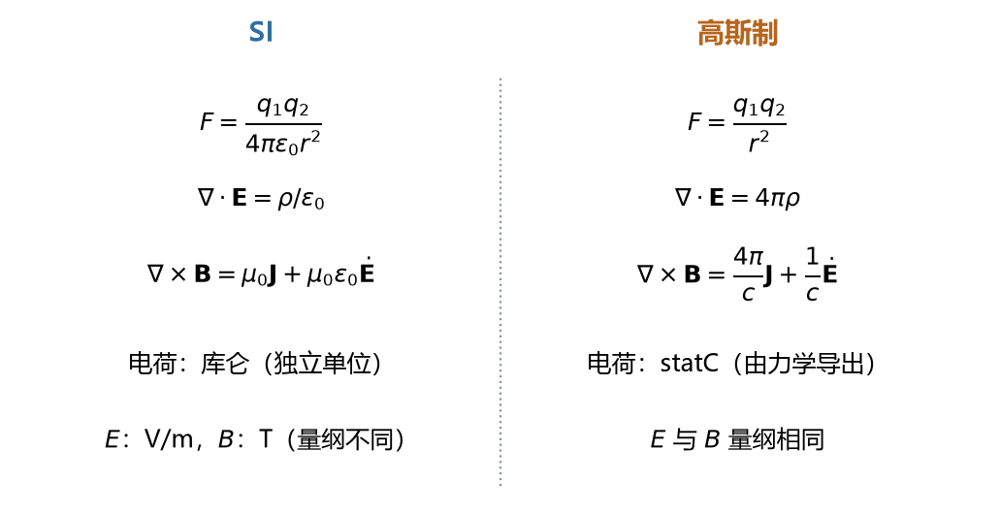
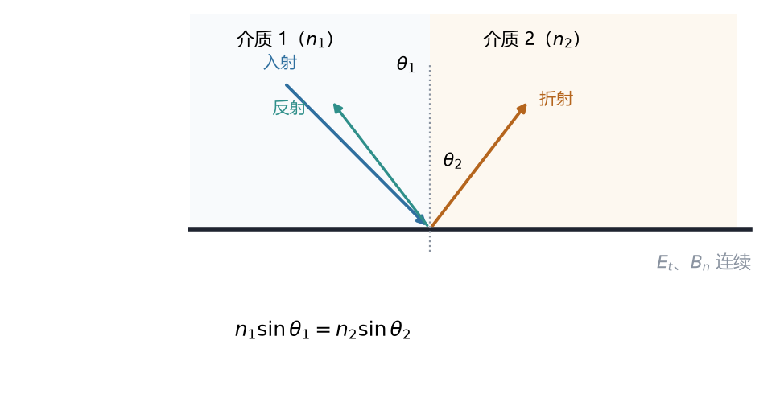

# 第 28 章 单位制、边界条件与总结

## 28.1 两套写法

麦克斯韦方程组有不止一种写法。本书一直用国际单位制（SI），还有一种在高斯制（CGS）下写的形式，两者的差别不只是单位倍数。

SI 下的真空方程组：

$$\nabla\cdot\mathbf{E}=\frac{\rho}{\varepsilon_0},\qquad\nabla\times\mathbf{E}=-\frac{\partial\mathbf{B}}{\partial t} , \tag{28.1}$$

$$\nabla\cdot\mathbf{B}=0,\qquad\nabla\times\mathbf{B}=\mu_0\mathbf{J}+\mu_0\varepsilon_0\frac{\partial\mathbf{E}}{\partial t} . \tag{28.2}$$

高斯制下：

$$\nabla\cdot\mathbf{E}=4\pi\rho,\qquad\nabla\times\mathbf{E}=-\frac{1}{c}\frac{\partial\mathbf{B}}{\partial t} , \tag{28.3}$$

$$\nabla\cdot\mathbf{B}=0,\qquad\nabla\times\mathbf{B}=\frac{4\pi}{c}\mathbf{J}+\frac{1}{c}\frac{\partial\mathbf{E}}{\partial t} . \tag{28.4}$$

差别有三处。$4\pi$ 从 $1/\varepsilon_0$ 里跑到电荷项前面；$c$ 显式出现在旋度方程里；$\varepsilon_0$ 与 $\mu_0$ 都不见了。

## 28.2 为什么会这样

根源在库仑定律的写法。SI 里写成

$$F=\frac{1}{4\pi\varepsilon_0}\frac{q_1q_2}{r^2} , \tag{28.5}$$

高斯制里写成

$$F=\frac{q_1q_2}{r^2} . \tag{28.6}$$

高斯制把比例常数取成 1，代价是电荷的单位不能再独立定义，必须由力学单位推出。SI 保留独立的电荷单位（库仑），代价是引入 $\varepsilon_0$。

这个选择影响整个体系。SI 里电场的单位是伏特每米，磁场的单位是特斯拉，两者量纲不同；高斯制里电场与磁场量纲相同，可以相加。SI 里 $\varepsilon_0$ 与 $\mu_0$ 是独立的常数，光速由它们的组合给出；高斯制里 $c$ 是基本常数，出现在方程里。

哪一套更好？工程上 SI 方便，因为电压、电流、功率的单位都是独立的、实用的。理论物理里高斯制方便，因为方程更对称，$c$ 显式出现，相对论的性质一目了然。粒子物理常用自然单位制，令 $c=\hbar=1$，连量纲都不区分了。

本书用 SI，因为读者更可能接触电路、器件、工程数据。遇到高斯制的文献时，按下面的规则换算。

## 28.3 换算

电荷：$q_{\text{SI}}=q_{\text{高斯}}\times\sqrt{4\pi\varepsilon_0}\times$ 一个数值因子。实际操作中用一个数：$1\ \mathrm{C}=3\times10^{9}\ \mathrm{statC}$（精确值 $2.998\times10^{9}$）。

电场：$1\ \mathrm{V/m}=10^{-4}/c\ \mathrm{statV/cm}\approx3.3\times10^{-5}\ \mathrm{statV/cm}$。

磁场：$1\ \mathrm{T}=10^{4}\ \mathrm{G}$（高斯），$1\ \mathrm{A/m}=4\pi\times10^{-3}\ \mathrm{Oe}$（奥斯特）。

能量密度：$1\ \mathrm{J/m^3}=10\ \mathrm{erg/cm^3}$。

换算容易出错，尤其是电场与磁场，因为两套单位制下它们的量纲关系不同。一个稳妥的办法是把公式整体换算：把 SI 公式里的 $\varepsilon_0$ 换成 $1/(4\pi)$、$\mu_0$ 换成 $4\pi/c^2$，同时把电荷的单位换掉。这样得到的式子就是高斯制。

## 28.4 边界条件回顾

第二十四章推出了四条边界条件。它们在解实际问题时是必须的，因为微分方程只在介质内部成立，界面上的行为要单独指定。

$$D_{2n}-D_{1n}=\sigma,\qquad B_{2n}=B_{1n},\qquad E_{1t}=E_{2t},\qquad H_{1t}-H_{2t}=K . \tag{28.7}$$

这四条条件的物理含义可以这样记：法向的 $\mathbf{D}$ 由自由面电荷决定，法向的 $\mathbf{B}$ 连续（没有磁荷），切向的 $\mathbf{E}$ 连续（否则沿界面的闭合回路会有非零环量而没有磁通量变化），切向的 $\mathbf{H}$ 由面电流决定。

用它们可以推出电磁波在界面上的反射与折射。设平面波从介质 1 射向介质 2，入射角 $\theta_1$，折射角 $\theta_2$。由切向分量连续，波矢的切向分量必须连续：

$$k_1\sin\theta_1=k_2\sin\theta_2 . \tag{28.8}$$

频率在两边相同（界面不改变频率），$k=\omega/v=\omega n/c$，代入：

$$n_1\sin\theta_1=n_2\sin\theta_2 . \tag{28.9}$$

这就是斯涅尔定律。折射率 $n=\sqrt{\varepsilon_r\mu_r}$，对非磁性介质 $n\approx\sqrt{\varepsilon_r}$。

反射系数、透射系数需要把电场与磁场的振幅都写出来，用四条边界条件联立求解，得到 Fresnel 公式。这些公式说明：反射光的强度随入射角变化，在某些角度（布儒斯特角）反射光完全偏振。本书不展开推导，但路径是清楚的：写出入射、反射、折射三列波的表达式，代入边界条件，解线性方程组。

## 28.5 四个方程的意义

回到四个方程。它们的意义可以从三个层面看。

**统一的层面。** 在麦克斯韦之前，电学、磁学、光学是三门独立的学问，各有各的定律。麦克斯韦方程组把三者统一：电与磁是同一个场的两个分量，光是这个场的波动。这是物理学史上第一次大统一，后来的弱电统一、标准模型都沿着这条路走。

**预言的层面。** 方程组预言了电磁波，预言了光速，预言了位移电流的磁效应。这些预言都不是从实验归纳的，而是从方程推出来的。赫兹在 1888 年的实验证实了电磁波的存在，这标志着理论物理作为一种方法的确立：先用数学推出结果，再用实验检验。

**技术的层面。** 发电机、电动机、变压器、无线电、雷达、电视、手机、光纤、微波炉，全都建立在这四个方程上。没有它们，现代电力系统与通信系统不可能存在。这不是夸张：一台发电机的设计、一条天线的尺寸、一根光纤的折射率分布，都要解麦克斯韦方程组（或者它的简化形式）。

## 28.6 经典电磁学的边界

方程组不是终极理论。它有三个边界。

**量子边界。** 在原子尺度，电磁场要量子化。光子是场的量子，电场与磁场不能同时有确定值（不确定性原理）。量子电动力学把麦克斯韦方程组作为经典极限，加上量子修正之后，电子磁矩的计算与实验符合到小数点后十二位。这是物理学里精度最高的理论。

**相对论边界。** 方程组本身满足狭义相对论，但力学定律（牛顿定律）不满足。这个矛盾在 1905 年被爱因斯坦解决：他保留麦克斯韦方程组，修改力学。所以在高速情形下，方程组仍然有效，要改的是粒子的运动方程。

**强场边界。** 场强超过施温格极限 $1.3\times10^{18}\ \mathrm{V/m}$ 时，真空会被击穿，产生正负电子对。这个场强在实验室里还达不到，但在中子星附近存在。超过这个极限，麦克斯韦方程组失效，需要量子电动力学的非微扰处理。

三个边界之外，方程组的适用范围极广。从 $10^{-10}\ \mathrm{m}$ 的原子尺度到 $10^{21}\ \mathrm{m}$ 的星系尺度，从 $10^{-20}\ \mathrm{s}$ 的快速过程到 $10^{9}$ 年的地质时间，它都成立（在适当的近似下）。

## 28.7 全书回顾

这本书从 1999 年一次单位混用的事故开始，到麦克斯韦方程组结束。中间经过了 28 章，路线是这样的。

第一篇建立运动与能量的语言：位置、速度、加速度、力、功、能量、动量。这一篇的目的是让读者能写出并解出运动方程，也为后面的能量方法打基础。

第二篇从库仑定律出发，建立电场、电势、电容。核心是"场"这个概念，以及用高斯定理和电势简化计算。

第三篇讲电流：欧姆定律的微观来源、电动势、电路定律、焦耳热。这一篇把"电荷的运动"与"能量的转换"接起来。

第四篇讲磁场：毕奥–萨伐尔定律、安培环路定理、洛伦兹力、磁介质。这一篇的推导比前面繁，因为磁场的积分不像电场那样有现成的对称性。

第五篇讲电磁感应：法拉第定律、楞次定律、自感、磁能。这一篇把"变化"引入，四个方程里的三个已经有了。

第六篇补矢量分析，把积分形式换成微分形式，补上位移电流，得到完整的方程组，解出电磁波。

这条路线不是唯一的，但它是最短的：每一步只用到前面已经建立的内容，没有跳步，没有"可以证明"。

## 28.8 最后一句话

四个方程的形式很简洁，但它们包含的内容极多。理解它们不是记住四个式子，而是知道每个符号在说什么：散度是什么，旋度是什么，为什么电场有源而磁场没有，为什么变化的场能互相激发，为什么光速由两个电学常数决定。

如果读完这本书，你能在看到一个电磁问题时，判断该用哪条方程、边界条件怎么写、近似是否成立，那这本书的目的就达到了。剩下的细节可以在任何一本电磁学教材里查到，但判断力只能靠这样的完整推导练出来。

## 28.9 数值方法

只有极少数几何能解析求解，实际问题要用数值方法。

**有限差分时域法。** 把空间分成网格，时间分成步长，用中心差分近似偏导数：

$$\frac{\partial E}{\partial t}\approx\frac{E^{n+1}-E^{n-1}}{2\Delta t},\qquad\frac{\partial E}{\partial x}\approx\frac{E_{i+1}-E_{i-1}}{2\Delta x} . \tag{28.10}$$

把方程组写成差分形式，交替更新电场与磁场，一步步推进时间。这个方法直观、容易实现，适合宽带问题与复杂几何。

稳定性条件是 Courant 条件：

$$\Delta t\le\frac{1}{c\sqrt{1/\Delta x^{2}+1/\Delta y^{2}+1/\Delta z^{2}}} . \tag{28.11}$$

时间步长必须小于波跨越一个网格所需的时间，否则数值解发散。网格缩小一半，步长也要减半，三维计算量增加八倍。

**有限元法。** 把区域分成小单元，在每个单元上用简单函数近似场，通过变分原理把偏微分方程变成线性方程组。适合复杂几何与多物理场耦合，商用软件多用这个方法。

**矩量法。** 把积分方程离散化，适合开放区域的辐射与散射（天线、雷达截面）。只需对表面离散，但对复杂结构的内存需求大。

三种方法都直接求解麦克斯韦方程组，不做额外的物理假设。误差来自离散化，加密网格可以系统减小；这一点与解析近似不同，后者丢掉的项改不回来。

## 28.10 换算例题

**例一：把 $1\ \mathrm{V/m}$ 换成高斯制。** 由 $1\ \mathrm{statV}=299.79\ \mathrm{V}$，$1\ \mathrm{m}=100\ \mathrm{cm}$：

$$1\ \mathrm{V/m}=\frac{1/299.79\ \mathrm{statV}}{100\ \mathrm{cm}}=3.34\times10^{-5}\ \mathrm{statV/cm} . \tag{28.12}$$

**例二：把 $1\ \mathrm{T}$ 换成高斯。** $1\ \mathrm{T}=10^{4}\ \mathrm{G}$，这是精确的，因为高斯的定义就是 $10^{-4}\ \mathrm{T}$。

公式的换算有一个简单规则：SI 公式里出现 $1/(4\pi\varepsilon_0)$ 的地方，高斯制里就是 1；出现 $\mu_0/(4\pi)$ 的地方，高斯制里是 $1/c^2$。电荷的单位同时要换，否则数值对不上。

这两个规则够用了。遇到一个 SI 公式，做替换就得到高斯制的形式，反之亦然。唯一容易错的是磁场，因为两套单位制下 $\mathbf{B}$ 与 $\mathbf{H}$ 的关系不同，换算时要先确认公式里用的是哪一个。

## 28.11 完整算一遍：把一组量换成高斯制

取一组 SI 数值：$E=1.0\times10^{4}\ \mathrm{V/m}$，$B=1.0\times10^{-3}\ \mathrm{T}$，$q=1.0\ \mathrm{\mu C}$。换成高斯制，并用库仑力核对。

**电场。** $1\ \mathrm{V/m}=3.34\times10^{-5}\ \mathrm{statV/cm}$（(28.12)），所以

$$E=1.0\times10^{4}\times3.34\times10^{-5}=0.334\ \mathrm{statV/cm} . \tag{28.13}$$

**磁场。** $1\ \mathrm{T}=10^{4}\ \mathrm{G}$：

$$B=1.0\times10^{-3}\times10^{4}=10\ \mathrm{G} . \tag{28.14}$$

**电荷。** $1\ \mathrm{C}=3.0\times10^{9}\ \mathrm{statC}$：

$$q=1.0\times10^{-6}\times3.0\times10^{9}=3.0\times10^{3}\ \mathrm{statC} . \tag{28.15}$$

**核对库仑力。** 两个这样的电荷相距 $r=0.10\ \mathrm{m}$，SI 下

$$F=\frac{1}{4\pi\varepsilon_0}\frac{q^{2}}{r^{2}}=8.99\times10^{9}\times\frac{10^{-12}}{10^{-2}}=0.899\ \mathrm{N} . \tag{28.16}$$

高斯制下 $F=q^2/r^2$，但长度要用厘米，电荷用 statC：

$$F=\frac{\left(3.0\times10^{3}\right)^{2}}{\left(10\ \mathrm{cm}\right)^{2}}=\frac{9.0\times10^{6}}{100}=9.0\times10^{4}\ \mathrm{dyn} . \tag{28.17}$$

换算：$1\ \mathrm{N}=10^{5}\ \mathrm{dyn}$，所以 $F=0.90\ \mathrm{N}$，与 SI 一致（差别来自 $3.0$ 与 $2.998$ 的取整）。

这个核对说明：换算不只是乘系数，电荷、长度、力的单位要一起换。只换电荷不换长度，力会差 $10^{4}$ 倍。

## 28.12 常见误解

**高斯制不是"没有常数"，而是把常数藏进了单位。** 库仑定律写成 $F=q_1q_2/r^2$，看起来没有 $4\pi\varepsilon_0$，但电荷的单位 statC 里已经包含了它。两套写法描述同一个物理，只是把常数放在方程里还是放在单位定义里。

**单位制混用是工程事故的常见原因。** 火星气候探测者号的失败就是牛顿秒与磅力秒混用。凡是跨系统交换数据的地方（接口、文件格式、传感器读数），都要明确标注单位，并在代码里做类型区分。

**SI 与高斯制给出的数值不同，物理结论必须相同。** 如果换算后发现能量不守恒、力方向反了，多半是换算系数或量纲搞错，而不是物理错了。

**"自然单位制令 $c=1$"不是"光速等于 1 米每秒"。** 它是把 $c$ 当作无量纲的 1，用来简化公式，时间与长度用同一单位（比如秒或米）度量。这种写法在高能物理里通用，在工程里没有意义。

## 28.13 再算一遍：数值方法的步长

用时域有限差分法模拟一个 $1\ \mathrm{GHz}$ 的电磁问题。网格取 $\Delta x=0.50\ \mathrm{mm}$，求允许的时间步长，并估算模拟 $1\ \mathrm{ns}$ 需要的步数。

Courant 条件（一维情形）：

$$\Delta t\le\frac{\Delta x}{c}=\frac{5.0\times10^{-4}}{3.0\times10^{8}}=1.7\times10^{-12}\ \mathrm{s}=1.7\ \mathrm{ps} . \tag{28.18}$$

模拟 $1\ \mathrm{ns}$ 需要

$$N=\frac{1.0\times10^{-9}}{1.7\times10^{-12}}\approx590\ \text{步} . \tag{28.19}$$

三维情形还要除以 $\sqrt{3}$：

$$\Delta t\le\frac{\Delta x}{c\sqrt{3}}=0.96\ \mathrm{ps} , \tag{28.20}$$

步数增加到约 $1040$。

再看计算量。三维网格 $100\times100\times100=10^{6}$ 个格点，每个格点每步要更新六个场分量，大约十次浮点运算，总共

$$10^{6}\times1040\times10\approx1.0\times10^{10}\ \text{次运算} . \tag{28.21}$$

十亿次量级。现代计算机每秒可以做 $10^{9}$ 到 $10^{10}$ 次浮点运算，所以这个模拟要几秒到几十秒。如果网格加密一倍（$200^3$），格点数增八倍，步长减半，总计算量增十六倍，需要几分钟。

这个估算说明数值方法的一个基本矛盾：精度靠加密网格，代价是计算量按四次方增长（三维：格点数 $\times8$，步数 $\times2$）。所以实际模拟要在精度与时间之间折中，常用非均匀网格（在细节处加密、在远处放粗）来缓解。

## 28.14 单位与符号的最后提醒

写物理公式时，单位不写在式子里，只在数值旁标注。这是惯例，但要求每一步都清楚每个符号的单位。检查的办法是把单位代进去，看两边的量纲是否一致。

举个例子：$c=1/\sqrt{\varepsilon_0\mu_0}$。右边 $\varepsilon_0$ 的单位是 $\mathrm{F/m}$，$\mu_0$ 是 $\mathrm{H/m}$，乘积是 $\mathrm{F\cdot H/m^2}$。由 $\mathrm{F=C/V}$、$\mathrm{H=V\cdot s/A}$，乘积是 $\mathrm{C\cdot s/(A\cdot m^2)}=\mathrm{s^2/m^2}$（因为 $\mathrm{C/A}=\mathrm{s}$）。开方取倒数，得 $\mathrm{m/s}$，是速度的单位。量纲检查通过。

再举一个容易错的：能量密度 $\frac{1}{2}\varepsilon_0E^2$。$\varepsilon_0$ 是 $\mathrm{F/m}=\mathrm{C/(V\cdot m)}$，$E^2$ 是 $\mathrm{V^2/m^2}$，乘积是 $\mathrm{C\cdot V/m^3}=\mathrm{J/m^3}$。正确。如果漏掉 $\frac{1}{2}$，量纲不变，但数值差一倍，量纲检查查不出来。所以量纲只能查出"形式错误"，查不出"系数错误"，系数要靠推导与核对。

这本书从单位与量纲开始，到这里以单位与量纲结束。中间二十八章的所有推导，都可以用同一条标准检查：每一步的单位对得上，每一步的依据说得清。这两条做到了，公式就不会记错，结论也不会用错。

### 两个常数的历史

$\varepsilon_0$ 与 $\mu_0$ 的数值不是"自然给出的"，而是单位制选择的结果。SI 定义了安培，就定下了 $\mu_0$；定义了库仑，就定下了 $\varepsilon_0$。两者相乘给出 $1/c^2$，这个关系是物理的，数值是约定的。

这就是为什么换到高斯制，$\varepsilon_0$ 与 $\mu_0$ 都消失了，只剩下 $c$：高斯制没有为电磁量单独定义单位，把它们都归到力学单位上。两种写法的物理相同，只是"把常数放在哪里"不同。

读文献时如果看到公式里突然出现 $4\pi$ 或 $c$，先确认它用的是哪套单位制，再决定要不要换算。这个习惯能省掉很多困惑。

### 结束语

四个方程、四条边界条件、三个本构关系，构成经典电磁学的全部。这本书把从中学物理到它们的路走了一遍，每一步都给出了依据。剩下的工作是把它们用到具体问题上：一台电机、一副天线、一块电路板、一束光。用到哪一步，就回头查哪一章。

---

从一根铜管里的磁铁，到真空中的一列电磁波，中间隔着一整套语言。这套语言现在归你了。
