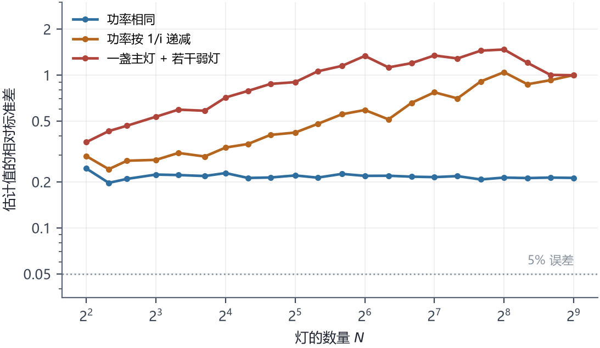
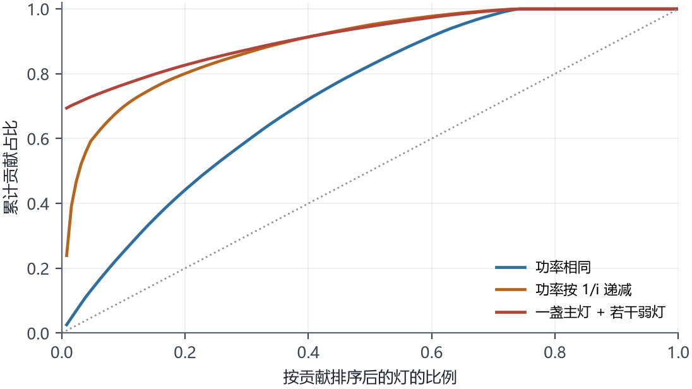
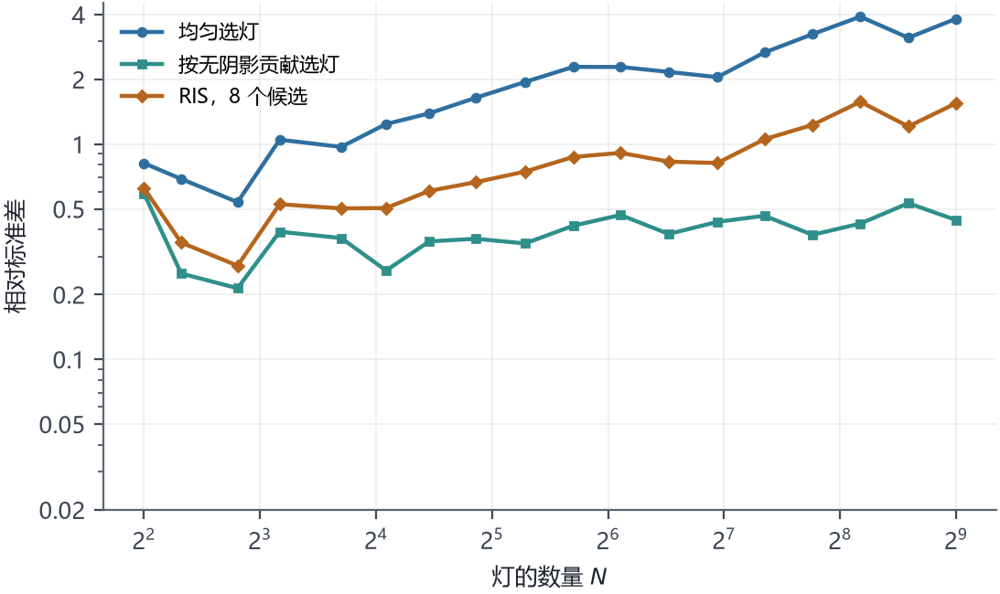

# 第 1 章 一百盏灯，一次采样

## 1.1 一盏灯的时候一切都好

一个点光源、一个漫反射面、每个像素发一条阴影光线。这个配置下渲染器几乎是精确的：着色点能被照亮还是被挡住，一条光线就能回答，而答案只有两种，方差乘以 1/1 就等于它自己。你加上抗锯齿用的几个子像素样本，图像就干净了。

再放第二盏灯。每个像素仍然只有一条阴影光线，于是它随机挑一盏灯，把结果乘二。这仍然无偏，但相邻像素挑的灯不同，一个有影子一个没有，图像上出现椒盐一样的斑点。把灯加到一百盏，每个像素从一百盏里挑一盏，乘一百。这时斑点不再是"噪一点"，它是彻底的失效：大部分像素恰好挑中一盏对本像素贡献很小的灯，乘上一百之后仍然很小；少数像素挑中主灯，一下子亮出十倍。像素之间的差别不再反映场景，只反映抽签结果。

这件事有一个很干净的定量描述，而它决定了这本书后面所有的设计。

## 1.2 均匀选灯的方差

把着色点上的直接光照写成对灯的求和。第 $k$ 盏灯对这个点的贡献是

$$f_k=\frac{1}{d_k^{2}}\,L_k\,V_k\,\cos\theta_k , \tag{1.1}$$

其中 $d_k$ 是灯到点的距离，$L_k$ 是灯的辐射亮度，$V_k$ 是可见性（被挡住为 0），$\cos\theta_k$ 是入射方向与法线的夹角余弦。BRDF 与面积项都折进了常数里，不影响下面的讨论。真实的直接光照是

$$I=\sum_{k=1}^{N}f_k . \tag{1.2}$$

均匀选灯的意思是：以概率 $1/N$ 挑一个下标 $k$，用

$$F=N f_k \tag{1.3}$$

估计 $I$。它对不对？把 $F$ 在所有可能的下标上取平均，

$$\mathbb{E}[F]=\sum_{k=1}^{N}\frac{1}{N}\cdot N f_k=\sum_{k=1}^{N}f_k=I , \tag{1.4}$$

所以它是无偏的。乘 $N$ 那一步不是随手写的，它是"以 $1/N$ 的概率挑中一个，就要除以 $1/N$"这条规则的直接结果。

方差要稍微多算一步。$F$ 只能取 $N$ 个值，第 $k$ 个值是 $Nf_k$，概率 $1/N$，于是

$$\mathbb{E}[F^2]=\sum_k \frac{1}{N}\,(Nf_k)^2=N\sum_k f_k^2 , \tag{1.5}$$

$$\operatorname{Var}[F]=N\sum_{k=1}^{N}f_k^2-I^2 . \tag{1.6}$$

用 $K$ 个独立样本取平均，方差除以 $K$，相对标准差是

$$\frac{\sigma_F}{I}=\frac{1}{I}\sqrt{\frac{N\sum_k f_k^2-I^2}{K}} . \tag{1.7}$$

式 (1.6) 里那两项的对比很说明问题。$\sum f_k^2$ 是贡献的平方和，$I^2$ 是和的平方。如果所有灯贡献相同，$f_k=I/N$，那么 $N\sum f_k^2=I^2/N$，方差是 $I^2(N-1)/N$，相对标准差约 $1/\sqrt{K}$——和灯数无关。这是均匀采样的最好情况：多加灯不变得更糟。

一旦贡献不均匀，情况就反过来了。设

$$N_{\text{eff}}=\frac{\left(\sum_k f_k\right)^2}{\sum_k f_k^2} , \tag{1.8}$$

代入 (1.6) 得到

$$\operatorname{Var}[F]=I^2\left(\frac{N}{N_{\text{eff}}}-1\right),\qquad
\frac{\sigma_F}{I}\approx\sqrt{\frac{N}{N_{\text{eff}}K}} . \tag{1.9}$$

$N_{\text{eff}}$ 叫有效灯数：一百盏灯里真正起作用的那几盏的数量。式 (1.9) 说明误差同时被两个方向推大，加灯让 $N$ 变大，让贡献更集中在少数几盏上又让 $N_{\text{eff}}$ 变小。

图 1-1 是这个式子的直接后果。功率相同时，误差停在 0.2 附近不动；功率按 $1/i$ 递减时，灯从 16 盏加到 256 盏，相对标准差从 0.32 涨到 1.0；一盏主灯带一群弱灯时，只要十几盏灯，误差就超过 1——意思是估计值的波动比它要估的量还大。

具体到数字：64 盏灯、功率按 $1/i$ 递减的场景，每像素一条阴影光线时相对标准差是 1.7。要把误差压到 1%，需要

$$K\approx\left(\frac{1.7}{0.01}\right)^2\approx 2.9\times 10^{4}$$

条阴影光线。256 盏灯时要 $1.6\times10^{5}$ 条。

图 1-2 换个角度看同一件事。功率按 $1/i$ 递减时，前 10% 的灯承担 69% 的贡献，有效灯数是 10.5；功率集中在一盏主灯上时，前 10% 的灯承担 76%，有效灯数只有 2.1。你有 128 盏灯要做决定，而真正需要问的只有两三盏。

## 1.3 按贡献选灯，以及它的代价

既然误差来自"挑错了灯"，那就按贡献挑。定义每盏灯的**无阴影贡献**

$$b_k=\frac{1}{d_k^{2}}\,L_k\,\cos\theta_k , \tag{1.10}$$

它和 $f_k$ 只差一个可见性。令 $B=\sum_k b_k$，按 $p_k=b_k/B$ 选灯，用

$$F=\frac{f_k}{p_k} \tag{1.11}$$

估计 $I$，方差是

$$\operatorname{Var}[F]=\sum_{k=1}^{N}\frac{f_k^2}{p_k}-I^2 . \tag{1.12}$$

同样的 64 盏灯，误差压到 1% 只需要约 1050 条阴影光线，比均匀选灯省 28 倍。在图 1-3 里，这条曲线在所有灯数下都待在 0.3 到 0.6 之间，几乎不随 $N$ 上升。原因是它可以解析地化简。把 $f_k=b_kV_k$ 与 $p_k=b_k/B$ 代进 (1.11)：

$$F=\frac{b_kV_k}{b_k/B}=B\,V_k . \tag{1.13}$$

$b_k$ 被约掉了。按无阴影贡献选灯时，估计量等于"整个无阴影贡献之和"乘上"被选中那盏灯的可见性"。前者是个确定的数，后者是一个 0 或 1。这就是那条曲线平坦的原因：它的误差完全不来自灯的分布，只来自那一次可见性查询的运气。

代价有三项。

第一，要按 $b_k$ 采样，得能 $O(1)$ 地抽一个下标。贡献分布每帧都变（物体动、相机动、灯动），所以要么每帧重建一次别名表（$O(N)$），要么用分层结构。这比"随机取模"贵得多，但仍在可接受范围。

第二，$b_k$ 需要遍历所有灯才能算出来，$N$ 大时这笔开销不小。实践中用聚簇或者粗层级的代理来做，代价是分布不再精确。

第三，也是更要紧的一项：$p_k$ 只能用无阴影贡献来定，因为真实的 $f_k$ 需要一条阴影光线才知道，而阴影光线正是我们想省的东西。于是一盏被完全挡住的灯仍然分到很大的 $p_k$，样本落在它上面，加权之后得到零。式 (1.13) 已经把这个后果摆出来了：估计量的误差就是 $V_k$ 的波动。$V$ 是伯努利(0.75) 时，相对标准差是 $\sqrt{0.25/0.75}\approx0.58$，和实测的 0.32 到 0.6 吻合。

## 1.4 一条阴影光线的信息量

上面这段推导值得停下来看清楚：最好的候选分布也只能把误差压到"一次可见性查询的方差"这个量级。一条阴影光线给出的是"这盏灯对这个点是否可见"，是一个比特。要降低这个比特带来的噪声，只有两条路：多问几次，或者问一个已经知道答案的人。

多问几次的代价是线性的。每像素 16 条光线，误差降 4 倍，要到 1% 就得几千条。1024×768 的一帧、每秒 60 帧，这个数字会把任何硬件的预算吃光。

第二条路在图像里到处都是答案。相邻的两个像素，遮挡关系几乎一样：同一个墙角把同一盏灯挡住，同一个手指在同一个位置上投影。相邻的两帧更是如此，相隔十六毫秒，场景几乎没动。然而一个逐像素独立采样的渲染器把这些答案全部丢掉了，每个像素、每一帧都从零开始问同样的问题。

现有的复用发生在图像空间，也就是降噪器里。它看邻域的颜色，把相近的像素平均一下。这确实压了噪声，但它不知道那些颜色背后是哪盏灯、以什么概率被选中、权重是多少。它只能看颜色，所以只能在颜色层面做平滑，遇到几何边缘就得停下来，遇到一个像素恰好抽中主灯而邻居没有的情况就无能为力。

信息是存在的，丢在了记录格式上。每个像素其实只想记住三件事：我最后选中的是哪盏灯，它值多少，我是从多少个候选里把它挑出来的。这三件事加起来不到二十个字节。有了它，邻居的结论就可以严格地并进自己的估计里，而不是在颜色空间里糊一下。

## 1.5 这本书要解决的问题

图 1-3 把三种做法放在一起。均匀选灯的曲线一路往上，到 256 盏灯时相对标准差接近 3；按无阴影贡献选灯稳定在 0.5 以下；RIS 用 8 次灯求值加 1 条阴影光线，取到两者之间。三条曲线共同的下界是那条可见性噪声的水平线，谁都压不下去，因为大家都只用了一条阴影光线。

压这条线的办法只有一个：让一个像素用上别的像素、别的帧已经付过费的阴影光线。难点在于，别人的样本是按别人的分布抽的，直接拿来用会引入偏差，而渲染最不能容忍的就是偏差——它不会像噪声那样随样本数消失，它会留在图里，表现为整体偏亮、接触阴影发灰、运动时亮度抖动。

所以后面九章讲的是同一件事的两个侧面：怎么把样本借过来，以及怎么保证借过来之后仍然无偏。第 2 章先把"一个像素内部怎么从多个候选里挑一个"讲清楚，给出蓄水池采样与 RIS 的无偏性证明。那个证明里的每一个条件，在后面做时空复用时都会变成一条必须满足的工程约束。

---

一百盏灯、一条阴影光线的场景里，误差的主项不是"样本不够多"，而是"样本用错了地方"。均匀选灯的方差随灯数线性增长，按贡献选灯能把它压住，但压到一个由单次可见性查询决定的水平就停住了。要越过这个水平，唯一的资源是已经被其他像素和其他帧算出来的可见性。把它用起来需要一种能携带"样本、权重、候选数"三件东西的数据结构，这就是下一章的蓄水池。
