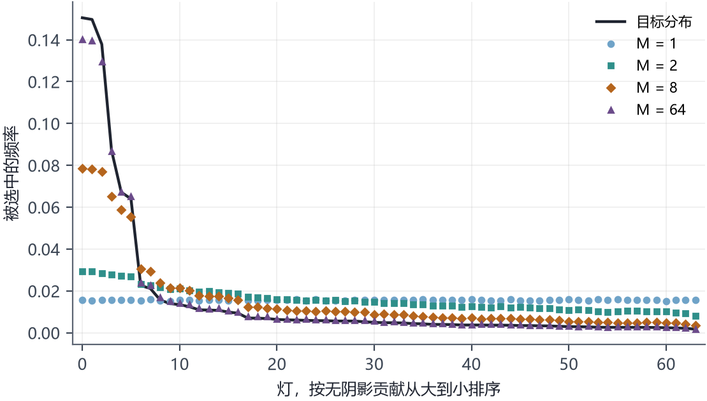
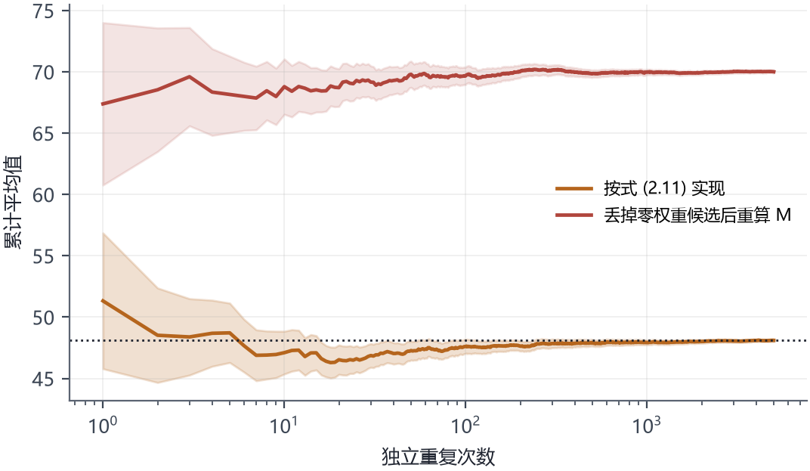
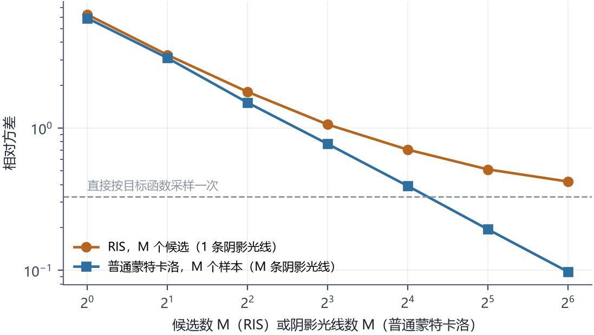
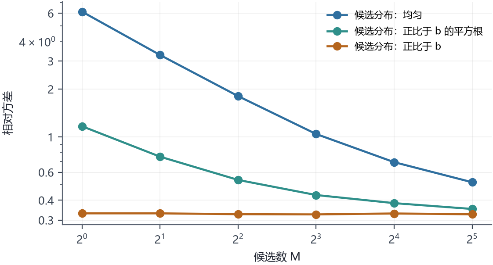

# 第 2 章 蓄水池：只留一个，但记住它怎么被选中

## 2.1 采不出来的分布

第 1 章的结论是：如果按灯的贡献选灯，一盏灯的场景里的方差可以从 1.7 降到 0.32。这句话藏了一个前提——你能按任意给定的分布抽样。

对直接光照来说，"按无阴影贡献抽样"是可以做到的。遍历所有灯算出 $b_k$ 与 $B=\sum b_k$，建一张别名表，之后每次抽样都是 $O(1)$。代价是每帧重建一次，但在几十万盏灯的量级上仍然划算。

真正麻烦的是那些连形式都不固定的分布。想要的目标其实不是 $b$，而是 $f=bV$：没有可见性的灯不该被选中。可是 $V$ 要一条阴影光线才知道，而省下阴影光线正是这件事的目的。于是出现一种循环：想按理想分布采样，理想分布需要影子；想要影子，又得先采样。

时间复用把这个循环勒得更紧。一个像素在这一帧最好的采样分布，是它上一帧的估计值——上一帧已经知道哪盏灯对它重要。这个分布每帧都变，没有解析形式，也没有归一化常数。空间复用同理，目标函数是邻域若干像素估计的和，形式取决于邻居最后选中了谁。

这些分布的共同点是：给定任意一个候选，你都能算出它的权重；但你说不出总权重，也说不出怎么从这个分布里直接抽一个。能做的操作只有"评估"，没有"抽样"。

重采样的全部内容，就是在只有评估能力的前提下，得到一个看起来像是从目标分布里抽出来的样本。这个说法可以做得非常严格，严格到有限样本数下也成立。

## 2.2 蓄水池：只留一个

先看不带权重的问题。一个长度未知的数据流，内存里只能放一个元素，要求每个元素被留下的概率相同。Vitter 1985 给出的做法叫蓄水池采样：先留第一个；读到第 $k$ 个时，以 $1/k$ 的概率用它顶掉手里的那个。

正确性一行就能看出来。第 $k$ 个元素最终被留下的概率等于"它在第 $k$ 步被选中"乘上"它在后面每一步都没被顶掉"：

$$\frac{1}{k}\prod_{j=k+1}^{n}\left(1-\frac{1}{j}\right)=\frac{1}{k}\cdot\frac{k}{n}=\frac{1}{n} . \tag{2.1}$$

关键在那个乘积刚好望远镜式地消掉。这个结构在后面会以另一种形式出现。

加权版本（Chao 1982）把"以 $1/k$ 的概率替换"换成"以 $w_k/(W_{k-1}+w_k)$ 的概率替换"，其中 $W_{k-1}$ 是已经看过的元素权重之和。留下的元素最终满足

$$\Pr[\text{留下第 } i \text{ 个}]=\frac{w_i}{\sum_j w_j} . \tag{2.2}$$

这个版本对渲染更贴切：候选的"权重"就是它对最终图像的贡献。留下贡献最大的那个，听起来正是重要性采样想要的事。

## 2.3 RIS 的三个量

蓄水池采样一次只看一个元素，不方便做方差分析。Talbot 等人 2005 年把它改写成批处理的形式，命名为重采样重要性采样（resampled importance sampling，RIS）：一次抽 $M$ 个候选，按权重挑一个，并且把权重和留下来。

定义两个函数。**候选分布** $p$ 是能直接抽的那个，一般是均匀或者正比于某个便宜的量。**目标函数** $\hat p$ 是想抽但抽不出来的那个，不必归一化。两者之比

$$w(x)=\frac{\hat p(x)}{p(x)} \tag{2.3}$$

就是这个候选的权重。从 $M$ 个独立同分布的候选 $x_1,\dots,x_M$ 里，以

$$\Pr[y=x_i]=\frac{w(x_i)}{\sum_{j=1}^{M}w(x_j)} \tag{2.4}$$

的概率选中一个，然后估计

$$F=\left(\frac{1}{M}\sum_{i=1}^{M}w(x_i)\right)\cdot\frac{f(y)}{p(y)\,w(y)} . \tag{2.5}$$

这个式子里有三个量要留下来：选中的样本 $y$、权重和 $\sum w$、候选数 $M$。它有一个更常用的等号右边：

$$F=\frac{f(y)}{\hat p(y)}\cdot\frac{1}{M}\sum_{i=1}^{M}\frac{\hat p(x_i)}{p(x_i)} , \tag{2.6}$$

把 $w=\hat p/p$ 代进去就得到，两边的差别只是写法的方便程度。式 (2.6) 读起来很清楚：括号外是"用目标分布做重要性采样"的那一项 $f/\hat p$，括号内是目标分布在候选集上的平均质量。前者逐样本变化，后者是整批候选共有的一个标量。这个拆分在后面的复用里会变成两件分开保存的东西，也是偏差的入口。

## 2.4 为什么它无偏

定理：设 $x_1,\dots,x_M$ 独立同分布于 $p$，$y$ 按 (2.4) 选出，$\hat p(x)>0$ 在 $f(x)\neq 0$ 处成立，则 (2.5) 定义的 $F$ 满足 $\mathbb{E}[F]=\int f$，对任意正整数 $M$ 成立。

证明分四步。

**第一步，把候选集固定住。** 记 $S=(x_1,\dots,x_M)$，$W=\sum_i w(x_i)$。条件在 $S$ 上，唯一剩下的随机性是"选中哪一个"。此时 $y$ 的分布是离散的，(2.4) 给出每个候选的概率。

**第二步，算条件期望。** 把 (2.5) 里与选择无关的部分提出来：

$$\mathbb{E}[F\mid S]=\frac{W}{M}\,\mathbb{E}\left[\frac{f(y)}{p(y)w(y)}\,\middle|\,S\right]
=\frac{W}{M}\sum_{i=1}^{M}\frac{w(x_i)}{W}\cdot\frac{f(x_i)}{p(x_i)w(x_i)} . \tag{2.7}$$

这一步只用了 $y$ 的条件分布，没有任何近似。注意 $W$ 和 $w(x_i)$ 都消掉了：

$$\mathbb{E}[F\mid S]=\frac{1}{M}\sum_{i=1}^{M}\frac{f(x_i)}{p(x_i)} . \tag{2.8}$$

这一步是整个证明的核心。式 (2.5) 里那个看起来别扭的 $\frac{1}{M}\sum w$ 与分母上的 $w(y)$，恰好是为了让"按 $w$ 加权平均"和"除以 $w$"互相抵消。

**第三步，对候选集取期望。** (2.8) 的右边是 $M$ 个独立同分布随机变量的平均，每个的期望是

$$\mathbb{E}\left[\frac{f(x)}{p(x)}\right]=\int \frac{f(x)}{p(x)}\,p(x)\,dx=\int f(x)\,dx . \tag{2.9}$$

于是

$$\mathbb{E}[F]=\frac{1}{M}\cdot M\int f=\int f . \tag{2.10}$$

**第四步，看条件被用在哪里。** 整个证明只依赖两件事：候选独立同分布于 $p$，选择概率严格等于 $w/\sum w$。它没有用 $\hat p$ 的归一化常数，没有用 $M$ 趋于无穷，也没有要求 $\hat p$ 接近 $f$。目标函数选得差只影响方差，不影响期望。

这个结论的分量在于：$M$ 可以等于 1。此时 (2.5) 退化成 $f(x_1)/p(x_1)$，就是普通的蒙特卡洛。随着 $M$ 变大，估计量从"普通蒙特卡洛"连续地滑向"按目标分布采样"，中间每一步都还是无偏的。



图 2-1 是这件事的可视化。64 盏灯里最强的一盏，在 $M=1$ 时被选中的频率是 0.016，恰好是均匀分布的 $1/64$；$M=8$ 时升到 0.079；$M=64$ 时 0.140，接近目标的 0.151。分布被"重采样"过来了，代价是 64 次灯求值。

## 2.5 四个条件，以及违反它们会发生什么

定理里的两个前提在实现时都有可能被破坏，另外还有两条容易被忽略的隐含要求。它们后面会反复出现。

**支持条件。** $\hat p(x)>0$ 必须在 $f(x)\neq 0$ 的地方成立。如果某盏灯有贡献但权重为零，它永远不会被选中，那部分能量就丢了，估计偏小。反过来，$\hat p$ 在 $f=0$ 处大于零没有关系，只是浪费候选。

**选择概率必须严格正比于 $w$。** 包括那些 $w=0$ 的候选：它们占着分母。这一点在加速结构里最容易出错，因为"零权重的候选可以跳过"是很有诱惑力的优化。

**$M$ 是最初抽的候选数。** 不是有效候选数，不是非零权重候选数。把它换成后者，等于偷偷改变了权重和的尺度。

**候选同分布，且 $p$ 与 $\hat p$ 在同一次评估下取值。** 混入来自别处的样本时，$p$ 和 $\hat p$ 分别是哪一套，必须记清楚。

第三条的错误值得看一眼它有多严重。取 64 盏灯、其中 44 盏可见，令目标函数包含可见性，$\hat p=f$，那么 20 盏灯的权重是零。丢掉它们并把 $M$ 改成非零个数，等于把权重和除以了一个更小的数。图 2-2 里那条红线是这么算出来的，它收敛到 70.0，而真值是 48.1，偏了 45.5%。这个错误不会带来任何视觉上的异常：图像只是亮了将近一倍，看起来像"曝光调高了"。



## 2.6 一份能跑的实现

把上面的式子写成代码，只需要两个函数。第一个抽候选并选中一个，第二个用蓄水池算亮度。

```python
import numpy as np

def ris_step(phat, M, rng, p=None):
    """phat 与 p 形状为 (N,)。返回 (y, wsum)。"""
    N = phat.size
    p = np.full(N, 1.0 / N) if p is None else p
    idx = rng.integers(0, N, size=M)
    w = phat[idx] / p[idx]          # 零权重也留着，它占分母
    wsum = w.sum()
    cdf = np.cumsum(w) / wsum
    sel = min(np.searchsorted(cdf, rng.random()), M - 1)
    return idx[sel], wsum

def shade(f, p, y, wsum, M, phat):
    """f 是真实贡献，按样本取值。"""
    return f[y] / p[y] * (wsum / M) / (phat[y] / p[y])
```

`shade` 里那个 `(wsum / M) / (phat[y] / p[y])` 就是 (2.5) 的后半段。把它写成两步（先算 $W/M$，再除以 $w(y)$）不是风格问题：复用的时候，$W$ 来自一个地方，$w(y)$ 来自另一个地方，两者会被分别重新计算，这正是第 4 章的主题。

用这两个函数跑本文的实验，$M=8$ 时相对标准差 1.07，$M=64$ 时 0.42，$M=1024$ 时 0.336，理论极限 0.330——那个极限是"按 $\hat p$ 采一次"的方差，见下一节。

## 2.7 方差：候选数、目标函数、候选分布

无偏性只管期望。真正决定图像能不能看的是方差，而 (2.5) 的方差由三样东西决定：候选数 $M$、目标函数 $\hat p$ 与真实贡献 $f$ 的接近程度、候选分布 $p$ 与 $\hat p$ 的接近程度。



图 2-3 里有两条曲线和一条水平线。水平线是理想值：如果能直接从 $\hat p$ 抽一个样本，方差会是多少。RIS 从上面逼近它，但永远到不了，因为 RIS 只用了一条阴影光线，而那条光线给出的可见性只有 0 或 1 两个结果，它的方差就是整个估计的方差下限。普通蒙特卡洛那条线可以用更多光线把这个下限压下去，代价是线性的。

64 盏灯的场景里，$M=64$ 的 RIS 相对方差是 0.42，要 8 条阴影光线的普通蒙特卡洛才能达到同样的 0.42。灯求值比阴影光线便宜一个数量级，这笔交换就是 ReSTIR 的全部经济基础。



图 2-4 拆开另一个因素。目标函数固定，候选分布取 $p\propto \hat p$ 时方差是一条水平线 0.33，加候选没有用；取均匀候选时，$M=1$ 的方差是 6.1，$M=32$ 才降到 0.51。中间那档 $p\propto\sqrt{\hat p}$ 落在两者之间。

这条规律决定了实际系统怎么选候选分布。直接光照里候选是灯，均匀抽一盏灯很便宜，所以用均匀候选、靠 $M$ 把它拉上来；如果场景有几千盏灯、贡献差异巨大，均匀候选要几百个 $M$ 才够，这时候才值得建别名表或者层级结构。而在复用场景里，候选来自别的像素的蓄水池，那些样本本来就偏向了重要区域，相当于用了一个已经接近 $\hat p$ 的候选分布，所以 $M$ 可以很小——这是时空复用能便宜的原因。

还有一件图里看不出来但很重要的事：$\hat p$ 与 $f$ 的接近程度只影响方差。取 $\hat p=b$（不含可见性）时，估计量对任意 $M$ 都无偏；取 $\hat p=f$ 时同样无偏，但方差更低，因为零权重的候选让选择更集中。这就是第 4 章要处理的问题的起点——$\hat p$ 越接近 $f$ 越省样本，可越接近就越需要知道 $f$ 的细节，而 $f$ 的细节正是阴影光线要买的东西。

---

蓄水池只存三个量：样本、权重和、候选数。它对外提供两件事——一个像是从目标分布里抽出来的样本，和一个对该分布总质量的估计。这两个东西都无偏，而且对任意候选数成立，这使得样本可以在像素之间、帧之间搬来搬去。

搬动的时候，(2.5) 里那个比值会被拆成两半：分子里的权重和来自搬动的源头，分母里的 $w(y)$ 必须在搬动的目的地重新算。第 3 章就把这个操作放进像素，第 4 章专门算清楚拆开之后偏差从哪里漏进来。
