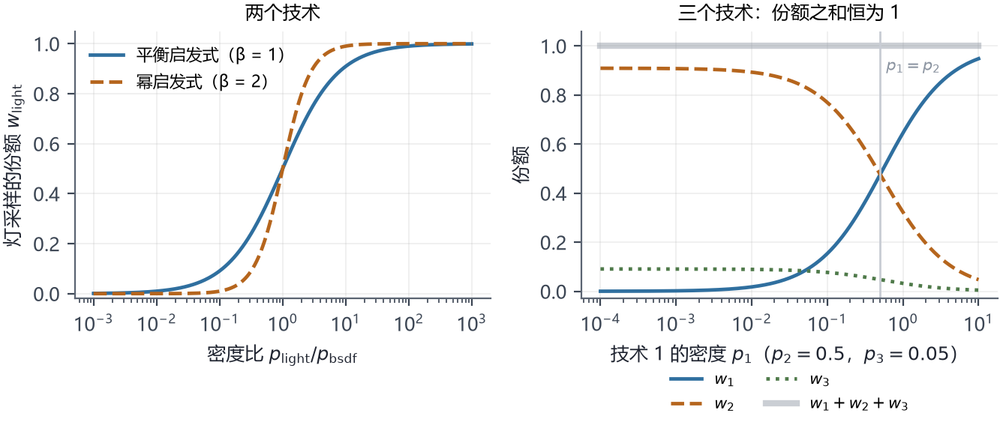
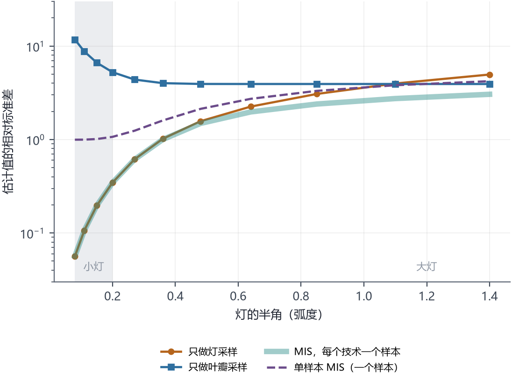
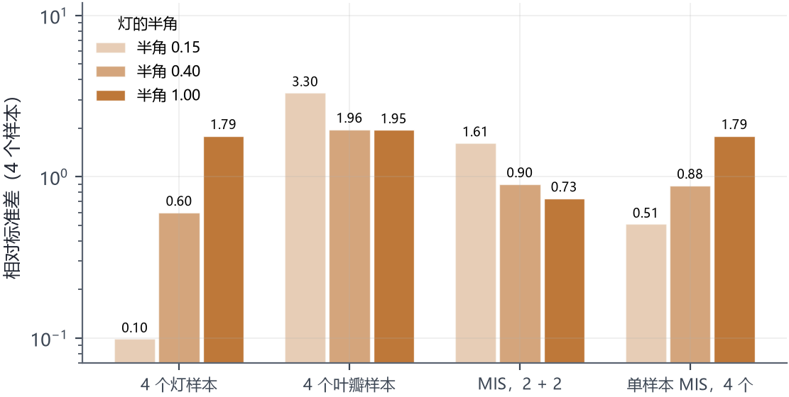

# 第 2 章 MIS：把多个采样器合起来

## 2.1 一个技术只擅长一半

第 1 章的场景里只有一种采样方式：挑灯。真实渲染器里至少有两种。一种是**灯采样**，在光源上取点、连一条阴影光线；另一种是**叶瓣采样**，按 BRDF 的形状取方向，撞上哪盏灯算哪盏。两者都有各自失效的区域，而失效的方式刚好相反。

小灯配光滑表面，灯采样很舒服：灯在半球上只占很小一块立体角，从这一小块里取点，被积函数在里面几乎是常数，估一次就准。叶瓣采样在这个配置下很糟。叶瓣窄，大部分样本落在灯外面的黑暗里，贡献为零；偶尔一两个落在灯内，值又很大。方差正比于"落入灯内的概率"的倒数。

大灯配粗糙表面，反过来。叶瓣采样好，因为 $f/p$ 被 Smith 遮蔽项压住，几乎是个常数；灯采样差，因为灯覆盖了半个半球，在这一大片里被积函数从高光峰值一直衰减到零，抽到峰值附近的概率很小。

渲染器不需要在这两者之间选一个。它可以把两个估计量加起来，按某种权重分配，得到的方差比两者都低——只要权重满足一个条件。这个条件，以及满足它的权重该怎么构造，是这一章的全部内容。Veach 在 1997 年的博士论文里把它叫作多重重要性采样（multiple importance sampling，MIS）。

先把问题写成一般形式。要算的积分是

$$I=\int_{\Omega} f(x)\,\mathrm{d}x , \tag{2.1}$$

有 $n$ 个技术可以采样，第 $i$ 个技术的密度是 $p_i$，它能抽出的样本数记作 $n_i$。每个技术单独用的时候，估计量是 $\frac{1}{n_i}\sum_j f(x_{ij})/p_i(x_{ij})$，无偏，方差各自不同。MIS 要做的是把这些样本放进一个式子里，让每个样本在自己擅长的区域说话。

## 2.2 组合估计量

最直接的想法是加权平均：

$$F=\sum_{i=1}^{n}\frac{1}{n_i}\sum_{j=1}^{n_i} w_i(x_{ij})\,\frac{f(x_{ij})}{p_i(x_{ij})} , \tag{2.2}$$

其中 $w_i(x)$ 是技术 $i$ 在 $x$ 处的份额，非负。$x_{ij}$ 是技术 $i$ 抽的第 $j$ 个样本，服从 $p_i$。

这个式子无偏吗？取期望，每一层都对 $p_i$ 积分：

$$\mathbb{E}[F]=\sum_{i=1}^{n}\frac{1}{n_i}\sum_{j=1}^{n_i}\int w_i(x)\,\frac{f(x)}{p_i(x)}\,p_i(x)\,\mathrm{d}x
=\int f(x)\sum_{i=1}^{n}w_i(x)\,\mathrm{d}x . \tag{2.3}$$

$p_i$ 在分子分母上消掉了，$1/n_i$ 与 $n_i$ 个相同的积分相加也消掉了。剩下的括号里是权重的和。要让 $\mathbb{E}[F]=I$ 对任意 $f$ 成立，必须有

$$\sum_{i=1}^{n}w_i(x)=1 \quad \text{对所有 } f(x)\neq 0 \text{ 的 } x . \tag{2.4}$$

这就是权重和为一的要求。它不是审美偏好，而是式 (2.3) 里唯一没有消掉的东西。少了这一条，估计量的期望等于积分乘上一个随 $x$ 变化的函数，误差不再随样本数消失。这是 MIS 与后面所有重采样共享的第一条硬约束。

式 (2.2) 还有一个等价写法，把 $w_i$ 与密度合起来看。定义合成密度

$$\hat p(x)=\sum_{i=1}^{n} n_i\,p_i(x) , \tag{2.5}$$

若取 $w_i(x)=n_i p_i(x)/\hat p(x)$，则 $w_i(x)/p_i(x)=n_i/\hat p(x)$，式 (2.2) 变成

$$F=\sum_{i=1}^{n}\frac{1}{n_i}\sum_{j=1}^{n_i}\frac{n_i\,f(x_{ij})}{\hat p(x_{ij})}
=\sum_{i=1}^{n}\sum_{j=1}^{n_i}\frac{f(x_{ij})}{\hat p(x_{ij})} . \tag{2.6}$$

括号外的 $1/n_i$ 与 $n_i$ 抵消，剩下的每一项都是"被积函数除以合成密度"。也就是说，按样本数加权的 MIS 就是把所有样本当成从合成分布 $\hat p$ 里抽出来的，直接做重要性采样。这个观察在后面会变得很重要：它说明 MIS 不改变"除以密度"这件事，只是把密度换成了几个密度之和。

## 2.3 平衡启发式

式 (2.5) 那个取法有个名字，叫平衡启发式（balance heuristic）：

$$w_i(x)=\frac{n_i\,p_i(x)}{\sum_{k} n_k\,p_k(x)} . \tag{2.7}$$

它满足式 (2.4)，因为分子相加正好是分母。它的含义是：在 $x$ 处，哪个技术给出的密度大，哪个技术就多承担一点。这不是随手定的，它有一个可以证明的近似最优性：在所有满足权重和为一的取法中，平衡启发式的方差与理论下界之差不超过一个常数倍，而这个常数与 $n$ 有关、与被积函数无关。Veach 的证明思路是把方差写成"每个样本的贡献偏离均值"的平方和，再用一个不等式把它压到 $\sum_i \int f^2/\hat p$ 的量级。

实际用的时候不需要记这个证明，需要记的是它的两个性质。第一，$w_i$ 只依赖密度，不依赖 $f$。这一点是它能用在渲染里的原因：$f$ 里含可见性，算不出来；$p_i$ 是采样时就知道的。第二，它自动处理"某个技术在某个区域根本没有样本"的情况：那里 $p_i=0$，份额也就是零，不会把权重分给一个不存在的技术。

把两个技术的平衡启发式代进方差公式，得到一个能直接读的形状。两个技术时，$\hat p=n_1p_1+n_2p_2$，MIS 估计量的方差是

$$\operatorname{Var}[F_{\text{bal}}]=\int\frac{f(x)^2}{\hat p(x)}\,\mathrm{d}x-I^2 . \tag{2.8}$$

作为对比，只用技术 1 的方差是 $\int f^2/p_1-I^2$。两个式子的差别只在分母：$p_1$ 换成了 $p_1+p_2$（取 $n_1=n_2=1$）。分母变大，方差变小，而且变小的幅度正好是"另一个技术在这一点提供了多少额外的样本密度"。在技术 1 失效的区域，$p_1$ 小，$p_2$ 大，分母主要由 $p_2$ 撑起来，方差就被压住了。这就是 MIS 起作用的具体机制，它没有让任何一个技术变好，只是让每个区域由更擅长的那一方主导。

## 2.4 幂启发式

平衡启发式有个弱点，出在密度的尾部。假设在某个点上 $p_1$ 是 $p_2$ 的一百倍，平衡启发式给技术 1 的份额是 $100/101$，给技术 2 的是 $1/101$。这个 $1/101$ 看起来无害，但如果在这个点上 $f$ 很大、而技术 2 的样本恰好落在那里，它的贡献是 $f/(101\,p_2)$，比技术 1 的样本贡献还大。尾部的大值会抬方差。

幂启发式（power heuristic）用指数把差距放大：

$$w_i(x)=\frac{\big(n_i p_i(x)\big)^{\beta}}{\sum_{k}\big(n_k p_k(x)\big)^{\beta}} , \tag{2.9}$$

$\beta=2$ 是最常用的取法。回到上面的例子，$100^2$ 对 $1$，技术 2 的份额从 $1/101$ 降到 $1/10001$，尾部被压掉了四个数量级。代价是在两个技术势均力敌的区域，份额变得比平衡启发式更"陡"，过渡带更窄。

图 2-1 左半边是这个过渡带的形状。密度比跨过 1 的时候，平衡启发式的份额以 $1/(1+1/r)$ 的速度走完 $0.1$ 到 $0.9$，幂启发式在同样的区间里走得更急。右半边是三个技术的情形：$p_1$ 从 $10^{-4}$ 涨到 $10$，三条曲线此消彼长，粗灰线始终贴着 1。这条灰线就是式 (2.4)，它必须成立，任何一条曲线写错都会让它离开 1。

$\beta$ 取 2 还是 1，对最终图像的影响不大，两者的方差差别通常在百分之几的量级。选 2 的理由更多是工程上的：尾部更干净，遇到一个技术几乎为零而另一个技术正常的地方，不会因为偶然的大值而在图像上打出一个亮点。这一点在有可见性的时候尤其明显，因为遮挡会让 $f$ 在灯与阴影的交界处突变，平衡启发式在这些跳变处的尾部比幂启发式长。

## 2.5 单样本 MIS

前面的写法要求每个技术都出样本。每像素只有一个样本的时候，就得换一种组织方式：先按概率 $c_i$ 挑一个技术，再用挑中的技术抽一个样本。估计量是

$$F=\frac{f(x)}{\sum_{k} c_k\,p_k(x)} , \tag{2.10}$$

注意分母里没有 $p_i$，只有混合密度。这个式子的无偏性一行就能看出来：样本 $x$ 的边缘密度正好是 $\sum_k c_k p_k(x)$，

$$\mathbb{E}[F]=\int \frac{f(x)}{\sum_k c_k p_k(x)}\sum_i c_i p_i(x)\,\mathrm{d}x=\int f(x)\,\mathrm{d}x . \tag{2.11}$$

它和式 (2.2) 的关系可以写清楚。把 $w_i(x)=c_i p_i(x)/\sum_k c_k p_k(x)$ 代进"按 $c_i$ 选技术"的期望里，

$$\mathbb{E}[F]=\sum_i c_i\int w_i(x)\frac{f(x)}{p_i(x)}p_i(x)\,\mathrm{d}x=\int f(x)\sum_i c_i w_i(x)\,\mathrm{d}x , \tag{2.12}$$

要它等于 $I$，需要的是 $\sum_i c_i w_i=1$，而不是 $\sum_i w_i=1$。两个条件不一样，因为选技术的那一次随机性已经吃掉了 $c_i$ 的一份。把 $w_i=c_ip_i/\sum c_kp_k$ 代进去，$\sum_i c_iw_i=\sum_i c_i^2p_i/\sum c_kp_k$，一般不等于 1，这个取法是错的。正确的是

$$F=\frac{w_i(x)}{c_i}\cdot\frac{f(x)}{p_i(x)},\qquad w_i(x)=\frac{c_i p_i(x)}{\sum_k c_k p_k(x)} , \tag{2.13}$$

两个 $c_i$ 抵消，回到式 (2.10)。写代码时这个 $1/c_i$ 最容易漏。漏掉它的症状是整体偏暗，偏的程度等于 $c_i$，而且不随样本数变化。

图 2-2 把单样本 MIS 放进了同一张图。它只有一条曲线，位置在两者之间：小灯时是 1.0 左右，比只做灯采样的 0.197 差五倍；大灯时是 4.2，比只做叶瓣采样的 3.9 略差。这不是实现问题，而是单样本的固有限制——它有一半的样本被分给了那个技术在当前位置的弱项上，而这一半样本的贡献只能靠分母里的混合密度摊薄。

图 2-2 里有一条值得注意的现象：MIS 的曲线几乎完全重合在"两者中更好的那条"上。小灯时它和灯采样重合，大灯时它和叶瓣采样重合，交叉点附近它略低于两者。这说明 MIS 的主要价值不是"比最好的技术更好"，而是"不需要事先知道哪个技术更好"。渲染器在着色时无法判断这个点该用灯采样还是叶瓣采样——判断本身要算 $f$，而算 $f$ 就是要算的东西。

## 2.6 四个样本怎么分

MIS 要付的代价在图 2-3 里。固定预算四个样本，四种分法：四个都给灯采样，四个都给叶瓣采样，两个技术各两个，四个都走单样本 MIS。

小灯那一组，四个灯采样的相对标准差是 0.10，MIS 平分是 1.61，差了十六倍。原因很直白：MIS 把两个样本给了一个在这个配置下毫无用处的技术，等于预算被浪费了一半，而另一半的样本数也从四降到二。大灯那一组反过来，四个灯采样是 1.79，MIS 平分是 0.73。中间的 0.40 那组，四灯 0.60、四叶瓣 1.96、MIS 0.90，MIS 比不上四灯，但比四叶瓣好得多。

这张图说明 MIS 不是免费的保险。它买到的是"不用判断"，付的是"判断错了的时候也还过得去"。在能便宜地判断该用哪个技术的场合——比如根据光源立体角和 BRDF 粗糙度估一个粗略的选择——直接用那个技术比 MIS 好。在判断不可靠或者代价高的场合，MIS 划算。

这也解释了后面 ReSTIR 里为什么要用 MIS 而不是"选一个技术"：一个像素的蓄水池里，样本可能来自灯采样，也可能来自叶瓣采样，还可能来自邻居的路径复用。每个样本属于哪个技术，是它在被抽出来的那一刻决定的，到了复用的时候已经没法重新判断"这个点该用哪个技术"。MIS 的权重只依赖密度，密度可以重算，判断不能。

## 2.7 权重和为一，破了会怎样

式 (2.4) 在实现里最容易被破坏的方式不是写错公式，而是"少算了一个技术"。举三个具体的例子。

第一个，密度在某个区域为零。技术 2 是灯采样，方向必须落在灯内；在灯外的方向 $p_2=0$。如果代码在灯外只算 $w_1=p_1/p_1=1$，看起来没问题——分母里少了 $p_2$，可 $p_2$ 本来就等于零。真正的问题出在反过来的地方：技术 1 的样本落在灯内时，分母里必须包含 $p_2$，否则 $w_1$ 会被算成 1，而正确的值是 $p_1/(p_1+p_2)$。灯内恰好是两个技术都有效的区域，也是份额必须分开的区域。把这里的 $p_2$ 漏掉，等于在灯内只用技术 1，方差回到"只做叶瓣采样"的水平——图像上表现为灯的高光核心特别脏，而周围干净。这个症状很容易被误判成"高光采样不够"。

第二个，份额归一化用了错误的样本数。式 (2.7) 里 $n_i$ 是每个技术抽了多少个样本，不是"有效样本数"。当某个技术抽出的样本全部落在 $f=0$ 的区域，它的 $n_i$ 仍然是原来的数。把 $n_i$ 改成非零样本的个数，等价于在式 (2.5) 里换了一个 $\hat p$，而 $F$ 的期望跟着变。

第三个，两个技术的 $f$ 不是同一个 $f$。MIS 的推导里，式 (2.2) 中所有技术共用同一个被积函数。如果技术 1 的样本在计算 $f$ 时用了它自己的可见性，技术 2 的样本用了另一条路径的可见性——这在路径追踪里很常见，两条路径的中间顶点不同——那么它们算的其实是两个不同的积分。把它们按份额相加，等于把一个积分的一部分与另一个积分的一部分相加。这个错误在 ReSTIR 里以"嵌套 MIS"的形式重新出现，第 11 章的 GRIS 会给它一个严格的处理方式。

## 2.8 嵌套 MIS 在 ReSTIR 里的位置

ReSTIR 的蓄水池里通常会同时放几种样本：灯采样的直接光样本、BSDF 采样的样本、以及从邻居那里搬来的样本。表面上这是三种技术，可以直接套式 (2.2)。实际的结构是两层的。

内层是"同一个技术内部的多个候选"。一个像素抽了 $M$ 个灯采样候选，按目标函数挑一个，这是第 4 章要讲的 RIS。外层是"不同技术之间"。灯采样和 BSDF 采样各自有一个 RIS 蓄水池，两个蓄水池之间按 MIS 份额合并。

这两层不能混在一起算。内层的重采样已经改变了样本的分布：从那 $M$ 个候选里挑出来的那个，密度不再是 $p_i$，而是"按权重挑中"的分布。如果外层还按 $p_i$ 算份额，权重就错了一整层。正确的做法是内层用 RIS 的无偏估计量（带着权重和与候选数），外层用这些估计量作为"技术"，份额按各自的合成密度算。这正是 GRIS 的框架，也是第 11 章那条 $M/M_i$ 修正项的来源。

现在只需要记住一件事：MIS 的每一条性质都建立在"密度已知、被积函数共享、权重和为一"这三件事上。重采样会把第一件事变得麻烦——样本的密度不再是抽它时用的那个 $p$，而是经过了一次按权重挑选之后的有效密度。下一章先解决一个更基础的问题：如果只能看一遍数据流、内存里只放得下一个样本，怎么保证留下的是按权重该留下的那个。
