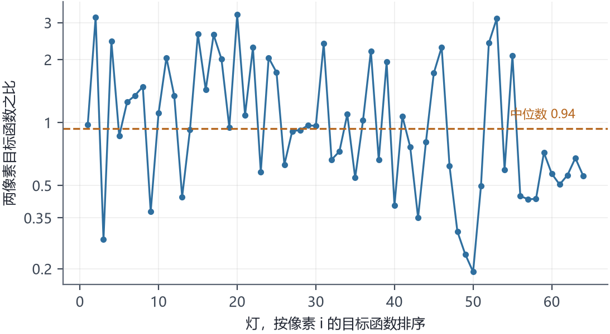
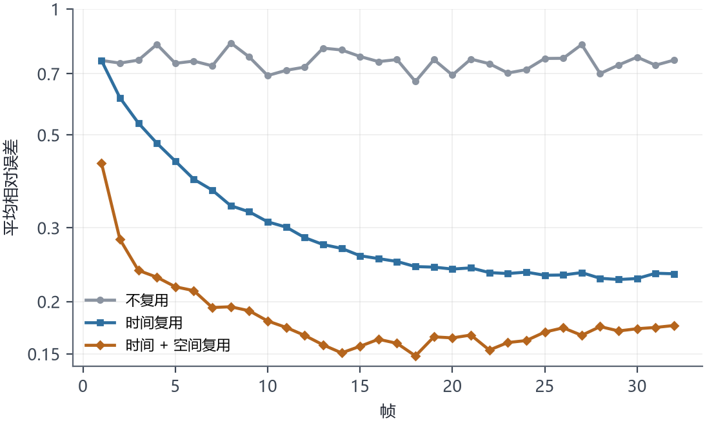
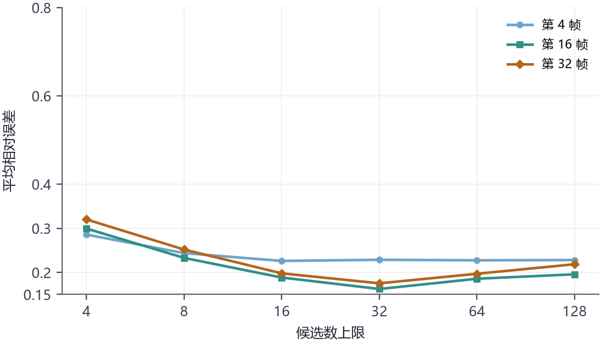

# 第 3 章 ReSTIR DI：把蓄水池放进像素

## 3.1 一个像素一个蓄水池

第 2 章的东西是"一个着色点、一批候选"的算法。把它变成渲染器的一部分，只需要换一个存放位置：蓄水池不是临时变量，它是像素的一个属性，跟着像素一起活过整帧，甚至活过很多帧。

一个像素的蓄水池里存三样东西：选中的光源下标 $y$、权重和 $\hat W$、候选数 $M$。二十个字节足够。每帧开始时它做三件事——从新抽的候选里更新自己，从上一帧的自己那里继承，从邻居那里借——然后出一条亮度。

这三件事的名字分别是初始候选、时间复用、空间复用。Bitterli 等人 2020 年的 ReSTIR DI 就是这三个步骤，加上一套保证合并之后仍然无偏的权重换算。

三条路各有各的麻烦。初始候选的麻烦是目标函数只能近似；时间复用的麻烦是历史样本的密度变了；空间复用的麻烦是邻居的目标函数和自己的不一样。后两个麻烦最后归结为同一个问题：权重该怎么换算。

## 3.2 初始候选：目标函数只能是近似的

理想的目标函数是真实贡献 $f_k=b_kV_k$。它需要可见性，而可见性正是要省的东西。所以初始候选用的目标函数只能是无阴影贡献 $\hat p=b$，也就是上一章的 (1.10)。

这个替换不破坏无偏性。第 2 章的定理只要求 $\hat p>0$ 在有贡献的地方成立，没要求 $\hat p$ 等于 $f$。用 $\hat p=b$ 的代价全部落在方差上：被完全挡住的灯仍然可能被选中，样本落在它上面时贡献为零。

这笔代价有多大，取决于遮挡的比例。如果场景里一半的灯被挡住，那么每次选中都有一半概率白选。要压低它，可以让 $\hat p$ 里加一点可见性的信息，比如用上一帧的可见性做代理——这是第 7 章的话题，它同时也打开了偏差的口子。

初始候选的另一件事是候选数 $M_0$。它一般取 1 到 32 之间。取得大，单帧的方差不那么依赖历史；取得小，单帧成本低，但开头几帧会很脏。第 8 章会回到这个参数。

## 3.3 时间复用：密度要在这一帧重新算

上一帧的蓄水池里有一个样本 $y$、权重和 $\hat W_{\text{prev}}$、候选数 $M_{\text{prev}}$。这一帧想把它并进来，先要回答一个问题：这个样本在这一帧的权重是多少。

权重是 $\hat p/p$。$p$ 是候选分布，这一帧还是均匀（或者还是那张别名表），所以 $p$ 没变。$\hat p$ 是目标函数，它在这一帧的值是

$$\hat p_t(y)=\frac{L_y\,V_y(t)\,\cos\theta_y(t)}{d_y^{2}(t)} , \tag{3.1}$$

距离、夹角都随物体运动变了。上一帧存下来的权重和，是按上一帧的 $\hat p_{t-1}$ 算的，把它直接拿来用，等于用旧价格结算新交易。

正确的换算是在合并时乘一个比值：

$$\hat W'=\hat W_{\text{prev}}\cdot\frac{\hat p_t(y)}{\hat p_{t-1}(y)} . \tag{3.2}$$

分子在这一帧算，分母是存下来的那个值。$y$ 一个样本代表整个蓄水池，这是近似——(3.2) 假设 $\hat p_t/\hat p_{t-1}$ 在整个候选集上大致相同。图 3-3 显示这个假设有多粗糙：相邻两个像素的目标函数之比在不同灯之间从 0.19 变到 3.28，差 17 倍。同一像素相邻两帧的比值温和得多，因为几何变化小，但也不是常数。



换算之后，合并的规则和 RIS 内部的加权选择完全一样。两个蓄水池的权重和分别是 $\hat W_a$ 与 $\hat W'$，以

$$\Pr[\text{选 } b]=\frac{\hat W'}{\hat W_a+\hat W'} \tag{3.3}$$

的概率选 $b$ 的样本，新的权重和是两者相加，新的候选数是 $M_a+M_b$。这一步之所以是对的，因为它就是 (2.4) 在两个候选上的特例：把"权重"理解为"权重和"，把"选择"理解为在两个蓄水池之间做一次加权抽签。

$M$ 不能无限增长。一个像素活了几千帧之后，$M$ 会变成一个巨大的数，历史样本的权重永远压过新样本，场景一变就反应不过来。所以要设上限 $M_{\max}$：当 $M_a+M_b$ 超过它时，把权重和按同样的比例缩下来，

$$\hat W\leftarrow \hat W\cdot\frac{M_{\max}}{M_a+M_b},\qquad M\leftarrow M_{\max} . \tag{3.4}$$

这个缩放不改变 $\hat W/M$，所以不影响估计的期望，只影响"新样本还能不能挤进来"。$M_{\max}$ 一般取 20 到 100 之间。

最后一步是着色。合并完的蓄水池给出

$$\langle L\rangle=\frac{f_t(y)}{p_t(y)}\cdot\frac{\hat W/M}{\hat p_t(y)/p_t(y)}
=\frac{f_t(y)}{\hat p_t(y)}\cdot\frac{\hat W}{M} , \tag{3.5}$$

这里 $f_t$ 是这一帧的真实贡献，含可见性；$\hat p_t(y)$ 是这一帧的目标函数在 $y$ 处的值。这个式子是整章最容易写错的地方，错法有三种。

第一种，$\hat p_t(y)$ 用了上一帧的值。样本还是那个样本，但它在当前帧的目标函数值已经变了，用旧的会带来随运动变化的亮度漂移。

第二种，$p_t(y)$ 用了上一帧的候选分布。如果这一帧重建了别名表，$p$ 变了，(3.5) 里的 $p_t$ 约不掉了。

第三种，$f_t(y)$ 与 $\hat p_t(y)$ 不同步。$f_t$ 含可见性，$\hat p_t$ 不含，这是设计如此，不是错误；但如果 $\hat p$ 用的是含可见性的版本（比如从 G-buffer 里读了一个上一帧的可见性），而 $f_t$ 用的是这一帧重新求交的结果，两者就打架了。

(3.5) 里 $\hat W/M$ 与 $\hat p_t(y)$ 的关系值得单独看一眼。前者是"整批候选在目标函数下的平均质量"，后者是"选中的那个样本的目标函数值"。前者在复用之后包含了很多历史信息，后者必须完全是当前的。这两件事分属两个时刻，这就是偏差的来源——第 4 章的全部内容。

## 3.4 空间复用：邻居的目标函数不一样

空间复用把同一帧里邻居的蓄水池并进来。做法和时间复用一模一样，只是"来源"从上一帧换成了隔壁像素。

麻烦在于邻居的目标函数是 $\hat p_j$，不是自己的 $\hat p_i$。邻居的样本 $y$ 在自己的像素上很合适，搬到这边来，权重得按

$$\hat W'=\hat W_j\cdot\frac{\hat p_i(y)}{\hat p_j(y)} \tag{3.6}$$

换算。$\hat p_i(y)$ 是"这盏灯对**我**这个像素的无阴影贡献"，可以就地算，代价是一次距离与夹角计算。$\hat p_j(y)$ 是"这盏灯对**邻居**的"，要么存下来，要么重算邻居的几何。

图 3-3 说的就是这件事：这个比值不是常数。用 $y$ 一个样本的比值去代表整个蓄水池，就是在假设它大致是常数。

那为什么不干脆用真实贡献 $f$ 当目标函数？因为 $f$ 要可见性，而邻居的可见性要么重新打一条阴影光线（那就等于没有复用），要么从缓冲里读一个已经过时的值（那就引入了另一类偏差）。用无阴影贡献是唯一一个能在当前像素就地、廉价、且对所有像素一致地求值的量。这个选择把偏差压到"目标函数近似"这一层，而不是"用了错误的数据"这一层。

空间复用的顺序也有讲究。ReSTIR 的实现一般是每帧随机选 3 到 5 个邻居，按顺序合并，每次合并都更新 $M$ 并做 (3.4) 的截断。如果按固定的顺序扫过所有邻居，结果会有方向性，表现为沿某个方向的拖影。随机选邻居同时解决了开销和方向性。

## 3.5 一帧的流程

把上面拼起来，一个像素在一帧里的动作是：

```text
1. 抽 M0 个候选灯，算 w = phat_t(light) / p(light)
2. 生成蓄水池：y, W = sum(w), M = M0
3. 若上一帧有蓄水池：
       W_prev' = W_prev * phat_t(y_prev) / phat_prev
       按 W/(W+W_prev') 的概率合并，M 截断
4. 对 3~5 个随机邻居：
       重算它们的 W 在本像素目标下的值（式 3.6）
       按权重和合并，M 截断
5. 着色：L = f_t(y) * W / (M * phat_t(y))
6. 存下 y, W, M, phat_t(y) 供下一帧使用
```

第 6 步存的那个 `phat_t(y)` 就是下一帧 (3.2) 的分母。它是整个流程里唯一一个"必须和样本一起存下来的历史量"，也是实现中最常被漏掉的一个。

## 3.6 收敛的样子



图 3-1 是三种策略在同一场景上的收敛曲线。不复用的曲线是一条噪声带，长期停在 0.75 附近——每帧都从 4 个候选重新开始，样本数不会累积。时间复用的曲线从 0.75 一路降到 0.23，因为 $M$ 从 4 涨到上限 32，候选在像素内部累积。时间和空间一起用的曲线起点就低（0.43），因为第一帧它就已经并进了 4 个邻居、共 20 个候选，随后降到 0.175。

三者的差别不是"谁更聪明"，而是"同样一条阴影光线被用了多少次"。空间复用让同一帧的 5 个像素共享 20 个候选，时间复用让同一像素的 32 帧共享 32 个候选，两者叠加，一个像素的有效候选数从 4 变成 32，误差降了 4 倍多。

候选数上限的作用在图 3-2 里。放宽上限，误差先降后平，32 之后不再改善，128 时反而回升到 0.22。回升的原因是老化：上限越大，历史样本占的份额越大，而历史样本的目标函数是旧的，用单点比值换算的近似误差被放大了。这个现象在第 4 章会变成一个明确的偏差公式。



## 3.7 这套东西的边界

ReSTIR DI 只处理直接光照。它的样本是一盏灯，权重是这盏灯对一个像素的贡献，重采样在所有灯之间做。间接光照的样本是一条路径，路径的"贡献"依赖整条路径的几何，复用的时候要处理的问题多得多——一条路径在邻居像素上可能已经不自交了。那是第 5 章。

它也没有解决方差的地板。第三章的曲线上那条平台（0.175）不是算法不够好，而是一条阴影光线只能给出一个可见性结果。要继续往下压，得让一个像素在一帧里用上多条光线（第一章的做法，代价线性），或者接受这个地板并用降噪器处理剩下的部分。ReSTIR 之所以看起来效果好，一半原因在于它的残差在空间上是相关的——邻域像素选中同一盏灯，误差同向，降噪器能整体修正而不是把噪声抹平。

最后一件事是偏差。上面所有公式都默认"用 $y$ 代表整个蓄水池"是可行的近似。它确实是近似，不是恒等式。当目标函数在候选集上变化剧烈时，这个近似会漏出偏差，而且偏差不会随样本数增加而消失。

---

一个像素的蓄水池每帧做三件事：抽新候选、继承上一帧、借邻居。每件事都靠同一个操作完成——按权重和的比例在两个蓄水池之间抽一次签。让这个操作保持正确的，是两个必须就地重算的量：样本在当前帧的真实贡献、以及它在当前帧目标函数下的权重。

下一章把这件事说透。偏差不是实现 bug，它可以写成一个式子，而且这个式子给出的偏量按“缺了多少”直接叠加，不随候选数增大而收敛。
