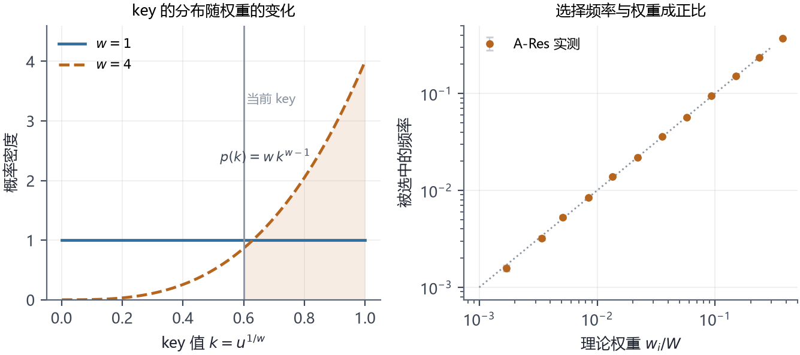
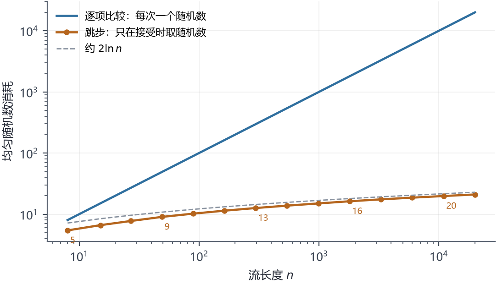
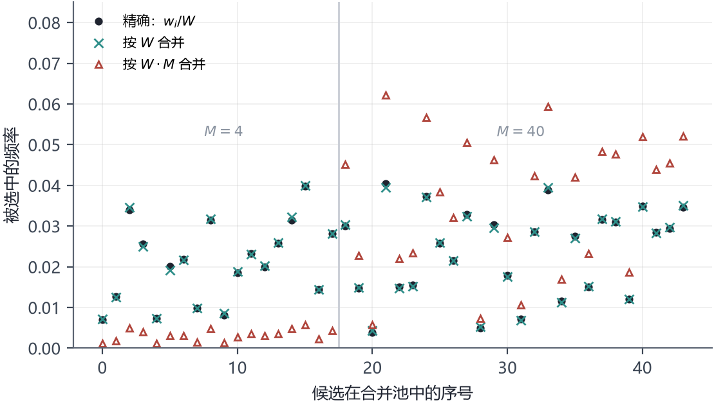

# 第 3 章 带权蓄水池：一遍流过完

## 3.1 内存里只放得下一个

有一个数据流，你看不到它的长度，也不能回头重读。内存里只放得下一个元素，要求是流结束时手里这个元素服从某个分布。流式采样问题在统计学里很老，1985 年 Vitter 给出了等概率版本的解法。它在渲染里重新变得重要，是因为 ReSTIR 的历史正好长这样。

一个像素的蓄水池跟着帧走。每一帧新增几个候选，旧的样本可能被顶掉，也可能留下。屏幕上的像素有几十万个，每个像素都不允许保留一整段历史——那意味着每帧上千字节的存储和每帧上千次的遍历。能保留的只有一个样本，以及关于这个样本的两三个数字。

第 1 章的 $b_k$ 加权采样要求你遍历所有灯、建一张别名表。流式场景里没有"所有灯"这个概念，只有"到目前为止见过的候选"。这两件事的差别看起来只是工程细节，实际上是两套不同的数学：前者要求知道归一化常数，后者不需要。

等概率版本先看清楚。读到第 $k$ 个元素时，以 $1/k$ 的概率用它顶掉手里的那个。第 $k$ 个元素最终被留下的概率是

$$\frac{1}{k}\prod_{j=k+1}^{n}\left(1-\frac{1}{j}\right)=\frac{1}{k}\cdot\frac{k}{n}=\frac{1}{n} ,  \tag{3.1}$$

中间的连乘是望远镜式的：$1-1/j=(j-1)/j$，从 $j=k+1$ 乘到 $n$，分子是 $k!$，分母是 $n!/k!$ 的倒数关系，整个乘积等于 $k/n$。关键在于这个乘积里没有任何一项需要知道 $n$。每一步只看当前的下标，最终结果自动是 $1/n$。

渲染里需要的是加权版本。候选的"重要性"是它对像素的贡献，贡献大的应该更可能留下。Chao 1982 给出了推广：以 $w_k/(W_{k-1}+w_k)$ 的概率用第 $k$ 个元素顶掉手里的，其中 $W_{k-1}$ 是前 $k-1$ 个的权重和。留下的元素满足

$$\Pr[\text{留下第 } i \text{ 个}]=\frac{w_i}{\sum_{j=1}^{n}w_j} .  \tag{3.2}$$

这个版本的证明比等权版本麻烦一点，因为每一步的替换概率都不一样。Efraimidis 和 Spirakis 在 2006 年给出了一个更漂亮的等价形式，它把"逐步比较概率"换成"给每个元素算一个 key，留 key 最大的"，证明变成了一次比较，而且天然支持并行与合并。

## 3.2 一个 key 决定一切

A-Res 的做法是：第 $i$ 个元素取一个均匀随机数 $u_i$，算

$$k_i=u_i^{1/w_i} ,  \tag{3.3}$$

流结束时留下 $k_i$ 最大的那个元素。$w_i>0$ 时 $k_i\in(0,1)$；权重越大，$u^{1/w}$ 越接近 1，因为它把 $u$ 开了一个更小的方。

先看单个 key 的分布。$k_i\le t$ 等价于 $u_i\le t^{w_i}$，所以

$$\Pr[k_i\le t]=t^{w_i},\qquad p_i(t)=w_i\,t^{w_i-1} ,  \tag{3.4}$$

密度在 $t=1$ 附近按 $t^{w-1}$ 抬起来，权重越大抬得越陡。图 3-1 左边画了 $w=1$ 与 $w=4$ 两条密度：$w=1$ 是均匀分布，$w=4$ 的密度在 $t=1$ 处是 4，在 $t=0.6$ 处只有 $4\times0.6^3=0.86$。

两个元素比较，$i$ 赢的概率可以直接积出来：

$$\Pr[k_i>k_j]=\int_0^1 p_i(t)\,\Pr[k_j<t]\,\mathrm{d}t=\int_0^1 w_i t^{w_i-1}\,t^{w_j}\,\mathrm{d}t=\frac{w_i}{w_i+w_j} .  \tag{3.5}$$

这个式子是整个算法的核心。它说的是：两个元素谁留下，只取决于它们的权重之比，与它们出现的先后、与流里还有多少别的元素都无关。

有了这一步，多个元素的结论可以直接积出来。$n$ 个元素的 key 互相独立，$k_i$ 最大这件事写成积分是

$$\Pr[k_i=\max]=\int_0^1 p_i(t)\prod_{j
eq i}\Pr[k_j<t]\,\mathrm{d}t . \tag{3.6}$$

把式 (3.4) 的密度与分布代进去。密度是 $w_it^{w_i-1}$，其余的分布函数是 $t^{w_j}$，乘积里 $t$ 的指数相加等于 $t^{W-w_i}$，其中 $W=\sum_j w_j$：

$$\Pr[k_i=\max]=\int_0^1 w_i\,t^{w_i-1}\cdot t^{W-w_i}\,\mathrm{d}t=\int_0^1 w_i\,t^{W-1}\,\mathrm{d}t=\frac{w_i}{W} . \tag{3.7}$$

两行。指数里那个 $w_i$ 在相乘时被抵消掉了，这是设计 key 时把权重放在指数上的原因——如果权重放在系数上，积分会留下一个随 $W$ 变化的因子。

为什么可以只看最大值，而不需要逐步归纳？因为"留下 key 最大的元素"这个规则，与"每一步以某个概率替换"在分布上等价，而前者的正确性只需要式 (3.7) 一个积分。这也解释了式 (3.1) 里那个望远镜乘积为什么在这里消失了：等权版本逐步比较，每一步的替换概率依赖当前下标；key 版本一次比较，所有的历史信息都压缩在"当前最大值"这一个数里。

图 3-1 右边是式 (3.7) 的实测。12 个权重按斐波那契增长、归一化后从 0.002 到 0.29，跑 12 万次，实测频率与理论值的最大偏差是 0.0016，误差棒是二项分布的标准差 $\sqrt{w(1-w)/T}$，点全部落在棒内。

## 3.3 跳步：把随机数省下来

A-Res 每个元素消耗一个随机数。ReSTIR 里这个代价不小：一个像素每帧要走几百个候选，几十万像素乘以几百次随机数调用，比一次求交还贵。

跳步的思路来自一个观察。设当前的 key 最大值是 $\kappa$。第 $i$ 个元素要赢过它，需要 $u_i^{1/w_i}>\kappa$，也就是

$$u_i>\kappa^{w_i} .  \tag{3.9}$$

所以单个元素顶掉当前样本的概率是 $p_i=1-\kappa^{w_i}$，只看权重和当前的 $\kappa$，不需要任何别的信息。等权重的流上，$\kappa$ 在一次顶替之后才变，顶替之间 $p$ 是常数，于是"还要跳过几个元素"服从几何分布：

$$\Pr[\text{跳过 } j \text{ 个}]=p\,(1-p)^{j} .  \tag{3.10}$$

几何分布可以用一次对数抽样。设 $u$ 均匀，令

$$X=\left\lfloor\frac{\ln u}{\ln \kappa}\right\rfloor ,  \tag{3.11}$$

则 $\Pr[X\ge j]=\Pr[u\le\kappa^{j}]=\kappa^{j}$。$\kappa^{j}$ 正好是"连续 $j$ 个元素都没赢"的概率，因为每个没赢的概率就是 $\kappa$。所以 $X$ 是对的跳过个数，一次对数、一次随机数，跳过一整段。

跳过去之后，下一个元素的 key 需要从"已经赢过 $\kappa$"的条件分布里抽，不能直接取均匀随机数，否则会把 key 抽到 $\kappa$ 以下，破坏单调性。条件分布是 $u\in(\kappa,1)$ 上的均匀分布，写成 $\kappa+(1-\kappa)v$，$v$ 均匀。这一步每接受一次消耗一个随机数。

总消耗是"接受次数乘 2"。等权流上一个元素被接受的概率是 $1-\kappa$，而 $\kappa$ 在流里逐步上升，接受次数按 $\ln n$ 增长。实测的消耗见图 3-2。

具体数字：$n=16$ 时逐项版 16 个、跳步版 6.7 个；$n=1024$ 时 1024 对 15.0；$n=16384$ 时 16384 对 20.5。跳步版的曲线在双对数图上几乎是水平的，多出来的部分是那条 $2\ln n$ 的斜率。这是 Efraimidis 和 Spirakis 的 A-ExpJ 在等权情形下的形态。

权重逐项变化时，跳步不能一次跳过一整段，因为每个元素的 $p_i=1-\kappa^{w_i}$ 不同。可以做的仍然是逐项比较，但只在接受时才消耗第二个随机数，而且不需要为每个元素把 key 算出来（省掉一次幂运算）。这个折中在实现里比纯 A-ExpJ 更常见，因为 ReSTIR 的候选权重几乎每项都不同。

## 3.4 合并两个蓄水池

流式采样在 ReSTIR 里出现得最多的形式不是"追加一个元素"，而是"合并两个蓄水池"。一个像素有自己这一帧的蓄水池（样本 $y_a$、权重和 $W_a$、候选数 $M_a$），邻居或上一帧有一个（$y_b$、$W_b$、$M_b$）。合并的规则是

$$\Pr[\text{选 } b]=\frac{W_b}{W_a+W_b},\qquad W\leftarrow W_a+W_b,\qquad M\leftarrow M_a+M_b .  \tag{3.12}$$

为什么是 $W_b/(W_a+W_b)$ 而不是别的比例？把两个蓄水池展开成候选集。$a$ 里有 $M_a$ 个候选，权重 $w_{a1},\dots$，$W_a=\sum w_{ai}$；样本 $y_a$ 是它们按权重挑出来的，所以 $y_a$ 等于第 $i$ 个候选的概率是 $w_{ai}/W_a$。合并时选 $b$ 的概率乘上 $b$ 内部选 $j$ 的概率，

$$\Pr[y=y_{bj}]=\frac{W_b}{W_a+W_b}\cdot\frac{w_{bj}}{W_b}=\frac{w_{bj}}{W_a+W_b} ,  \tag{3.13}$$

分母是合并池的总权重，分子是这一个候选自己的权重。这正是对整个池子做一次加权蓄水池采样的结果。蓄水池的合并与"把两个流接起来继续跑"给出同一个分布，这是它能在像素之间流动的前提。

$M$ 不进入式 (3.12)。它只影响最后那一步归一化：蓄水池给出的亮度是 $\frac{f(y)}{\hat p(y)}\cdot\frac{W}{M}$，$M$ 是"这个结论是从多少个候选里挑出来的"，用来把权重和换算成平均权重。把 $M$ 塞进合并概率里，等于让候选多的那个蓄水池获得额外的话语权。

这个错误很常见，因为"样本多的人应该说话更响"听起来合理。图 3-3 是它的后果：两个蓄水池，$M$ 分别是 4 和 40，权重和的量级相同。按 $W$ 合并时，两侧的选中频率与精确值完全重合；按 $W\cdot M$ 合并时，$M=40$ 那一侧的总概率从 0.62 抬到 0.94，另一侧被压到 0.06。整幅图会偏向"历史更长"的那些像素，而历史长度在图像上是不均匀的：静止区域的历史长，运动区域的历史短，于是运动物体的边缘会出现一条随速度变化的亮度带。

合并必须是随机的，这一点在实现时最容易被"优化"掉。既然 $W_b$ 比 $W_a$ 大，为什么不直接留 $b$ 的样本？因为蓄水池的语义是"我代表了一个池子"，而代表的方式只能是通过一次概率抽样。直接取权重大的那个，等于把分布退化成"总在同一个候选上"，下次再合并时，这个蓄水池就再也无法表达池子里的其他候选了。偏差不会立刻显现：单帧看起来甚至更干净，因为随机性少了。等到场景变化、旧样本失效，那个被反复强化的候选仍然占着位置，图像上出现一块擦不掉的亮斑，而它的亮度对应的是一个早已不存在的时刻。

还有一个相关的错误是在时间复用上"只在权重更大时才更新"。这看起来是在保护历史样本，实际效果是让新样本永远进不来：一旦某帧的权重偏大，后面的所有帧都会被它压住，直到场景变化到它的权重掉下来。这个失败模式的症状是运动时的拖影特别长，而且拖影的亮度不随时间衰减。

## 3.5 ReSTIR 的蓄水池就是 WRS

到这里可以把两套语言对起来了。ReSTIR 的蓄水池有三个字段：样本 $y$、权重和 $W$、候选数 $M$。WRS 的元素有一个字段：权重 $w$。对应关系是

$$W=\sum_{i=1}^{M}w_i,\qquad \Pr[\text{留下第 } i \text{ 个}]=\frac{w_i}{W} .  \tag{3.14}$$

时间复用是"往流里追加一批候选"，追加的规则就是式 (3.12)；空间复用是"并行地合并若干个已经建好的蓄水池"，规则还是式 (3.12)。$M$ 是计数器，不是权重。

再往下一层，$w_i$ 具体是什么？在第 4 章的 RIS 里，

$$w_i=\frac{\hat p(x_i)}{p(x_i)} ,  \tag{3.15}$$

$\hat p$ 是想要的目标函数，$p$ 是抽候选时用的分布。WRS 只说"按权重留一个"，没规定权重怎么来。RIS 补上了这一层，并且给出了一个 WRS 没有的东西：估计量。

这个区别值得强调。WRS 的输出是一个样本，以及"这个样本是从什么样的分布里来的"这个信息（由 $W$ 和 $M$ 编码）。它本身不告诉你积分等于多少。要把样本变成一个无偏估计，需要 $\frac{W}{M}\cdot\frac{f(y)}{\hat p(y)}$ 这个式子，而它的无偏性证明（第 4 章）依赖 $\hat p$ 与 $p$ 的关系。WRS 的定理只保证"留下的样本服从 $w_i/W$"，那是一个关于样本分布的话，不是关于积分的话。

在实现里这个区别表现为一个具体的约束：$W$ 不能随便缩放。如果为了让历史样本"不要太重"而把 $W$ 乘一个 0.9，样本分布不变（式 (3.8) 只依赖比值），但估计量会整体偏暗 10%。反过来，把 $W$ 和 $M$ 同时乘 0.9，估计量不变，只有新样本挤进来的难度变了。这就是候选数上限 $M_{\max}$ 的正确用法：

$$W\leftarrow W\cdot\frac{M_{\max}}{M},\qquad M\leftarrow M_{\max} ,  \tag{3.16}$$

缩放的是比值 $W/M$ 之外的两件事，亮度不受影响。第 5 章会看到 ReSTIR 里那条式子的完整形式。

实现上还有一个精度细节。$W$ 是浮点数，$M$ 是整数，两者的量级差别很大：几千帧之后，$M$ 可能到 $10^4$，而 $W$ 因为目标函数可能有各种量级。式 (3.16) 的缩放要在 $W$ 上做，如果 $W$ 已经接近浮点上限，缩放之前先做除法会让结果失真。稳妥的写法是把亮度存成 $\frac{W}{M}$ 的比值而不是分别存两个数，合并时按候选数加权平均这个比值：

$$\frac{W}{M}=\frac{M_a\,(W_a/M_a)+M_b\,(W_b/M_b)}{M_a+M_b} , \tag{3.17}$$

这个式子和"先加 $W$ 再除以 $M_a+M_b$"完全等价，但它在浮点上更安全，而且允许把 $M$ 存在定点数里。代价是每帧要做一次除法，以及亮度比值不能超过一个上限，否则要在存储时截断——截断就是偏差，第 7 章会具体算这笔账。

## 3.6 从 WRS 到 RIS 还差一步

WRS 解决的是"留哪一个"。它没有回答"留下的这个值多少"。这两件事在等权情形下看起来是一回事，因为留下的元素本身就是答案；在渲染里不是，因为一个候选的贡献是 $f(x)$，而它被选中的概率是 $w(x)/W$，两者不同。

这个差别也解释了为什么第 1 章的"按无阴影贡献选灯"不能直接当成 WRS 用。按 $b_k$ 选灯，选中的是 $k$；要从"选中的 $k$"得到积分估计，还需要除以 $p_k=b_k/B$。WRS 的框架里没有"除以 $p_k$"这一步，它只有"留下的元素服从 $w_i/W$"这个结论。

把这一步补上，就得到 RIS。它的估计量里带一个 $\frac{1}{M}\sum w_i$ 的因子，那个因子在 WRS 里不存在，而在无偏性证明里起决定作用。下一章从 Talbot 等人 2005 年的原始形式开始，把那个因子为什么必须在那里、以及它为什么能在 $M$ 变化时保持不变，逐步推一遍。

---

流式采样的三条结论在后面的每一章都会用到。第一，权重与接受概率的关系由 key 的构造决定，$k=u^{1/w}$ 这一个式子给出了式 (3.8)。第二，合并两个蓄水池的概率是权重和之比，候选数不参与。第三，蓄水池只保证样本的分布，不保证估计量的期望，后者需要额外的一个因子。第三点最容易出错，而且出错之后图像看起来完全正常，只是整体亮了或暗了一点。
