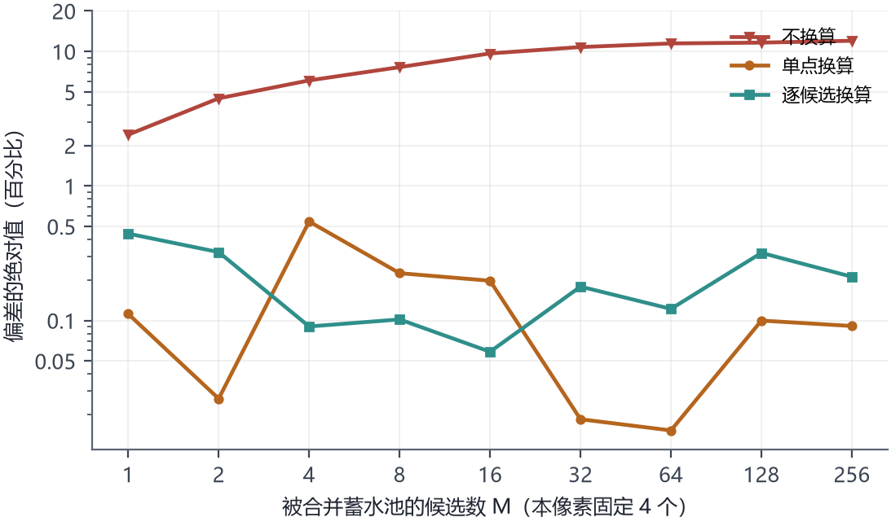
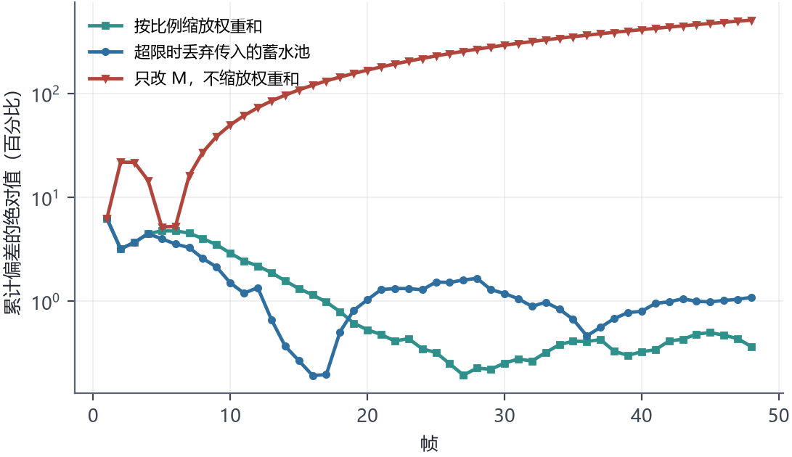
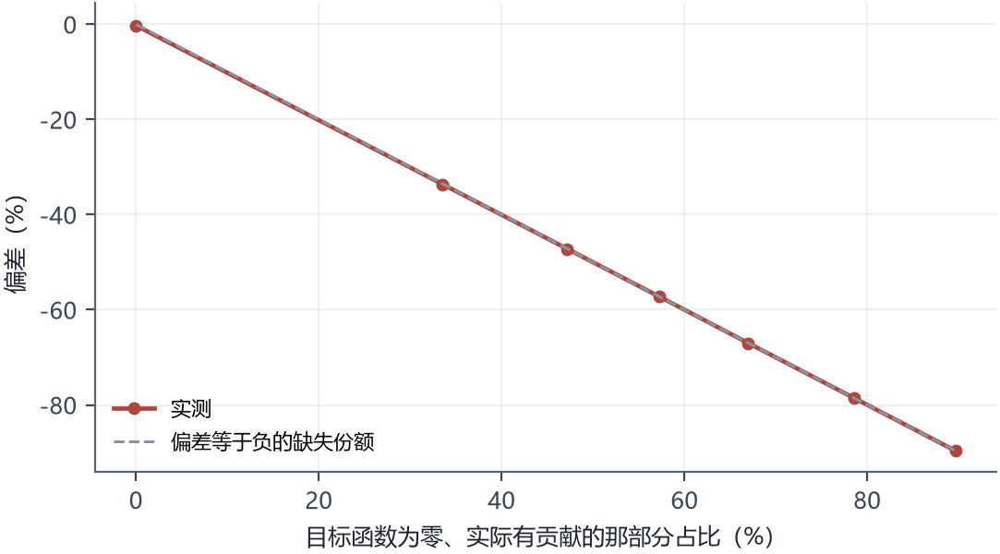

# 第 4 章 偏差从哪里来

## 4.1 一个看起来对的式子

第 3 章的合并规则是这样的：把邻居的蓄水池并进来时，先把它的权重和乘上一个比值 $\hat p_i(y_j)/\hat p_j(y_j)$，然后按两个权重和的比例抽一次签。这个比值只用了一个样本 $y_j$，而那个蓄水池里可能有几十个候选，每个候选的两个目标函数之比都不一样。

直觉上这应该引入误差。一个蓄水池里有的候选比值是 0.9，有的是 2.1，你却用其中随便一个的比值乘整个和，怎么可能对？

图 3-3 显示这个比值在相邻像素之间从 0.19 变到 3.28。可是第 3 章测出来的偏差是零。这件事值得把它算清楚，因为它决定了后面所有近似能不能用。

## 4.2 单点换算为什么恰好无偏

设被合并的蓄水池来自像素 $j$，它的候选 $x_1,\dots,x_K$ 独立同分布于 $p$，权重 $w_k=\hat p_j(x_k)/p(x_k)$，权重和 $W_j=\sum_k w_k$，选中的样本是 $y$。并进像素 $i$ 时，它的权重和被换成

$$W'=W_j\cdot\frac{\hat p_i(y)}{\hat p_j(y)} . \tag{4.1}$$

要问的是 $\mathbb{E}[W']$ 等不等于"这些候选在像素 $i$ 的目标函数下本来的权重和"$\sum_k \hat p_i(x_k)/p(x_k)$。

把 (4.1) 写开。$y$ 是候选之一，所以 $W_j\cdot r(y)$ 里每一项都能凑成一个两重和：

$$\mathbb{E}\left[W_j\,r(y)\right]=\mathbb{E}\left[\sum_{m=1}^{K}w_m\sum_{k=1}^{K}\frac{w_k}{W_j}r(x_k)\right]
=\mathbb{E}\left[\sum_{k=1}^{K}w_k\,r(x_k)\right] , \tag{4.2}$$

第二个等号只是因为 $\sum_m w_m=W_j$。这一步是整个论证的关键：**按权重 $w$ 抽中的样本，用 $w$ 加权平均之后，和把每个候选各自乘一遍是同一件事**。抽签这一步没有丢掉信息，它把"随机选一个"和"按权重求和"配平了。

再把 $w_k=\hat p_j(x_k)/p(x_k)$ 与 $r(x_k)=\hat p_i(x_k)/\hat p_j(x_k)$ 代进去，$\hat p_j$ 消掉：

$$\mathbb{E}[W']=K\sum_{k=1}^{N}p(k)\cdot\frac{\hat p_i(k)}{p(k)}=K\sum_{k=1}^{N}\hat p_i(k) , \tag{4.3}$$

这恰好是"这 $K$ 个候选如果一开始就是在像素 $i$ 抽的"应有的权重和。所以单点换算在期望上是精确的，不是近似。图 4-1 里橙色曲线落在千分之几以内，与逐候选换算（青色）没有区别，测不出偏差。

这个结论有一个前提，而且只有这一个：比值 $r$ 必须用**被合并的那个蓄水池自己的样本**来算。用一个别的样本代替，比如用合并之后重新选出来的 $y$，上面的两重和就不成立了，偏差立刻回来。实现里"先合并、再统一重算权重"是个很自然的写法，它正好破坏了这个前提。

(4.2) 还解释了另一件事：为什么这个做法对 $\hat p$ 的形状不敏感。比值在候选之间差 17 倍也没关系，因为差的那部分被 $w_k$ 的加权吸收了。真正敏感的是 $r$ 与 $w$ 之间的相关性——如果某个候选权重很大而它的比值特别小，(4.2) 的两重和仍然成立，但单次实现的波动会很大。

## 4.3 M 估计量：三件东西必须成对

Talbot 等人 2005 年给出的估计量形式是

$$\langle L\rangle=\frac{f(y)}{p(y)}\cdot\frac{\hat W}{M}\cdot\frac{1}{\hat p(y)/p(y)} , \tag{4.4}$$

其中 $\hat W$ 是权重和，$M$ 是候选数。$\hat W/M$ 这个量有个名字，叫 M 估计量：用 $M$ 个候选的权重平均去估计目标函数的总质量 $\int\hat p$。第 2 章的证明说明，只要这三样东西——$y$、$\hat W$、$M$——属于同一组候选，(4.4) 就是精确无偏的。

问题在于，实现里这三样东西是分别保存、分别更新的。它们很容易不再属于同一组候选。

最典型的一种是候选数上限。$M$ 已经涨到 32，新的蓄水池还有 8 个候选，合并之后 $M=40$，超过上限。正确的做法是把权重和乘 $32/40$，同时把 $M$ 改成 32，(4.4) 里的 $\hat W/M$ 不变。如果只改了 $M$ 而没缩放 $\hat W$，$\hat W/M$ 就虚高了一倍多，而且这个比例每帧都在放大。

图 4-2 是三种写法的实测。按比例缩放的累计偏差稳定在 0.4%，超限时丢弃传入蓄水池的稳定在 1% 附近（丢样本只增加方差，不产生系统误差，剩下的一点是统计噪声）。只改 $M$ 的那种在第 8 帧就已经偏 27%，第 48 帧偏 509%，因为它是一次乘性误差，每帧乘一次。

这类偏差的形状很好认：它不是噪声，是单调增长的曲线，而且不随样本数收敛。第 9 章会给出识别它的办法。

## 4.4 支持条件：零权重的地方

第 2 章的定理有一条前提，在单帧里很容易满足，在复用里很容易破坏：$\hat p(x)>0$ 必须在 $f(x)\neq 0$ 的地方成立。

考虑一个具体情形。有人想提高效率，把上一帧的可见性读进目标函数里：$\hat p(y)=b(y)\cdot V_{t-1}(y)$。这很合理，被挡住的灯不该被选中。但如果某盏灯在上一帧被挡住，这一帧露出来了，它在当前目标函数下的权重是零——它永远不会被选中，而它有贡献。

这一部分能量就直接丢了。丢多少，偏多少。

图 4-3 里那七个点，横轴是被置零的灯实际承担的贡献比例，从 0 到 89.7%，纵轴是偏差，从 0 到 −89.7%。两者完全重合：缺多少就少多少，一分不多一分不少。实测值 −33.6% 对应的理论值是 −33.5%，其余各点也都在千分之一的误差内。

这类偏差最容易被忽略，因为它的表现是"图像稍微暗了一点"，而且暗得很均匀，看起来像曝光或者色调映射的问题。它也最容易被发现，因为它的量值可以解析预测：把目标函数为零的那些灯的贡献加起来，除以总量，就是应该看到的偏差。

## 4.5 历史样本没有在当前帧重新评估

第 3 章已经说过这一点，图 4-1 的红色曲线是它的定量版本。把上一帧（或邻居）的权重和原样搬过来，偏差从 2.4% 涨到 12%——而且是随被合并蓄水池的候选数单调增长的。

增长的原因不难看出来。不换算时，估计量的期望多了一个 $1/\hat p_j$ 的因子；被合并的蓄水池越大，它在总权重里占的份额越大，这个因子对整体的影响就越大。极端情况下（只做复用、不做新采样），估计量完全由旧权重决定，偏差就不再随任何参数变化了。

正确做法是把 $y$ 在当前帧的目标函数值算出来。这个值在第 3 章的流程里是第 6 步存下来的那个 $\hat p_t(y)$，下一帧用 (3.2) 做比值。它只花一次距离与夹角计算，没有任何阴影光线。

## 4.6 什么情况下可以忽略

上面三种偏差按"能不能靠调参数解决"分，只有一种可以。

**支持条件的破坏不能容忍。** 它按缺失的能量直接偏，没有随参数收敛的趋势。唯一的解法是保证目标函数在真实贡献非零的地方非零，也就是不要在目标函数里放任何可能"过时"的门控条件（可见性、材质掩码、图层 ID）。

**不换算不能容忍，但换算的代价很低。** 一次距离与夹角计算，没有额外光线。它没有理由省。

**$M$ 与 $\hat W$ 不成对不能容忍，但它是纯粹的记账问题。** 只要把这两个量当成一个不可分割的整体（一个结构体，两个字段一起写），这类错误在类型层面就能避免一些。

至于单点换算带来的近似，图 4-1 说明它在期望上是精确的，不需要担心。真正需要担心的是它的方差：比值 $r$ 在候选之间变化越大，(4.2) 那个两重和的单次实现波动越大。这个波动在空间复用里表现为"同一片区域里样本在几个灯之间来回跳"，是 ReSTIR 那种特有的闪烁的来源之一，第 7 章会处理它。

---

RIS 的公式本身没有偏差，无论用哪一种写法，无论 $M$ 取多少。偏差全部来自"三件东西不再成对"：样本、它在当前帧的真实贡献、它在当前帧目标函数下的权重。

第 3 章和第 4 章处理的是光源。样本是一盏灯，权重是这盏灯对一个点的贡献。间接光照的样本是一条路径，路径的"贡献"依赖整条路径，包括它在邻居像素上已经不自交这件事。第 5 章把同一套机器推到那里，会看到一批新的、更难发现的偏差。
