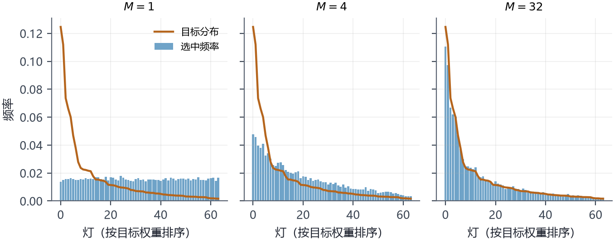
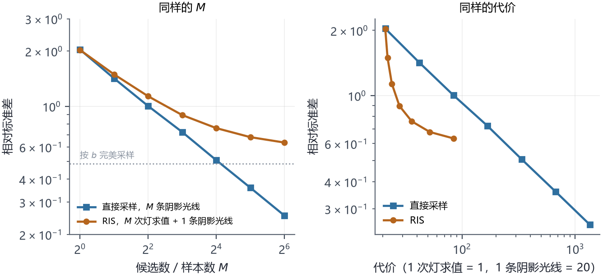
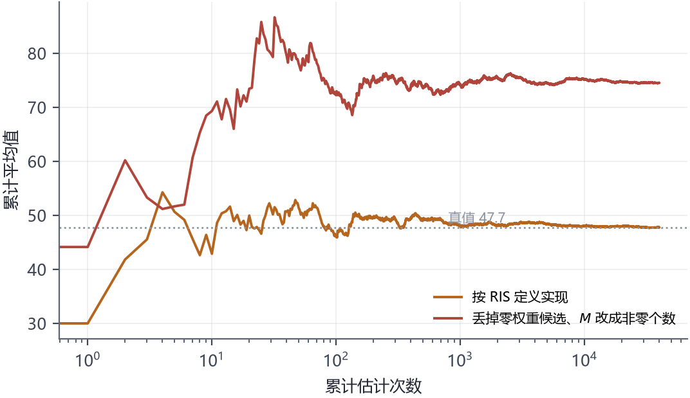

# 第 4 章 RIS：廉价评估换昂贵评估

## 4.1 目标函数里含可见性

第 1 章的按贡献选灯有一个前提：贡献 $b_k$ 可以算。它不含可见性，所以能遍历所有灯、建分布、采样。真正想按之采样的分布是 $f_k=b_kV_k$，它含可见性，而可见性正是要省的。

开灯那一刻，一盏灯对某个着色点是否可见是确定的，只是不知道。于是出现一个循环：想按 $f$ 采样，$f$ 需要影子；想要影子，又得先采样。打破循环的办法是不去采样。**评估** $f$ 是便宜的——给一个候选，算它的贡献，这件事不需要阴影光线（$b$ 部分），也可以在拿到阴影光线之后做（$V$ 部分）。整个过程需要的是"给我一个候选，我告诉你它值多少"，而不是"给我一个分布，我抽一个样本"。

Talbot、Cline 和 Egbert 在 2005 年的论文里把这件事写成了一个可用的估计量，叫重采样重要性采样（resampled importance sampling，RIS）。它的做法是：从一个能抽的分布里抽一批候选，按目标函数的权重从中挑一个，再把"这批候选的平均权重"记下来乘到结果上。挑出来的样本服从的分布接近目标分布，而记录下来的平均权重修正了"接近"与"等于"之间的差。

## 4.2 三个量

定义两个函数。**候选分布** $p$ 是能直接抽的那个，一般取均匀，或者正比于某个便宜的量。**目标函数** $\hat p$ 是想抽但抽不出来的那个，不必归一化——这一点很重要，因为归一化常数往往正是算不出来的东西。两者的比值

$$w(x)=\frac{\hat p(x)}{p(x)}  \tag{4.1}$$

是候选的权重。从 $M$ 个独立同分布的候选 $x_1,\dots,x_M\sim p$ 里，以

$$\Pr[y=x_i]=\frac{w(x_i)}{\sum_{j=1}^{M}w(x_j)}  \tag{4.2}$$

的概率挑出一个 $y$，然后估计

$$F=\left(\frac{1}{M}\sum_{i=1}^{M}w(x_i)\right)\frac{f(y)}{p(y)\,w(y)} .  \tag{4.3}$$

这个式子要留下三个量：选中的样本 $y$、权重和 $\sum w$、候选数 $M$。把 $w=\hat p/p$ 代进去，得到一个更好读的形式：

$$F=\frac{f(y)}{\hat p(y)}\cdot\frac{1}{M}\sum_{i=1}^{M}\frac{\hat p(x_i)}{p(x_i)} .  \tag{4.4}$$

括号外是"用目标分布做重要性采样"的那一项 $f/\hat p$，逐样本变化；括号内是目标分布在候选集上的平均质量，整批候选共有一个值。这个拆分是后面所有复用算法的骨架：复用的时候，括号外的部分必须在当前像素重算，括号内的部分跟着样本一起搬。

式 (4.4) 还解释了一件事：$\hat p$ 不必归一化。如果 $\hat p$ 被乘了一个常数 $c$，括号外除以 $c$，括号内乘以 $c$，乘积不变。所以目标函数可以随手写成 $b$ 或者 $bV$ 或者任何正比于它的量，不用去找归一化常数。这也是它与"真正的按 $\hat p$ 采样"的区别：真正的采样需要归一化，RIS 不需要。

一个自然的问题是：为什么不能直接用 $f(y)/\hat p(y)$？因为它少了一个归一化常数。$\hat p$ 只在相差一个常数的意义下已知，$\int\hat p$ 算不出来，而 $f/\hat p$ 的期望是 $\frac{1}{Z}\int f$，其中 $Z=\int\hat p$，也不等于 $\int f$。括号内那一项正是在估计这个常数：$\frac{1}{M}\sum \hat p/p$ 的期望是 $\int\hat p$，而 $f(y)/\hat p(y)$ 的期望是 $\int f/\hat p$。两者相乘，常数恰好消掉。这也是为什么 $M$ 必须如实记录——它是这个常数估计里的样本数。

## 4.3 无偏性：四步

要证明 $\mathbb{E}[F]=\int f$，需要三个前提：候选独立同分布于 $p$；选择概率严格等于式 (4.2)；$\hat p(x)>0$ 在所有 $f(x)\neq 0$ 的地方成立。第三个是支持条件，第四小节会说它。

**第一步，固定候选集。** 记 $S=(x_1,\dots,x_M)$，$W=\sum_i w(x_i)$。条件在 $S$ 上，剩下的随机性只有"选中哪一个"，而 $y$ 的分布是离散的、已知的。

**第二步，算条件期望。** 式 (4.3) 里与选择无关的部分提出来：

$$\mathbb{E}[F\mid S]=\frac{W}{M}\,\mathbb{E}\left[\frac{f(y)}{p(y)w(y)}\,\middle|\,S\right]
=\frac{W}{M}\sum_{i=1}^{M}\frac{w(x_i)}{W}\cdot\frac{f(x_i)}{p(x_i)w(x_i)} .  \tag{4.5}$$

第一个等号只是把 $W/M$ 提出来。第二个等号把 $y$ 的条件分布写开：$y=x_i$ 的概率是 $w(x_i)/W$，代进去的估计值是 $f(x_i)/(p(x_i)w(x_i))$。

**第三步，消掉 $W$ 与 $w$。** 式 (4.5) 里，求和号外的 $W$ 与每个求和项里的 $1/W$ 抵消，每个项里的 $w(x_i)$ 也上下抵消：

$$\mathbb{E}[F\mid S]=\frac{1}{M}\sum_{i=1}^{M}\frac{f(x_i)}{p(x_i)} .  \tag{4.6}$$

这一步是整个证明的核心，也是式 (4.3) 那个看起来别扭的 $\frac{1}{M}\sum w$ 存在的唯一理由。它和分母上的 $w(y)$ 是一对：$w(y)$ 让选中概率大的候选贡献变小，$\frac{1}{M}\sum w$ 把整体尺度拉回。少了任何一半，期望就不对。

**第四步，对候选集取期望。** 式 (4.6) 的右边是 $M$ 个独立同分布随机变量的平均，每个的期望是

$$\mathbb{E}\left[\frac{f(x)}{p(x)}\right]=\int\frac{f(x)}{p(x)}\,p(x)\,\mathrm{d}x=\int f(x)\,\mathrm{d}x ,  \tag{4.7}$$

所以

$$\mathbb{E}[F]=\frac{1}{M}\cdot M\int f=\int f .  \tag{4.8}$$

证明里没有用到 $\hat p$ 的归一化，没有假设 $M$ 很大，也没有要求 $\hat p$ 接近 $f$。目标函数选得差只影响方差。

$M=1$ 时，式 (4.3) 退化成 $F=\frac{\hat p(x_1)}{p(x_1)}\cdot\frac{f(x_1)}{p(x_1)\hat p(x_1)/p(x_1)}=f(x_1)/p(x_1)$，就是普通的蒙特卡洛。随着 $M$ 增大，估计量从"按 $p$ 采样"连续地滑向"按 $\hat p$ 采样"，中间每一步都无偏。这个连续性在图 4-1 里看得很清楚。

最强那盏灯在 $M=1$ 时的频率是 0.014，恰好是 $1/64$；$M=4$ 时 0.048；$M=32$ 时 0.111，离目标 0.125 还有距离。离得慢，是因为"挑一个"这个操作只从 $M$ 个候选里挑，而候选的分布本身是均匀的——要让它逼近目标，需要让"最强灯至少出现一次"的概率足够高，而那个概率是 $1-(1-0.125)^{M}$。$M=32$ 时它是 0.987，仍然有 1.3% 的批次里最强灯没出现，那些批次只能从次强的灯里挑。

## 4.4 同样的候选数与同样的代价

把 RIS 和"直接多发几条阴影光线"放在一起比较，会得到一个容易误读的结果。图 4-2 左半边是同样的 $M$：直接采样用 $M$ 条阴影光线取平均，RIS 用 $M$ 次灯求值加 1 条阴影光线。$M=1$ 时两者相同（2.03 与 2.03）；$M=8$ 时直接采样 0.72，RIS 0.90；$M=64$ 时 0.25 对 0.63。**同样的样本数下，RIS 更差。**

这不是实现错误。RIS 的方差有两部分：一部分来自"挑中的样本服从的是 $\hat p$ 的近似"，另一部分来自"权重和本身是随机的"。后一部分随着 $M$ 增大才慢慢消失，所以 RIS 的曲线收敛到 0.485 这条虚线（按 $b$ 完美采样的水平）之上，收敛速度比 $1/\sqrt{M}$ 慢。直接采样的方差是 $2.03^2/M$，没有下界，可以一直降。

图 4-2 右半边换成代价轴之后结论翻转。一次灯求值算 1，一条阴影光线算 20——这个比例在实时光线追踪里是保守的，真实比例常常更悬殊。在这个尺度下，RIS 用到 $M=64$ 的总代价是 84，相对标准差 0.63；直接采样要达到同样的 0.63 需要 10 条光线，代价 210。同样的代价下 RIS 好三倍多。

代价轴上还有一件事：两条曲线在某个点交叉。再往后（代价几千），直接采样继续下降，RIS 停在 0.5 附近。这个交叉点的位置由阴影光线的相对代价决定：光线越贵，RIS 的优势区间越长。离线渲染里一条光线不贵，直接多发几条更省事；实时渲染里一条光线很贵，RIS 才有意义。

## 4.5 候选从哪来，以及重复几次

候选分布 $p$ 的选择是一个独立的工程问题。均匀是最省事的：抽一个下标，$p=1/N$，$w=N\hat p$。别名表更准：按上一帧的贡献建表，$p_k\propto b_k$，$w$ 变成 $\hat p/b$ 这种量级为 1 的数，方差更小，代价是每帧一次 $O(N)$ 的建表。第三种选择是上一帧的目标函数，它把历史信息带进来，同时把 §4.6 的第三个条件（$p$ 与 $\hat p$ 在同一次评估下取值）变成一件需要小心的事。

每候选的代价也要算清楚。灯求值包含一次灯坐标变换、一次距离平方与夹角余弦、一次目标函数求值，在 GPU 上通常十几条指令。阴影光线包含一次加速结构遍历、若干次三角形求交，几百条指令起步，还要考虑相干性。式 (4.4) 的括号内就是 $M$ 次这样的灯求值，它换掉的是括号外那一次真实的、需要阴影光线的求值。

$M$ 不是唯一可调的旋钮，还有重复次数。一个蓄水池只给一个样本，但可以独立地跑 $R$ 次，把 $R$ 个估计平均：

$$F_R=\frac{1}{R}\sum_{r=1}^{R}\left(\frac{1}{M}\sum_{i=1}^{M}w(x_{ri})\right)\frac{f(y_r)}{\hat p(y_r)} ,  \tag{4.9}$$

方差是单次的 $1/R$。给定灯求值的总预算 $B=R\cdot M$，$M$ 与 $R$ 怎么分？$M$ 大则单次准、次数少，$M$ 小则相反。表 4-1 是同一场景下的实测，总预算固定为 64 次灯求值。

| $M$ | $R$ | 灯求值 | 阴影光线 | 相对标准差 |
|-----|-----|--------|----------|------------|
| 64 | 1 | 64 | 1 | 0.631 |
| 16 | 4 | 64 | 4 | 0.382 |
| 8 | 8 | 64 | 8 | 0.323 |
| 4 | 16 | 64 | 16 | 0.284 |
| 1 | 64 | 64 | 64 | 0.257 |

灯求值一样多的时候，把预算摊成更多次、每次更少候选，结果更好。原因是重复次数带来的是独立的估计，方差按 $1/R$ 掉；而候选数带来的改善是次线性的，从 0.63 到 0.38 需要的是 $R$ 从 1 到 4，从 0.38 再往下走要付的候选数越来越多。

可是表 4-1 没有算阴影光线的代价，而阴影光线才是贵的那一项。$M=1$ 那一行用了 64 条光线，$M=64$ 那一行只用 1 条。按光线 20、灯求值 1 折算，两行的总代价分别是 1344 与 84，差了十六倍。真正要做的选择是：给定总代价，$M$ 取多少。

这个权衡在实时渲染里的答案通常是 $M$ 大、$R$ 小，因为光线贵；在离线渲染里反过来，因为光线便宜而 $M$ 次灯求值里的加速结构遍历也不便宜。ReSTIR 选的是前者，它的整个设计就是"每像素一条光线，把所有力气花在复用上"。

## 4.6 三个不能破的条件

式 (4.3) 的实现比公式看起来更容易出错，因为有三个条件在代码里不显眼。

**支持条件。** $\hat p(x)>0$ 必须在 $f(x)\neq 0$ 的地方成立。如果某盏灯有贡献但目标函数给它零权重，它永远不会被选中，那部分能量就丢了，结果偏小。反过来，$\hat p$ 在 $f=0$ 处大于零没有关系，只是浪费候选。这个条件在实现里最常见的破坏方式是"目标函数里乘了一个可见性代理"——用上一帧的可见性做近似，把这一帧已经不被挡住的灯判成零权重。

**$M$ 是最初抽的候选数。** 不是有效候选数，不是非零权重候选数，不是通过了某种剔除的候选数。这一条最容易在"优化"里被破坏，因为跳过零权重候选看起来是完全无害的：它们对权重和没有贡献，对选择概率也没有贡献。问题出在式 (4.6) 的那个 $1/M$ 上。$M$ 变小，$1/M$ 变大，整个估计被放大。

图 4-3 是这个错误的实测。64 盏灯，目标函数取 $\hat p=f$（含可见性），$M=8$。被挡住的灯权重为零，8 个候选里平均只有 5.2 个非零。按式 (4.3) 实现，累计平均值收敛到 47.78，真值 47.67；把零权重候选丢掉、$M$ 改成非零个数，收敛到 74.49，偏了 56.3%，正好是 $8/5.18$ 这个比例。

这个错误最阴险的地方是它的外观。偏差不带来任何额外的噪声，图像只是亮了，亮得很均匀，像是曝光调高了一档。它也不会随样本数消失——多跑几帧，那条红线只会更稳地停在 74.49。用单帧图像做测试看不出问题，用长序列均值才能看出来。

**候选同分布，且 $\hat p$ 与 $p$ 在同一次评估下取值。** 混入来自别处的样本时，$p$ 和 $\hat p$ 分别是哪一套必须记清楚。这一条在时空复用里变成主要矛盾，因为"别处"的样本是按别的 $p$ 抽的、按别的 $\hat p$ 加权的。

## 4.7 从 RIS 到复用

式 (4.4) 的三个字段——样本、权重和、候选数——就是后面所有复用算法的数据格式。为什么是这三个，现在可以回答了。样本 $y$ 是结论；权重和 $\hat W$ 记录了"这个结论是在多大的权重密度下被挑出来的"；候选数 $M$ 记录了"它是从多少个候选里胜出的"。三者合起来，等价于一个"平均权重" $\hat W/M$ 加上一个样本。

复用的时候，某个像素想借用邻居的结论。它需要知道两件事：这个样本在我这里的价值是多少，以及它原本是从多大的池子里挑出来的。第一件事靠重算 $f$ 与 $\hat p$ 得到，第二件事靠 $\hat W/M$ 换算。如果只知道样本、不知道它背后的池子大小，就无法判断该给它多少话语权——这正是第 3 章里"按 $W$ 合并而不是按 $W\cdot M$"那条规则的来源。

这套格式的代价是每个像素要存十几到二十个字节。收益是一个像素的有效候选数不再等于它自己抽的那几个：时间复用让 $M$ 逐帧累加，空间复用让相邻像素的 $M$ 相加。第 5 章会看到，一个像素跑几十帧、每帧抽 8 个候选、从四个邻居各借一次之后，$M$ 可以到几百，而这一切只花了每帧一条阴影光线。

---

RIS 把"采不出来的分布"这个问题变成了"评估得起的分布"，代价是每次估计要做 $M$ 次廉价求值，换掉一次昂贵求值。它的无偏性只依赖三件事，其中两件在代码里不显眼：$M$ 必须是最初的候选数，$\hat p$ 必须在有贡献处为正。第三件事——候选同分布——在单点时自动成立，一旦开始复用就成了主要问题。下一章把 RIS 搬进像素，让它的三个字段跟着像素活过整帧。
