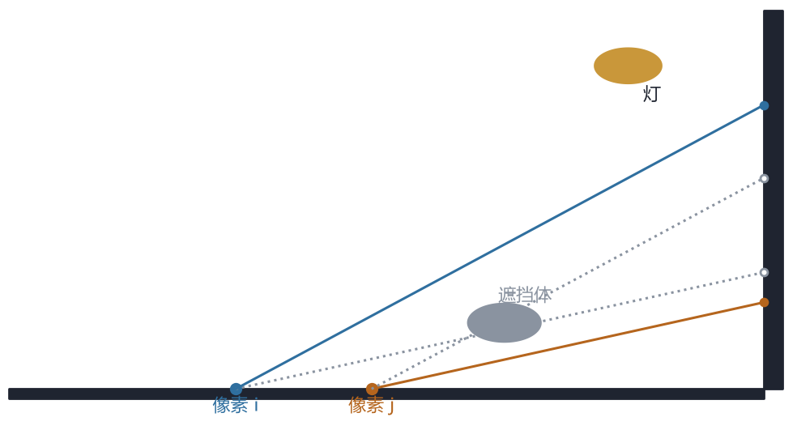
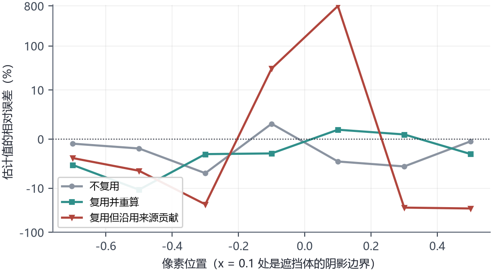

# 第 5 章 ReSTIR GI：把路径也放进蓄水池

## 5.1 间接光的样本不是一盏灯

直接光照的样本是一盏灯。它有一个天然的下标，把十盏灯排序、编号，随机取一个很便宜。间接光没有这种东西：从着色点出发的方向是连续的，一条路径由方向、次级顶点、再往下的方向共同决定，中间任何一处变了，贡献就变了。

Ouyang 等人 2021 年的 ReSTIR GI 做的事情，是把蓄水池从"灯的下标"换成"路径的方向"。每个像素维护一个方向 $\omega$，它是这个像素第一次弹射的方向；这个方向决定了整条路径，因为它会在场景里打到某个次级顶点 $q$，$q$ 再从灯那里接收光照。像素只要记住 $\omega$ 和这条路径的吞吐量，就相当于记住了整条路径。

换掉了样本的定义，第 2 章到第 4 章的东西几乎原样保留：候选、权重、选择、合并、截断。需要重新检查的只有一件事——当一条路径从一个像素搬到另一个像素，它的权重还剩多少。

## 5.2 一条路径在像素上的价值

取一个只有一次弹射的场景：地面上一排着色点，远处一堵墙，墙前面有一盏灯，灯和地面之间有一个遮挡体。图 5-1 是这个场景的剖面。

从一个着色点 $p$ 沿方向 $\omega$ 出发，路径打到墙上的点 $q=p+t\omega$，其中 $t$ 由墙的位置定出。这条路径的贡献是

$$f_p(\omega)=\frac{\rho}{\pi}\cos\theta_p\cdot\frac{L\cos\theta_q}{2\pi\,\|q-\ell\|^{2}}\cdot V(p,q)\,V(q,\ell) , \tag{5.1}$$

其中 $\ell$ 是灯的位置，两个 $V$ 分别管"从 $p$ 到 $q$ 有没有被挡"和"从 $q$ 到灯有没有被挡"。式中的几何量全部依赖 $p$——距离、夹角、交点 $q$ 的位置。

候选分布 $p(\omega)$ 一般是余弦加权的 $\cos\theta_p/\pi$，因为那是 BRDF 采样给出的分布。于是权重是

$$w_p(\omega)=\frac{f_p(\omega)}{p(\omega)} . \tag{5.2}$$

一个像素的蓄水池里存方向 $\omega$、权重和 $\hat W$、候选数 $M$。着色时 $\langle L\rangle = f_p(\omega)/p(\omega)\cdot\hat W/(M\,w_p(\omega))$，和第 2 章的 (2.5) 一模一样。

## 5.3 搬一条路径意味着什么

现在把一个像素的 $\omega$ 搬到隔壁。方向不变，起点变了，于是打到的墙点从 $q$ 变成 $q'$。这个位移是整件事的核心：路径的"后半段"被丢掉了，只留下方向。

后果有三层。

**第一层，贡献必须重算。** $f_{p'}(\omega)$ 里的距离、两个夹角、交点位置全部变了。用来源像素的 $f_p(\omega)$ 代替，等于假设"同一个方向在两个位置看到的东西一样"，这个假设在几何上就是错的。

**第二层，可见性可能翻转。** 这是最要命的一层。图 5-1 里同一个方向从像素 i 出发是通的，从像素 j 出发被遮挡体挡住。翻转发生在阴影边界附近，而阴影边界正是人眼最敏感的地方。

**第三层，pdf 也要重算。** 如果候选分布是余弦加权，它只依赖法线，两个像素法线相同，pdf 恰好一样。但只要 BRDF 不是各向同性漫反射，或者样本来自多部件 MIS，pdf 就依赖入射方向，搬到新像素必须重新求值。这和第三章"历史样本的 pdf 要在当前帧重新评估"是同一条规则的路径版。

第 4 节的结论在这里原样适用：单点换算在期望上是精确的，前提是比值用被合并的那个样本算，且分子分母属于同一套评估。搬到路径上，这个"同一套评估"就是"同一个起点、同一次几何求交"。

## 5.4 存的是方向，不是吞吐量

蓄水池里存什么，取决于什么东西必须在终点重算。

方向 $\omega$ 必须存，因为它是样本的标识。权重和 $\hat W$ 必须存，因为它是整批候选的统计量，重算不了。候选数 $M$ 必须存，理由同上。

吞吐量 $f_p(\omega)/p(\omega)$ 不能存。它是路径在**来源像素**上的价值，搬到新像素之后这个价值变了。存下来会省掉一次求值，但省下的正是必须重做的那一步。

这条规则有一个不太明显的推论：如果一条路径的后续弹射也被复用（不只是第一次），那么后续那段的吞吐量同样不能存。ReSTIR GI 的做法是只存第一次弹射的方向和第一段的吞吐量，把 $q'$ 之后的子路径整个重走。这比复用整条路径贵，但没有偏差。

有人试过把整条路径的吞吐量存下来做"路径复用"，在静态场景里效果很好，一运动就出问题。原因和这里说的一样：吞吐量里含了距离、夹角、材质的乘积，这些量在换起点之后全部变了，而它们的变化率最大的地方恰好是几何边缘。

还有一个更微妙的量：pdf。如果第一次弹射是按余弦加权的，$p(\omega)=\cos	heta_p/\pi$ 只依赖法线，两个像素法线相同就没问题。但只要材质不是各向同性漫反射，或者采样用了多部件 MIS，$p$ 就依赖入射方向，必须在新像素重新求值。这一条和第 3 章"历史样本的 pdf 要在当前帧重新评估"是同一条规则的两种表现：**凡是含了位置或时间的量，都要在终点重算**。

## 5.5 光漏是怎么来的

把上面的第一条和第二条放在一起，就是 ReSTIR GI 最典型的失效：复用一条路径，但用来源像素的贡献。这条路径在被复用到的像素上可能根本不通，可它的权重是从一个通的像素带过来的。

图 5-2 是这个实验的结果。场景就是图 5-1 的那个剖面：地面 $x$ 从 −0.7 到 0.5 放七个着色点，墙在 $x=1.2$，灯在 $(0.75, 2.05)$，遮挡体在 $(0.34, 0.42)$。每个像素每帧采四个余弦加权方向，复用半径两个像素。

不复用的平均相对误差是 −2.5%，复用并重算的是 −3.2%，两者都在蒙特卡洛噪声的量级上。沿用来源贡献的那条红线在阴影边界处偏到 +800%：那些像素本该是暗的，可它们借来的路径全都来自旁边亮着的区域。

这就是游戏引擎里"接触阴影漏光"的来源。它不是参数问题，也不是候选数不够——把候选数从 4 调到 400 也没用，因为偏差是乘性的，只在阴影边界最明显，而在别的地方只有百分之几，肉眼看不出来。

## 5.6 那为什么它还是能出图

因为重算这一步本身不贵。$q'$ 的求交可以做一次，从 $q'$ 到灯的可见性本来就是这条路径要付的阴影光线，而 $f_{p'}$ 的几何量在求交过程中顺手就能算出来。真正省下的是"找到好方向"这件事——方向的空间是连续的，随机采很难碰到墙上灯光亮斑的那种方向，而邻居已经碰到了。

所以 ReSTIR GI 的复用是"借用方向，重算整条路径"。这和直接光照的复用不同：那边借的是灯的下标，灯是离散的，重算一次可见性就完事；这边借的是连续方向，重算的是整条路径的几何。

这也带来一个直接光照没有的问题：复用之后路径的"后半段"（$q'$ 之后的弹射）必须重新走。如果场景有多次弹射，每次复用都要重做后面所有次，成本随弹射深度线性增长。ReSTIR GI 的做法是把第一次弹射之后的子路径也一起复用——用 $q$ 附近的信息去近似 $q'$ 之后的路径，代价是引入另一层近似。这一层是后续研究的主要战场，2021 年之后有不少工作专门处理它。

## 5.7 两个容易忽略的细节

方向是连续的，这意味着两个样本"相同"的概率为零。直接光照里，两个蓄水池都选中同一盏灯是常事，合并时等于把一个候选从 2 个变成 1 个，$M$ 会虚高。路径空间里不会出现这种情况，但会出现它的近亲：两个像素的 $\omega$ 非常接近，几乎落在同一个次级顶点上，它们的信息几乎重复。

这种现象让有效候选数低于 $M$。第 8 章讲有效样本数时会回到这一点。它不影响无偏性，只让"候选数"这个数量指标变得不可靠——用一个重复度很高的候选集去估方差，会得到过于乐观的结果。

另一件事是"路径的年龄"。直接光照的样本只有一盏灯，它没有年龄；路径样本有，因为一条路径的后续弹射是在某一帧的几何上走出来的。几何一动，那条后续路径对应的就是过去的世界。把年龄长的路径和新路径放进同一个蓄水池，短期看不出问题，等场景动起来就会出现"影子拖在后面"的现象——那不是阴影，是一条已经失效的路径还在被计数。

处理办法和第 3 章一样：限制历史长度，并且按帧对权重做无偏的衰减。差别在于路径样本失效得更快，所以路径空间的候选数上限通常比直接光照小。

---

路径复用的规则可以压成一句话：借方向，不借贡献。方向是离散化之后的样本，可以跨像素搬运；贡献依赖起点，必须在终点重新算。

有了这条规则，间接光也能用上和直接光一样的机器。但这台机器现在有两套目标函数（DI 的和 GI 的）、两套候选分布，它们经常需要一起用——一个像素既要做光源采样，又要做路径采样，两边的样本还要放进同一个蓄水池。怎样把不同来源、不同维度的样本放进一个框架里而不出错，是第 6 章的内容。
