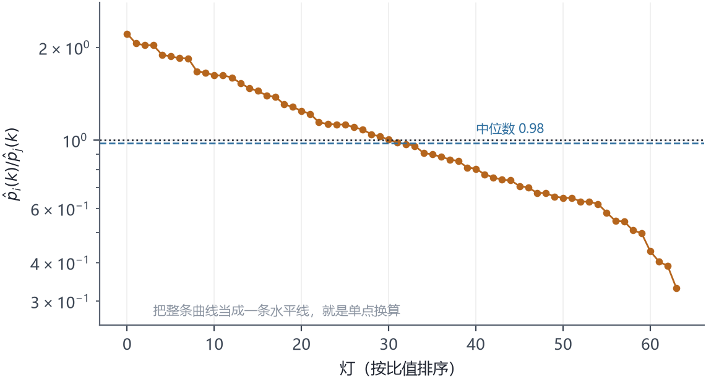
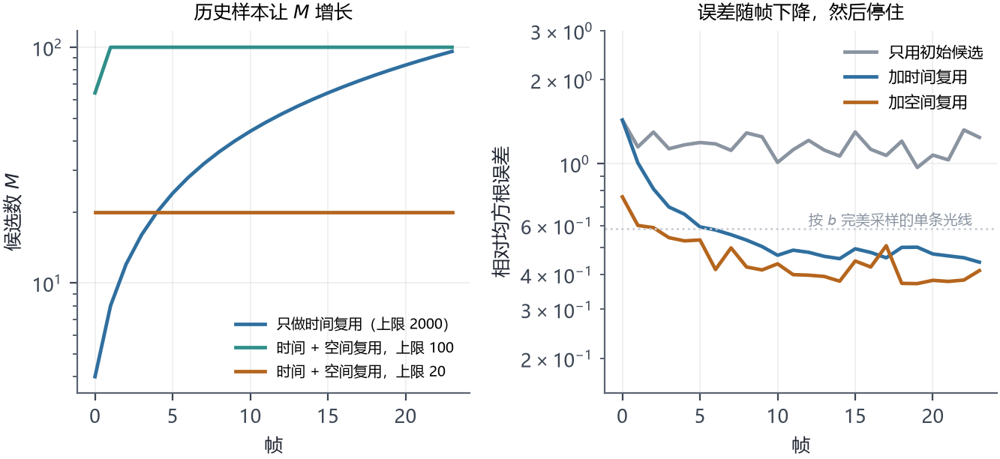
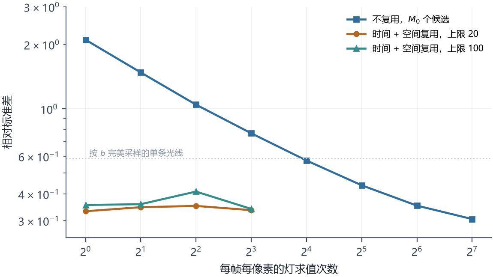

# 第 5 章 ReSTIR DI：把蓄水池放进像素

## 5.1 一个像素一个蓄水池

第 4 章的东西是"一个着色点、一批候选"的算法。把它变成渲染器的一部分，只需要换一个存放位置：蓄水池不是临时变量，它是像素的一个属性，跟着像素活过整帧，甚至活过很多帧。

一个像素的蓄水池里存三样东西：选中的光源下标 $y$、权重和 $\hat W$、候选数 $M$。加上一个目标函数值 $\hat p_j(y)$ 用于换算，二十个字节足够。每帧它做三件事——从新抽的候选里更新自己，从上一帧的自己那里继承，从邻居那里借——然后出一条亮度。

这三件事的名字分别是初始候选、时间复用、空间复用。Bitterli 等人 2020 年的 ReSTIR DI 就是这三个步骤，加上一套保证合并之后仍然无偏的权重换算，以及一个可选的第四步：可见性复用。

三条路各有各的麻烦。初始候选的麻烦是目标函数只能近似；时间复用的麻烦是历史样本的密度按上一帧的几何算的；空间复用的麻烦是邻居的目标函数和自己的不一样。后两个麻烦最后归结为同一个问题：权重该怎么换算。

## 5.2 初始候选

理想的目标函数是真实贡献 $f_k=b_kV_k$。它需要可见性，而可见性正是要省的东西。所以初始候选用的目标函数只能是无阴影贡献

$$\hat p(x)=b(x)=\frac{L\,A\,\cos\theta_x}{d^2} ,  \tag{5.1}$$

其中 $A$ 是灯的面积、$d$ 是距离、$\theta_x$ 是灯面法线与连线的夹角（灯的朝向也要算进来）。

这个替换不破坏无偏性。第 4 章的定理只要求 $\hat p>0$ 在有贡献的地方成立，没要求 $\hat p$ 等于 $f$。代价全部落在方差上：被完全挡住的灯仍然可能被选中，样本落在它上面时贡献为零。

目标函数里要不要含材质的 BRDF 项，是个常被忽略的选择。含进去更接近真实贡献，样本分布更准；不含则所有像素共享同一个目标函数，空间复用的比值退化成一个纯几何量，实现更简单，而且可以在不同的着色通道之间共享。多数实现把 BRDF 的余弦与基础色留下、把粗糙度相关的高光细节交给 BSDF 采样，避免蓄水池在光滑表面上把候选全压在镜面反射方向附近。

初始候选抽 $M_0$ 个，一般取 1 到 32。$M_0=1$ 时这一帧只问一盏灯，方差不比纯随机好多少；$M_0=8$ 时已经能挑出主灯。$M_0$ 太大则每帧的灯求值开销上去了，而重复帧之间的历史会补充同样的信息——初始候选的作用是"给蓄水池注入新的可能"，不是"一次算准"。

初始候选结束后，像素有一个蓄水池 $(y,\hat W,M_0)$，$\hat W=\sum_{i=1}^{M_0}\hat p(x_i)/p(x_i)$。若 $p$ 均匀，$p=1/N$，$\hat W=N\sum\hat p(x_i)$。

## 5.3 时间复用

上一帧的蓄水池里有 $(y_{\text{prev}},\hat W_{\text{prev}},M_{\text{prev}})$ 与它当时的 $\hat p_{\text{prev}}(y_{\text{prev}})$。这一帧想把它并进来，先要回答一个问题：这个样本在这一帧的权重是多少。

权重是 $\hat p/p$。$p$ 是候选分布，这一帧还是均匀（或者还是那张别名表），所以 $p$ 没变。$\hat p$ 是目标函数，它在这一帧的值是

$$\hat p_t(y)=\frac{L_y\,A_y\,\cos\theta_y(t)}{d_y^{2}(t)} .  \tag{5.2}$$

相机移动之后，这个着色点在屏幕上的位置变了，它到灯的距离、灯面法线与连线的夹角也变了。上一帧存下来的权重和是按 $\hat p_{t-1}$ 算的，直接拿过来用，等于用旧价格结算新交易。

正确的换算是在合并时乘一个比值：

$$\hat W'=\hat W_{\text{prev}}\cdot\frac{\hat p_t(y)}{\hat p_{t-1}(y)} .  \tag{5.3}$$

分子在这一帧算，分母是上一帧存下来的那个值。$y$ 一个样本代表整个蓄水池，这是近似——式 (5.3) 假设 $\hat p_t/\hat p_{\text{prev}}$ 在整个候选集上大致相同。图 5-1 显示这个假设有多粗糙：相邻两个像素对同一批灯的目标函数之比，在 64 盏灯上从 0.33 变到 2.22，差 6.7 倍。同一个像素相邻两帧的比值温和得多，因为几何变化小，但也不是常数。



换算之后，合并的规则和 RIS 内部的加权选择完全一样。两个蓄水池的权重和分别是 $\hat W_a$ 与 $\hat W'$，以

$$\Pr[\text{选 } b]=\frac{\hat W'}{\hat W_a+\hat W'}  \tag{5.4}$$

的概率选 $b$ 的样本，新的权重和是两者相加，新的候选数是 $M_a+M_b$。这一步之所以是对的，因为它就是式 (4.2) 在两个候选上的特例：把"权重"理解为"权重和"，把"选择"理解为在两个蓄水池之间做一次加权抽签。第 3 章的合并定理已经把它证明过了。

## 5.4 空间复用

空间复用和 §5.3 的式子一模一样，只有一处不同：$b$ 不是上一帧的自己，而是隔壁像素这一帧的蓄水池。$\hat p$ 与 $p$ 的比值换算还是式 (5.3)，只是分母换成了"邻居当时用的目标函数"。

$$\hat W'=\hat W_j\cdot\frac{\hat p_i(y_j)}{\hat p_j(y_j)} .  \tag{5.5}$$

这个比值比时间复用里的那个更不可靠。时间复用的两个目标函数是同一个像素在两帧的值，差异来自相机与物体的运动；空间复用的两个目标函数是两个像素在同一帧的值，差异来自它们在几何上的位置差。位置差是固定的，所以这个比值不会随帧变化，但它可以很大——表面曲率大的地方，两个相隔一像素的点看到的是完全不同的环境。

实现上有两个细节必须固定下来。第一，所有邻居必须基于**同一份快照**合并，不能在合并过程中让已经更新过的蓄水池被下一个邻居读到。否则一个像素在五个邻居之间会形成链式传播，最终的 $M$ 与 $\hat W$ 不对应任何一个真实的候选集，式 (5.4) 的前提就没了。第二，邻居的选取通常只取空间上相邻的四个或八个方向，而不是随机采样，因为随机采样会让同一帧内不同像素的复用结构不一致，噪声图案在屏幕上流动。

## 5.5 候选数上限

$M$ 不能无限增长。一个像素活了几千帧之后，$M$ 会变成一个巨大的数，历史样本的权重永远压过新样本，场景一变就反应不过来。所以要设上限 $M_{\max}$：当 $M_a+M_b$ 超过它时，把权重和按同样的比例缩下来，

$$\hat W\leftarrow \hat W\cdot\frac{M_{\max}}{M_a+M_b},\qquad M\leftarrow M_{\max} .  \tag{5.6}$$

这个缩放不改变 $\hat W/M$，所以不影响估计的期望，只影响"新样本还能不能挤进来"。它是第 3 章式 (3.16) 的直接应用。

图 5-2 左边是 $M$ 随帧的增长。只做时间复用、$M_0=4$、上限 2000 时，$M$ 每帧加 4，线性上升，23 帧到 92；打开空间复用之后，一帧之内就从 4 涨到 100，撞上限。这个对比说明上限不是可选的调参项：没有它，空间复用会在第一帧就把蓄水池塞满，之后新样本再也进不来，图像出现"冻结"——运动物体后面拖着一段不动的历史。



邻居的数目不是越多越好。四个方向是最常见的取法；八个方向能多借一倍的候选，代价是每个像素的合并次数翻倍，而且斜对角的像素与自己的几何差更大，式 (5.5) 的比值更不可靠。用半径 $r$ 的正方形邻域（累计 $4r$ 个方向）时，候选数增长与半径成正比，而几何相似度随半径迅速下降，两者的乘积在一个很小的半径处就饱和了。第 13 章会用实验把这条曲线画出来。

## 5.6 可见性复用

还有一步是可选的，Bitterli 等人写作可见性复用（visibility reuse）。做法是：蓄水池给出样本 $y$ 之后，先对 $y$ 做一次可见性查询；如果不可见，就把这个蓄水池整个丢掉，重新用初始候选建一个。

这一步能省下一整条阴影光线吗？不能，查询本身就是一条阴影光线。它省的是**方差**：一个被挡住的样本对图像的贡献是零，但它在估计量里占着 $\hat W/M$ 的份额，这个份额本来可以给别的候选。把被挡住的样本换掉，等于把"抽到了没用的样本"这件事从方差里剔掉。

代价是偏差。可见性复用之后，留下来的样本一定可见，所以 $y$ 的分布不再是 $\hat p/p$，而是"$\hat p/p$ 再乘上可见性"。估计量的期望因此偏大——半影区域里，一半的候选被剔掉，剩下的那些代表不了被剔掉的那些。Bitterli 等人的实验里这个偏差很小，因为半影的梯度被降噪器抹平了；在没有降噪器或者半影很窄的场景里，它能被看出来，表现为阴影边缘一圈偏亮。

严格的处理方式有两种。一种是不丢样本，而是把可见性放进目标函数，变成 $\hat p=bV$，这样被挡住的候选权重为零，选择时自然不会被选中——代价是 $M$ 里多算了那些零权重的候选（第 4 章 §4.6 的那条），而且 $\hat p$ 需要阴影光线才能算，循环又回来了。另一种是接受它有偏，但把偏差限制在半影宽度以内，并交给降噪器处理。生产实现几乎都选后者，因为前者会把可见性查询的次数翻倍。

## 5.7 一份能照着写的实现

把上面五步写成伪代码，结构如下。变量都是每个像素一份。

```text
每帧，每个像素 i：
  # 1 初始候选
  y, W, M = 0, 0, 0
  for k in 1..M0:
      x = 按 p 抽一个候选            # 均匀，或按别名表
      w = phat_i(x) / p(x)
      W += w; M += 1
      if rand() * W < w:  y = x; ph = phat_i(x)
  # 2 时间复用
  if 有历史:
      ph_cur = phat_i(y_prev)                       # 当前帧重新评估
      Wb = W_prev * ph_cur / ph_prev
      if rand() * (W + Wb) < Wb:  y = y_prev; ph = ph_cur
      W += Wb; M += M_prev
  # 3 空间复用（基于同一份快照）
  for j in 四个邻居:
      ph_cur = phat_i(y_j)
      Wb = W_j * ph_cur / ph_j
      if rand() * (W + Wb) < Wb:  y = y_j; ph = ph_cur
      W += Wb; M += M_j
  # 4 上限
  if M > Mmax:  W *= Mmax / M; M = Mmax
  # 5 着色
  L = f_i(y) / phat_i(y) * (W / M)
```

第五步是整段代码最容易写错的地方。错法有三种：$\hat p_t(y)$ 用了上一帧的值；$f_i(y)$ 用了邻居的可见性；$W/M$ 写成了 $W$。三者的症状都是整体亮度偏，而且都不随帧数消失。

注意第 3 步里 $f_i(y)$ 用到的是**当前像素**的可见性，而 $y$ 是邻居挑的灯。这意味着阴影光线必须在当前像素重新打，不能复用邻居的可见性结果——否则就不叫复用了，那叫"用邻居的影子给这个像素着色"。

## 5.8 代价与效果

图 5-3 是这套结构的收益。横轴是每帧每像素的灯求值次数，纵轴是相对标准差。



不复用时，$M_0=1$ 的相对标准差 2.10，$M_0=4$ 是 1.08，$M_0=64$ 才降到 0.35。打开复用、$M_0=1$、上限 20，相对标准差 0.35——和 $M_0=64$ 不复用持平，而每帧的灯求值只有 1 次，少了 64 倍。这就是 ReSTIR 的全部经济学：把每帧的开销压到很低，让历史与邻居补上候选数。

同一组实验里的偏差是多少？64 个种子、每种子 24 帧、64 个像素，平均相对偏差是 $+0.07\%$，标准误 0.7%，即落在统计噪声里，测不出系统性偏差。式 (5.5) 那个单样本近似带来的误差是 $O(1/M_j)$ 量级，在 $M_{\max}=20$ 时小到测不出来。这个数字在下面是重要的对照：第 7 章会给出同样场景下几种"真错"的偏差，量级是它的十倍到百倍。

图 5-2 右边是误差随帧的下降。只用初始候选时误差停在 1.1 附近不动——每帧都是独立的一批新候选，历史被丢掉了，所以帧数增加不带来任何改善。加时间复用之后，误差在前几帧迅速从 1.15 降到 0.47，然后缓慢下降；加空间复用再降到 0.38。两条曲线都在 0.33 到 0.42 之间趋平，这个平台不是收敛不完全，而是"每帧只有一条阴影光线"的信息上限。

0.33 这个平台比按 $b$ 完美采样的单条光线的 0.585 还要低。这并不矛盾：蓄水池给出的估计是 $\frac{f(y)}{\hat p(y)}\cdot\frac{\hat W}{M}$，后面这个因子是多个候选的平均权重，它自己也在平均不同候选的可见性差异。所以复用不仅能逼近完美重要性采样，还能通过跨像素的可见性平均略微超过它。

降噪器接口是另一个需要提前想清楚的地方。ReSTIR 的蓄水池可以顺手给出一个方差估计：$\hat W/M$ 的倒数与候选数一起，能凑出一个"这个像素的估计值有多可信"的量。这个量不能直接当噪声水平用，因为它衡量的是重采样的方差，不含可见性带来的那一部分；把它交给降噪器时要乘上一个与候选数相关的系数，否则会出现"越干净的像素被降噪得越狠"的过度平滑。

## 5.9 剩下的问题

这套算法有一个前提没被检查：式 (5.5) 用的是"邻居的样本在邻居的目标函数下的值"与"它在我这里的目标函数下的值"的比值。如果邻居的候选集与我的候选集在几何上是两回事——比如邻居的样本是一盏离它很近、离我很远的灯——这个比值可以极大或者极小，合并之后我的蓄水池权重和就被一个不具代表性的数缩放了。

这个近似带来的偏差有多大、什么时候可以忽略、怎样从数学上界定"什么时候它是精确的"，是下一章的内容。第 6 章先把整套重采样的数学写成一套可以逐项检查的式子：目标函数与密度的关系、历史样本的重新评估、$M$ 估计量、权重和的归一化、偏差与方差如何分解。有了这套语言，第 7 章才能精确地指出哪种实现会偏、偏多少。
