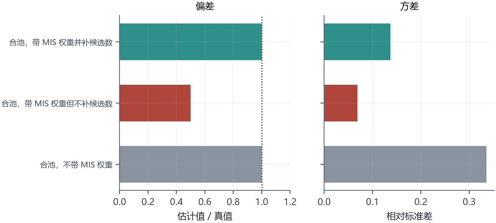
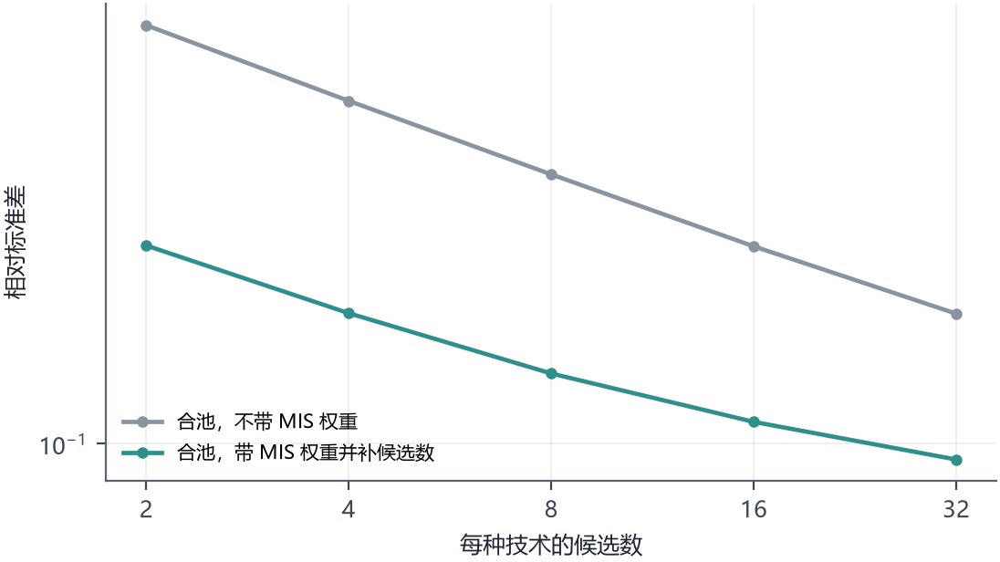

# 第 6 章 GRIS：重采样与多重重要性采样的统一

## 6.1 一个像素上有两种样本

一个像素同时要直接光和间接光。直接光靠光源采样，样本是一盏灯。间接光靠方向采样，样本是一个方向。两者的候选空间不同，分布不同，目标函数也不同。

自然的写法是各做各的：一个蓄水池管直接光，一个管间接光，各自重采样，最后相加。这对，因为两者估的是两个不同的积分。但如果想让它们共用一个蓄水池——比如让光源采样的候选和路径采样的候选竞争同一个"最好样本"的位置——就必须先回答一个问题：两边的权重能不能直接放在一起比。

Lin 等人 2022 年的 GRIS 给出了这个问题的完整答案。它的结论有一半是好消息（能放在一起），一半是警告（放的方式不是看上去最自然的那个）。

## 6.2 多重重要性采样的恒等式

先复习 MIS 的那一步，因为它是全部推导的起点。有若干个技术，每个技术 $i$ 给出一个候选分布 $p_i$，都能独立地估同一个积分 $I=\int f$。定义一组权重 $m_i(x)$ 满足

$$\sum_i m_i(x)=1\qquad\text{对任意 } x . \tag{6.1}$$

那么

$$\mathbb{E}\left[\sum_i m_i(x_i)\frac{f(x_i)}{p_i(x_i)}\right]=\sum_i\int m_i(x)f(x)\,dx=\int f(x)\,dx , \tag{6.2}$$

每个技术承担贡献的一部分，加起来正好是全部。平衡启发式 $m_i=p_i/\sum_j p_j$ 是其中分得最匀的一种，但它不是唯一的选择。式 (6.1) 是唯一的要求。

(6.2) 的形状值得注意：$m_i(x_i)f(x_i)/p_i(x_i)$ 可以读成"技术 $i$ 的样本，带一个折损系数 $m_i$"。这个折损系数的作用是防止同一块区域被两个技术各算一次。

## 6.3 搬进蓄水池：权重和不再估计积分

现在把两个技术的候选放进同一个蓄水池。来自技术 $i$ 的候选 $x$ 的权重应该是什么？

先看最自然的答案：$w_i(x)=m_i(x)\,\hat p_i(x)/p_i(x)$，也就是把 MIS 的折损系数直接乘上去。听上去完全合理，实测偏差 −50%（图 6-1 中间那条）。

问题出在归一化。第 2 章的定理要求 $(1/M)\sum \hat w$ 是 $\int\hat p$ 的无偏估计。池化之后，候选来自不同技术，每个技术贡献的候选数 $M_i$ 一般不同，于是

$$\mathbb{E}\left[\frac{1}{M}\sum_{k=1}^{M}\hat w(x_k)\right]=\sum_i\frac{M_i}{M}\int m_i\hat p_i . \tag{6.3}$$

右边是 $\int\sum_i (M_i/M)\,m_i\hat p_i$，而我们要的是 $\int\sum_i m_i\hat p_i$。两者只在 $M_i/M$ 对每个技术都等于 1 时才相同——那不可能，份额之和为 1。

差多少？两个技术各出一半候选时，右边正好是目标的一半，于是估计值减半。图 6-1 里实测 −50.0%，与这个推理完全一致。

修法是给每个技术的权重乘一个份额校正：

$$w_i(x)=\frac{M}{M_i}\,m_i(x)\,\frac{\hat p_i(x)}{p_i(x)} . \tag{6.4}$$

代回 (6.3)，$\frac{M}{M_i}\cdot\frac{M_i}{M}=1$，权重和的期望回到 $\int\sum_i m_i\hat p_i=\int\hat p$。这一项就是 GRIS 里那个容易漏掉的因子，它的含义很朴素：**一个技术出了多少个候选，它的每个候选就要按比例放大多少**，否则候选多的技术会主导权重和。

## 6.4 三条无偏条件

把这套东西写成条件，一共三条，前两条是第 2 章的老朋友，第三条是新的。

**支持条件。** $\hat p_i(x)>0$ 在 $f(x)\neq 0$ 处成立。合并目标 $\hat p=\sum_i m_i\hat p_i$ 也要满足同样的条件——如果某个技术的目标在一处为零而另一个技术在那里有贡献，$m_i$ 必须保证那一处的合并目标不为零。

**权重成对。** 每个候选的 $\hat p_i$、$p_i$、$m_i$ 必须在同一个点、同一次评估下取值。这一条在时空复用里退化成第 4 章的三件东西成对，在技术合并里退化成"目标函数和候选分布必须属于同一个技术"。

**份额校正。** 式 (6.4) 里的 $M/M_i$ 不能省。它看起来像是一个可以并进常数的东西，实际上它随帧变化，因为每帧各技术出的候选数可能不同。

第三条是最容易出错的，因为它不改变任何单个候选的"合理性"：每个候选的权重看起来都对，只有总体的尺度差了。它也不会在单技术时暴露——$M_i=M$ 时校正因子是 1。只有两个技术同时在池子里的时候才显形。

## 6.5 实测

图 6-1 的两个面板要一起看。不带 MIS 权重的做法（灰）无偏但方差大，相对标准差 0.336；带 MIS 权重并补候选数的做法（青）无偏且方差只有一半，0.137；漏掉候选数校正的做法（红）方差最小，但整体减半，这是典型的"用偏差换方差"。

图 6-2 把候选数从 2 拉到 32。两条无偏曲线的相对标准差都按候选数平方根的倒数下降，带 MIS 权重的那条整体低了一半。这个一半不是理论保证的常数，它取决于两个技术的重合程度：重合越多，MIS 权重的收益越大；完全不重合时，两个技术各管一块区域，MIS 权重退化成 1，收益为零。

## 6.6 权重函数怎么选

式 (6.1) 只要求权重之和为 1，没有规定怎么分。分法不同，方差不同，期望一样。

最常用的是平衡启发式 $m_i=p_i/\sum_j p_j$。它把每个技术的密度按比例分，不会在某个技术上过采样也不会欠采样。代价是要为每个技术在同一个点上求值——在 ReSTIR 里这意味着要对同一个候选算出所有技术的 pdf。

另一种是幂启发式 $m_i=p_i^{\beta}/\sum_j p_j^{\beta}$，$\beta=2$ 时方差在多数场景下更小。它的直觉是"把权重推向优势技术"：当 $p_A$ 是 $p_B$ 的十倍时，平衡启发式给 $A$ 91%，幂启发式给 99%。哪个更好取决于场景，$\beta=2$ 在直接光照里通常赢一点，在路径空间里两者接近。

在 GRIS 的框架里，$m_i$ 的选择只影响方差，不影响偏差——这一点值得强调，因为 $m_i$ 出现在 (6.4) 的分子里，看起来像是会影响总量。它不会，因为份额校正同时出现在每一个 $m_i$ 里，$m_i$ 之和恒为 1，(6.3) 的两边同时按同一个比例变。

但有一个前提：$m_i$ 必须用**和目标函数同一套**的 $p_i$ 来算。如果 $m_i$ 用近似的 pdf（比如忽略了几何项）而 $\hat p_i$ 用的是完整的，式 (6.1) 就不成立，偏差立刻回来。这一类错误在实现里很隐蔽，因为两个 pdf 的函数长得几乎一样，只差一个因子，而这个因子在单技术时被约掉了。

三个以上技术时，$\sum_i m_i=1$ 的构造方式不变，但份额校正要变成 $M/\sum_i M_i$ 乘以技术个数——更准确地说，每个候选的权重乘的是 $M/M_i$，其中 $M=\sum_j M_j$。技术越多，$M_i$ 越不均匀，这一项越重要。

## 6.7 什么时候可以各自做再相加

有一件事必须说清楚，因为它是很多实现里混淆的来源。图 6-1 的实验里，两个技术估的是**同一个**积分。如果就这么把它们各自的结果相加，得到的是 $2I$，实测偏差 +100%，一分不差。

直接光和间接光不是这种情况。它们估的是总积分的两个**不同分量**，一个对应光源那一段的积分，一个对应路径那一段的积分。分量不同，各自做蓄水池再相加是正确的，也是 ReSTIR DI 和 ReSTIR GI 分开实现时的做法。

判断标准只有一条：两个技术是不是在估同一个积分。是，就必须放进一个池子按 (6.4) 合并，或者用 MIS 权重相加；不是，分开做再加，但两个分量的边界必须真的不重叠——一束光既被光源采样又被路径采样打到，就是重叠。

这条标准在第 7 章会以另一种形式出现：当一个像素同时维护直接光蓄水池和间接光蓄水池，而两者又都参与时空复用时，跟踪"哪些样本属于哪个分量"就变成了工程问题。

---

重采样和多重重要性采样不是两种技巧，它们共用同一个恒等式。MIS 说"把贡献按比例分给若干技术，加起来等于全部"；重采样说"用一堆便宜候选模拟一个采不出来的分布"。GRIS 把两者接起来的方式，是让候选的权重里同时带上技术之间的折损系数和技术内部的候选份额，两个因子都不能省。

省掉第一个会重复计数，省掉第二个会让权重和不再估计积分。这两种错误都不改变单个候选的样子，只在总量上偏，所以只能靠长序列的均值检验发现。第 9 章会给出一套这样的检验。
