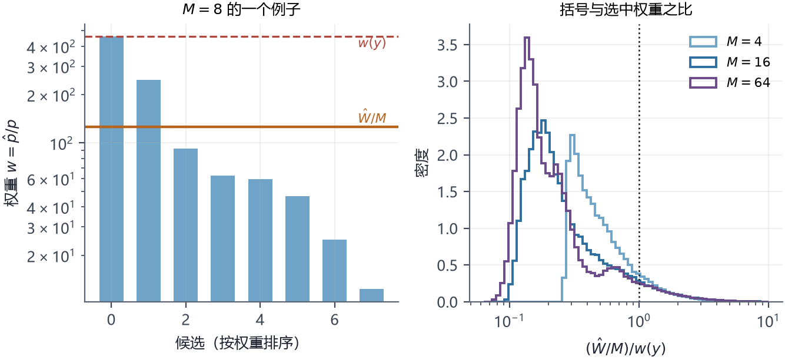
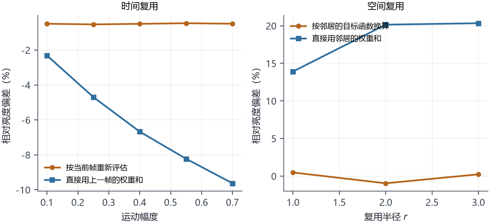
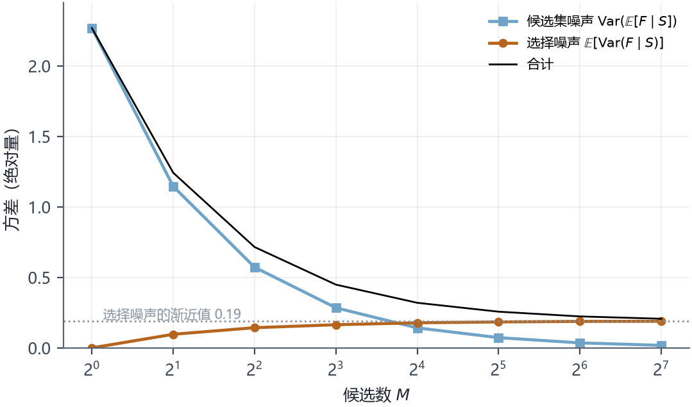

# 第 6 章 ReSTIR 的数学

## 6.1 三个数不够，还差一个

到第 5 章为止，一个蓄水池存三样东西：样本 $y$、权重和 $\hat W$、候选数 $M$。式 (5.3) 与式 (5.5) 里还出现了第四样东西：$\hat p_j(y)$，样本在**来源像素**上的目标函数值。它不是用来算亮度的，是用来做换算的分母。

这四样东西构成一次完整的陈述：*有一个样本 $y$，它是从 $M$ 个按 $\hat p_j$ 加权的候选里挑出来的，那些候选的权重之和是 $\hat W$。* 有了这句话，任何知道自己目标函数 $\hat p_i$ 的像素都能判断这个样本对自己值多少，以及该给它多大的份额。

这一章把这句陈述写成数学，并且逐项检查它在什么条件下成立。检查的方式不是"看起来对"，而是把每一个量写成对候选集的期望，看它是否消得掉。第 4 章已经做过一次这样的检查（$M=1$、单点），这里要做的是它在复用、历史、合并之后的形式。

## 6.2 目标函数与密度

先把两个函数分清楚。$p$ 是**候选密度**：抽候选时用的那个分布，必须能采样，必须归一化。$\hat p$ 是**目标函数**：希望样本服从的那个形状，不必归一化，只需要在有贡献的地方为正。

两者之比 $w=\hat p/p$ 是权重。它在 RIS 里有两个作用：决定选择概率（式 (4.2)），以及和 $\hat W/M$ 一起构成估计量（式 (4.4)）。

这里有一个容易混淆的地方。重采样之后，样本 $y$ 的**实际分布**既不是 $p$ 也不是 $\hat p$，而是

$$q(y)=\int\cdots\int \frac{w(y)}{\sum_{i=1}^{M}w(x_i)}\,p(y)\prod_{i\neq j}\mathrm{d}p(x_i) , \tag{6.1}$$

也就是"按权重挑中 $y$"的边缘密度。它没有闭式，依赖 $M$，并且在 $M\to\infty$ 时趋于 $\hat p/\int\hat p$。任何"这个样本服从 $\hat p$"的说法都是近似的。

这件事在实现上有一个直接后果：$q$ 的尾部由 $p$ 决定，而不是由 $\hat p$ 决定。如果 $\hat p$ 在某个区域很大而 $p$ 在那里很小，$q$ 仍然会在那一片留下足够的质量——这是 RIS 比"按 $\hat p$ 采样"差的地方，也是它比"按 $p$ 采样"好的地方。想让 $q$ 更贴近 $\hat p$，唯一的手段是让 $p$ 本身更贴近 $\hat p$，而这又回到了"能不能直接采"的原点。

真正被证明的是式 (4.4) 那个估计量的期望，而不是 $q$ 的形状。这两件事的区别在复用里变得关键：一个从邻居搬来的样本，服从的是**邻居的** $q_j$，而我们对它的期望用的是**自己的** $\hat p_i$。把 $q_j$ 当成 $\hat p_j$ 来换算，误差是 $O(1/M_j)$——小，但不是零。

## 6.3 括号里的东西不是常数

式 (4.4) 的括号是 $\frac{1}{M}\sum_{i=1}^{M}w(x_i)$。它与选中的样本 $y$ 不独立：$y$ 是按 $w$ 挑出来的，所以 $w(y)$ 平均而言偏大，而括号是全体的平均。两者的比值的分布见图 6-1。

左图是一个具体的例子：8 个候选里最大的权重 459，平均权重 125，相差接近四倍。右图是比值的分布：中位数 0.46 到 0.63，说明"选中的样本权重高于平均"是常态；均值恰好是 1，因为括号的期望除以 $w(y)$ 的期望正好是 1（这正是式 (4.5) 到式 (4.6) 那一步代数消去的内容）；变异系数 1.36，说明这个比值波动很大。

这个结构决定了 RIS 的方差形态。把估计量写成

$$F=\underbrace{\frac{\hat W}{M\,\bar w}}_{\text{尺度}}\cdot\underbrace{\frac{f(y)}{\hat p(y)}}_{\text{形状}}\cdot\bar w , \tag{6.2}$$

其中 $\bar w$ 只是把尺度归一化的一个常数。第一部分逐候选集变化，第二部分逐样本变化，两者负相关——挑中的样本权重越大，括号相对它就越小。这个负相关是 RIS 方差比"独立地算两个部分再相乘"要小的原因。

用乘积的期望做一个检查。如果有人把 $\mathbb{E}[F]$ 写成 $\mathbb{E}[\hat W/M]\cdot\mathbb{E}[f(y)/\hat p(y)]$，他会得到一个偏大的数：前者是平均权重，后者是"按权重加权的 $f/\hat p$"，两者的乘积重复计入了权重偏高的样本。正确的做法是条件期望，像式 (4.5) 那样先固定候选集。这个错误在代码里表现为"把括号用上一帧的值、把样本用这一帧的"——两个量来自不同的候选集，独立性假设不成立。

## 6.4 历史样本要在当前帧重新评估

一个样本从上一帧搬过来，它在上一帧的权重是 $\hat p_{t-1}(y)/p(y)$，在这一帧是 $\hat p_t(y)/p(y)$。$\hat W_{\text{prev}}$ 是前者的和，要它在这一帧有意义，必须整体乘上比值

$$r_t(y)=\frac{\hat p_t(y)}{\hat p_{t-1}(y)} . \tag{6.3}$$

这个比值的分子分母都是"同一个函数在不同参数下的值"，参数是距离、夹角、以及（在路径复用里）路径本身的几何。

不做这一步的后果有多大？图 6-2 左半边是实测：相机单向移动，运动幅度从 0.1 加到 0.7，正确实现（乘比值）的偏差稳定在 $-0.5\%$（这是有限 $M$ 的残余效应），不做换算的偏差从 $-2.3\%$ 线性掉到 $-9.6\%$。移动越快，图越暗。

右半边是空间复用的版本：直接用邻居的 $\hat W_j$ 而不换算，偏差 $+16\%$ 到 $+20\%$，随半径略增。方向是变亮，因为邻居的权重和通常对应着"离灯更近"的那一侧，把这些候选搬过来而不打折，等于给它们额外的份额。

两个方向的偏差不一样（时间偏暗、空间偏亮），原因是它们破坏的东西不同。时间复用丢掉的是"这一帧比上一帧更亮"这个增量；空间复用塞进来的是"邻居比我更受光"这个额外份额。

## 6.5 权重和怎么归一化

蓄水池给出的亮度是

$$\langle L\rangle=\frac{f_t(y)}{\hat p_t(y)}\cdot\frac{\hat W}{M} . \tag{6.4}$$

三个因子各管一件事：$f_t(y)/\hat p_t(y)$ 是"这个样本代表的那份能量"，$\hat W/M$ 是"平均权重"，二者相乘把单个样本放大成整批候选的贡献。

归一化的错误有三种常见形态，每一种都能从式 (6.4) 直接读出来。

第一种，把 $\hat W/M$ 写成 $\hat W$。这时估计量被放大了 $M$ 倍，图像一片白。这种错误很少见，因为它太明显。

第二种，把 $M$ 写成有效候选数。第 4 章 §4.6 已经算过：$M=8$、平均 5.18 个非零候选时，图像亮 56%。

第三种，也是最隐蔽的一种，$\hat W$ 与 $M$ 来自不同的池子。比如 $\hat W$ 在合并时更新了，$M$ 因为上限钳制没有更新；或者时间复用更新了 $\hat W$，空间复用只更新了 $M$。这种错误的偏差是 $M_{\text{used}}/M_{\text{true}}$，随机地大于或小于 1，表现为图像上不均匀的亮度斑块——历史长的区域偏一边，历史短的区域偏另一边。

这条约束可以写成一句话：**$\hat W$ 与 $M$ 必须描述同一个候选集**。这也是为什么实现里通常把两者放在同一个结构体里、在同一个函数里更新，而不是分成两个数组。

## 6.6 合并的期望

把两个蓄水池合并这一步拆开算，可以看清偏差到底出在哪一项上。

像素 $i$ 有蓄水池 $A$：候选集 $\{x_k\}_{k\le M_A}$ 从 $p$ 抽出，权重 $w_k=\hat p_i(x_k)/p(x_k)$，$\hat W_A=\sum_k w_k$。邻居 $j$ 的蓄水池 $B$：候选集 $\{z_k\}_{k\le M_B}$ 从 $p$ 抽出，权重按 $j$ 的目标函数 $\hat p_j$ 算，$\hat W_B=\sum_k\hat p_j(z_k)/p(z_k)$，它的样本是 $y_B$。

合并按式 (5.4)：以概率 $\hat W_B'/(\hat W_A+\hat W_B')$ 选 $y_B$，其中 $\hat W_B'=\hat W_B\cdot r$，$r=\hat p_i(y_B)/\hat p_j(y_B)$。合并后的权重和是 $\hat W_A+\hat W_B'$，候选数 $M=M_A+M_B$，估计量

$$F=\frac{\hat W_A+\hat W_B r}{M}\cdot\frac{f_i(y)}{\hat p_i(y)} . \tag{6.10}$$

给定两个候选集，选择概率已知，条件期望可以把每一项单独算出来。$A$ 的候选 $x_k$ 被选中的概率是 $w_k/(\hat W_A+\hat W_B r)$，代入后它的贡献是

$$\frac{\hat W_A+\hat W_B r}{M}\cdot\frac{w_k}{\hat W_A+\hat W_B r}\cdot\frac{f_i(x_k)}{\hat p_i(x_k)}
=\frac{1}{M}\cdot\frac{f_i(x_k)}{p(x_k)} , \tag{6.11}$$

$\hat p_i$ 与 $p$ 都消掉了。$B$ 的候选 $z_k$ 被选中的概率是 $r\hat p_j(z_k)/p(z_k)$ 除以同一个分母，它的贡献是

$$\frac{1}{M}\cdot r\cdot\frac{\hat p_j(z_k)}{\hat p_i(z_k)}\cdot\frac{f_i(z_k)}{p(z_k)} , \tag{6.12}$$

这里没有消干净：$\hat p_j/\hat p_i$ 留下了。于是

$$\mathbb{E}[F\mid A,B]=\frac{1}{M}\left[\sum_{k\in A}\frac{f_i(x_k)}{p(x_k)}+r\sum_{k\in B}\frac{\hat p_j(z_k)}{\hat p_i(z_k)}\frac{f_i(z_k)}{p(z_k)}\right] . \tag{6.13}$$

第一项对 $A$ 取期望，得 $\frac{M_A}{M}\int f_i$，和第 4 章一样干净。第二项麻烦在于 $r$ 与求和里的每一项都相关：$r$ 用的是被选中的那个 $y_B$，而求和遍历的是 $B$ 的全部候选。它的期望可以写成

$$\mathbb{E}\Big[r\cdot\frac{\hat p_j(y_B)}{\hat p_i(y_B)}f_i(y_B)\Big]=\mathbb{E}[r]\,\mathbb{E}\Big[\frac{\hat p_j}{\hat p_i}f_i\Big]+\operatorname{Cov}\Big(r,\ \frac{\hat p_j}{\hat p_i}f_i\Big) . \tag{6.14}$$

$\mathbb{E}[r]$ 是 $\hat p_i/\hat p_j$ 在 $B$ 的样本分布下的期望，约为 $\int\hat p_i/\int\hat p_j$。把它与后面的项配起来，第二项的主部变成 $\frac{M_B}{M}\int f_i$，与第一项相加恰好是 $\int f_i$。剩下的就是那个协方差，它是偏差的全部来源，量级 $O(1/M_B)$：$B$ 的候选越多，$r$ 越接近"整个 $B$ 的代表值"，协方差越小。

式 (6.14) 也解释了为什么"用一个样本代表整个蓄水池"在 $M$ 大时几乎无害。协方差来自 $r$ 的抽样波动，而 $r$ 的波动按 $1/\sqrt{M_B}$ 缩小。这个结论与第 5 章的实测吻合：$M_{\max}=20$ 时偏差在千分之一量级测不出来，$M_j$ 只有一两个时偏差才是可观的。

## 6.7 偏差与方差的分解

式 (4.4) 的估计量在给定候选集 $S$ 时还有一层随机性：挑中哪个候选。条件方差可以精确地算出来，因为候选集有限、选择概率已知。于是总方差分解成两项：

$$\operatorname{Var}[F]=\underbrace{\mathbb{E}\big[\operatorname{Var}(F\mid S)\big]}_{\text{选择噪声}}+\underbrace{\operatorname{Var}\big(\mathbb{E}[F\mid S]\big)}_{\text{候选集噪声}} . \tag{6.5}$$

第一项是"给定这批候选，挑谁"的随机性；第二项是"这批候选本身好不好"的随机性。前者不会随 $M$ 消失，后者会。

图 6-3 是这个分解的精确数值。对每个 $M$，抽两万组候选，对每组算出 $\mathbb{E}[F\mid S]$ 与 $\operatorname{Var}(F\mid S)$（都是有限和，可以精确算），再对候选集取平均与方差。

$M=1$ 时没有选择噪声（只有一个候选，必选它），全部方差来自候选集。$M=64$ 时反过来，候选集噪声降到 0.036，选择噪声涨到 0.188，合计 0.223。交叉点大约在 $M=20$ 附近，此后加候选的收益迅速衰减。

这张图解释了第 4 章图 4-2 里那个"RIS 收敛得慢"的现象。RIS 只从候选里挑一个，所以它继承了候选集噪声（随 $M$ 下降）却引入了选择噪声（随 $M$ 上升并饱和）。两者之和有一个下界，下界的值取决于目标函数与真实贡献的匹配程度：$\hat p$ 越接近 $f$，选择噪声越小。

这里也能看出为什么"多抽几个样本"和"多抽几个候选"不是同一件事。样本数 $R$ 让两项都按 $1/R$ 下降；候选数 $M$ 只压第一项。给定预算时，二者的最优配比由第 4 章表 4-1 那个权衡决定。

把这两项翻译成"有效样本数"，可以看清 $M$ 的实际含义。对一批权重，Kish 有效样本数是 $N_{\text{eff}}=(\sum w)^2/\sum w^2$，它衡量"这批权重有多不均匀"。蓄水池的 $M$ 是候选的个数，而 $N_{\text{eff}}$ 是它们代表的独立信息量。目标函数选得差时，$N_{\text{eff}}$ 可以远小于 $M$：64 盏灯、功率按 $1/i$ 递减、$\hat p=b$ 时，$N_{\text{eff}}$ 只有 10 左右。这解释了为什么从图 6-3 看，$M$ 从 20 加到 64 只让候选集噪声降了三倍，而方差合计只降了 30%。

## 6.8 偏差从哪来，什么时候可以忽略

把上面的检查汇总，偏差的来源可以归成四类，每一类对应一个可以被单独测试的条件。

**候选集不一致。** $\hat W$ 与 $M$ 描述的不是同一批候选。来源是合并、钳制、剔除候选时的记账错误。量级可以到几十个百分点。

**来源密度被当成当前密度。** 历史样本按 $\hat p_{t-1}$ 加权，当前估计按 $\hat p_t$ 归一。不做换算，偏差随运动速度线性增长，量级几个百分点。

**单样本代表整个蓄水池。** 式 (5.3) 与式 (5.5) 用一个样本的比值去缩放整个 $\hat W$。误差 $O(1/M)$，实测在千分之一到百分之一的量级，$M$ 越大越小。

**目标函数本身不等。** 邻居的 $\hat p_j$ 与自己的 $\hat p_i$ 在样本处相差很大时（几何跳变），单点换算的近似变差，偏差也随之变大。这一类最难界定，因为"相差很大"没有阈值。

前两类是错误，后两类是近似。工程上要保证前两类为零，然后决定后两类可以接受到什么程度。第 7 章会给出前两类的具体测法，以及几种"看起来能减小偏差、实际只是把偏差挪到别处"的做法——权重钳制是其中最典型的一个。

## 6.9 关于嵌套

最后的这个结构在第 2 章提过一次，这里给出它的数学形式，为第 11 章的 GRIS 铺路。

一个像素的估计量里通常有两层技术：内层是重采样（从 $M$ 个候选里挑），外层是多个重采样器之间的 MIS。外层的"技术"不再是单个样本的分布 $p_i$，而是重采样之后的分布 $q_i$（式 (6.1)）。MIS 的份额必须按 $q_i$ 算，而不是按 $p_i$。

$q_i$ 没有闭式，但它与 $\hat p_i$ 的关系是"差一个 $O(1/M_i)$ 的扰动"。于是外层的份额可以用 $\hat p_i$ 近似。这个近似在 $M_i$ 大时误差小，在 $M_i$ 小的时候——也就是一个刚建立的、只有几个候选的蓄水池——误差大。GRIS 的 $M/M_i$ 修正项正是为了把这个误差显式地补偿掉：它把"候选数少的那个技术在内层已经损失了一部分信息"这件事，折算到外层的权重里。

这一层关系用一句话概括：**重采样改变了样本的分布，而 MIS 的权重是分布的函数**。所以每加一层重采样，就要重算一次权重。第 11 章会把这个重算写成通用的移位映射，并给出它成立的条件。

---

第 4 章给出的三个数在这里被拆成了四件事：样本、权重和、候选数，以及"样本在来源处的目标函数值"。四者构成一次可以搬运的陈述，搬运的正确性依赖四个条件，其中两个是错误、两个是近似。误差的方向和量级都能从式 (6.4) 读出来——时间复用偏暗、空间复用偏亮、候选数记账错误偏亮、$M$ 钳制偏暗。第 7 章把这四种偏差放到同一张图上，看它们各自随参数怎样变化。
