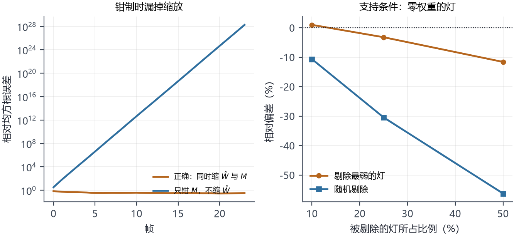
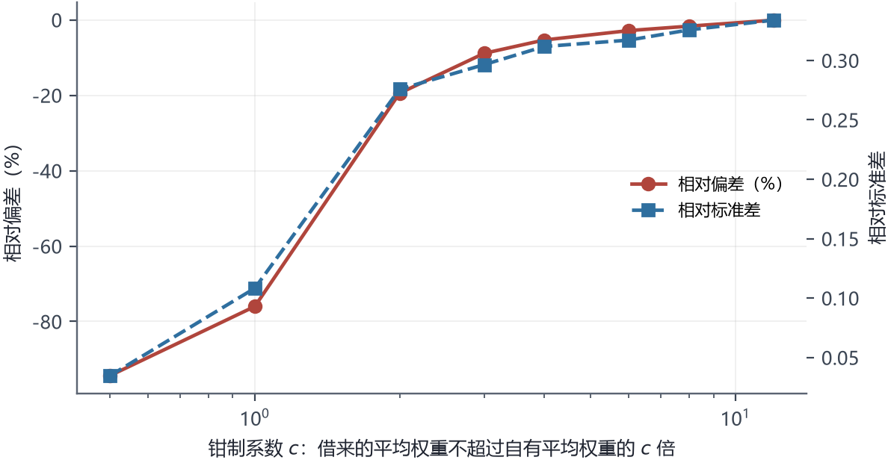
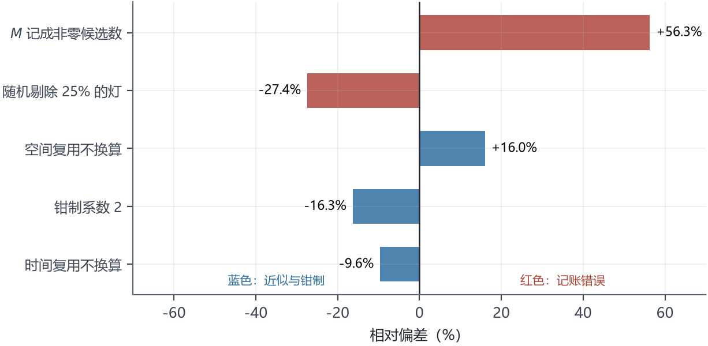

# 第 7 章 偏差从哪里来

## 7.1 三种症状，一张图分不清

把 ReSTIR 接进渲染器之后，出问题的样子总是相似：图像某个区域偏亮或者偏暗，边缘有一圈颜色不对的带，运动时亮度轻微抖动。这些现象在单帧画面上长得几乎一样，但它们的原因分属两类，处理方式相反。

一类是**方差**：估计值围绕真值上下波动，样本数增加、候选数增加、复用半径增加，它都会减小。另一类是**偏差**：估计值的期望本身偏了，加多少样本都不消失。降噪器能治第一类，治不了第二类；把第二类交给降噪器，它会把偏差当成信号平滑到更大的一片区域里去。

区分二者的唯一办法是测期望，也就是跑很多帧、很多像素、很多随机种子，把估计值平均起来跟真值比。这件事没有捷径，但可以设计得很快：一个 64 盏灯的玩具场景，一次实验几秒就能把偏差测到千分之几（附录 A 说明了这个设置）。

这一章按"错误"和"近似"两类，把第 6 章列出的四种偏差来源逐个测一遍，给出量级，并指出哪种做法看起来像在减小偏差、实际只是把它换了个方向。

测偏差时有一个容易掉进去的坑：单帧的"平均亮度"本身就有 $\pm$ 几成的随机误差，用它跟真值比，得到的差几乎全是噪声。实验必须把"随机种子"也当作一个维度——同一场景换可见性、换候选抽样、换随机数序列，跑几十次，再看这些次之间的平均值与真值的差异。噪声按 $1/\sqrt{n}$ 下降，偏差不动，两者的区别在多跑几次之后自然显形。

## 7.2 三个字段必须成对

重采样的估计量是

$$\langle L\rangle=\frac{f_i(y)}{\hat p_i(y)}\cdot\frac{\hat W}{M} , \tag{7.1}$$

它包含三个量：样本 $y$、权重和 $\hat W$、候选数 $M$。无偏性要求这三个量描述**同一个候选集**。任何一个被单独改动，式 (7.1) 就不再是第 4 章那个已经证明过的估计量。

这句话说起来简单，做起来容易破，因为三个量在代码里往往分处不同的结构、在不同的函数里更新。合并两个蓄水池时 $\hat W$ 要相加、$M$ 要相加；撞到上限时两个都要缩；剔除候选时两个都要减；换目标函数时只有 $\hat W$ 变、$M$ 不变。四种操作里任何一种写漏一半，就是偏差。

## 7.3 记账错误一：把 M 记成非零候选数

第 4 章 §4.6 已经算过一笔账：$M=8$、目标函数含可见性、平均 5.18 个候选有非零权重时，把 $M$ 改成非零个数，估计值偏大 56.3%，收敛值 74.49 而真值 47.67。

这个错误在 ReSTIR 里以另一种形式出现：剔除候选。当加速结构返回"这盏灯在视锥外"或者"这盏灯的贡献低于阈值"时，实现经常把候选从池子里删掉，同时把 $M$ 减一。删掉一个权重为零的候选确实不改变选择分布，但它改变了 $1/M$ 这个因子，也就是改变了整个估计的尺度。

## 7.4 记账错误二：钳制时漏掉缩放

候选数上限的写法是

$$\hat W\leftarrow\hat W\cdot\frac{M_{\max}}{M_a+M_b},\qquad M\leftarrow M_{\max} , \tag{7.2}$$

两个赋值必须一起做。只做第二个——把 $M$ 钳到上限、让 $\hat W$ 继续增长——的后果不是"偏一点"，而是**指数爆炸**。

图 7-1 左边是实测。原因很简单：$\hat W$ 每帧加上历史与邻居的贡献，却从不被缩小，于是 $\hat W/M$ 这个"平均权重"以几何级数增长。24 帧之后估计值是真值的 $10^{16}$ 倍，浮点直接溢出。

这个错误在实际代码里通常不会这么赤裸，而是以一种更细的形式出现：$\hat W$ 缩放了，但缩放用的是合并**前**的 $M$；或者 $M$ 缩放了两次。两种写法的偏差都是同一个量——缩放比例与 $M$ 的比值不一致——只是量级小，表现为缓慢的亮度漂移，容易被当成色调映射的问题。

## 7.5 支持条件：零权重的灯

目标函数 $\hat p$ 必须在所有有贡献的地方为正。这个条件被破坏时，估计偏小，偏的幅度等于"被漏掉的那部分能量"。

最常见的破坏方式是光源剔除。为了省下灯求值的次数，实现会维护一个"对这个像素可能重要的灯"的列表，把其余的灯从候选里排除。如果这个列表按贡献排序，剔除最弱的那些，损失很小；如果按别的标准（视锥、距离、上一帧的可见性）剔除，损失可能是几十个百分点。

图 7-1 右边是这个实验。64 盏灯、功率按 $1/i$ 递减，随机剔除 10% 的灯让图像暗 9%，剔除 25% 暗 27%，剔除 50% 暗 55%——比例几乎是一比一。同样比例、但只剔除最弱的那批灯，10% 时偏差 $+1.4\%$（在噪声内），25% 时 $-2.4\%$，50% 时 $-10.6\%$。两者的差距说明：剔除本身不是问题，"按什么剔除"才是。

在 ReSTIR 里还有一处更隐蔽的支持条件破坏。目标函数里如果乘了上一帧的可见性做代理（"这盏灯上次被挡住了，这次大概也被挡住"），那么这一帧刚变成可见的灯权重为零，永远不会被选中。这个错误的症状是接触阴影处的物体边缘发灰——新露出来的那部分光来不及进入蓄水池。它不随帧数消失，因为每一帧的代理都是上一帧的。

## 7.6 近似一：不换算

第 6 章 §6.4 已经测过：时间复用不乘 $\hat p_t/\hat p_{t-1}$，偏差随运动幅度线性增长，从 $-2.3\%$ 到 $-9.6\%$；空间复用不乘 $\hat p_i/\hat p_j$，偏差 $+16\%$ 到 $+20\%$。

这一条严格说不是"错误"而是"少做了一步"，但它的量级比前两类小一个数量级，而且方向可以预测：时间复用偏暗（历史代表的是更亮的时刻），空间复用偏亮（邻居代表的是更受光的位置）。两个方向同时存在时，它们会部分抵消，于是图像看起来还行，直到相机停下来，或者运动方向改变——那时其中一个消失，剩下的那个露出来。

两个方向同时存在时，它们会部分抵消，这一点值得单独说。相机一边靠近灯一边横移，时间复用给出"变暗"，空间复用给出"变亮"，两者相减之后可能只剩百分之一二。看起来是对的，但只要运动改变性质——横移停止、或者灯被挡住——其中一个消失，另一个就裸露出来，表现为"相机一停下来画面就变了一下"。这种"运动时正常、静止时异常"的症状几乎是"两个方向抵消"的签名。

## 7.7 近似二：钳制

钳制（clamping）是 ReSTIR 实现里最常见的"防偏差"手段，做法是把从历史或邻居借来的权重大幅截断：

$$\hat W'\leftarrow\min\Big(\hat W',\ c\cdot\frac{\hat W_a}{M_a}\cdot M_b\Big) , \tag{7.3}$$

也就是"借来的平均权重不超过自有平均权重的 $c$ 倍"。它的初衷是限制不连续处的历史惯性：物体突然出现、灯突然打开时，旧的样本权重会异常大，钳制能防止它压住新样本。

代价在图 7-2 里。钳制系数从 0.5 加到 12，偏差从 $-93\%$ 回到 $0$，相对标准差从 0.053 涨到 0.339。

这张图最值得看的地方是两条曲线**同向**。如果钳制是一个有效的手段，它应该能"降方差而不动偏差"，曲线会呈现一个明显的拐角：左边偏差陡升、右边方差平缓。实际看到的是两者一起移动，说明这里降下来的方差大部分来自把估计值整体压小——被钳掉的样本本来贡献了那部分能量，钳掉之后噪声小了，图也暗了。

这不是说钳制没用。在真正的不连续处（物体从遮挡后出现、灯开关、相机穿过门框），历史样本的权重可以比当前帧的平均权重高上百倍，一个这样的样本就能毁掉一帧。钳制在这些位置有效，是因为那里的"正确值"本来就依赖新样本，而钳制把旧样本的份额压到了新样本可以竞争的水平。但在连续运动的场景里，钳制只是持续地压暗，没有对应的收益。

判断自己的场景属于哪一种，办法是关掉钳制跑一遍，看偏差和方差各变多少。如果关掉之后方差没变、偏差变小，说明钳制在当前位置没有用；如果关掉之后出现零星的高亮噪点（在运动物体边缘），说明它在起作用。

## 7.8 确定性地挑大的

合并两个蓄水池时，式 (5.4) 要求按 $\hat W'/(\hat W_a+\hat W')$ 的概率抛一次硬币。有些实现省掉这次随机数，直接取权重大的那个：

$$\text{若 } \hat W'>\hat W_a\ \text{则取 } b\ \text{的样本，否则保留 } a\ \text{的} . \tag{7.5}$$

这个改法看起来只是"减少随机性"，实测的后果是 $-11.7\%$ 的偏差，而相对标准差只从 0.326 降到 0.267。噪声降了 18%，图像暗了 12%。

为什么？因为"取大的"让蓄水池每次合并都偏向权重和较大的那一方，而权重和较大的一方往往是"历史更长"或者"离灯更近"的那一侧。反复合并之后，蓄水池被固定在一个方向上，再也表达不了池子里的其他候选。这与 §3.4 讲的"合并必须随机"是同一件事的两个面：随机性不是为了让结果更"公平"，它是让蓄水池能代表整个池子的唯一机制。

更隐蔽的变体是"只在权重超过某个倍数时才替换"，也就是带阈值的贪心。它的偏差比纯贪心小，但方向相同，而且不可预测——阈值以下的那部分候选永远进不来，那部分能量按比例丢失。

## 7.9 四类偏差放在一张图上

图 7-3 把本章与前两章的测量放在一起。记账错误的量级是几十个百分点，方向不定；近似的量级是几个到十几个百分点，方向由"历史代表哪个时刻、邻居代表哪个位置"决定。两类相差一个数量级，这个差别决定了排查顺序：先排除记账错误，因为它们一旦存在就一定很大；再去评估近似，因为它们永远存在，只能评估能不能接受。

排查记账错误的方法不需要真值，只需要两个恒等式：

$$\hat W=\sum_{k=1}^{M}w_k,\qquad \frac{\hat W}{M}\ \text{在场景不变时应收敛到常数} . \tag{7.4}$$

第一式可以在调试版本里逐帧检查：把候选的权重和重新算一遍，与存下来的 $\hat W$ 比。第二式更实用：让场景静止，看每个像素的 $\hat W/M$ 是否收敛到一个稳定值；如果它随帧漂移，说明有某个量没有跟着另一个量一起更新。

把这一章的测量汇总成一张表，可以作为调参时的参照。

| 来源 | 实测偏差 | 会不会随帧消失 | 处理方式 |
|------|----------|----------------|----------|
| $M$ 记成非零候选数 | $+56\%$ | 不会 | 修代码 |
| 钳制时漏掉 $\hat W$ 的缩放 | 指数增长 | 不会 | 修代码 |
| 确定性挑大的 | $-12\%$ | 不会 | 改回随机 |
| 随机剔除 25% 的灯 | $-27\%$ | 不会 | 改按贡献剔除 |
| 空间复用不换算 | $+16\%$ | 不会 | 补比值 |
| 时间复用不换算 | $-2\%$ 至 $-10\%$ | 不会 | 补比值 |
| 钳制系数 4 | $-2.5\%$ | 不会 | 视场景 |
| 单点近似（$M_{\max}=20$） | $<0.1\%$ | 不会 | 忽略 |

## 7.10 什么时候可以忽略

近似的偏差能不能接受，取决于它相对于噪声有多大。图 5-1 里那个 $0.33$ 的相对标准差意味着单帧单像素的误差是 33%；一个 $3\%$ 的偏差在单帧上完全看不见，在降噪之后也看不见，只有在长序列均值里才显形。而 $-27\%$ 的偏差在任何一帧上都表现为"这幅图暗了一档"。

可以拿来当阈值的经验是：偏差小于单帧相对标准差的十分之一时，它不会在画面上造成可辨识的差异。按这个标准，$M_{\max}=20$ 时的单点近似（千分之一量级）可以忽略，钳制系数大于 6 时可以忽略，不换算（几个到十几个百分点）不能忽略，记账错误不能忽略。

这个阈值也解释了为什么 ReSTIR 的实现里那些"看起来不严格"的地方能存在：它们都在噪声底下。一旦噪声明因降噪器而下降，同样的偏差就会浮出来——这也是为什么"先调降噪器再调 ReSTIR"的顺序是错的。

---

偏差的四种来源在这一章被拆成了两类：三个字段的记账错误，以及"用一个样本代表一批候选"的近似。前者的量级是几十个百分点，可以在调试版本里用两个恒等式抓出来；后者永远存在，量级由 $M$ 和几何差异决定，只能评估。下一章回到结构本身，把时空复用与可见性复用拆开，看每一步各自贡献了多少方差、多少偏差，以及为什么"多借几个邻居"在某个半径之后就不再划算。
