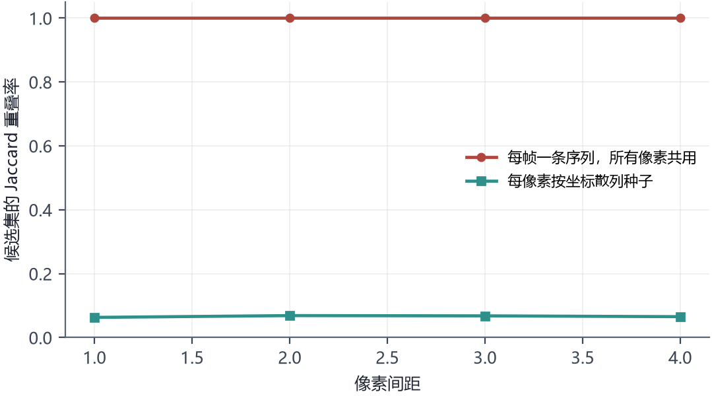

# 第 7 章 实现细节

## 7.1 每帧一条序列的后果

把 ReSTIR 接进渲染器的第一版通常这么写：每帧开始时初始化一个随机数生成器，然后按像素顺序遍历，每个像素抽 $M$ 个候选。代码很干净，逻辑很清楚，出来的图会有一个很难解释的现象——不是噪点，是整片区域的亮度一起跳。

原因很直接。同一个生成器按顺序发放随机数，第一个像素拿到前 $M$ 个数，第二个像素拿到接下来 $M$ 个，但如果代码里每帧重新播种而不随像素推进（比如在并行 kernel 里每个像素都用 `frame_seed`），所有像素拿到的就是同一组数。它们抽出同一批候选灯，做出同一个决定，于是整片区域一起亮一起暗。

这件事在串行代码里不容易发生，在 GPU 上很容易：每个线程都从 `seed = frame_index` 开始的时候，一万个像素共享一条序列。

图 7-1 里那条 0.06 的水平线是独立抽样的理论值：$8$ 个候选从 $64$ 盏灯里抽，两个集合的交集期望是 $64\cdot(8/64)^2=1$，并集 15，比值 0.067。

正确的做法是让种子同时依赖像素和帧：`seed = hash(x, y, frame)`，用一个小整数散列（比如把三个数乘上不同的奇素数再异或，跑两轮 PCG 的混合函数）。这不只是"避免重复"，它是让每个像素的随机性真正独立于它的邻居。

## 7.2 历史里该存什么

第 3 章的流程里，蓄水池要存四个东西：样本 $y$、权重和 $\hat W$、候选数 $M$、以及 $\hat p_t(y)$。

第四个最容易被省掉，因为它看起来可以重算。确实可以重算——下一帧把 $y$ 代进目标函数就行。但如果存下来，就能省掉一次求值；更重要的是，存下来之后 (3.2) 的比值有一个明确的分母，而这个分母必须和 $\hat W$ 是同一次评估的产物。用"下一帧重算的分母"去配"上一帧存下的分子"，偏差就回来了。

浮点范围是另一件事。$\hat W$ 会随候选数增长，一个存活了几百帧的像素，$\hat W$ 可以到 $10^7$ 量级；场景里有极亮的灯时还能更大。float32 在这个量级上仍有精度，但如果再乘上距离平方的倒数，就可能溢出成 inf，而 inf 会污染整个合并链——一次 inf 乘以 0 得到 nan，nan 会一直传到最后。

实用做法有两条。一是把 $\hat W$ 除以一个随帧更新的常数，让它保持在 1 附近，同时把这个常数的对数记下来；二是干脆用 float64 存蓄水池、float32 算图像。ReSTIR 的蓄水池只有几个字段，用双精度多占的内存可以忽略。

## 7.3 偏差补偿：钳制的代价

所有实现都有某种"防炸"的手段，最常用的是钳制：把样本的贡献或者权重和压到一个上限之内。它的动机是去掉萤火虫——那些权重异常大的样本会让画面出现亮点闪烁。

钳制一定引入偏差，问题是有多划算。图 7-2 是这个交换的实测：场景同前，每帧 8 个新候选，候选数上限 32，对传入的历史权重和设一个上限，然后看整段序列的偏差与标准差。

上限从"不限"压到 1000，标准差降了 32%（49.9% 到 34.1%），偏差从 0 涨到 40%。再往下压，偏差迅速失控，而标准差几乎不动。这条曲线说明钳制不是一个好的方差控制手段：它换来的方差收益远小于偏差代价，因为钳制削掉的正是那些携带最多信息的样本。

真正有效的"防炸"是限制样本的年龄而不是幅度。一个像素的历史如果只有 8 帧，不管里面的样本权重多大，它最多影响 8 帧；而钳制会把一个刚产生的高权重样本从第一帧就削掉。年龄限制不引入偏差——丢弃旧样本等于减少了 $M$，这是 (3.4) 的合法操作。

## 7.4 时间稳定性

闪烁和噪声不是一回事。噪声是每帧不同、空间独立的偏差；闪烁是同一位置在相邻帧之间跳动，人眼对它极其敏感，即使幅度只有 2%。

ReSTIR 的闪烁有两个来源。第一个是候选数上限：当 $M$ 顶到上限，新样本进来的比例很小，蓄水池的内容变化缓慢，本该平滑；但如果上限是精确截断（每帧都恰好卡在边界上），样本切换会呈现周期性。用随机的上限（比如每帧在上限的 0.8 到 1.0 倍之间随机）能打散这种周期。

第二个来源是空间复用选邻居。每帧随机选 3 到 5 个邻居，如果这些邻居当帧的蓄水池内容差异很大（比如它们各自选中了不同的灯），像素的估计就在几盏灯之间跳。这在小 $M$ 时尤其明显。缓解办法是让邻居的选择在帧之间保持一部分连续性（用一个每帧只更新一部分的邻居列表），代价是空间复用的多样性下降。

这两种手段都是在"复用带来的相关性"和"独立性带来的稳定"之间挪动。没有免费的选项。

## 7.5 合井的顺序

时间复用和空间复用谁先谁后，会影响结果，虽然两种顺序都无偏。

先时间后空间：先把上一帧的自己拿到本帧的目标下重新评估，再和邻居合并。这是大多数实现的选择，原因是时间复用只有一个来源，换算一次就够；空间复用有多个来源，放在后面可以让它们共享一个已经更新的蓄水池。

先空间后时间：邻居的蓄水池先互相合并，再把合并的结果当成本帧的"邻居代表"与历史合并。这种顺序让邻域的信息先汇总，代价是同一帧内要遍历两轮，而且邻居的蓄水池在这一帧被改写了，下一帧读到的就不是它自己的结论。

更实际的差别在 $M$ 截断上。$M$ 上限是共享的，先做的那个操作会先把 $M$ 抬到上限，留给后面的份额就少了。先时间后空间意味着历史占主导，图像稳但反应慢；反过来意味着邻域占主导，反应快但更容易在几盏灯之间跳。

还有一件与顺序有关的事：邻居的蓄水池应该读"这一帧开始时的快照"，而不是读完一个写一个。读写同一个缓冲区会让结果依赖线程的调度顺序，同一帧渲两遍结果不同——这类不确定性极难调试，因为它在单线程下永远不出现。

## 7.6 帧间要去相关

第 7.1 节讲的是像素之间的相关。帧之间也有同样的问题，而且更隐蔽。

如果每帧都用同一个种子，那么同一像素在每一帧抽到的候选完全一样，蓄水池的内容永远不变。图像会非常"稳定"，稳定到场景动了它也不变——历史样本没有新信息进来，更新全靠权重换算。这种画面看起来像运动模糊，实际上是采样停滞。

如果每帧换种子，但用的是低差异序列（比如 Sobol），又会出现另一种停滞：序列的前 $M$ 个点在每一帧被重复使用，只是像素之间有不同的偏移。这时候像素之间是去相关的，但每个像素在时间上是固定的。

正确的做法是每帧给序列一个随机旋转（Cranley–Patterson 旋转）：把每个维度加上一个独立的随机偏移再取小数部分。旋转不改变序列的低差异性质，但让每帧的采样点在单位立方体里重新分布，于是时间上也是独立的。旋转量本身要用每像素散列的种子生成，否则又回到像素间的相关。

## 7.7 与降噪器的接口

ReSTIR 输出的是每像素一个亮度值，以及一个可以大致反映方差的量（$\hat W/M$ 或者有效样本数）。降噪器如果直接用亮度，会把复用的成果部分丢掉；如果用方差，需要一个正确的量纲。

一个实用的做法是把 $\hat W/M$ 和 $\hat p(y)$ 都传给降噪器，后者用它们的比值判断这个像素的估计有多可信：比值大的像素，说明目标函数在样本处的值和平均质量接近，估计比较可靠。这个量在阴影边界处会明显下降，正好对应降噪器需要收缩滤波核的位置。

---

工程上的错误分两类：一类让图像更噪，一类让图像偏。前者能看出来，后者不能。7.1 节和 7.3 节的例子都属于后者——共用随机数让整片区域偏，钳制让高光区域偏，两者都不会让图像"看起来有问题"，只会让它在某些位置和参考图不一样。

第 8 章讨论参数。参数本身不产生错误，但它们的取值范围决定了你是"偏了一点点但很干净"还是"没偏但很脏"，而这个选择在项目里往往是被工期决定的。
