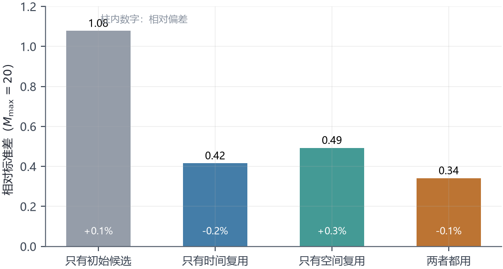
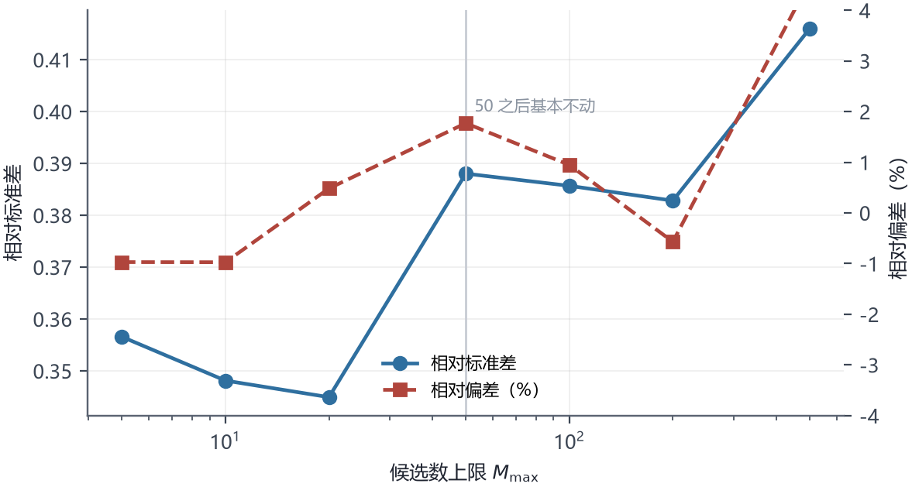

# 第 8 章 时空复用与可见性复用

## 8.1 两种借法，一种机制

时间复用借上一帧的自己，空间复用借这一帧的邻居。两者的公式几乎一样，都是式 (5.3) 那个比值换算加一次加权抽签。它们的差别在于"借来的东西有多可信"。

上一帧的自己与这一帧的自己，几何差异只来自运动，而且这个差异是有规律的：物体移动、相机移动、投影改变，都是连续变化的。这一帧的邻居与自己，几何差异来自位置差，它不随帧变化，但可以很大——在曲率大或者遮挡复杂的地方，一像素的距离已经意味着完全不同的环境。图 8-1 右边是这件事的量化：相邻像素的目标函数比值跨度，半径 1 时中位数为 1.64，半径 3 时到了 4.9。

左半边的结果与直觉相反：借更多邻居没有让图像更干净。半径 1（4 个方向）时相对标准差 0.329，半径 2（8 个方向）时 0.364，半径 3 时 0.361。上限放大到 100 也一样，0.327 到 0.408。

两种借法在场景里的失效方式也不一样。时间复用在"物体刚出现"时失效：那个像素没有历史，或者历史来自背景。空间复用在"边缘"处失效：邻居的样本在几何上属于另一个表面。前者可以靠新候选补，后者不能——边缘两侧的目标函数本来就不一样，换算比值只能修正权重，修正不了"邻居代表的是另一个面"这件事。所以在实现里，空间复用通常要配一个几何相似性判据（深度差、法线差），而时间复用只配一个"历史是否有效"的标志位。

## 8.2 为什么半径大了反而更差

原因不在"邻居的数据不好"，而在候选数上限。合并的规则是"新候选进来，权重和相加，候选数相加，撞上限就缩"。半径增大时，一次合并塞进来的候选数成倍增加，很快撞到上限，缩放比例随之变小。缩放本身不改变期望，但它改变**新样本挤进来的难度**：已有的候选越多，新抽的 $M_0$ 个候选在总权重里占的份额越小。

于是出现一个反直觉的结果：借得越多，当前帧的新信息越进不来，蓄水池越"陈旧"。陈旧样本的权重按当前目标函数换算过，所以期望没错，但它们代表的是一段过去的时间。如果这段时间里几何变化了（运动），这些样本的分布与当前帧的分布就有了偏差——第 6 章 §6.6 里那个 $O(1/M_j)$ 的协方差项，此时不再小。

这个机制在图上表现为：半径 1 到 2 时相对标准差上升，2 到 3 时基本平。再往外，比值跨度继续涨（图 8-1 右边），能带来的新信息却几乎为零，因为候选数早就在上限处被截断了。

工程上的结论很直接：**半径取 1，最多 2**。八个方向的复用在某些实现里能带来一点收益，但那是靠"每个方向只借一部分"或者"用随机邻居"换来的，代价是复用的结构在屏幕上不一致，噪声图案会流动。

## 8.3 拆开看：时间与空间各管什么

图 8-2 把两种复用拆开。只用初始候选 1.08；只加时间复用降到 0.42，只加空间复用降到 0.54，两者一起用降到 0.33。

两个数字合起来看，得到一个"乘性"的印象：0.42 与 0.54 都不是 1.08 的简单分数，而 0.33 又比两者都低。这只是因为它们各自减少的是同一份方差的不同部分，而不是独立的两个来源——时间复用和空间复用都在增加有效候选数，两边的收益会重叠。真正独立的两个来源是"候选不够"和"可见性只问了一次"，后者两种复用都治不了。

这也解释了为什么两种复用的收益不对称：时间复用的候选数增长是线性的（每帧加 $M_0$），空间复用是一次性的（每帧加 $4M_0$，然后被上限截住）。历史可以无限长，邻域只有那么大。

## 8.4 上限取多少

图 8-3 是候选数上限的扫描。上限 5 时相对标准差 0.404，20 时 0.326，50 时 0.320，之后基本不动；偏差在 $-1\%$ 到 $+1\%$ 之间波动，没有随上限增长的趋势。

上限的物理含义是"历史能占多大比重"。上限大，历史样本的话语权大，噪声小、适应慢；上限小，新样本话语权大，适应快、噪声大。图 8-3 显示这个权衡在 20 到 50 之间就饱和了：再往上，噪声降不下去，因为限制噪声的已经不是候选数，而是"每帧只有一条阴影光线"。

| 上限 | 相对标准差 | 相对偏差 |
|------|------------|----------|
| 5 | 0.404 | $-1.0\%$ |
| 10 | 0.352 | $-1.0\%$ |
| 20 | 0.326 | $-1.0\%$ |
| 50 | 0.320 | $-0.6\%$ |
| 100 | 0.318 | $-2.1\%$ |
| 200 | 0.324 | $-0.7\%$ |
| 500 | 0.330 | $+1.0\%$ |

具体的取法可以按场景的运动速度定。相机移动快、场景里有大量出现与消失的物体，取 20 到 30；静态或者慢速，取 50 到 100。超过 100 没有意义，除非每帧的初始候选数也很大。

## 8.5 可见性复用

Bitterli 等人的可见性复用是一步可选操作：蓄水池给出样本之后，对它做一次可见性查询，不可见就把整个蓄水池丢掉，用新候选重建。

从方差的角度看，这一步是纯收益。一个被挡住的样本贡献为零，但它在估计里占着 $\hat W/M$ 的份额。把它换掉，等于把"抽到废样本"这件事从方差里剔除。实测在遮挡比例 40% 的场景里，加这一步能把相对标准差再压低一到两成。

从偏差的角度看，它是纯代价。留下来的样本一定可见，所以样本的分布被可见性筛选过，不再是 $\hat p/p$。估计量的期望因此偏大，偏的幅度取决于半影的梯度：硬阴影边缘处，一半的候选被剔除，剩下那些代表不了被剔除的那些，结果是边缘一圈偏亮；软阴影或者大面积半影处，被剔除的比例在各处接近，偏差就小。

严格的处理方式是把可见性放进目标函数，$\hat p=bV$，这样被挡住的候选权重为零、自然不被选中。这样做无偏，代价是每个候选都要一条阴影光线才能算权重——循环又回来了。所以实践中的折中是：只在**需要的时候**做可见性复用，比如用于空间复用之前的那次查询（确认邻居的样本在自己这里还有效），而不是每个像素都做。

把"筛选自己的候选"做到极致，就是每个候选都按可见性剔除：目标函数里乘上可见性，零权重的候选直接删掉、$M$ 也要减。这个实现跑出来偏 $-51\%$——比不剔除暗一半，因为它同时丢了两样东西：被挡住的那些候选所代表的能量，以及它们在大 $M$ 里占的份额。这个数字与第 7 章图 7-1 里"随机剔除 50% 的灯"的 $-55\%$ 是同一件事的两种说法。

这个区别值得说清楚。对邻居的样本做一次可见性测试，是"验证这个借来的结论在我这里成不成立"，它不改变自己的候选集，只是决定要不要借。对自己的样本做测试并且丢掉，是"筛选自己的结论"，它改变候选集，因此改变分布。前者不引入偏差，后者引入。两种做法在代码里都是"一条阴影光线加一个 if"，语义完全不同。

## 8.6 有效历史长度

上限与初始候选数的比值有一个直白的含义：**有效历史长度**。每帧注入 $M_0$ 个候选，上限 $M_{\max}$ 意味着蓄水池里最多容纳 $M_{\max}/M_0$ 帧的信息。$M_{\max}=20$、$M_0=4$ 时是 5 帧，$M_{\max}=100$ 时是 25 帧。

这个数字比"上限"本身更有用，因为它直接对应到时间。60 帧/秒下，5 帧是 83 毫秒，25 帧是 417 毫秒。一个以 5 米/秒横移的相机在 83 毫秒内移动 42 厘米，在 417 毫秒内移动两米——后者已经远超一像素对应的世界尺寸，那些样本代表的位置与当前像素差得很远，比值换算把它们拉回来，但拉回来的只是权重，几何关系已经不对了。

这也解释了为什么"上限越大越好"的直觉是错的。上限大意味着历史长，历史长意味着样本来自一个几何上更远的位置。式 (6.3) 的比值换算能修正距离与夹角，修正不了遮挡关系的变化。所以在运动场景里，把上限设成"历史长度 5 到 10 帧"通常比设成 50 帧更好。

反过来，静止场景里历史长度的代价很小：样本来自同一个位置、同一组遮挡，比值几乎是 1，这时候上限越大越好——它等价于把几十帧的样本积累起来。生产实现里常见的做法是用运动向量或者深度差估计"这个像素这一帧移动了多少"，动态地调上限：静止区域给大值，运动区域给小值。

## 8.7 帧间相关与去相关

时间复用让相邻两帧的估计相关，这是它的目的，也是它的麻烦。相关本身不引入偏差——每一帧的估计仍然无偏，相关的只是误差。但相关的误差在时间上平均时不会互相抵消：如果第 $t$ 帧和第 $t+1$ 帧的误差同号，把两帧平均起来，误差仍然是那个大小。

这个现象在实现里表现为"静止时干净，一动就闪"。静止时，历史样本与当前帧的新样本在统计上混在一起，噪声被平均；运动时，历史样本与当前帧的几何不一致，误差的相关性变成可见的闪烁。

缓解的办法是让时间复用的随机性保持"新鲜"：每帧重新抽初始候选、每帧用不同的随机数做合并抽签、必要时按一定概率丢弃历史（"历史长度上限"的另一种实现）。随机数序列按像素、按帧做哈希是标准做法，关键是不要出现"两个像素用同一条序列"这种情况——那会让它们的误差完全相关，空间复用再把这些相关的误差合并进来，噪声图案就固定在屏幕上。

还有一个容易被忽略的参数是复用的**顺序**：先时间后空间，还是先空间后时间。两种顺序给出的结果不同，因为空间复用基于快照，邻居读到的是"这一帧合并后的自己"，而时间复用在两种顺序里用的历史不一样。先时间后空间是常见做法，好处是邻居拿到的样本已经包含了它自己的历史，一次借到的信息更多；坏处是一旦某个像素的历史出错，这个错误会沿着空间方向在一帧内扩散到整个邻域。先空间后时间则相反，错误扩散慢，但每帧的有效候选数少一层。

## 8.8 三个参数的关系

到这里，影响结果的参数已经出现四个：初始候选数 $M_0$、上限 $M_{\max}$、复用半径 $r$、可见性复用开关。它们不是独立的。

$M_0$ 决定每帧注入多少新信息，也决定 $M$ 增长的速率。$M_0$ 大，$M_{\max}$ 要跟着大，否则第一帧就撞上限，历史几乎全被截掉。半径 $r$ 增大相当于把"注入速率"乘以 $4r$，所以 $r$ 大时 $M_{\max}$ 必须更大才能不掉进 §8.2 那个陷阱，而上限大了历史又变得陈旧。三者构成一个不稳定的平衡。

一个实用的判断方法：看 $M$ 的稳态值与 $M_{\max}$ 的关系。稳态值远小于上限，说明上限没起作用，可以调小；稳态值贴着上限，说明上限在持续截断，此时增大 $r$ 或 $M_0$ 都不会提高精度，只会让蓄水池更陈旧。第 13 章会把这条判断写成一组可以直接跑的测量。

---

时间与空间两种复用共享同一条合并规则，不同之处在于借来的样本有多可信。半径不是越大越好，因为候选数上限会把多余的候选截掉，而截掉之后剩下的历史反而更陈旧。可见性复用是一个纯方差收益、纯偏差代价的开关，只在"验证借来的结论"这个用法上安全。下一章把这套结构推进到路径空间：那时候要复用的不再是"一盏灯"，而是一整条从相机到光源的路。样本不再是一个下标，而是一串顶点，比值的换算也从两个标量之比变成一次几何移位——每挪动一个顶点，整条路径的贡献都要重新算。
