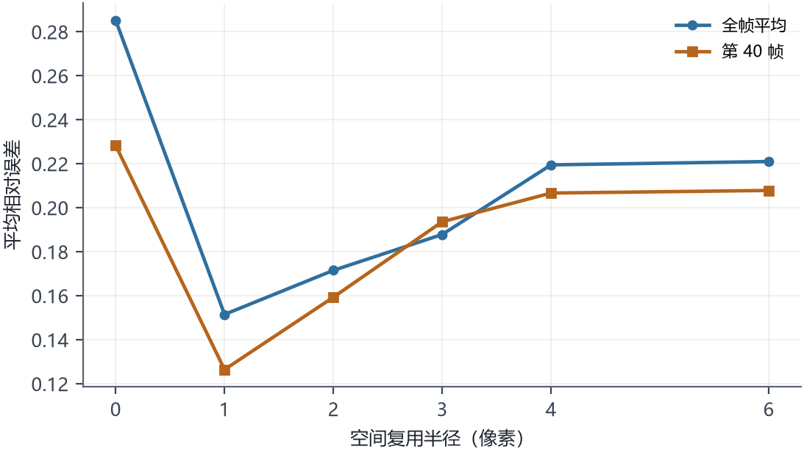
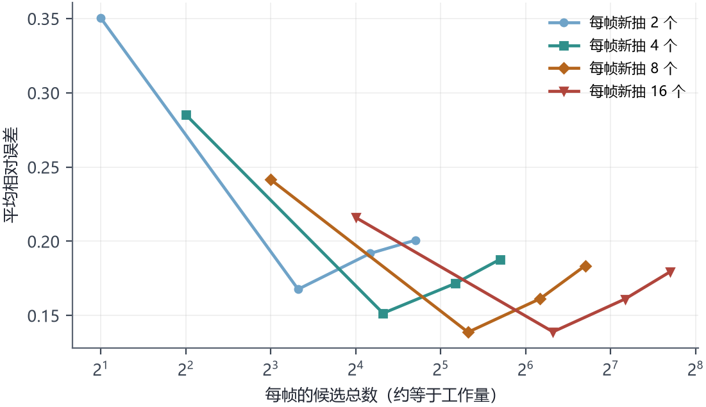

# 第 8 章 参数与收敛

## 8.1 四个旋钮

一个 ReSTIR 实现暴露给使用者的参数通常有四个：每帧新抽的候选数 $M_0$、候选数上限 $M_{\max}$、空间复用的半径 $R$、以及历史在合并里占的比例。它们不是独立的，改动一个会改变其余三个的最优值。

这四个参数的共同作用是决定"一个像素的有效候选来自哪里"。$M_0$ 决定这一帧新采了多少，$M_{\max}$ 决定历史能占多大份额，$R$ 决定能从多少个邻居借，比例决定借来的东西权重多大。

先看它们各自的效果，再看它们怎么互相替代。

## 8.2 半径：借得越多不一定越好

图 8-1 是一个很典型的结果：半径 0 的误差是 0.285，半径 1 掉到 0.15，半径 2 回到 0.17，半径 3 到 6 稳定在 0.19 到 0.22 之间。最低点在半径 1，也就是四个直接邻域。

为什么会回升？两个原因。第一，邻域的目标函数开始不像。半径 1 的邻居在几何上几乎和自己一样，距离、夹角只差一点点；半径 3 的邻居可能落在另一个物体上，目标函数完全不同，借来的样本权重换算得越狠，误差越大（第 4 章 4.2 节说换算在期望上精确，但方差随比值变化增大）。第二，候选数上限。半径 3 意味着一次合并 12 个邻居，$M$ 立刻顶到上限，之后进来的样本全部被截断，历史更新变慢，场景一动就跟不上。

半径 1 是最稳的默认值。有些实现用半径 2 到 3 加上随机选邻居，效果接近，因为随机选出来的邻居平均距离比扫全部邻居小。

## 8.3 工作量怎么分配

每帧的候选总数大约是 $M_0(1+4R)$：自己抽的加上四个邻居的。同样是 40 个候选，可以来自"每帧抽 8 个、半径 1"，也可以来自"每帧抽 4 个、半径 2"。

图 8-2 把这件事画成了成本-误差曲线。40 个候选用法的两种分配：$M_0=8,R=1$ 得 0.139，$M_0=4,R=2$ 得 0.172。同样的工作量，差别 24%。

原因在"新鲜度"。邻居借来的样本是本帧的，但它们的目标函数是邻居的；自己抽的样本目标函数是自己的。前者需要换算，后者不需要。在候选数相同的情况下，含"自己的"比例越高，误差越小。

这条规律对预算分配有一个直接含义：**先增加 $M_0$，再增加半径**。$M_0$ 从 2 加到 8，误差从 0.35 降到 0.24（半径 0）；半径从 0 加到 1，误差从 0.24 降到 0.139。两者都值，但 $M_0$ 的收益更稳定，因为它不依赖邻域的相似性。

反过来，如果场景的灯很少（比如 8 盏），$M_0$ 超过 8 就没有意义——候选会重复。这时应该增加半径，因为灯的选择空间已经穷尽，剩下的方差来自可见性，而可见性只能从更多像素那里借。

## 8.4 有效样本数不是 M

第 2 章说过，候选数 $M$ 是"抽了多少个"，不是"有多少独立信息"。在复用场景里这两个数差得很远。

一个像素的蓄水池里，可能有一半的候选来自同一个邻居，而那个邻居又和它自己共享了上一帧的历史。这些候选不是独立的。权重和 $\hat W$ 里，重复的信息被算了多次。

工程上有一个粗略的度量叫有效样本数，

$$M_{\text{ess}}=\frac{\left(\sum_k w_k\right)^2}{\sum_k w_k^{2}} , \tag{8.1}$$

它衡量权重分布的集中程度。$M_{\text{ess}}=M$ 当且仅当所有候选的权重相等。在 ReSTIR 里，权重集中在少数几个样本上是常态，$M_{\text{ess}}$ 常常只有 $M$ 的三分之一到一半。

这个量的用处不是精确估计方差，而是判断"再加候选还有没有用"。如果 $M$ 从 32 加到 64，$M_{\text{ess}}$ 只从 12 涨到 13，说明新增的候选和已有的高度重叠，这笔预算花在了重复劳动上。

它的另一个用处是定位异常。$M_{\text{ess}}$ 突然变小的像素，通常是权重集中在了一个极亮的样本上。这要么说明场景真的有一个很亮的灯（合理），要么说明目标函数在那个像素上写错了（不合理）。两种情况的区别在于这个像素在邻域里是不是孤立：真实的高动态范围光源会让一整片区域的 $M_{\text{ess}}$ 都变小，写错的目标函数只影响一两个像素。

计算 $M_{\text{ess}}$ 需要保留整个候选集的权重，而蓄水池只存了权重和。工程上的近似做法是递归式地估计它：每次合并时把两边的 $M_{\text{ess}}$ 按权重相加，再加上一个修正项。这个估计在候选完全独立时是准确的，在高度重复时偏大——它会给一个乐观的值，恰好是不能全信它的原因。

## 8.5 参数随场景变

上面所有数字都来自一个特定场景：64 盏灯、功率按 $1/i$ 递减、遮挡比例中等。换一个场景，最优参数会变。

灯数从 64 涨到 4096 时，$M_0$ 的重要性上升，因为候选空间变大了，均匀抽 $M_0$ 个能碰到主灯的概率下降（第 2 章图 2-1 的 $M=64$ 那一档，主灯的被选频率 0.140，还没追上目标的 0.151）。这时候要么加大 $M_0$，要么在初始候选那一层加一个更聪明的分布（比如用聚簇或者按亮度分层的采样）。

遮挡比例从 50% 涨到 90% 时，情况反过来。绝大多数候选的可见性为零，加候选只是在抽取"哪一盏没被挡住"，而邻居已经知道答案（它们的遮挡情况和你几乎一样）。这时候半径的收益上升，$M_0$ 的收益下降。

有一套经验做法在项目里用得比较多：按"每帧新抽的候选数等于灯数的平方根"来起步，半径从 1 开始，候选数上限设在 $M_0$ 的 8 到 16 倍。这不是理论最优，但它保证了两个极端（灯极多、灯极少）都不会太差。

## 8.6 让候选数随像素变

前面把 $M_0$ 当成一个全局常量。实际上不同像素需要的东西差很多：一个被二十盏灯均匀照亮的墙面，每帧抽两个候选就够；一个紧贴在阴影边界的像素，抽二十个也不一定碰到对的光。

自适应做法很容易想到：按上一个蓄水池的状态调下一帧的 $M_0$。$M$ 顶到上限、有效样本数却很低，说明本像素饱和了，不必再加；$M$ 很低而且估计值逐帧大幅度变化，说明信息不够，应当加。

这条路在离线渲染里很常见，在实时渲染里有一个额外代价：同一个 warp 里的像素如果 $M_0$ 不同，GPU 会按最大值执行，分歧的部分被浪费。所以自适应最好在 tile 或画块的粒度上做，而不是逐像素。

本节的实验里没有启用自适应，因为它会让“误差随候选数变化”这条曲线变成两个变量的复合，看不出趋势。工程上如果需要，把它当作一个乘在 $M_0$ 上的、取值在 0.5 到 2 之间的因子，并且限制它每帧的变化幅度，否则它自己会成为闪烁的来源。

## 8.7 收敛的形态

把误差画成帧数（第 3 章的图 3-1），会看到一条指数下降后趋于平台。下降段的速率由 $M$ 的增长速度决定，平台的 height 由三个因素决定：一条阴影光线的可见性方差（第 1 章第 1.4 节）、目标函数与真实贡献的差距（第 2 章第 2.7 节）、以及复用带来的相关性（它让"有效样本数"饱和）。

平台的绝对高度不是调参能改的。能改的是到达平台的快慢，以及平台的波动幅度。前者靠 $M_0$，后者靠 $M_{\max}$ 和邻居选择。

---

参数没有最优解，只有一组和场景、预算、可接受的偏差相匹配的值。理解每个参数改变的是什么量——有效候选数、目标函数的相似度、还是历史的新鲜度——比记住一组数字有用。

下一章讲怎么检查这些参数选得对不对。这件事比调参难，因为最危险的错误不是"误差大"，而是"误差不大但方向一致"。
