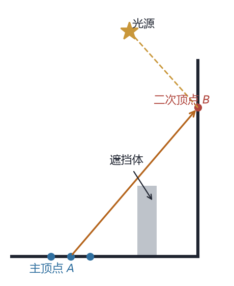
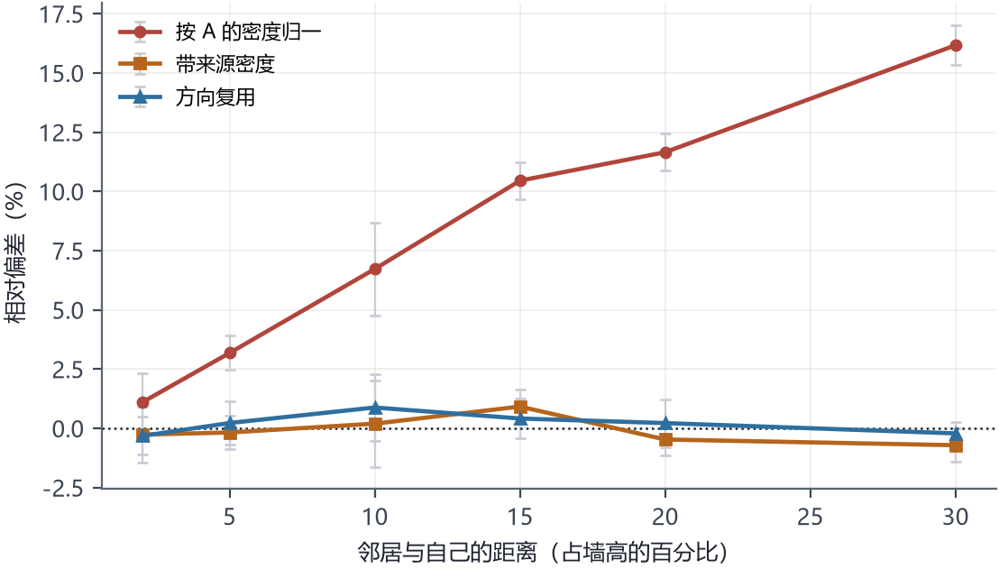
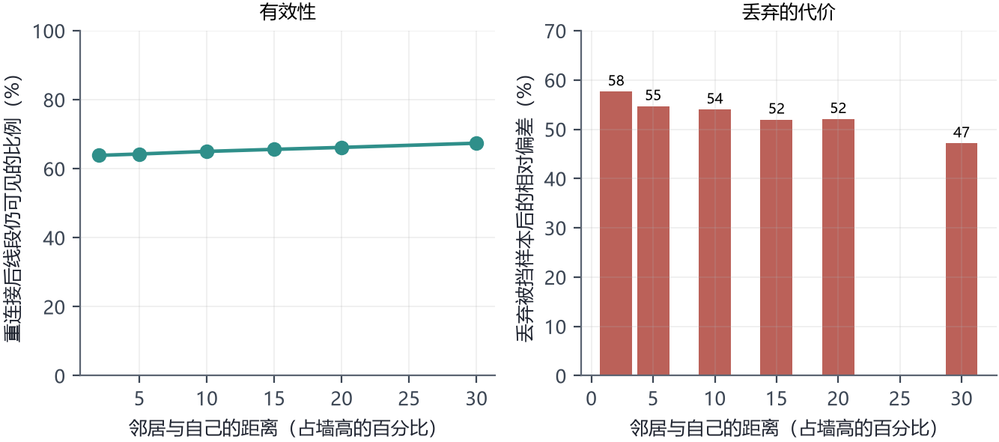
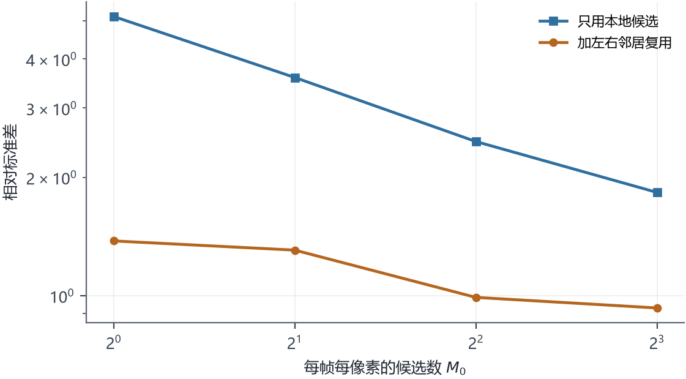

# 第 9 章 ReSTIR GI：把路径放进蓄水池

## 9.1 间接光的样本不是一盏灯

直接光的蓄水池里，样本是一个光源下标。间接光的样本要复杂一层：它是一条从着色点出发、打到一个中间顶点、再从那里连到光源的路径。把这条路径放进蓄水池，意味着"样本"变成了一串顶点，而两点之间的一切——几何、遮蔽、概率密度——都要跟着搬。

Ouyang 等人 2021 年的 ReSTIR GI 做的是这件事。它保留了 DI 的三步结构（初始候选、时间复用、空间复用），但每一步的内容都变了：候选不再是灯，而是"一个中间顶点加一个方向"；目标函数不再是一个可解析的表达式，而是一次完整的路径求值；复用时的比值换算不再是一个标量之比，而是一次**几何移位**。

这一章用第 6 章那套数学去检查这些变化，重点在一个问题：为什么把 DI 的写法直接搬过来会错。

## 9.2 一个二维的路径场景

本章与后面两章的实验都在同一个二维场景里做，见图 9-1。地板上有一排主顶点，墙上可以取二次顶点 $B=(1,z)$，点光源在右上方，中间有一个方框遮挡体。间接光的积分是

$$I(A)=\int_0^{H} L(B)\,V(A,B)\,\frac{\cos\theta_A\cos\theta_B}{r^2}\,\mathrm{d}z , \tag{9.1}$$

其中 $L(B)$ 是墙上那点受到的直接照明（含光源到 $B$ 的可见性），$V(A,B)$ 是 $A$ 到 $B$ 的可见性，两个余弦与 $r^2$ 都是 $A$、$B$ 坐标的函数。

这个场景的好处是每一项都能解析算，真值可以用细网格积分得到，不依赖任何渲染器。坏处是它只有两个维度，但这恰好够用：遮蔽、掠射角、距离衰减这些让路径复用变麻烦的因素都在。

## 9.3 采样与密度

从主顶点 $A$ 出发按余弦权重抽方向：

$$p_\theta(\theta)=\frac{\cos\theta}{2},\qquad \theta\in\left[-\frac{\pi}{2},\frac{\pi}{2}\right] . \tag{9.2}$$

方向与墙上位置的关系是 $z=d\tan\theta$，$d=1-A_x$，于是墙上位置的密度

$$p_A(z)=p_\theta\big(\arctan(z/d)\big)\cdot\frac{1}{d\,\big(1+(z/d)^2\big)} . \tag{9.3}$$

这个密度**依赖 $A$**，这是本章全部麻烦的源头。DI 里候选分布是"均匀选一盏灯"，与像素无关；这里候选分布是"从 $A$ 看出去的方向"，换个 $A$ 就换了一个分布。

用式 (9.1) 的被积函数除以式 (9.3) 的密度，得到的估计量无偏。实测：$A=-0.5$ 处 60 万个样本的均值 0.02904，真值 0.02909；$A=-0.2$ 处 0.02539 对 0.02494。标准差是真值的四倍多——间接光的单样本方差天生就大，这也是它必须靠复用才能出图的原因。

## 9.4 三种搬法

邻居 $A'$ 有一个样本，它在 $A'$ 处的墙上位置是 $z'$。搬到 $A$ 有两条路。

**重连接**：保留墙上顶点 $z'$，把主顶点换成 $A$，重新连一条 $A\to B'$ 的线段。这是 ReSTIR GI 用的方式，因为它保住了"顶点"，也就保住了顶点的光照 $L(B')$，不需要重算光源那一侧。

**方向复用**：保留方向，从 $A$ 重新求交，得到新的墙上位置。这条路径一定有效（从 $A$ 打出去的射线总会撞到墙上某个地方），但它已经不是邻居那条路径了，顶点换了，光照要重算。

两条路的差别，用式 (9.3) 的密度一算就出来。样本 $z'$ 在 $A'$ 处的密度是 $p_{A'}(z')$，在 $A$ 处的密度是 $p_A(z')$。这两个数不相等，比值就是**雅可比**

$$J=\frac{p_{A'}(z')}{p_A(z')} . \tag{9.4}$$

它衡量"同一个墙上位置，在两个人的视角下占据的立体角不同"。掠射的那一侧，$J$ 可以差好几倍。

## 9.5 三种归一化，两种偏差

把样本搬过来之后，估计量写成 $f_A(z')/p(z')$。分母用哪个密度，决定了结果偏不偏。

**用 $A$ 的密度**：这是最自然、也最容易写错的选择，因为"在我这里评估"听起来对。但样本并不是从 $A$ 的分布里抽的，它服从的是 $A'$ 的分布。除以一个错的密度，等于给每个样本配错了权重。

**用 $A'$ 的密度**：样本真正的分布。这是正确的做法，也是 ReSTIR 的蓄水池"必须存 $\hat W$ 而不是重新算密度"的原因——$\hat W$ 里记着的正是来源处的密度。

**方向复用**：等价于用 $A$ 的密度，但样本也换成了从 $A$ 抽的样子，两边一致，所以无偏。

图 9-2 是这三条路的实测。横轴是邻居与自己的距离（用墙高归一化），纵轴是相对偏差。

按目的地的密度归一，偏差从 1.1% 涨到 16.2%，随距离近似线性。带来源密度与方向复用都在 $\pm1\%$ 以内，落在统计误差里。这个结果与 DI 那边形成对照：DI 的目标函数在邻居处的比值只影响"权重多大"，而 GI 的密度在邻居处的比值直接决定了样本的概率密度，弄错就是分布层面的错误，量级大得多。

## 9.6 可见性：三分之一的重连接是无效的

重连接之后，$A\to B'$ 这条线段可能被挡住。图 9-3 左边是有效比例：在任何距离下都只有 64% 到 67% 的重连接可见，也就是说三分之一借来的路径在几何上不成立。

处理无效样本的方式决定了偏差。正确的做法是保留它、让它贡献零：$V(A,B')=0$ 时被积函数为零，估计量自然为零，而分母里的密度不变。这样做的期望是对的。

错误的做法是把它丢掉，再把剩下的样本按"有效比例"重新归一化。图 9-3 右边是这么做的结果：偏差 47% 到 58%，图像整体亮五成。原因与第 7 章那个"丢掉零权重候选、$M$ 改成非零个数"完全一样——分母被缩小了，剩下的样本被放大了。

这一条在实现里非常容易踩。射线追踪的返回值是"命中/未命中"，很自然地写成 `if (hit) accumulate(...)`，丢掉的那部分就没了。正确写法是让未命中的贡献为零但**保留在计数里**：权重和要加上它（它是零），候选数要算上它。

## 9.7 存方向还是存顶点

实现 ReSTIR GI 时要决定蓄水池里存什么。两种选择各有代价。

存方向：样本是一个单位向量（加上它的概率密度和权重和）。复用的时候从自己的主顶点沿着这个方向重新求交，得到一个新的顶点。这样永远不会出现无效的重连接，因为射线是从自己这里打出去的。但它有两个问题。第一，新的交点与邻居的交点不是同一个点，光照要重新算——光源到新顶点的可见性、新顶点上的直接照明，都要重新追踪或者查询。第二，方向往往指向邻居那里的微小特征（比如墙上的一个小凹槽），搬到另一个位置之后那个特征不存在了，样本的价值大幅下降。

存顶点：样本是空间中的一个点（加上它到光源的连接）。复用的时候保留顶点、只改主顶点，光照可以直接沿用——这是 ReSTIR GI 选择它的理由。代价是重连接可能被挡住，图 9-3 左边那个 64% 到 67% 就是它的代价；而且顶点如果是镜面反射的产物，改主顶点之后反射方向就对不上了，这类样本根本不能重连接，只能重算。

第三种做法是存"整个路径"：顶点链加上每一段的类型。复用的时候逐段判断能不能重连接，能连的连，不能连的从那里开始重新追踪。这是 ReSTIR GI 论文里的做法，也是"路径复用"这个名字的由来。它的实现复杂度最高，但它是唯一能同时处理漫反射段与镜面段的方案。

## 9.7 为什么不能照搬 DI

把 DI 的代码直接改成 GI，会遇到三处不成立的地方。

**密度不是同一个函数。** DI 里 $p$ 是"均匀选一盏灯"，与像素无关，所以式 (5.3) 的比值只需要换算目标函数。GI 里 $p$ 依赖主顶点，样本搬过去之后密度变了。蓄水池里存的 $\hat W$ 已经含了来源处的密度，所以只要不动它、只换算目标函数，结果是对的——这正是 §9.5 里"带来源密度"那条曲线无偏的原因。但如果实现为了"修正"而重新算一遍密度，就等于把正确的 $\hat W$ 改成了错的。

**目标函数是整条路径的贡献，不能只算光源那一侧。** DI 的目标函数 $\hat p=b$ 是"这盏灯照到我的无阴影贡献"，只依赖光源与着色点。GI 的目标函数包含中间顶点的光照、两个余弦、距离平方。换一个主顶点，这些全部要重算；如果只重算了一部分（比如只重算了距离），偏差就是漏算的那些项的比值。

**可见性从"一条"变成"两段"。** DI 里一次阴影光线回答"灯是否可见"。GI 里要回答两件事：光源到中间顶点是否可见（这一项在复用时不重算，因为 $B$ 没变），中间顶点到主顶点是否可见（这一项必须重算，因为主顶点变了）。把这两段混在一起，就会出现"借来的路径在邻居那里可见、在自己这里被挡，但仍然被算进去"的漏光。

## 9.8 复用的收益

图 9-4 是在这个二维场景里跑的小型 ReSTIR GI：12 个像素、每帧 $M_0$ 个候选、左右各借一次、上限 20。只用本地候选时，$M_0=1$ 的相对标准差 5.1，$M_0=8$ 降到 1.8；加上复用之后，$M_0=1$ 就是 1.4，$M_0=8$ 是 0.93。

复用在 $M_0$ 小的时候收益最大（5.1 降到 1.4，3.7 倍），$M_0$ 大的时候收益变小（1.8 降到 0.93，不到 2 倍）。这与 DI 的规律一致：复用补的是"候选不够"，候选本身够了，复用能补的就只剩时间维度上的稳定性。

偏差方面，这个实验的样本量只够把偏差测到 $\pm2\%$，实测两条曲线的偏差都落在这个范围内。要像第 7 章那样测到千分之一，需要把样本数提高两个数量级——间接光的方差决定了它比直接光更难验证。

## 9.9 时间复用里的几何一致性

时间复用对 GI 比对 DI 苛刻。DI 的样本是一盏灯，物体动一动，灯还是那盏灯，只是权重变了。GI 的样本是空间中的一个顶点，物体动一动，那个顶点可能已经不在原来的表面上了。

处理这件事的标准做法是把历史样本连同上一次的位置、法线一起存下来，复用时先判断"这个顶点所属的表面还在不在"：位置差超过阈值、法线夹角超过阈值，就丢掉。这个判断不需要射线，只需要比较几个浮点数，代价很小。

判断本身的阈值很关键。松了，样本被搬到一个已经不存在或者已经转过去的表面上，得到的是错误的光照；紧了，历史几乎全部作废，等于没有时间复用。实践中常见的取值是：位置差小于一个像素投影到世界空间的尺度，法线夹角小于 20 到 30 度。这两个阈值都随相机的距离变化，所以要按深度缩放。

还有一件事是"路径长度"。DI 的路径长度固定为 1（着色点直接连灯），GI 的路径长度可以是一、二、三……不同长度的路径在同一个像素上代表不同的积分项，合并时必须分开，否则就是第 2 章说的"把两个不同积分的一部分相加"。多数实现给每种路径长度单独一个蓄水池，代价是内存成倍增加。

## 9.10 与 DI 共用的一套结构

尽管上面说了三处不成立，ReSTIR GI 与 ReSTIR DI 的整体结构是同一套：蓄水池存样本、权重和、候选数、来源处的目标函数值；每帧先抽本地候选，再合并历史与邻居，最后按式 (6.4) 着色。区别只在"样本是什么"和"目标函数怎么算"。

这种"结构相同、内容不同"的关系，正是 GRIS 要解释的。GRIS 把"样本"抽象成"某个域里的一个点"，把"复用"抽象成域之间的一个映射，然后给出一个条件：只要这个映射的雅可比被正确地乘进去，重采样就仍然无偏。DI 的映射是恒等映射（灯的下标不变），所以雅可比为 1，看起来"不需要"；GI 的重连接映射不是恒等，雅可比不为 1，于是必须显式地处理。第 11 章会把这个框架完整写出来。

---

间接光的复用比直接光多两层复杂性：样本是路径，密度依赖主顶点，搬动时会出现几何上不成立的连接。三者的共同后果是"分母"变得脆弱——密度写错一点、无效样本丢一个、可见性少算一段，偏差都是几十个百分点。这一章的三条曲线也是后面两章的基础：体积重采样会把"沿射线的距离"当作样本，GRIS 会把"重连接"写成一般的移位映射。
