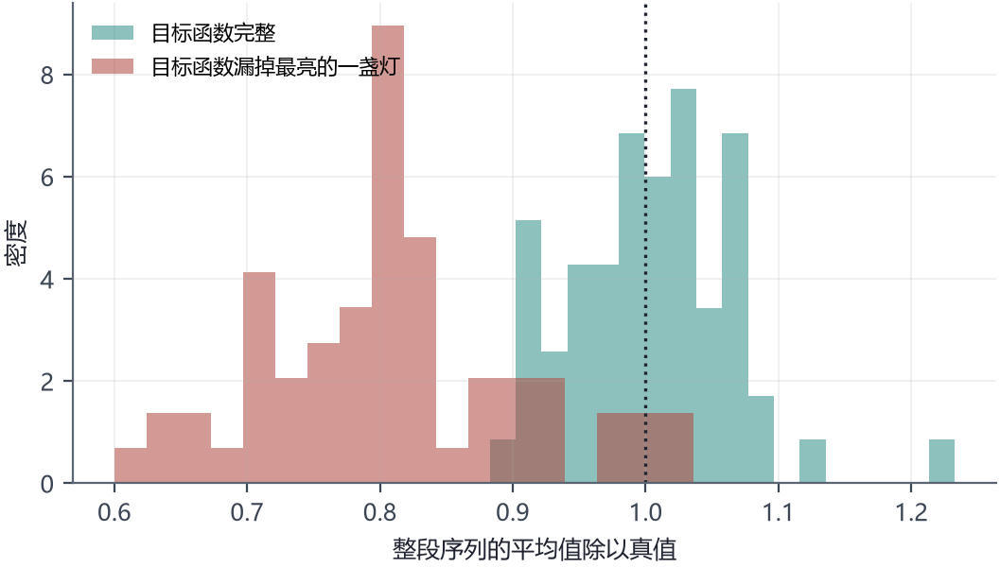
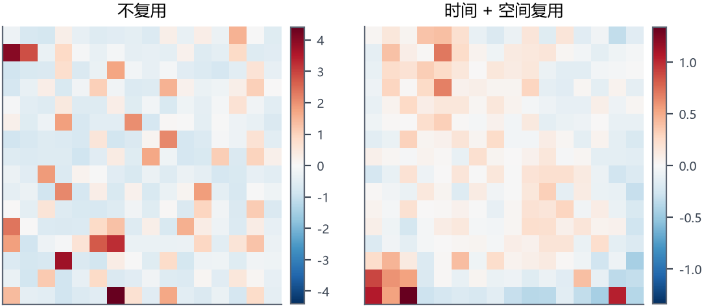

# 第 9 章 验证与调试

## 9.1 三种病，三种症状

渲染出来的图不对，只有三种可能：噪声大、有偏差、或者有结构性的错误（比如条纹、闪烁、漏光）。前两种在单帧图上几乎分不开，第三种常常被误认为前两种。

区分它们的办法是改变一个变量，看症状怎么变。

噪声随样本数下降，按平方根。把候选数从 8 加到 32，噪声应该减半；没有减半，说明有东西不是噪声。

偏差不随样本数下降。把候选数从 8 加到 32，图还是暗，说明它暗得很有道理——错的东西被一致地算了很多遍。

结构性的错误随参数变化但没有规律。改半径，条纹换了方向；改上限，闪烁换了频率。这类错误通常来自随机数或者复用顺序。

下面三个检验分别针对这三种。

## 9.2 解析解：两盏灯

最省事的检验是一个能算的场景。一个着色点、两盏灯、一个遮挡体，让其中一盏被挡住。贡献是

$$I=\frac{L_1\cos\theta_1}{d_1^{2}}+\frac{L_2\cos\theta_2}{d_2^{2}}\cdot 0 , \tag{9.1}$$

第二盏被挡住，所以真值就是第一项。这个值可以直接写在测试里，不需要渲染器算。

然后用每像素一条阴影光线的 ReSTIR 去估它，跑一千次，看均值。用 $M=1$（退化成普通蒙特卡洛）时，估计量必须是"要么是 $I$，要么是 0"，均值必须收敛到 $I$；用 $M=8$ 时，估计量变成"所有候选的无阴影贡献之和乘上选中样本的可见性"，均值仍然必须是 $I$。

这个测试能抓住绝大多数与归一化有关的错误：$M$ 用错、漏掉 $\hat W$ 的缩放、权重和与目标函数不成对、支持条件破坏。它们都会让均值偏离 $I$，而且偏得很稳定，一千次之内就收敛到错的值。

测试的写法要点是：不要用渲染器自己的积分器算真值，要用纸上算出来的常数。用渲染器自证会掩盖系统性错误。

## 9.3 长序列均值

单帧单像素的测试抓不到"复用才出现"的错误，因为那些错误需要历史才能积累。第 4 章图 4-2 的 $M$ 截断错误在单帧里完全看不出来，第 8 帧偏 27%，第 48 帧偏 509%。

检验的办法是跑一段长序列，取整段的时间平均，与真值比。噪声在这一步被平均掉了：如果每帧的估计有 40% 的相对标准差，跑 32 帧、8×8 像素，时间平均的标准误是 $0.40/\sqrt{32\cdot 64}\approx0.9\%$。也就是说，几帧的序列就能把 1% 以上的偏差测出来。

图 9-2 是这个检验的输出形态。两次运行的分布宽度是 0.06 和 0.10，中心的距离是 0.19，远大于宽度。实践中的判据是：**如果两个实现的均值差大于它们标准误的四倍，就不是噪声**。

这个检验的代价是它需要一个真值。真值可以来自解析解（9.2）、来自更高精度的参考渲染（把所有灯都逐条算一遍），或者来自一个保守但肯定无偏的实现（$M=1$、不复用、不钳制）。

## 9.4 单帧误差图

把单帧的估计值除以真值再减一，得到一个误差图。它比图像本身有信息得多。

图 9-1 的两幅图色标不同：不复用的误差范围约是复用的四倍。更重要的是结构。

左图是椒盐状的：每个像素独立地错，相邻像素的误差几乎无关（相关系数 0.01）。这类误差降噪器能处理，因为它是白噪声。

右图是成片的：相邻像素同向错，相关系数 0.26。这类误差在视觉上"没那么噪"，因为人眼对低频不敏感；但它更难被降噪器去掉，因为降噪器的工作原理是"相邻像素的值应该相近"，而这里相邻像素确实相近——它们一起错。

这件事有两面。好的一面是它解释了为什么 ReSTIR 看起来比同方差的普通采样干净：误差低频，受人眼容忍。坏的一面是它让"图像看起来没问题"变得不可靠——成片的 2% 偏亮，看起来像环境光，看起来不像错误。

如果误差图呈现明显的条纹、棋盘、或者沿着某个方向的拖影，那不是噪声，是随机数或复用顺序出了问题，回到第 7 章。

## 9.5 一份检查流程

按这个顺序查，每一步都能独立地判定通过或者不通过。

**第一步，单点解析解。** 两盏灯、一盏被挡，一千次运行的均值必须落在真值的 1% 内。不过，先查归一化。

**第二步，单帧误差图。** 不启用任何复用时，误差应该空间独立（相关系数接近 0）。有明显的片状结构，说明随机数在像素之间相关。

**第三步，长序列均值。** 启用复用，跑 32 帧以上，看整段的均值。偏了，说明复用链里的换算或者截断有问题。

**第四步，把候选数加倍。** 误差的标准差应该下降，偏差应该不变。偏差随候选数变化，说明 $M$ 与 $\hat W$ 的配对有问题（第 4 章 4.3 节）。

**第五步，把历史长度减半。** 偏差不应该变化，方差应该上升。偏差随历史长度变化，说明历史样本的重新评估有问题（第 3 章 3.3 节）。

**第六步，关掉空间复用，再关掉时间复用。** 两次都应该保持无偏，只是变噪。任何一步出现偏差，就是那一步的实现问题。

这六步做完，剩下的问题基本只有参数了。

## 9.6 一个容易被忽略的量

实现里最好一直能读出两个数：每个像素的 $M$ 与 $\hat W/M$。

$M$ 顶在上限，说明这个像素的蓄水池是满的，历史份额很大，它对场景变化反应慢。一片区域全是满的，说明复用半径或者初始候选数偏大。

$\hat W/M$ 是"目标函数的平均质量"。它突然变大或者变小的地方，通常是目标函数不连续的地方——灯刚刚露出、遮挡刚刚变化。这些位置是偏差最容易出现的位置，也是降噪器最该保守的位置。

把这两个量渲染出来看，比看图像有用。图像上的异常需要解释，这两个量上的异常直接指出问题在哪。

## 9.7 把检验固定下来

上面六个步骤靠人手跑很容易忘。把它们写成脚本，每次都跑一遍，是唯一能防住回归的办法。

两个测试就够。第一个是数值测试：固定种子、固定玩具场景，跑 32 帧，断言整段均值与解析真值的差小于某个阈值（比如 1%），并断言方差不超过基线的一点五倍。第二个是构建测试：建检器能拦住文件、图、公式这类结构错误，这一册的 `books/build/build.py` 就在做这件事。

两个测试都跑得快。数值测试在本册的玩具场景上不到一秒，构建测试十几秒。它们的价值不在于找到新错误，而在于让旧错误不会再回来——尤其是那些只在特定参数组合下才显形的偏差。

测试里最好也打印出当前的 $M$、$\hat W/M$ 的均值。这些数字的突然变化往往比断言失败更早地提示出了什么问题。

---

验证的本质是"能不能在不看图像的情况下判断对错"。图像能告诉你有问题，但不能告诉你是哪一种；解析解、长序列均值、误差图这三样能。

接收一个新实现的顺序应该是：先证明它在简单场景里无偏，再证明它在复用下仍然无偏，最后才去调参数让它好看。反过来做，会调到一个"看起来很好"的局部最优，而那个局部的底下可能压着一个 20% 的偏差。
