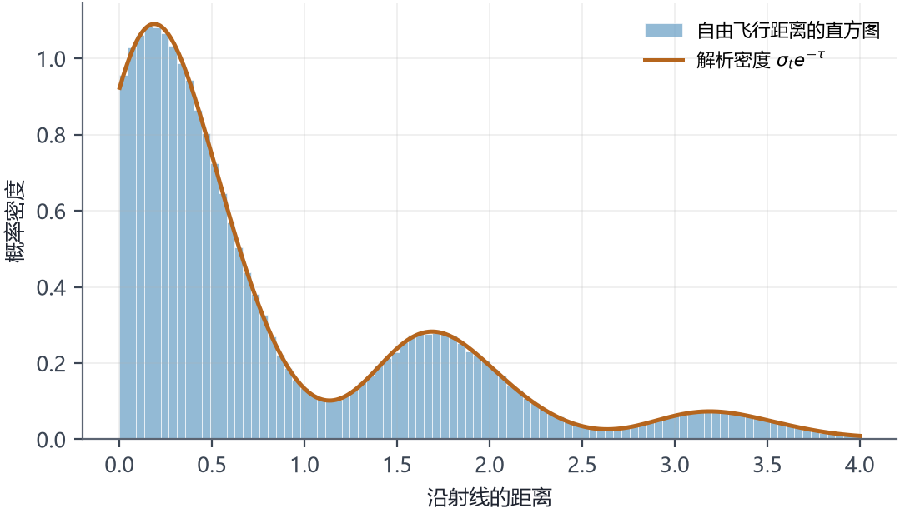
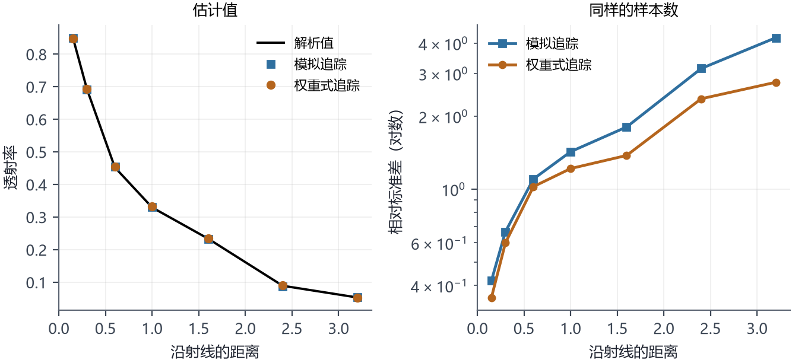
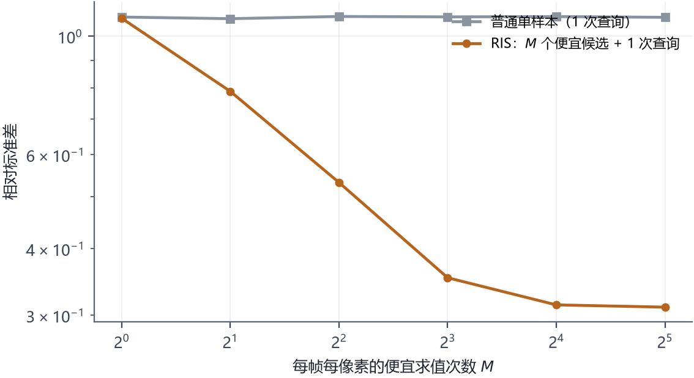

# 第 10 章 体积重采样

## 10.1 体积里的样本是一个距离

表面上，一次采样的结果是"哪盏灯"；体积里，一次采样的结果是"沿射线在多远的地方发生散射"。这个距离决定了一切：那一点的密度、从相机到这里积累的透射率、那一点受到的光照。

ReSTIR 的结构可以原样搬过来，只要把"样本"换成距离、"目标函数"换成"沿射线的单次散射贡献"：

$$\hat p(t)=T(t)\,\sigma_s(t)\,L_i(t) , \tag{10.1}$$

其中 $T(t)$ 是从起点到 $t$ 的透射率，$\sigma_s$ 是散射系数，$L_i$ 是那一点收到的入射辐亮度。真实贡献 $f$ 与 $\hat p$ 的差别在于可见性——$L_i$ 里是否包含光源到那一点的遮挡。

麻烦在于式 (10.1) 的三个因子没有一个是免费的。$T(t)$ 需要沿射线积分，$\sigma_s(t)$ 需要查询介质，$L_i(t)$ 需要一次光源采样加一次可见性判断。三者之中，前两个是"便宜的"（可以在候选上反复算），第三个是"昂贵的"（每条射线只能做一次）。这个分界线决定了体积重采样的全部设计。

null-scattering 这个框架有一个容易被忽略的好处：它把"采样"与"估计"统一到了同一套机制上。撞到哪里、这一点是真实碰撞还是虚拟碰撞、权重要不要乘一个因子，全部由同一个随机数序列决定。在表面渲染里，位置由求交决定、方向由采样决定、权重由 pdf 决定，三者分属不同的子系统；体积里它们必须咬合，否则会出现"距离按一个分布抽、权重按另一个分布算"的错误，而这种错误的表现与第 9 章那个"按错误密度归一"完全一样。

## 10.2 null-scattering：把积分变成碰撞

非均匀介质的透射率是

$$T(d)=\exp\left(-\int_0^d\sigma_t(x)\,\mathrm{d}x\right) , \tag{10.2}$$

积分在指数里，不能直接蒙特卡洛。null-scattering 的做法是引入一个上界 $\sigma_{\max}\ge\sigma_t(x)$，把介质看成"真实粒子 + 虚拟粒子"的混合物，虚拟粒子的密度是 $\sigma_{\max}-\sigma_t(x)$。光线在介质里前进时，每一步的碰撞距离按 $\sigma_{\max}$ 抽样，碰撞时以 $\sigma_t/\sigma_{\max}$ 的概率是真实碰撞（散射或吸收），否则是虚拟碰撞（继续前进，什么也没发生）。

这样做的结果是：碰撞距离的分布是解析的，而真实碰撞的位置按介质的真实密度分布。用这个机制同时解决两个问题——自由飞行距离的采样（撞到哪里），以及透射率的估计。

图 10-1 是这件事的验证。介质的密度是周期起伏的，自由飞行距离的分布跟着起伏：密度高的地方碰撞多，分布在那里鼓起来。直方图与解析密度在 40 万样本下几乎重合。

介质还有两个参数容易被忽略：散射反照率 $\sigma_s/\sigma_t$ 与相函数。前者决定一次碰撞之后有多少能量被散射而不是被吸收，后者决定散射到哪个方向。两者都不参与"距离"的采样，但都乘在贡献里。ReSTIR 的蓄水池合并时，这两个因子跟着样本走，不参与权重的换算——它们是贡献的一部分，与目标函数、密度的比值无关。

## 10.3 两种透射率估计

同一个追踪过程可以给出两种透射率估计。

**模拟式**：撞到真实碰撞就返回 0，一路穿过返回 1。这是一个伯努利变量，期望是 $T(d)$，方差是 $T(1-T)$。

**权重式**（ratio tracking）：每一次碰撞都把权重乘上 $1-\sigma_t(x)/\sigma_{\max}$，不管这次碰撞是真是假，一直走到 $d$ 为止。估计值是权重的乘积：

$$T(d)\approx\prod_{k}\left(1-\frac{\sigma_t(x_k)}{\sigma_{\max}}\right) . \tag{10.3}$$

它的期望也是 $T(d)$，但方差小得多，因为权重是逐渐衰减的，而不是一次性归零。

图 10-2 是这两种估计的对比。实测：距离 0.15 时模拟式相对标准差 0.42、权重式 0.36；距离 3.2 时 4.21 对 2.76。偏差两者都在 1% 以内（$d=1.6$ 时模拟式 $-0.8\%$，权重式 $0.0\%$）。

幅度不算惊人，因为这里的 $\sigma_{\max}/\sigma_t$ 只有 1.5 左右。介质越不均匀（$\sigma_{\max}$ 比典型 $\sigma_t$ 大得多），权重式的优势越明显——它的权重每一步只乘一个接近 1 的数，而模拟式在这种介质里大量样本会在第一次真实碰撞处归零。

这个差别对 ReSTIR 有直接影响。蓄水池的目标函数里含 $T(t)$，如果 $T$ 的估计方差很大，目标函数就带噪声，重采样选出来的样本也跟着不稳。所以在体积重采样里，透射率一般用权重式，而且尽可能复用——沿同一条射线的透射率可以在多个候选之间共享。

为什么权重式的方差更小？因为它的估计值是许多接近 1 的因子的乘积，而模拟式的估计值是一个 0/1 的指示器。指示器的方差是 $T(1-T)$，在中等光学厚度处最大（$T=0.5$ 时达到 0.25）；乘积式没有这个上限，它逐项地吸收"这一步没有碰撞"的信息，所以信息量随步数增长。代价是它必须走到射线终点，不能提前终止——在光学厚度大的介质里，这意味着更多的碰撞计数与更多的随机数。

这也是一个可以按需选择的开关：只需要"这条射线是否穿透"（比如判断可见性）时用模拟式，它可以在第一次真实碰撞处提前结束；需要透射率的数值（比如乘进目标函数）时用权重式。

## 10.4 把昂贵的那一步摘出来

体积单次散射的完整估计需要对距离采样、对光源采样。把光源那一侧写成 $L_i$，它的求值包含一次光源采样与一次可见性查询，是整条链上最贵的一步。

ReSTIR 的做法是把这一步摘出来：用 $M$ 个候选做距离采样，每个候选只算便宜的 $\hat p_0(t)=T(t)\sigma_s(t)$，挑一个之后再对它做一次昂贵求值。

$$\langle L\rangle=\frac{\hat W}{M}\cdot L_i(y)\,V(y),\qquad \hat W=\sum_{i=1}^{M}\frac{\hat p_0(t_i)}{p(t_i)} . \tag{10.4}$$

这个式子把两件事分开：括号那一项是 $M$ 个候选的平均权重，只依赖便宜的 $\hat p_0$；乘上去的 $L_i(y)V(y)$ 是选中样本的昂贵部分，只求一次。$V(y)$ 是光源到散射点的可见性，只有这一项需要真正的查询。

图 10-3 的数字：$M=1$ 时两者都是 1.08；$M=2$ 时 RIS 0.79；$M=4$ 时 0.53；$M=8$ 时 0.35；$M=32$ 时 0.31，然后不再下降。停在 0.31 是因为剩下的方差来自"那一次可见性查询"本身——它的结果只有 0 或 1，无法通过重采样改善。换句话说，重采样只能优化"问哪里"，不能优化"答案本身有多随机"。

这条曲线与第 4 章图 4-2 的形状一致：重采样把"候选的质量"与"单次求值的随机性"分开，前者随 $M$ 改善，后者不动。

先说清楚体积蓄水池里到底存什么。一个可用的样本至少包含五样东西：散射点的位置（等价于距离 $t$）、入射方向（决定相函数的值）、光源的下标与光源上的位置、散射点的密度与散射系数、以及这一点到光源的可见性。前四样在候选生成时就确定，第五样在选中之后才求。合并两个蓄水池时，位置与方向是"样本"的一部分，权重和与候选数是"账本"，可见性不进账本——它属于 $f$，在着色时按式 (6.4) 乘进去。

## 10.5 体积蓄水池与表面蓄水池的区别

结构一样，内容有四处不同。

**样本的域不同。** 表面的样本是一盏灯的下标，离散、有限、可以枚举。体积的样本是一个距离，连续、无穷。合并时"权重和"的含义不变，但"候选数"的意义变了：表面的 $M$ 是"看了几盏灯"，体积的 $M$ 是"沿射线试了几个位置"。

**可见性的角色不同。** 表面复用时，可见性是一个 0/1 的开关，乘在 $f$ 上。体积里，可见性出现在两处：光源到散射点（$V(y)$，必须重算），以及相机到散射点（$T(t)$，是一个连续量，已经含在 $\hat p$ 里）。把这两处混在一起，会出现"复用了邻居的透射率却重算了它的光源可见性"这种半对半错的情况。

**空间复用的几何含义不同。** 表面的空间复用是"邻居像素的灯"，两个像素看的是同一批灯；体积的空间复用是"邻居像素的散射点"，两个像素的射线穿过介质的不同部分，散射点之间没有对应关系。所以体积的空间复用通常不是"搬样本"，而是"搬方向与距离的组合"，并且要求两条射线在几何上接近。

**时间复用的稳定性不同。** 介质的密度场往往随时间变化（烟、雾、云），时间复用的历史样本对应的密度可能与当前帧不同。表面那边可以用"位置差、法线差"判断有效性，体积这边没有这样简单的判据，通常只能靠"密度场变化幅度"做一个全局的衰减。

## 10.6 Utah Graphics Lab 的工作

Utah Graphics Lab 关于体积重采样的工作把上面这套结构写成了完整的算法，题目是《Volumetric ReSTIR》。它处理的正是这一章讨论的几个问题：在 null-scattering 框架下定义蓄水池的样本与权重、把透射率估计纳入目标函数、在时间与空间上复用散射点，以及在介质随时间变化时控制历史的有效性。

与表面版本相比，这份工作最值得注意的一点是它对"昂贵"与"便宜"的划分更细。表面的 ReSTIR 只需要区分"灯求值"与"阴影光线"；体积里至少要分三层：密度与透射率（可以任意次求值）、光源采样的方向与距离（可以少量次）、可见性（一次）。三层之间的预算分配决定了最终的噪声水平，而这个分配在表面版本里不存在。

这里不展开它的具体实现细节——公开材料里能核实的部分主要是方法框架与实验设置，某些工程选择（比如蓄水池的具体布局、候选的生成顺序）在不同的实现里差别很大，写进来反而会误导。能确认的是：这条路线证明了几何上的重采样可以推广到介质，代价是目标函数的计算变复杂，以及"有效性"的判断从几何变成了与密度场相关。

第三个验证针对采样：把同一个积分用均匀距离采样与分层距离采样各跑一遍，两者的偏差都应该在统计误差内，而分层版本的方差应该明显更小。如果分层版本的偏差更大，说明层与层之间的权重没有按体积比例分配——在非均匀介质里，等分距离不等于等分光学厚度，按距离等分会把样本堆在密度低的地方。

这条路线在生产里还没有像 DI 那样普及，原因不在算法，而在代价。表面的蓄水池合并是几十个字节的加法；体积的样本要带上位置、方向、密度，合并时还要重新评估介质与透射率，一次合并的开销是表面的几倍。加上体积渲染本身对噪声更宽容（雾与烟的不均匀掩盖了噪声），收益没有 DI 那么直接。可以预期的是，当介质渲染的分辨率与精度要求提高、而硬件的光线预算继续增长时，这笔账会重新算。

## 10.7 一个可以自己做的验证

体积重采样最容易出错的地方是权重与 $M$ 的配对，还有一处同样隐蔽的是距离与光学厚度的混用。下面三个测试都能在几秒内跑完，而且都不需要真值以外的任何工具。一个简单的验证：把介质设为均匀、把光源设为常数、把可见性设为恒 1，这时解析解是

$$\int_0^{d}T(t)\,\sigma_s\,L\,\mathrm{d}t=L\,(1-e^{-\sigma_t d})\,\frac{\sigma_s}{\sigma_t} , \tag{10.5}$$

任何实现都应该收敛到这个数。如果收敛到的是它的一半或者两倍，问题一定在权重上，而不在采样上。这个测试还有一个变体：把 $\sigma_s$ 设成 $\sigma_t$（纯散射，无吸收），这时解简化为 $L(1-e^{-\sigma_t d})$，形状更容易目测。

第二个验证：把介质密度改成随位置变化，但保持总光学厚度不变。物理上，单次散射的总量会变（因为 $\sigma_s$ 与 $T$ 的乘积在变），但如果实现用了"错误的 $\sigma_s$"，结果会不随密度变化而变化。这个测试能抓出"忘了乘 $\sigma_s$"这类错误——它在均匀介质里恰好被归一化掉了，只有非均匀时才显形。

---

体积把"样本"从离散的下标换成了连续的距离，把"可见性"从一个开关换成了两个量（一个连续、一个离散），把"复用的对象"从灯换成了空间中的点。结构没变，但每一处的记账都更细：候选数是沿射线试了几个位置，权重和是这些位置的权重之和，而可见性不进账本。下一章把 DI、GI、体积三条线合到一起，给出一个统一的条件：什么样的移位映射、什么样的权重修正，能让重采样保持无偏。
