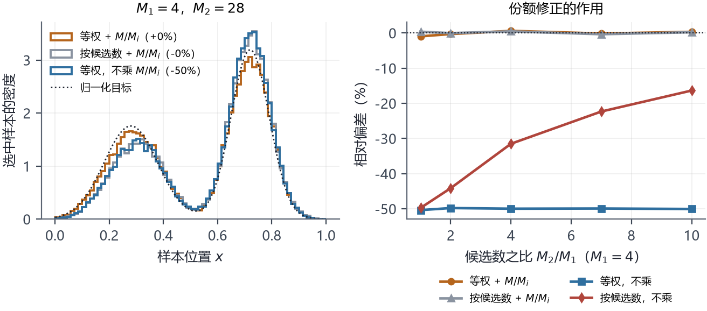
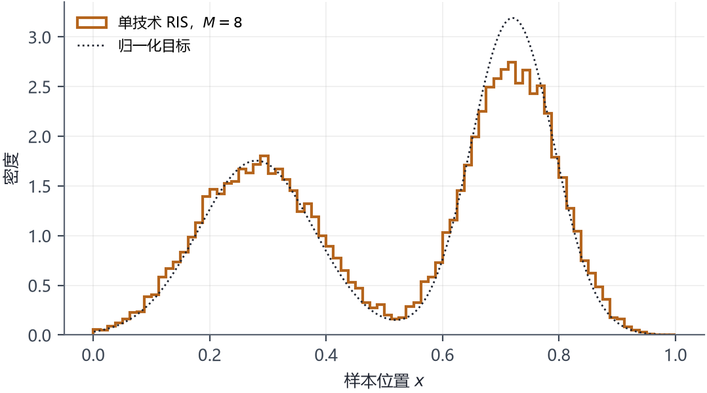

# 第 11 章 GRIS：重采样与多重重要性采样的统一

## 11.1 一个共用的框架

前面三章各自处理一类复用：DI 复用灯的下标，GI 复用路径的顶点，体积复用射线上的位置。三者的公式看起来不一样，但都在回答同一个问题：把一个在域 $A$ 里产生的样本搬到一个新的域 $B$ 里，权重该怎么改。

Lin 等人 2022 年的广义重采样重要性采样（generalized resampled importance sampling，GRIS）把这个问题的答案写成了一组条件。它的形式很简单：给每个技术一个**移位映射** $T_i$，一个**目标函数** $\hat p_i$，一个**候选密度** $p_i$，一个**份额** $m_i$，候选的权重是

$$w_i(x)=m_i\big(T_i(x)\big)\cdot\frac{M}{M_i}\cdot\frac{\hat p_i\big(T_i(x)\big)}{p_i(x)}\cdot\left|\frac{\mathrm{d}T_i}{\mathrm{d}x}\right| ,  \tag{11.1}$$

其中 $T_i$ 把技术 $i$ 的样本域映到公共的目标域，雅可比 $|\mathrm{d}T_i/\mathrm{d}x|$ 是"密度换域"的换算因子，$M/M_i$ 是候选数的补偿，$m_i$ 是技术之间的份额，满足 $\sum_i m_i=1$。

式 (11.1) 一写完，前面三章的东西都能对上号。

## 11.2 与前面三章的对应

**DI**：技术是"按某个分布选灯"，样本域是灯的下标（离散），移位映射是恒等映射，雅可比为 1。$\hat p_i$ 是那盏灯的无阴影贡献，$p_i$ 是选它的概率。$M/M_i$ 在单技术时等于 1。

**GI**：技术是"从某个主顶点采样"，样本域是方向，映射到公共域（比如"墙上的位置"）时雅可比是 $\mathrm{d}\omega/\mathrm{d}z$，也就是第 9 章式 (9.4) 那个比值的倒数。

**体积**：技术是"沿射线采样距离"，映射可能带一个缩放（如果两个像素的距离参数化不同），雅可比等于参数化的比值。

所以 GRIS 不是第四个算法，它是前三章那套东西的共同语法。这也是它值得单独一章的原因：判断"我这样改还对不对"时，只需要检查式 (11.1) 里的五样东西有没有写对。

## 11.3 份额修正项

$M/M_i$ 这一项最容易被当成"实现细节"。它的作用可以用一句话说清：**让技术的份额不被候选数污染**。

设两个技术，候选数分别是 $M_1=4$、$M_2=28$，总候选数 $M=32$。希望两个技术在结果里各占一半的话语权，于是取 $m_1=m_2=1/2$。如果权重里没有 $M/M_i$，那么技术 2 贡献的候选数是技术 1 的七倍，实际的话语权就变成 $28/32$ 对 $4/32$——份额被候选数带偏了。

图 11-1 左边是三种组合的选中分布。乘了修正的两条（等权、按候选数）都贴在目标上；不乘的那条整体低了 50%——不是形状错，是尺度错，因为权重和的期望少了一半。

右半边解释了那 50% 是从哪来的。按候选数分配份额、又不乘修正时，权重和的期望是

$$\mathbb{E}\Big[\frac{\hat W}{M}\Big]=\sum_i\left(\frac{M_i}{M}\right)^2\int \hat p_i ,  \tag{11.2}$$

系数是候选数比例的平方和。$M_1=M_2$ 时是 $1/2$，偏差 $-50\%$；$M_2/M_1=10$ 时是 $(1/11)^2+(10/11)^2=0.835$，偏差 $-17\%$。图 11-1 右边那条红线就是这个式子。

式 (11.2) 也说明为什么乘上 $M/M_i$ 之后就对了：它把每个技术的权重和从"候选数乘平均值"变成"平均值"，于是份额 $m_i$ 直接作用在平均值上，而不是作用在候选数上。

在进入推导之前，先把式 (11.1) 里五个量的"谁属于谁"说清楚。$T_i$、$\hat p_i$、$m_i$ 都是**目标域**里的量：它们描述"我想要什么"。$p_i$、$M_i$ 是**来源域**里的量：它们描述"我怎么抽"。雅可比是两者之间的桥。写代码时如果把这五样放在同一个结构体里而不加区分，就很容易出现"用来源域的目标函数配目标域的密度"这类错误，而这种错误在数值上不会报错，只会让图慢慢偏掉。

## 11.4 移位映射与雅可比

雅可比是 GRIS 里唯一需要真正推导的东西。它的含义是：技术在**自己的域**里抽样，而目标函数定义在**公共域**里；两个域之间的换算不是免费的。

一个最小的例子。技术 2 在 $[0,s]$ 上均匀抽样，而目标函数定义在 $[0,1]$ 上。样本 $x$ 落在 $[0,1]$ 里的概率密度不是 1，而是 $1/s$——因为总概率 1 被摊到了长度 $s$ 上。如果实现按"均匀，密度为 1"来算权重，每个样本的权重就被高估了 $s$ 倍。

![图 11-2　漏掉雅可比的后果。技术 2 在 $[0,s]$ 上均匀抽样，正确的密度是 $1/s$。橙线按 $1/s$ 归一，全程无偏；蓝线按 1 归一，偏差从 $-17\%$ 到 $-55\%$，正好是 $1-1/s$](../images/11/fig11-2-jacobian.png)

实测的偏差是 $1-1/s$：$s=1.2$ 时 $-16.8\%$，$s=1.5$ 时 $-33.4\%$，$s=2.2$ 时 $-54.5\%$。与 $1-1/1.2=0.167$、$1-1/1.5=0.333$、$1-1/2.2=0.545$ 完全吻合。

这个例子看起来太简单，但它就是 GI 重连接的形状：两个主顶点到同一个公共点的立体角之比，正是 s 的来源。第 9 章里那个"按目的地的密度归一"的错误，本质上是把 $s$ 从 $p_{A'}/p_A$ 换成了 1；误差大小取决于两个视角下同一个墙上位置对应的立体角之比，也就是 $1-1/s$ 那个形式。

还有一个技术上的细节值得单独说：式 (11.1) 里的雅可比通常是 $3 imes3$ 矩阵的行列式，但在实际的光线追踪里它很少被显式地算成矩阵。多数实现用几何恒等式把它化简成一个标量比值，例如重连接时它等于两个主顶点各自到同一点的距离平方与夹角余弦之比。这个化简只在映射是"从主顶点指向公共点"时成立；一旦映射里含镜面反射或者折射，就退化成矩阵形式，计算量跟着上去。这也是为什么路径复用里镜面段不能重连接——不是不想，而是雅可比没法化简成廉价的形式。

## 11.5 无偏的条件

把式 (11.1) 代进第 4 章那套证明，可以逐项列出条件。它们不多，但每一条都对应一个具体的实现错误。

**条件一：移位映射是双射，且雅可比不为零。** $T_i$ 必须把技术的样本域一一映到目标域，否则同一个样本会被映射到多处（或无处），权重无从定义。GI 里重连接不满足这一条——映射的像只是一部分（被遮挡的那些对应到"无效"），所以需要额外的处理：把无效的映射到零贡献，而不是丢弃。

**条件二：$\hat p_i(T_i(x))$ 在映射后的点上求值。** 目标函数必须定义在公共域，在映射之后的位置求值。如果实现图省事，在来源域里求值，那就是把"我这里的价值"换成了"邻居那里的价值"，等价于第 7 章那个"空间复用不换算"。

**条件三：$p_i(x)$ 是技术在自己域里的真实密度。** 采样与归一化必须自洽。这一条在 GI 里最容易破，因为"方向采样"和"距离采样"两种参数化的密度不同。

**条件四：$m_i$ 的和为 1。** 第 2 章的式 (2.4)。它保证技术之间的份额不重复也不缺失。

**条件五：$M/M_i$ 与 $M$ 的定义一致。** $M=\sum_i M_i$，$M_i$ 是技术 $i$ 实际贡献的候选数。把 $M_i$ 写成"有效候选数"，就回到第 7 章那个 $+56\%$。

五条里前三条是"域"的事情，后两条是"账"的事情。域错了，偏差随几何变化；账错了，偏差是一个常数比例。两者在图像上的样子不同：前者在几何复杂处更明显，后者是全图均匀地亮或暗。第 14 章会利用这个区别设计诊断。

式 (11.1) 里还有一个隐含的假设：技术 $i$ 的候选是独立同分布地从 $p_i$ 抽的。时间复用破坏了这个假设——历史候选之间相关，因为它们来自同一段过去。GRIS 处理这件事的方式是把历史当作一个独立的技术：技术 $i$ 的候选是上一帧的蓄水池，它的密度就是上一帧的重采样分布 $q_{t-1}$。这样相关性被吸收进 $q_{t-1}$ 里，公式仍然成立，代价是 $q_{t-1}$ 没有闭式，只能用近似。这个处理方式解释了为什么时间复用的正确写法是"目标函数重新求值、密度不重求"：$q_{t-1}$ 不可算，所以只能依赖蓄水池已经存下的 $\hat W$。

## 11.6 退化关系

GRIS 在几种特殊情况下应当退化回已知的算法，这是检查实现是否正确的捷径。

**单技术、$M_i=M$。** 式 (11.1) 里 $M/M_i=1$、$m_i=1$、$T$ 为恒等，权重就是 $\hat p/p$，估计量是第 4 章的 RIS。图 11-3 是单技术版本的选中分布。数值上两者应当完全一致：$M=8$ 时，单技术 RIS 的均值 0.31409，拆成两个各 4 个候选的技术并按 $M/M_i=2$ 修正之后是 0.31316，真值 0.3134——两者在统计误差内相同。

**多技术、$m_i$ 取平衡启发式。** 若每个技术的候选数相同、$T_i$ 为恒等、并且只用一次重采样（$M_i=1$），式 (11.1) 退化成第 2 章的式 (2.13)：$w_i=\hat p_i/\sum_k\hat p_k$，也就是单样本 MIS。这说明 MIS 是 GRIS 在"没有重采样"时的特例，而 RIS 是它在"只有一个技术"时的特例。

**$M_i\to\infty$。** 候选数趋于无穷时，重采样的样本分布趋于 $\hat p_i/\int\hat p_i$，第 6 章式 (6.1) 那个"实际分布"变成目标分布本身。这时 GRIS 退化成"每个技术都能完美采样"的经典 MIS。

三个退化关系构成一个三维的检查空间：沿每条轴走到端点，都应该得到教科书上的结果。实现里任何一处写错，通常会在某个端点上暴露。这也是为什么复现论文时先跑单技术、再跑两技术，比直接照搬整套流程更省时间。

份额函数 $m_i$ 的选择在 GRIS 里比在 MIS 里更自由，因为它可以依赖候选数。常见的三种取法：按候选数（$m_i=M_i/M$）、技术等权（$m_i=1/n$）、按目标函数的模（$m_i\propto\int\hat p_i$）。第一种实现最省事，第二种在技术之间质量差距大时更稳，第三种需要估计 $\int\hat p_i$，通常用候选权重和代替。三者在无偏性上没有区别，差别只在方差。

## 11.7 嵌套：GRIS 为什么必须递归

DI 与 GI 的组合是嵌套的：像素上先用蓄水池挑一条路径，路径的每个顶点上又有各自的采样技术。GRIS 的处理方式是递归地套用式 (11.1)：内层重采样给出一个估计量，外层把这个估计量当作"技术"的贡献，再乘一次份额与候选数修正。

这种递归有一个后果：权重的量级会随层数增长。两层的 $M/M_i$ 乘起来可以是几百，浮点精度在极端情况下会出问题。实践中的做法是把权重归一到"每个像素的总权重量级约为 1"，或者在每层之后做一次钳制——而钳制就是第 7 章那个偏差与方差的权衡。

递归还有另一个后果：**无偏性是可组合的**。如果每一层都满足五条条件，整体就无偏。这条性质听起来理所当然，但它的证明需要"内层估计量的条件期望等于外层需要的东西"这一步，而这一步只在"内层的目标函数等于外层的被积函数"时成立。把内层的目标函数设成近似值（比如用上一帧的可见性做代理），组合性就断了。

还有一类问题 GRIS 回答不了：映射的"质量"。两套方案可以都无偏，但一套的雅可比在几何上剧烈变化，另一套平缓，前者的方差就会大得多。式 (11.1) 只保证尺度对，不保证样本落得均匀。判断质量要靠实验：在同一场景里比较两种映射的方差，或者比较"复用半径增大时方差的增长速度"。第 13 章会把这类比较写成一组可复现的曲线。

## 11.8 这套理论能回答什么

GRIS 的价值不在于给出一个新算法，而在于把"这样改对不对"变成一次逐项检查。遇到一个没见过的复用方案，可以按下面的顺序过一遍。

先问样本的域是什么、目标域是什么、映射是什么。这三件事定下来，雅可比就定了。再问目标函数在哪个域求值、密度是哪个域的量。最后问候选数怎么记、份额怎么分。

这个顺序也能用来评估别人的实现。看到一段 ReSTIR 代码，找出它的 $T$、$\hat p$、$p$、$m$、$M_i$ 五个量，对照式 (11.1) 逐项核对，比读代码逻辑快得多。多数 bug 出在"目标函数求值的域"和"候选数的记账"这两处，它们也正好是式 (11.1) 里最不显眼的两个位置。

这套语法还有一个副产品：它让"读别人的实现"变成一件可操作的事。把一段 ReSTIR 代码里的五个量找出来，对照式 (11.1) 摆好，哪一项缺失或者位置不对，一眼就能看出来。多数 bug 藏在两个地方：目标函数在哪个域求值，以及候选数记的是谁的数。前者写错，偏差随几何变化；后者写错，偏差是全图的一个常数。

---

重采样、MIS、移位映射在 GRIS 里被写成同一个式子的五个位置。DI 是恒等映射、单技术，五条里有三条自动成立；GI 是重连接映射、需要雅可比，第一条还要处理无效的像；体积是参数化映射、需要密度换算，第三条最容易被参数化搞混。前面三章那些看起来各自独立的陷阱——密度归一、候选数记账、无效样本的丢弃——在式 (11.1) 里各自对应一项。这套语法到此为止是完整的，剩下的问题是工程：怎么在有限的算力与内存里把它跑起来，以及怎么在跑起来之后判断它有没有走样。
