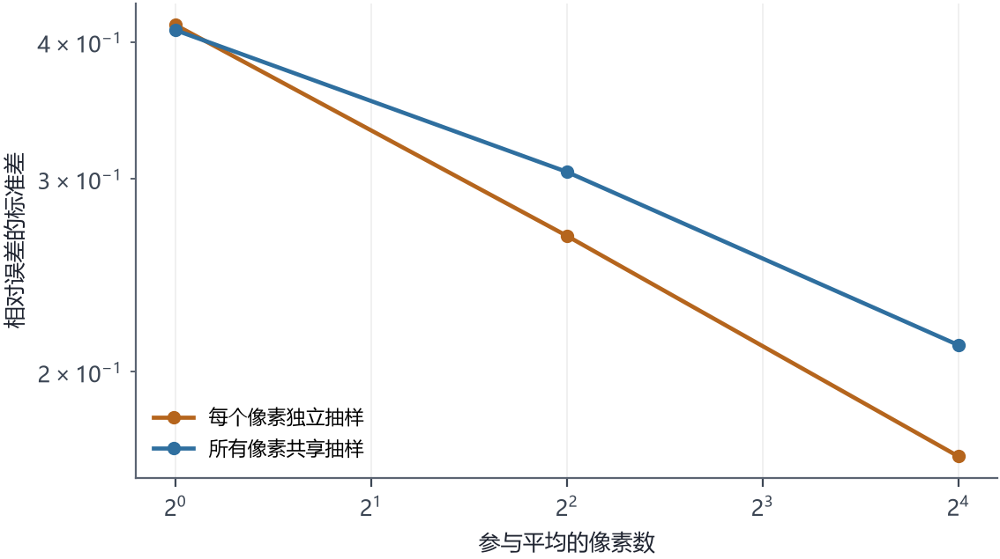
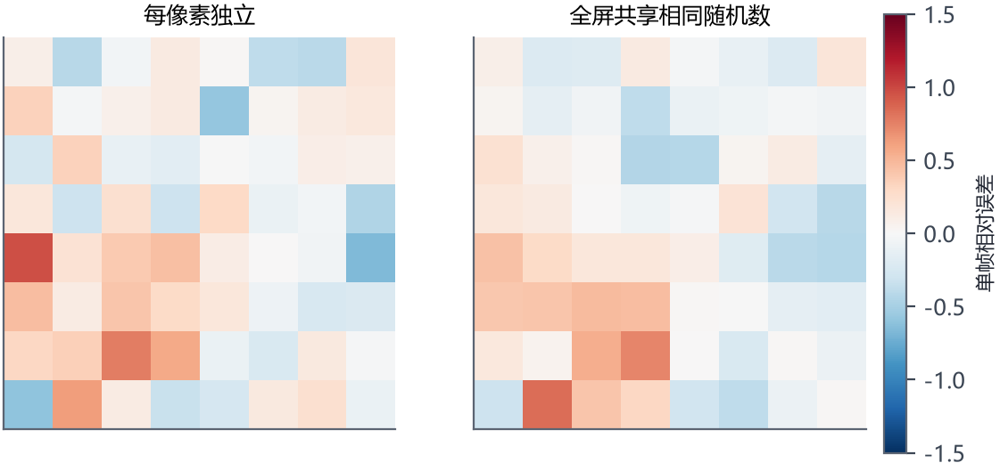

# 第 12 章 实现细节

## 12.1 一个像素存什么

理论说到第 11 章已经完整。从这一章开始换成另一套问题：把这些式子写成能跑在显卡上的代码，哪些地方会走样。

先看数据结构。一个像素的蓄水池至少要存：样本 $y$（灯下标或路径顶点）、权重和 $\hat W$、候选数 $M$、样本在来源处的目标函数值 $\hat p_j(y)$。如果还要做可见性复用，得加一个可见性标志；如果做路径复用，得加顶点位置与法线；如果做时间复用，还得加"历史是否有效"。

把这些塞进一个结构体，表面上看是布局问题，实际上是**一致性**问题。第 6 章说过 $\hat W$ 与 $M$ 必须描述同一批候选，而它们分处两个字段，任何一处漏更新都会破坏这条。工程上能做的是把它们放进同一个结构、用同一个函数更新、并且让"更新"成为唯一能改这两个字段的入口。

二十个字节大致是下限：$y$ 用 4 字节（灯下标或指向顶点的索引）、$\hat W$ 用 4 字节、$M$ 用 4 字节、$\hat p_j(y)$ 用 4 字节，再加 4 字节的杂项。一帧 1080p 就是 40 MB，两倍缓冲 80 MB，加上路径顶点就更多。这个量级决定了"能不能把历史放在显存里"，也决定了"要不要压缩"。

## 12.2 随机数怎么发

一个像素每帧要消耗若干随机数：抽候选、做合并抽签、决定是否复用。这些随机数的来源决定了噪声的空间结构与时间结构：空间结构决定降噪器能做什么，时间结构决定观众看到的是闪烁还是稳定。

最省事的做法是按"帧号 + 像素号 + 用途"哈希出一个种子，再在像素内部开一个线性同余或者 PCG。这样每个像素的序列互不相关。糟糕的做法是用一个全屏共享的序列：所有像素在同一步消耗同一个随机数，于是它们的误差是同一个随机变量的缩放。

图 12-1 是实测。独立抽样时，邻域误差的相关系数是 0.24；共享同一条序列时升到 0.48。平均 4 个像素，标准差从 0.42 降到 0.27（独立）或 0.30（共享）；平均 16 个，0.17 对 0.21。差距在块越大时越明显，因为共享序列让误差有了一个共同的低频成分，平均掉不了。

这个差距对降噪器是致命的。降噪器的基本假设是"邻域内的误差互相独立，平均能降噪"，而共享序列恰好破坏这个假设。它看到的是"这片区域整体偏亮"，会把这个偏亮当成信号保留下来。

图 12-2 是同一帧、同一个随机种子的两张误差图。左图的误差在像素之间跳，右图的误差连成片。后者的平滑外观更容易被误认为"已经收敛"，实际它是**结构化**的误差，降噪之后仍然存在。

一个具体的例子说明"顺序"为什么重要。初始候选的抽取需要"从所有灯里挑 $M_0$ 个"，如果实现用一个光源树的下降过程来挑，那么每次下降的步数随灯的分布变化，消耗的随机数个数也变化。下一步的合并抽签就会从不同的位置开始读序列，于是同一个像素在两次运行里用到了不同的随机数。看起来无害，实际上让整个渲染器失去了可复现性：回归测试无法逐像素比对，只能看平均亮度。

解决办法是给每个用途分配独立的序列：初始候选用一段、合并抽签用一段、可见性抖动用一段，各自的偏移量由哈希决定。这样即使某一段的消耗个数变化，也不会污染别的段。

## 12.3 历史的存储

历史样本要存到下一帧，于是有了精度与范围的问题。

精度方面，实测表明不是瓶颈。把 $\hat W$ 量化到 8 位有效数字，引入的偏差在 $-0.02\%$，已经低于统计噪声（0.7%）。原因是 $\hat W$ 的量化误差对称，取期望之后互相抵消。真正需要注意的是**范围**：$\hat W$ 的量级随场景变化可以跨十几个数量级，从"一盏很远的弱灯"到"贴着面的面光源"。用 16 位浮点存，量级够了但精度只剩三位；用 32 位浮点，范围与精度都够，代价是带宽。

工程上的折中是"共享指数"：一帧之内所有像素的 $\hat W$ 用同一个指数缩放，尾数各存 10 到 12 位。这个做法在时间上稳定，因为指数是逐帧平滑更新的；缺点是场景里同时存在极亮与极暗的区域时，缩放会把暗的那部分压到精度之外。

还有一件事容易被忽略：历史需要**重置**。相机切换、分辨率变化、场景重载时，历史蓄水池里的样本对应的几何已经不存在了。不重置的后果不是慢慢变坏，而是立刻出现一块"上一个场景"的残影，而且它带着自己的 $\hat W$，会持续几十帧。实现里应该有一个显式的 `reset()`，在每一处会改变像素对应关系的操作之后调用；它应当是幂等的，并且在取消暂停、拖动时间轴、切换相机这类操作上都要触发。

帧间闪烁还有一个不那么显眼的来源：**候选数是整数而权重和是浮点**。$(\hat W,M)$ 一起缩放时，$\hat W/M$ 不变，但下一次合并的比较用的是 $\hat W$ 的绝对值。浮点的舍入让"缩放后"的 $\hat W$ 与"理论值"差一个极小的量，这个差在几百次合并之后会累积成"某个邻居总是赢"的偏置。实测量级很小（千分之一以下），但在长时间静止的场景里，它会让某个像素的蓄水池被一个固定的样本长期占据。缓解办法是每次缩放后从候选里重新抽一次，或者定期重置。

## 12.4 合并的原子性

空间复用要读邻居的蓄水池、写自己的。如果一边读一边写，会形成链式传播：像素 1 读了像素 2，像素 2 又读了像素 3，于是像素 1 间接读到了像素 3 的样本，而它的 $M$ 只加了两次。

正确的做法是"快照"：先把整帧的蓄水池复制一份，所有合并都从副本读、往自己写。代价是一次全屏的拷贝，几十 MB 的带宽；收益是合并的结果只依赖上一帧与当前帧的初始候选，与遍历顺序无关，也就与线程调度无关。

有意思的是，实测下来"就地合并"与"快照合并"的偏差与方差几乎相同：64 个种子、24 帧、64 个像素，两者的相对偏差都是 $-0.1\%$（标准误 1.3%），相对标准差都是 0.34。链式传播在这个场景里没有造成可测的错误，因为一个像素最多链式地读到四个邻居，而 $M$ 的差异在 20 的上限附近被截断了。

但这不说明就地合并是安全的。它的风险在于**不可预测**：链式传播的方向依赖线程调度，同一份输入可能得到不同的结果。渲染器需要可复现性——同一帧渲两遍要一样，否则回归测试、帧间比较、A/B 对比全部失效。所以工程上仍然用快照，理由是确定性，不是精度。

还有一处实现细节值得写下来：$\hat p_j(y)$ 该不该存。它可以从样本重建——重算一次目标函数即可。但重算的开销不小（要访问灯、算距离与夹角），而且如果目标函数依赖历史（比如含上一帧的可见性代理），重算出来的值与当初用的值不同。存下来最省事，代价是 4 个字节。多数实现选择存，因为它同时保证了"换算用的分母"与"当初的权重和"来自同一次评估，这正是第 6 章那条一致性要求。

## 12.5 与降噪器的接口

ReSTIR 的输出不只是颜色，还有一组"这个像素有多可信"的量：候选数 $M$、权重和 $\hat W$、以及两者之比。降噪器需要这些量来判断该在多大范围内平均。

接口的设计有一个陷阱。$\hat W/M$ 看起来像一个"平均权重"，可以直接当方差用，但它衡量的是重采样的方差，不含可见性带来的那一部分。第 8 章图 8-1 那个 0.33 的相对标准差里，大部分来自"每帧只有一条阴影光线"，而不是来自"候选不够"。把 $\hat W/M$ 直接当噪声水平，会让降噪器对"候选多但可见性差"的像素过度平滑。

比较稳妥的做法是让渲染器额外输出一个粗糙的方差估计：可以用相邻两帧的估计值之差，也可以用同一次着色里几个子样本的离散度。前者便宜、但有滞后；后者准确、但要多花算力。

还有一个与精度有关但经常被归错类的现象：**帧间闪烁**。它的来源不是噪声，而是"历史有效性的判断在边界处抖动"。一个像素的历史在某几帧被判定为有效、另几帧被判为无效，于是它的有效候选数在 20 与 4 之间跳，亮度也跟着跳。这类抖动在半影、轮廓、运动的物体边缘最明显。

判断抖动本身没有好坏，它是离散判断的必然结果。可以缓解的做法是让判断"软化"：不是"有效/无效"两种状态，而是一个 0 到 1 的权重，乘在借来的 $\hat W$ 上。

并行还影响"候选的可见性测试"。如果一次合并产生多个候选，测试它们的阴影光线可以在同一个波前里发射，交错的代价被摊薄；如果每个像素单独发射，光线发散、缓存命中率低。这一点在高性能实现里往往比算法本身的差异更大：同样的算法，光线组织方式不同可以差出一倍的吞吐。

## 12.6 顺序、确定性与并行

ReSTIR 的每一步都可以并行到像素级：初始候选、时间复用、空间复用、着色。前两步只读自己，天然并行；空间复用要读邻居，需要一份快照；着色只读自己。

不天然并行的是"候选的生成"。如果候选用一个贪心的加速结构遍历（比如从光源树的根开始按贡献下降），那么遍历路径依赖当前的随机数，而随机数依赖像素。这在实现上没问题，但会让"同一帧渲两遍"的结果在浮点上不完全一致——除非随机数完全由像素与帧号决定，不依赖执行顺序。

减少不确定性的标准做法是把所有随机数来源都写成"种子 = 哈希(像素, 帧, 用途)"，并且保证每个像素内部的消耗次序固定。这样即使显卡的线程调度变化，结果也一致。代价是无法用"全局计数器"这种省事的写法，每个像素都要自己维护一个小的状态。

带宽优化里最有效的一招不是压缩，而是**减少一次读写**。时间复用必须先读上一帧的蓄水池、再写这一帧的，这是一次读一次写，省不掉。空间复用可以省：如果四个邻居在同一个线程组的不同线程里，它们可以用共享内存交换，而不是各自去显存里读。代价是线程组的划分必须与像素邻域对齐，而这一点在分辨率不是组大小的整数倍时要特殊处理。

## 12.7 内存与带宽

最后算一笔带宽账。1080p、每像素 20 字节的蓄水池，读写一遍是 40 MB。时间复用读一遍写一遍、空间复用读四个邻居写一遍，加起来大约 200 MB/帧。60 帧/秒是 12 GB/s——接近一块中端显卡的显存带宽的三分之一。

这个数字解释了为什么实现里要做压缩、为什么"复用半径"不能随便加大、也解释了为什么有些实现把蓄水池放在共享内存或者 L2 里分块处理。它也解释了为什么"每个像素多存几个字节"不是免费的：多存 4 字节的顶点位置，带宽就多 20%。

---

实现层面的三件事——随机数的相关性、历史的精度与范围、合并的原子性——都不会让结果"明显错"，但都会让结果"不可信"：噪声图案变成斑块、历史带着上一个场景的残影、同一帧渲两遍不一样。它们的共同点是，在没有对照的情况下看不出来：画面看起来是干净的，只是干净得不对——噪声成了斑块、历史带着上一帧的形状、两次运行的结果略有不同。下一章给出一组参数与收敛的测量方法，用来在没有真值的情况下判断"现在这个状态是调好了还是只是看起来还行"。
