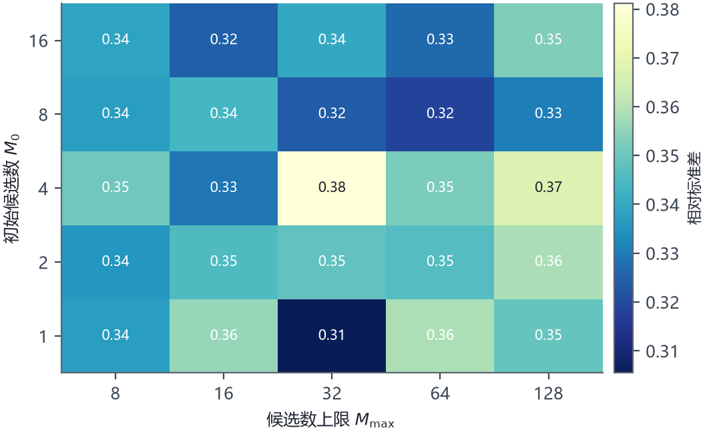
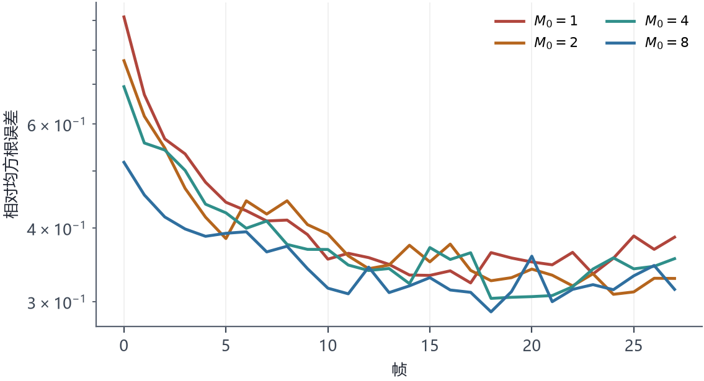
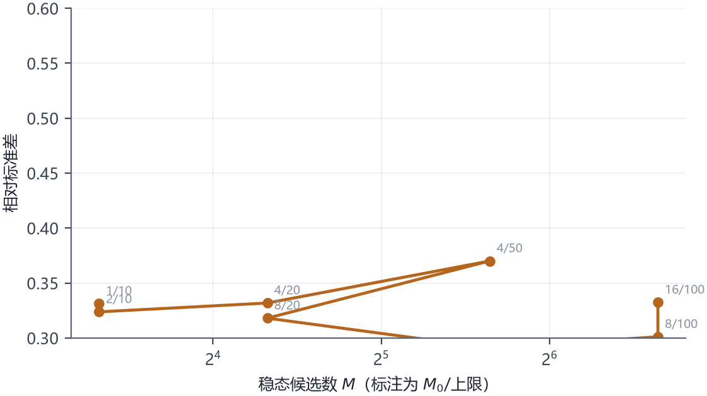

# 第 13 章 参数、收敛与稳定性

## 13.1 四个旋钮

ReSTIR 的实现里有四个经常被调的参数：每帧的初始候选数 $M_0$、候选数上限 $M_{\max}$、复用半径 $r$、以及可见性复用与钳制这类开关。它们各自有直觉上的作用：$M_0$ 决定每帧注入多少新信息，$M_{\max}$ 决定历史能占多大比重，$r$ 决定借多少邻居，开关决定要不要用某个近似。

调参的目标是让噪声尽量低、而图不要"发木"（运动时拖影、静止时过度平滑）。这两件事往往冲突，所以需要知道每个旋钮的边际收益。

调参之前还有一件事要做：把"噪声"量化。用人眼看"噪不噪"在不同显示器、不同亮度下差别很大，而且会被图像的对比度误导。可操作的做法是固定一个相机路径、跑固定帧数、对同一批像素统计相对标准差，再在几个配置之间比。这一章所有数字都来自同一套设置：64 个像素、64 盏灯、功率按 $1/i$ 递减、24 帧、12 个种子。

## 13.2 一个不太好接受的结果

图 13-1 是这两个参数的完整网格：$M_0$ 从 1 到 16，上限从 8 到 128，每个格子跑 12 个种子、24 帧、64 个像素。25 个格子的相对标准差全部落在 0.31 到 0.38 之间，最小值 0.305 与最大值 0.381 相差不到 25%，而格子之间的差异有一半是统计噪声。

这个结果说明，在这个场景里，两个参数几乎不影响噪声。噪声被另一件事锁住了：每帧每像素只有一条阴影光线。候选数再多，也只是在"哪一盏灯被选中"上花更多力气，而"这盏灯是否可见"始终只问一次。第 8 章图 8-2 已经把这个结论摆出来了：四种配置的相对标准差从 1.08 一路降到 0.33，然后停住。

所以调参的正确心态是：先确认自己在哪一侧，再决定要不要动。如果噪声随参数明显变化，说明还没到平台，参数有意义；如果到了平台，再调就是在浪费时间，该做的是换一个维度——加光线、加可见性复用、或者把噪声交给降噪器。判断"到了没到"最省事的办法，是把其中一个参数从最小拉到最大，看噪声曲线有没有明显的下降段；没有，就是到了。

在讨论收敛之前，先把"误差"这个词固定下来。这一章用两种量：相对标准差（同一配置跑多个种子，估计值的离散度）与相对均方根误差（每一帧、每个像素与真值之差的均方根）。前者衡量"噪声有多大"，后者衡量"这一帧有多不准"。两者在偏差很小时接近，在有偏差时会分开——这个区别是第 14 章诊断的基础。

还有一个量值得一起看：**每帧的有效新信息比例**，即 $M_0/M$ 的稳态值。它直接决定"历史刷新一代需要几帧"。$M_0=4$、上限 20 时是 0.2，也就是 5 帧换一代；上限 100 时是 0.04，25 帧换一代。这个数比参数本身更能预测"运动时的跟随能力"。

## 13.3 收敛的形态

图 13-2 是误差随帧的形态。第一帧的误差由初始候选决定，$M_0=1$ 时最大；随后几帧迅速下降，因为历史开始积累；第 5 帧之后进入一个缓慢下降段，$M$ 撞到上限，新信息只能按 $M_0/M_{\max}$ 的比例挤进来。

四条曲线的末帧值分别是 0.42、0.38、0.355、0.315（$M_0$ 从 1 到 8）。差距比网格里大，因为这里的上限都固定为 20，$M_0$ 越大，新信息占比越高，历史更新越快。

这个形态有一个实用含义：**首帧到第 5 帧的这段是"冷启动"**。相机切换、场景加载之后，观众会看到这几帧的噪声。要缩短它，只能提高 $M_0$ 或者把首帧的候选数临时调大（有些实现会在前几帧用一个更大的 $M_0$）。

还有一个经常被问到的参数组合：$M_0$ 与上限应该保持什么比例。从"有效历史长度"的角度，比例决定历史覆盖多少帧；从"新信息比例"的角度，比例 $M_0/M_{\max}$ 决定每帧刷新多少。两个说法是一回事。实践中常见的组合是 $M_0=4$、上限 20 到 50，对应历史长度 5 到 12 帧，与 60 帧/秒下 80 到 200 毫秒的时间尺度吻合——这个尺度大约是人眼开始察觉"拖影"的边界。

## 13.4 稳态候选数与噪声

图 13-3 把"稳态候选数"与噪声画在一起。八个配置的稳态 $M$ 从 10 到 100，噪声在 0.291 到 0.370 之间，没有单调关系：$M_0=8$、上限 50 的噪声最低（0.291），$M_0=4$、上限 50 的反而 0.370。

这种"不单调"是统计噪声与参数效应量级相当的表现。它说明在平台区里，"多存一些候选"已经买不到精度。真正决定精度的是那次可见性查询，以及它带来的方差。

再把"冷启动"与"陈旧"放在一起看，会发现它们是一枚硬币的两面。历史更新快（$M_0/M$ 大），冷启动短、跟随好，但噪声高；历史更新慢，噪声低、跟随差，而且一旦场景变化，恢复需要几十帧。同一个参数无法同时满足两端，这就是为什么实现里会有"检测到场景变化时临时重置历史"这类机制——它不是调参，而是把两种情况分开处理。

稳态候选数还有一个用途：判断"实现有没有按预期工作"。如果算出来的稳态 $M$ 明显低于上限（比如上限 100、稳态只有 15），说明每帧的合并没有像预期那样累积——可能是历史被判无效的次数太多，也可能是合并的权重换算让新候选一直占主导。这是一个不需要真值、只需要打印一个数的检查。

## 13.5 陈旧的代价

上限不是越大越好，这一点第 8 章已经算过：上限决定有效历史长度（$M_{\max}/M_0$ 帧）。历史越长，样本越陈旧；在运动场景里，陈旧的样本经过比值换算之后权重是对的，但它们代表的几何位置已经偏离。

这个代价在噪声曲线上看不出来（占比很小），在"运动时的表现"上很明显。一个经验判据：把上限从 50 提到 200，如果静止画面的噪声几乎不变，而运动时的拖影变长，那就是上限过大了。

还有一种"陈旧"来自候选的分布。上限很大时，蓄水池里大部分候选是很久以前抽的，而那时候的场景可能与现在不同（灯的开合、物体的进出）。比值换算能修正距离与夹角，修正不了"这盏灯当时存在、现在不存在"。所以上限的合理值与场景的变化速率相关，这一点在第 8 章的表格里已经列过。

到这里为止讨论的都是"单帧质量"。但 ReSTIR 的观感更多由**时间**决定：一个噪声略大但稳定的画面，比一个噪声小但闪烁的画面更可接受。所以调参时还应该记录一个时间维度上的指标：相邻两帧同一像素估计值的变化幅度。

实测里这个量对上限定得并不敏感。静止场景、上限 20 时，相邻帧的相对变化平均是 0.271；上限 100 时是 0.239，只降了一成一。运动幅度 0.5 时两个数分别是 0.276 与 0.237，几乎相同。换句话说，在这个场景里"加大上限换稳定"这条路没什么效果——时间稳定性同样被那条阴影光线锁住了。

这个结果值得记住，因为它与很多调参经验相反。经验说"上限越大图越稳"，那是在噪声确实来自候选不足的场景里成立的；一旦噪声来自单次可见性查询，历史再长也只是把不同的随机结果平均起来，帧与帧之间该跳还是跳。

## 13.6 按像素分配预算

固定参数意味着所有像素花同样的力气。这在图像上是浪费的：平坦区域的方差本来就小，边缘与半影区域的方差大。理想的分配是"方差大的地方多给候选"。

实现上有两种做法。第一种按**像素的历史长度**分配：$M$ 已经接近上限的像素，再多给候选也没用；反之可以多给。第二种按**估计值的波动**分配：用相邻两帧的估计之差作为方差的代理，波动大的像素提高 $M_0$。

两种做法都会破坏"所有像素参数一致"这个前提，从而破坏空间复用的对称性：邻居的候选数不同，合并时的权重换算要跟着变。这不影响无偏性（式 (5.5) 只依赖目标函数之比），但会让实现复杂一些，而且让"参数"从一个全局常数变成一张逐像素的表——调试时更难复现。

一个折中的做法是用**两级**：把屏幕分成粗网格，每格一个预算等级，格内一致。这样既保留了大部分自适应的收益，又保住了局部的一致性。

分配预算还有一个隐含的代价：它让"误差"这个量的测量变难。全局一致的参数下，误差是整幅图的一个统计量；逐像素分配之后，误差变成一张随参数变化的图，任何"平均误差"都可能掩盖局部的恶化。做对比实验时，最好先把分配关掉，确定基础配置的行为，再打开分配看它带来的净收益。

还有一个参数是"多少个像素共享一个蓄水池"。多数实现是一像素一个，但在低分辨率渲染或者粗糙的间接光通道里，会有"每 2×2 像素一个蓄水池"的做法。它的效果相当于把 $M$ 扩大四倍而空间分辨率减半，在平坦区域看不出差别，在边缘处会有可见的块状。这个参数通常不暴露给用户，但它在性能预算吃紧时是第一选择。

## 13.7 稳定性

调参时最容易被忽略的是"稳定性"：参数的小改动是否带来结果的小改动。

多数参数是平滑的：$M_0$ 从 4 改到 5，噪声缓缓变化。但有几处是**不连续**的。上限从 20 改到 21，`min(1, cap/M)` 这个函数的行为在 $M$ 恰好等于 20 的地方跳一下，于是某些像素的缩放比例从"刚好不缩"变成"缩一点点"。半径从 1 改到 2，邻居数从 4 变 8，合并顺序变化，结果可能变差（第 8 章图 8-1 就是这个）。

这类不连续本身不是错误，但它们让"调参"变成一件不能靠梯度的事情。实践中的做法是把参数取值限定在几个"台阶"上（$M_0\in\{1,2,4,8\}$、半径 $\in\{1,2\}$），台阶之内不做微调，因为微调的收益小于噪声。

调参还应该记录"参数改动的方向性"。有些参数是单调的（上限越大噪声越低，直到平台），有些不是（半径 1 比 2 好）。对非单调的参数，不要用"二分法"或者"梯度下降"去搜，直接枚举几个候选值、画一张图看形状。图 13-1 那种网格就是为此存在的：它不告诉你最优值，它告诉你"这片区域是平的"。

## 13.8 什么时候该停止调参

一个可操作的判据：把参数改动带来的噪声变化，与"同一参数下换一批随机种子的噪声波动"比较。前者小于后者时，再调就是在拟合噪声。

按图 13-1 的数据，12 个种子下相对标准差的统计误差约 0.005（由重复测量的离散度估得），而整个网格的跨度是 0.076，其中约三分之一来自统计噪声。看起来还有空间，但网格里的大部分差异来自"上限是否撞到"这个离散事件，不是连续的趋势。

更实际的判据来自图像：把两个参数的配置并排渲染同一段动画，让不参与开发的人看，问"哪个更干净"。如果他们说不出区别，说明参数已经进入平台。这个判据不精确，但它衡量的正是最终要交付的东西：不是数字，是观感。数字用来排除明显的错误，观感用来决定什么时候停。

---

四个参数在平台区的边际收益都很小，因为噪声被每帧一条光线锁住了：一次可见性查询的方差，是靠候选数压不下去的。收敛的形态是"前几帧陡、之后缓"，上限决定的是"缓的那段有多长、历史有多陈旧"。调参能做的事只有两件：把冷启动的几帧压下去，以及让运动时的拖尾不至于明显。剩下的噪声要靠别的维度解决。而在解决之前，得先能判断"现在到底有没有问题"——这也是为什么下一章要讲验证：在没有真值的情况下，"这个配置是调好了，还是只是看起来还行"，只能靠一套测量流程回答。
