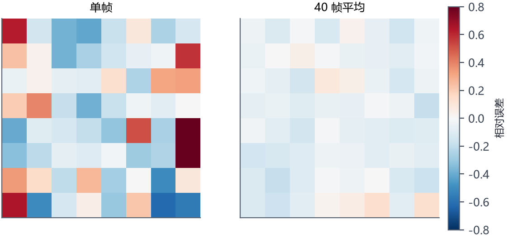
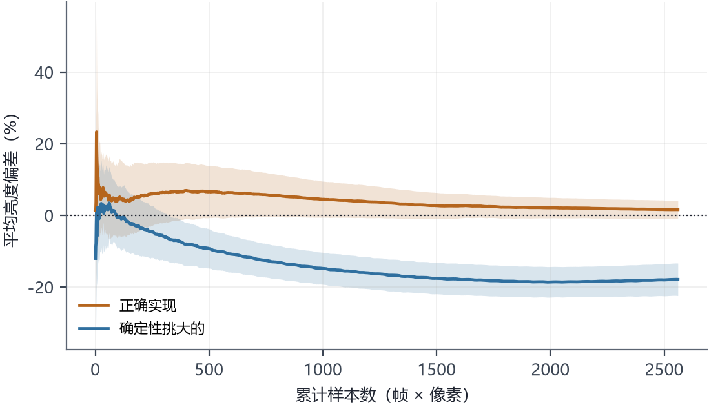

# 第 14 章 验证与调试

## 14.1 单帧看不出来的东西

把 ReSTIR 接进去之后，最危险的 bug 是那些"看起来更好"的 bug。第 7 章那个确定性挑大的实现，噪声比正确版本低 18%，图像更干净——如果只看一帧，它像是优化。

判断一个实现对不对，需要三类测量：偏差、方差、结构。偏差问期望对不对，方差问波动多大，结构问误差在空间与时间上怎么分布。三者对应三种不同的工具：长序列均值、多种子重复、误差图。

这一章把这三类测量写成一套可以照着跑的流程，包括它们的统计精度与常见陷阱。需要强调的前提是：所有测量都要在线性空间、在着色值上做，不要经过色调映射。

在开始之前，先说清楚"真值"从哪来。三条路。第一条是解析：单灯、单面、单遮挡体的场景可以直接算出辐照度。第二条是大规模采样：同一个实现跑 10 万条光线，把它当作真值，代价是慢但可靠。第三条是朴素实现：故意写一个又慢又简单的版本（每像素几千条独立光线，不做任何复用），用它做对照。

第三条最实用，因为它同时验证了"复用有没有引入错误"这个问题：朴素版本没有复用，它不会因为复用而错。代价是它自己也可能有 bug，所以通常与第一条配合使用。

## 14.2 误差图：方差与偏差在空间上不同

图 14-1 左边是单帧的相对误差，标准差 0.322；右边是 40 帧的平均，标准差 0.069。平均之后，逐像素的"椒盐"被压掉了，剩下的是一片一片的低频残留——那些残留就是偏差或者强相关的误差。

这张图的用法很直接，也很容易被做错：如果平均图上有明显的结构，某个区域系统性偏亮或偏暗，那就是偏差；如果平均图接近均匀的灰，而单帧图很花，那就是方差。两者的处理完全不同：偏差要改代码，方差要加样本或者交给降噪器。

一个常见的误判是把"低频噪声"当成偏差。某些误差是时间相关的（比如某个像素的蓄水池长期被同一个样本占据），它们在 40 帧里不会被平均掉，看起来像偏差。区分的办法是换一批随机种子重跑：偏差在换种子后仍在同一位置、同一方向；相关噪声会换位置。

误差图还有一个变体：把误差按"候选数"分箱画。如果误差随 $M$ 单调下降，说明噪声来自候选不足；如果不随 $M$ 变化，说明噪声来自单次可见性查询；如果误差在某个 $M$ 处突然变大，说明那里有记账的不连续（第 13 章 §13.7 提到的那种）。这张图不需要真值就能画——用相邻帧之差当噪声的代理即可，它也是调试现场最常用的一张图。

## 14.3 长序列均值

图 14-2 是这类测量里最有用的一个：把所有像素、所有帧的估计值加起来，除以真值之和，看它随样本数怎么变。正确实现收敛到 $+1.6\%$，错误实现收敛到 $-19\%$。

这条曲线的前几百个样本很抖，因为第一帧没有历史、噪声大。随着样本数增加，噪声按 $1/\sqrt{n}$ 下降，曲线变平；如果它停在某个非零值上，那个值就是偏差。

两个细节决定这个测试的有效性，也决定了别人能不能复现你的结论。第一，**像素必须独立**：如果所有像素共享随机数，样本数增加不会让噪声下降，曲线会一直抖。第二，**真值必须准**：这里的真值是对同一个玩具场景直接求和得到的，不是另一个渲染器算的。用另一个渲染器做真值，两个渲染器的近似会混在一起，测出来的"偏差"可能是两者的差。

图 14-1 里还有一个值得注意的细节：单帧误差的标准差是 0.322，而 40 帧平均之后还有 0.069。按 $1/\sqrt{n}$ 的关系，40 帧应该降到 $0.322/\sqrt{40}=0.051$。实际是 0.069，比理论值高 35%。多出来的部分就是"时间相关的误差"——相邻帧的误差不完全独立，所以平均的收益打折。

这个可比性很重要：如果实测的下降速度明显慢于 $1/\sqrt{n}$，说明时间复用引入了相关性；如果明显快于，说明有东西在不该被平均的地方被平均了（比如把不同像素的真值混在一起算）。

## 14.4 白炉测试

白炉测试（white furnace test）是渲染里的经典手段：把场景做成一个均匀发光的球体内部，理论上任意方向的辐射亮度都相等，渲染结果应当处处等于那个常数。它能在不看图像的情况下判断能量是否守恒。

ReSTIR 版本的白炉测试要稍微改一下：把所有灯换成同一个常数、把所有表面换成同一个漫反射、把可见性设成恒 1。这时每个像素的真值相同，蓄水池的估计应当收敛到这个常数。任何偏差——比如候选数记账错误、权重归一化错误——都会让结果偏离。

这个测试的好处是它不需要任何真值计算：真值就是那个常数，连积分都不用做。坏处是它只测"平均能量"，测不出"分布对不对"。所以它通常与长序列均值配合使用：白炉测试先排除尺度错误，长序列均值再排除细节错误。

还有一个测试专门针对"密度对不对"，叫**权重和测试**。做法是让目标函数等于候选密度（$\hat p=p$），这时每个候选的权重都是 1，权重和应当严格等于 $M$，估计量应当等于 $f(y)$ 的均值。这个恒等式在实现里可以用断言检查，任何密度参数化的错误（比如换域时漏了雅可比）都会让它立刻失败。

通道测试是另一个便宜的手段。让场景只包含一盏红灯，看输出的三个通道里是否只有红色通道非零。这条测试能抓出"把不同通道的蓄水池混在一起"的错误——这种错误会让颜色偏移，而在灰色场景里完全看不出来。

## 14.5 支持条件与零权重

第 7 章说过，$\hat p(x)>0$ 必须在 $f(x)\neq 0$ 处成立。这个条件被破坏时，估计偏小，偏的幅度等于漏掉的那部分能量。测试它的办法是构造一个"只有一盏灯"的场景：如果实现正确，单灯场景的结果应当与解析解一致；如果某处漏掉了这盏灯（比如剔除规则把它排除了），结果会偏小。

单灯测试的价值在于它的解析解容易写。单灯 + 漫反射面 + 一个遮挡体，可以直接算出着色点的辐照度。把渲染结果与它对比，偏差超过 1% 就说明有问题。

白炉测试还有一个变种专门测可见性：把所有表面做成完全吸收（黑色），只留一盏灯照在一个漫反射面上。这时间接光为零，输出应当是纯粹的直接光。任何"借来的样本"如果带着不该有的能量，会在这里显形——它会把间接光漏进一个本该没有间接光的场景。这是路径复用最常见的漏光测试。

还有第三个变种测时间：让相机静止不动、场景也静止，跑几百帧。理论上每一帧的估计都在真值附近抖动，均值稳定。如果均值随帧缓慢漂移，说明历史里有东西在累积——最常见的是权重和每次合并都乘了一个不该乘的因子，几十帧后把它放大成了可见的漂移。

## 14.6 统计精度：跑多少次才够

一个实测的数字：12 个种子、24 帧、64 个像素时，相对标准差的统计误差约 0.005（相对于 0.33 的均值），而偏差的统计误差约 2 到 3 个百分点。

这两个数字决定了什么能被测出来。0.005 的精度足够区分"0.31 与 0.38"这种差异；2% 的偏差精度不足以区分"偏差 1% 与偏差 3%"。所以：

- 比较方差：12 个种子够用；
- 判断有没有偏差：需要至少几十个种子，或者把帧数与像素数加大；
- 判断偏差的量级（比如千分之一）：需要上百万个样本。

第 6 章 §6.6 那个"单点近似带来的偏差是 $O(1/M)$"的结论，就是在百万级样本下才测出来的；在第 5 章那个规模下，它落在噪声里。

流程里还有一件事没写进去，就是记录。每一次测量都要把配置、种子、样本数、以及得到的量写进一个文件，否则过两周就无法复现在图上看到的那个尖峰。这件事听起来琐碎，但它是能不能定位回归的分界线：有记录的人能说清"上次这个数是 0.33"，没有的人只能重跑一遍再猜。

三类测量的成本差别很大，值得排一下序。白炉测试与单灯测试各几秒，几乎免费；长序列均值要几十秒；误差图要跑两种规模（单帧与多帧平均），也要几十秒；参数扰动是前面每一项乘以 10。所以日常开发里跑前两项做快速回归，提交之前跑前三项，发版之前跑全套。

这个排序还有一个好处：前两项能在没有额外真值的情况下发现问题。白炉测试的真值是一个常数，单灯测试的真值是解析式，都不需要额外的渲染器。这也是为什么它们适合做单元测试——可以自动化，可以在每次提交时跑。

## 14.7 一份可以照着跑的流程

把上面的东西串起来，得到一个六步的流程。每一步都只需要几百行脚本，跑起来几秒到几分钟。

**第一步，白炉测试。** 常数场景，检查估计是否收敛到常数，偏差应小于 0.5%。这一步排除尺度错误。

**第二步，单灯解析解。** 一盏灯、一个遮挡体，结果与解析解对比。这一步排除支持条件与可见性相关的错误。

**第三步，长序列均值。** 正常场景，跑 40 帧、12 个种子，看累计均值是否收敛到真值。这一步暴露所有非零偏差。

**第四步，误差图。** 单帧与 40 帧平均各一张，看误差的空间结构。这一步区分方差与偏差。

**第五步，参数扰动。** 把 $M_0$、上限、半径各改一档，看偏差是否跟着变。偏差随参数变化说明记账有问题；偏差不随参数变化说明是结构性的。

**第六步，换种子。** 同一配置换一批种子重跑，看误差图是否"换了位置"。换了是噪声，没换是偏差。

误差图还有一种用法：把两张不同参数的误差图相减。相减之后，共同的偏差被消掉，只剩参数改动带来的差异。这在评估"某个优化有没有用"时特别有效，因为它天然过滤掉了"两边都有的误差"。

## 14.8 三个容易踩的坑

**用图像差做真值。** 把 ReSTIR 的结果与一个已经"确认正确"的路径追踪器做逐像素差，这个差里混着两个渲染器的所有差异：采样策略、滤波、色调映射。用它当误差会被误导。真值应当来自解析解或者同一渲染器的极大规模采样。

**在色调映射之后比。** 色调映射是非线性的，会把偏差压缩、把噪声放大，两者混在一起。所有比较都应该在线性空间、在着色值上做。

**只跑一帧。** 一帧的统计量里噪声占绝对多数，任何结论都可能是噪声。至少要跑几十帧，并且把种子也当作一个维度。

---

验证的三件工具——误差图、长序列均值、白炉测试——分别对应空间结构、期望、尺度三件事，再加上单灯解析解、权重和恒等式、通道测试这三个便宜的自检，构成了一个能覆盖大部分错误的组合。它们的共同点是都不需要一张好看的图：判断标准是一个数或者一个恒等式，而不是视觉印象。它们的共同前提是"有一个可信的真值"，而这个前提在真实场景里往往不成立。这也是为什么书里的实验都在玩具场景里做：不是因为玩具更简单，而是因为玩具能给出精确的真值，而精确的真值是判断"偏差还是噪声"的唯一依据。

下一章离开这本册子的技术范围，看看这些方法在生产里被用到了什么程度：SIGGRAPH 2025 的实时渲染课程报告里，哪些做法已经从论文走进了引擎，以及它们在工程上留下了哪些新问题。
