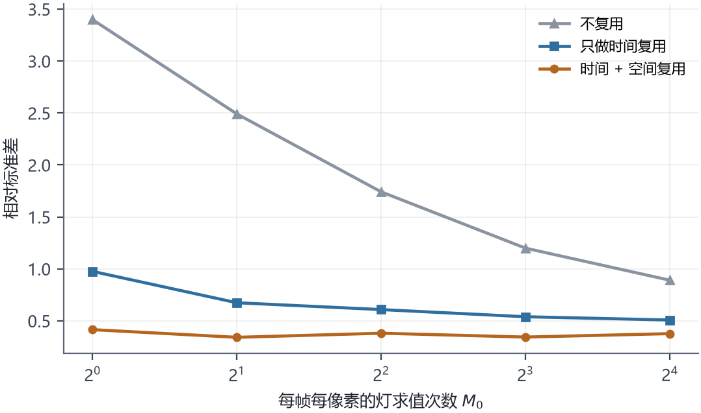
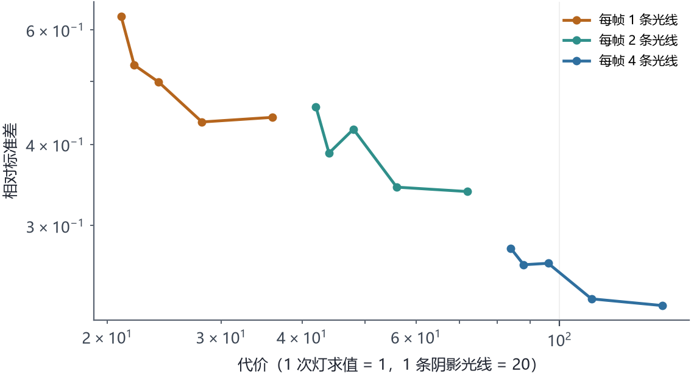

# 第 15 章 SIGGRAPH 2025 的生产现状

## 15.1 从论文到引擎

这本书讲的方法在 2020 年前后成形，五年之后它们出现在商业引擎里，成为随机直接光这个方向的基础设施。2025 年 SIGGRAPH 的实时渲染课程（Advances in Real-Time Rendering in Games）里，随机直接光已经是一个常规话题：不再讨论"要不要用重采样"，而是讨论"在多少盏灯、多少光线预算下，怎么把重采样和降噪接起来"。

这一章讲生产落地的现状。能核实的内容写成陈述，不能核实的内容明确标出，并且说明为什么标出。这么做不是因为谨慎，而是因为生产实现里的很多选择与具体引擎、具体硬件绑定，把它们写成"通用做法"会误导后来的人。

灯的数量增长还有第二个后果：**光源加速结构本身成为开销**。几千盏灯意味着遍历光源树、算包围盒、维护每帧的更新，这些都要时间。重采样能省的是"每盏灯的求值次数"，省不掉"找到哪些灯可能相关"这件事。所以生产的实现里，光源的统一管理与空间加速和随机采样是配套出现的——只做其中一半，收益会打对折。

## 15.2 问题形态变了

第 1 章的模型是"一百盏灯照一个点，随机挑一盏"。生产的形态是"几千盏灯照一个场景，每个像素被其中几盏照到"。

这两个模型的差别不在数量，在重要性的分布：有多少盏灯真的对某个像素有贡献，以及这个数量与总数之比。一百盏灯里如果有十盏重要，均匀采样命中率是 10%；几千盏灯里如果只有三盏重要，命中率是 0.1%。后者的方差是前者的百倍，而且灯越多越糟。这就是为什么把灯变多，在旧的采样方式下是线性变差，而在重采样下几乎不变。

图 15-1 是我们那个玩具场景在 256 盏灯下的结果。不复用时，每帧的灯求值次数从 1 加到 16，相对标准差从 3.40 降到 0.89；加时间复用，$M_0=1$ 就是 0.98，加到 16 是 0.51；再加空间复用，$M_0=1$ 就是 0.42，之后基本不动。

这张图说明了生产方案为什么长成现在这样：**像素级的光线预算是个位数，靠的是把候选数从时间与空间里"借"回来**。如果一个像素每帧只能问一盏灯，那么蓄水池与复用不是优化，而是唯一可行的路。

在讨论具体方案之前，先把"生产"这个词的范围划清楚。这里说的生产指实时渲染引擎与游戏，帧预算 16 毫秒左右，光线预算是每像素个位数。离线渲染里的重采样（比如路径引导里的样本复用）目标不同：光线便宜、内存宽松、追求的是收敛速度而不是帧率。本书的方法两边都能用，但权衡完全不同——第 4 章那张代价图已经说明了这一点，光线越贵，重采样越划算。

## 15.3 生产方案的三层结构

把公开的课程报告与厂商演讲里的描述归纳起来，随机直接光的方案大致分三层。

**第一层是采样。** 每个像素每帧抽少量灯光样本（一到几个候选），用目标函数挑一个，做一次可见性查询。目标函数通常包含距离衰减、灯面法线、以及某种"这盏灯对这个点是否重要"的粗判据。这一层对应第 4 章的 RIS。

**第二层是复用。** 时间上继承上一帧的蓄水池，空间上从邻域借。借的时候按目标函数之比换算，撞到上限就缩。这一层对应第 5 章的 ReSTIR DI。

**第三层是降噪。** ReSTIR 的输出仍然是单样本、带噪声的，必须交给时域与空域滤波器。滤波器的输入除了颜色，还有本书第 12 章提到的那些量（候选数、权重和、可见性标志），用来判断"这个像素有多可信"。这一层不在本书范围内，但它是把 0.35 的相对标准差变成"看起来干净"的必要环节。

三层之间的耦合是工程难点，也是这一章能说的与实际能看到的差距最大的地方。样本数太少，降噪器需要更大的窗口；窗口大，细节被抹掉，边缘出现拖影；为了压拖影，提高样本数，帧预算又不够。参数不是独立可调的，调一个必然牵动另外两个。

第三层里还有一个与本书相关但没展开的量：**样本的"年龄"**。降噪器需要知道一个像素的样本是"这一帧刚抽的"还是"从几十帧前继承来的"，因为两者的可信度不同。生产实现通常把候选数与一个粗略的帧龄一起传给滤波器；帧龄大、候选多的像素被视为稳定，允许更强的时域累积。这个信息在本书的模型里对应蓄水池的 $M$ 与上限之比，但公开的材料里各家用的具体形式不同。

## 15.4 MegaLights 与"随机直接光"的位置

2025 年的课程报告与厂商技术演讲里，NVIDIA 的 MegaLights 是被提到最多的一个具体方案。它在 Unreal Engine 里的定位是"让场景可以有大量动态灯"，做法是把直接光从"每盏灯都算"改成"每像素随机取少量灯、再用时空方法把结果稳定下来"。这与本书第 5 章的结构一致：随机采样、候选选择、时间与空间复用、去噪。

能核实的是这个轮廓：随机化 + 重采样 + 时空滤波，目标是"灯的数量不再受前向渲染的瓶颈限制"。不能核实的是实现细节——每像素的候选数、蓄水池的字段布局、与具体降噪器的接口、以及硬件上的调度策略。这些在不同的演示与不同的版本里都可能不同，写进书里会很快过时，也容易被误当成"标准做法"。

需要提醒的是，这类方案在宣传材料里强调的"支持多少盏灯"是一个场景相关的数字：它取决于灯的影响范围、重叠程度、以及画面里有多少像素同时被很多灯照到。同一个方案在"几百盏聚光灯照一个广场"与"几千盏小灯照一条走廊"下的表现可以差一个数量级。读这类数字时，先问清楚场景，再问清楚这个数字是在多少毫秒的帧预算下得到的。

这几条之外，还有一条"不能省"但很难写进规范的：**调试工具**。一个随机直接光的渲染器如果不能在运行时显示"每个像素的候选数""这一帧有多少样本被判为无效""历史平均存活了多少帧"，调参就只能靠猜。第 14 章那套测量在离线的小场景里跑，生产的可视化在真实的场景里跑，两者互补：前者告诉你"对不对"，后者告诉你"哪里不对"。

## 15.5 哪些做法被证明是必须的

从公开材料与工程实践里能归纳出几条"不能省"的做法，它们与本书的推导一致。

**目标函数必须便宜且连续。** 生产的实现不会用"含可见性的真实贡献"做目标函数，因为那需要阴影光线。它们用一个连续的无阴影近似，代价是方差，收益是可以在候选上反复求值。

**候选数上限必须存在。** 没有上限，空间复用会在第一帧把蓄水池塞满，之后新样本进不来，画面"冻住"。这一点在第 5 章与第 8 章都验证过。

**可见性复用的用法要分清。** 用它验证"借来的样本在我这里还成不成立"是安全的；用它筛掉"我自己的样本"会引入偏差。生产实现里两种用法都存在，前者更常见。

**降噪器要与采样器共享信息。** 只给颜色的降噪器无法区分"这里本来就暗"与"这里样本被挡住了"。把候选数、方差估计一起传过去，滤波器的行为会稳定得多。

分配还有一个维度：**同一帧内不同像素的预算**。第 13 章讨论过按方差分配候选数，生产里的做法更粗：按"这个像素被多少盏灯照到"分层。被几十盏灯照到的像素（比如站在一群灯中间）给更多候选，只被一盏灯照到的给一个就够。这个分层可以用光源加速结构的遍历结果顺便得到，几乎不额外花钱。

## 15.6 代价的分配

图 15-2 是分配的实测。三条曲线对应每帧 1、2、4 条阴影光线，横轴是折算后的总代价。每帧 1 条光线时，候选数从 1 加到 8，相对标准差从 0.63 降到 0.43，之后饱和；每帧 4 条光线时能到 0.23，代价是四倍。

这个形状解释了生产里的一个常见取舍：**先加光线，还是先加候选**。在候选数还没饱和的那一段，加候选便宜（一次灯求值 vs 一条光线，差二十倍）；饱和之后，加候选没有收益，只能加光线。这个拐点的位置与灯的数量无关，与每帧的光线预算有关。判断"饱和没饱和"的办法就是画这条曲线，看它有没有拐平。

还有一个问题在公开讨论里出现得越来越多：**评测**。生产方案的效果很难用单一数字衡量，因为它同时改变噪声、细节保留、时间稳定性与延迟。业界常见的做法是列一组场景（室内、室外、夜景、大量小灯），每个场景给人看一段视频并打分；这套方法有效，但不可复现。本书第 14 章那套测量能给出可复现的数字，只是它需要一个可控的玩具场景，而玩具场景的结论不能直接搬到生产。

## 15.7 还没解决的问题

公开材料里能看到的问题，大致有三个，它们都与帧预算有关。

**运动时的稳定性。** 时间复用让静止画面干净，但物体一动，历史样本的几何就对不上。第 8 章测过：上限加大能降噪声，但对"帧间变化幅度"几乎没影响（0.271 对 0.239）。生产方案普遍靠"运动向量 + 深度差"判断历史是否有效，这个判断本身在边界处会抖动。

**半影与接触阴影。** 单条阴影光线的估计在半影里方差最大，而降噪器最容易在这里把阴影"抹平"。可见性复用能压一部分方差，代价是偏差。两者的平衡没有一个普适的参数，只能按场景调。

**多光源类型混合。** 点光、面光、聚光、以及带 IES 剖面的灯，目标函数的形状不同，方差也不同。把它们放进同一个蓄水池时，"份额"怎么分没有理论上的最优解——第 11 章的 GRIS 给出的是无偏的条件，不是最优的条件。

## 15.8 这一册到此为止

回到书的开头：一个着色点被一百盏灯照着，一条阴影光线只能问其中一盏。这本书给出的答案是"记住问过的那一盏，以及它是怎么被问出来的"，然后让这个记忆在像素之间、帧之间、路径之间流动。

流动的代价是每一处都要保证"权重与密度的关系没有被破坏"。第 2 章的权重和为一、第 4 章的 $M$ 记账、第 6 章的重新评估、第 9 章的雅可比、第 11 章的五个量——它们其实是同一条约束在不同场景下的写法。理解了这条约束，剩下的都是工程。

生产落地把这条约束推到了更复杂的场景：几千盏灯、动态几何、与降噪器紧耦合。方法在变，约束没变。判断一个新方案值不值得用，仍然可以先问三个问题：它的样本来自哪个分布，它的权重怎么换算，它的候选数怎么记。三个问题答不上来的方案，跑起来大概率会在某个运动镜头里露出偏差——而那个镜头往往不在演示视频里。

---

这一册讲的是"用重采样把有限的光线预算花在刀刃上"。它没有讲降噪、没有讲采样器的硬件实现、也没有讲如何把这些方法接到具体的引擎里。那些是另外几册的事。这里留下的是一组可以自己验证的式子与实验：任何实现，只要能在 64 盏灯的玩具场景里把偏差测到千分之一，就已经比大多数看起来对的实现更可靠。这件事没有捷径，但它有一个好处——一旦做过一次，以后遇到任何新的复用方案，都知道该从哪里下手检查。
