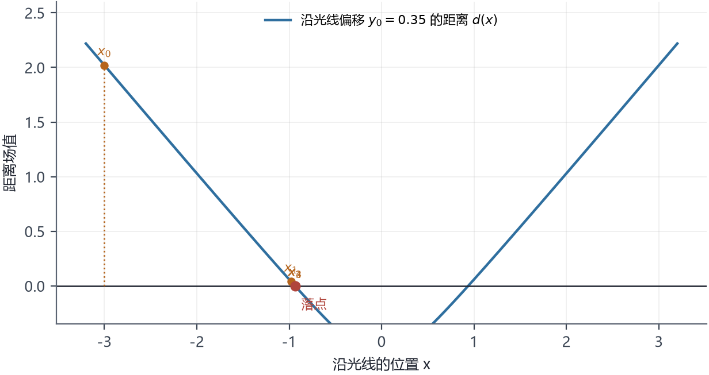
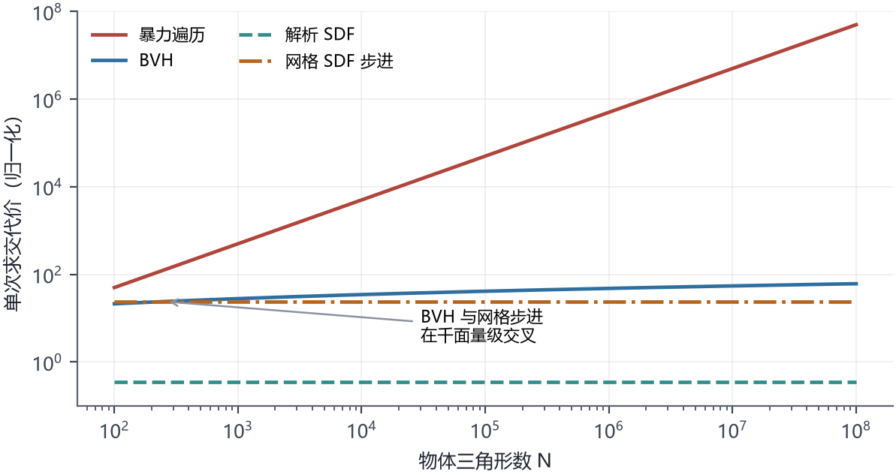
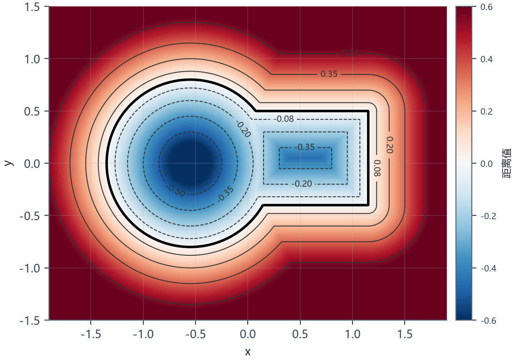

# 第 1 章 从几何到函数

## 1.1 一个球需要多少三角形

在场景里放一个半径一米的球，要它看起来圆，轮廓上不能有折线。1080 行的画面，垂直视场 60 度，在一米距离处一个像素覆盖约 1.1 毫米，球在屏幕上的直径接近 1000 像素。要让折线小于一个像素，相邻三角形的法线夹角不能超过约 0.1 度，球面一共需要二十万个三角形。

球是最好说话的形状。换成一张雕花的桌面，几百万个三角形也只是勉强。这些三角形还要建 BVH，每个节点两个包围盒加两个索引，四十八字节，把内存翻上几倍。构建一次要几秒，物体一动就要重建。

渲染器为这件事付出的代价，在光照阶段还要再付一遍。软阴影要从着色点向光源方向发几条、几十条光线；环境光遮蔽要在半球上撒几十条；一次弹射的全局光照还要更多。每条光线都要在 BVH 里从上往下走一遍，每一层做一次射线与盒的测试。一个像素几十条光线，一帧就是几亿次遍历。

问题不在于 BVH 不够快。问题在于这些光线里有大量是"这条路上有没有东西"这样的问题，而 BVH 为了回答它，必须把几何的细节一层层展开。距离场给出的答案是另一个形状：它不告诉你哪里有三角形，它告诉你每个位置离最近的表面有多远。有了这个数，一条光线的行进方式就变了。

## 1.2 求交变成求零点

设场景的表面是集合 $S$，定义

$$d(\mathbf{p})=\operatorname{sign}(\mathbf{p})\cdot\min_{\mathbf{s}\in S}\lVert \mathbf{p}-\mathbf{s}\rVert , \tag{1.1}$$

符号在内部取负，外部取正。这个函数叫有符号距离函数（signed distance function，SDF）。表面的位置就是 $d=0$ 的等值面，求交于是变成求一条直线上这个函数的零点。

零点可以迭代找。设光线起点 $\mathbf{o}$，方向 $\mathbf{u}$，当前参数 $t$。如果 $d(\mathbf{o}+t\mathbf{u})=v$，那么以这一点为心、半径 $v$ 的球整个落在表面的一侧，球内不可能有表面。于是可以安全地把 $t$ 推进 $v$，一步跨过一整段没有表面的区间。

这个论证有一个前提，就是 $v$ 确实是到最近表面的距离，而不是别的东西。只要这个前提成立，迭代就永远不会跨过表面，最终落在表面上。图 1-1 画了一条偏移光线上的情形：距离曲线是双曲线状的一条谷，每次落点都取当前高度作为水平步长，落点一路逼近谷底，四步之内误差就降到千分之一。



对应的代码只有几行：

```python
import numpy as np

def sphere_sdf(p, c, r):
    return np.linalg.norm(p - c) - r

def march(o, u, f, tmax=10.0, eps=1e-3):
    t = 0.0
    for _ in range(256):
        d = f(o + t * u)
        if d < eps:
            return t
        t += d
        if t > tmax:
            break
    return None
```

这段代码假定 $f$ 是精确距离场。第 2 章会给出这个假定的严格形式，第 9 章会说明当它不成立时会发生什么。现在只需要注意一件事：步长取距离值，而不是取距离值乘某个经验系数，是因为距离值本身就是"到最近表面"的证据，乘系数只会让步数变多，不会让结果更安全。

代价换了一个方向。BVH 的代价随三角形数增长，距离场的代价随步数增长，而步数取决于光线穿过场景时的几何形状，与三角形数无关。一个两百万面的雕像和一个二十面的盒子，在距离场里查询一次都只是一次公式求值。



图 1-2 把四种做法的代价画在一起。四条曲线里，解析 SDF 和网格 SDF 都是水平线，这是距离场最重要的性质：查询代价与场景复杂度解耦。代价是它必须提前把场景变成一个函数，而这一步的构建成本在图上没有体现。第 15 章会算这笔账。

## 1.3 布尔运算变成取最小值

第二个变化更彻底。设两个物体分别由 $d_1$、$d_2$ 定义，它们的并集是

$$d_{\cup}(\mathbf{p})=\min\big(d_1(\mathbf{p}),\,d_2(\mathbf{p})\big) , \tag{1.2}$$

交集是 $\max$，差集是 $\max(d_1,-d_2)$。三个运算都是逐点的比较，没有拓扑，没有接缝，没有重新三角化。

推导在 2.2 节，这里先用一个例子说明它的分量。两个球粘在一起，接缝处的轮廓在网格里是一条折线或者一圈补出来的面片，法线在那里不连续；而公式 (1.2) 给出的场在两球交界处是精确的，法线在交界两侧各自连续，交界线本身是一条尖锐的棱。想要圆角，把 $\min$ 换成第 6 章的平滑最小值，接缝变成一段圆弧。

图 1-3 是一个圆与一个盒子的并集。黑色粗线是零等值面，其余曲线是等值线，颜色是距离值。注意两件事。等值线在物体外部是同心的一圈圈，间距均匀，说明梯度长度恒为一；在物体内部则出现了不规则的形状，尤其在盒子内部，等值线是矩形的层层内缩，而不是圆形。这不是画错了，是并集的距离场在内部确实不再是到边界的最短距离，因为内部还保留着被吞掉的那个形状的边界。第 5 章会说明这个"不精确"对渲染通常无害，对碰撞检测有害。



## 1.4 同一个数，三种用法

距离值是一个带有方向信息的数，它在三个地方都有直接用处。

**渲染。** 步长、遮挡、模糊半径。软阴影的估计用"从着色点向光源走，路上最小的距离值"来衡量遮挡的程度，最小的距离越小、离光源越近，半影越窄。环境光遮蔽用沿法线方向若干个距离值来近似半球积分。这两个做法在第 11 章，它们的共同点是都只需要距离值，不需要任何表面参数。

**碰撞。** 距离值就是穿透深度，梯度就是推出方向。两个物体相交时，把它们的距离场相加，和小于零的区域就是重叠区，重叠区里和的最小值点是最深穿透点。这一套在物理引擎和布料自碰撞里用得很广，因为查询一次是常数代价，且天然给出连续的距离，不需要处理接触点的拓扑。

**建模。** 一个曲面沿法线向外偏移 $r$，只需要把场减去 $r$，也就是 $d(\mathbf{p})-r$。向内偏移是加 $r$。这个操作在网格上要重算所有顶点的偏移位置并处理自交，在距离场里是一次减法。同理，圆角是把场减去圆角半径，壳体是取绝对值再减厚度。第 8 章讲这三种算子。

三处用法有一个共同要求：函数必须真的是距离，或者至少梯度长度不超过一。碰撞对这一点最敏感，因为穿透深度小一个因子就意味着物体陷进去；渲染稍宽松，因为步长保守一点只是慢，但第 9 章会看到，宽松到某个程度就会穿模。这就是为什么第 2 章要花一整章讲这件事。

## 1.5 换掉了什么

距离场不是免费的午餐，它换掉的东西值得说清楚。

纹理坐标没有了。网格上每个顶点带 UV，插值就有纹理坐标；距离场里没有参数化，贴图只能靠三平面投影，接缝和拉伸都要单独处理。

锐利的边缘变贵了。两个盒子的并集在棱上是精确的，因为 $\min$ 不改变函数值，但一旦做了平滑，棱就变成圆弧，参数不能取零。想要又锐利又平滑，标量场本身不够用。

薄结构变糊了。一堵两厘米的隔断，场在两侧都是一厘米，梯度在中轴面上没有定义，法线在那里是噪的。求交还能做，着色会出问题。

细节的存储效率不高。一个雕花表面，网格只在表面存数据，距离场要在表面附近的一层体素里存，体素数正比于面积除以分辨率的平方。同样的细节，距离场的内存通常大一个数量级。第 15 章的所有结构都是为这件事设计的。

---

这一章说明了为什么要换。距离场把求交变成求零点，把布尔变成取最小值，把偏移变成减法，代价是查询与场景复杂度解耦之后，构建成本、内存和若干几何细节被换了出去。图 1-1 里那条 45 度的切线是整个方法的支点，它成立的条件是函数值等于到最近表面的距离。

下一章把这个条件写成数学，并给出一个判据，用来检查一个随手写出来的函数能不能安全地用于步进。
