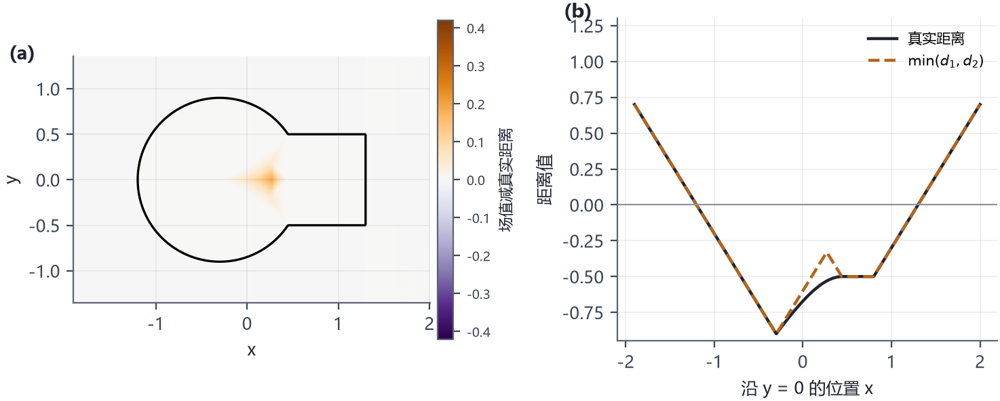
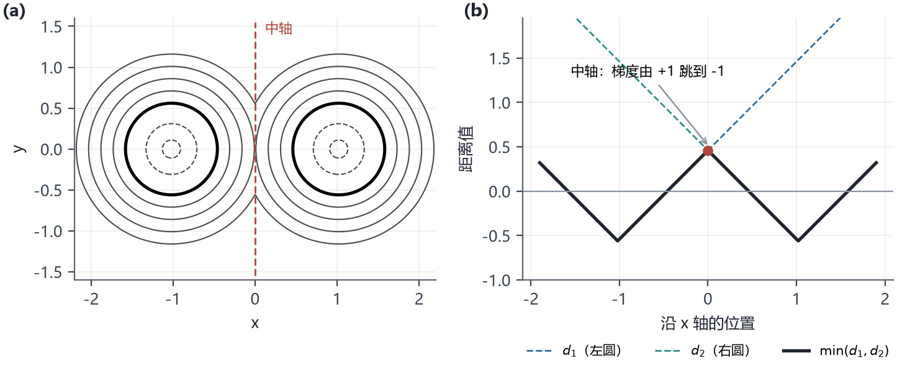
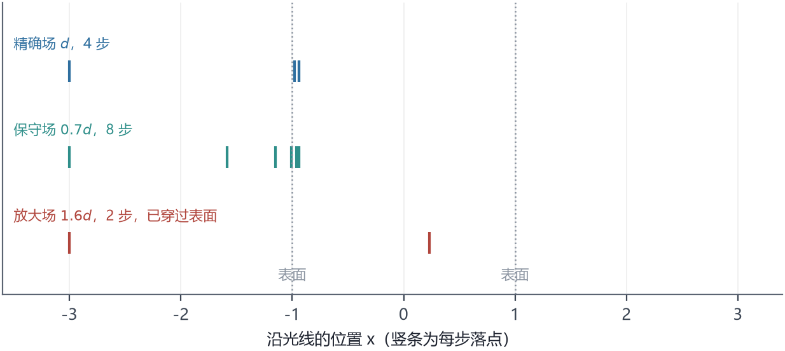

# 第 2 章 有符号距离的定义与性质

## 2.1 一个梯度恒为一、却不是距离的函数

先看一个反例。两个圆，圆心在 $\pm1.02$，半径 $0.56$，取并集

$$f(\mathbf{p})=\min\big(\lVert\mathbf{p}-\mathbf{c}_1\rVert-r,\ \lVert\mathbf{p}-\mathbf{c}_2\rVert-r\big) . \tag{2.1}$$

这个函数在物体外部等于到并集边界的真实距离，在内部不等于。它处处连续，梯度长度处处不超过一，看上去完全合格。用它做光线步进不会穿模，因为步长总是不大于真实距离。

再看一个不合格的例子。把一个椭球写成"球的公式换个坐标"

$$g(\mathbf{p})=\frac{\lVert \mathbf{p}/\mathbf{a}\rVert-1}{\lVert \mathbf{p}/\mathbf{a}\rVert}\,\lVert\mathbf{p}\rVert \tag{2.2}$$

这个式子在长轴方向高估距离，梯度长度在某些方向大于一。用它步进会在长轴附近一步跨过表面。

两个函数都长得像距离，一个能用，一个不能用。判据是什么？这一章回答这个问题。答案不是"看起来像"，而是两条可以检验的性质，以及一条关于"哪里必须精确"的要求。

## 2.2 定义

设 $S\subset\mathbb{R}^3$ 是一张封闭的分片光滑曲面，$\Omega$ 是它围住的内部。有符号距离函数定义为

$$d(\mathbf{p})=\begin{cases}+\ \mathrm{dist}(\mathbf{p},S), & \mathbf{p}\notin\Omega,\\[2pt] -\ \mathrm{dist}(\mathbf{p},S), & \mathbf{p}\in\Omega,\end{cases} \tag{2.3}$$

其中 $\mathrm{dist}(\mathbf{p},S)=\min_{\mathbf{s}\in S}\lVert\mathbf{p}-\mathbf{s}\rVert$。符号约定内外相反也常见，这本书里内部一律取负，因为内部深度用负数表示时，"穿透深度"就是 $-d$，不需要额外取绝对值。

有两个点需要说明。

第一，$\mathrm{dist}$ 的最小值一定取到，因为 $S$ 是闭集。取到最小值的点叫最近点，可能不唯一。最近点唯一时，记作 $\mathbf{s}^*$，有

$$\mathbf{s}^*=\mathbf{p}-d(\mathbf{p})\,\nabla d(\mathbf{p}) , \tag{2.4}$$

因为从 $\mathbf{p}$ 沿最短路径走到 $\mathbf{s}^*$ 的方向正是距离增加最快的反方向。这个式子在第 4 章会反复用到，它是法线、投影、排斥力的共同来源。

第二，$d$ 在 $\Omega$ 内部是负的，但它的绝对值不是"到表面的距离"以外的任何东西。有的实现把内部写成 $-1$ 或者干脆不写，只存到表面的无符号距离，再用一个位图标记内外。这在存储上是省了，在运算上把符号变成了特例，第 9 章会看到这类实现为什么在布尔运算上很容易出错。

## 2.3 1-Lipschitz

第一条性质是 Lipschitz 连续性。对任意两点 $\mathbf{p},\mathbf{q}$，设 $\mathbf{q}$ 的最近点是 $\mathbf{s}^*$，则

$$d(\mathbf{p})-d(\mathbf{q})\le \lVert\mathbf{p}-\mathbf{s}^*\rVert-\lVert\mathbf{q}-\mathbf{s}^*\rVert\le\lVert\mathbf{p}-\mathbf{q}\rVert , \tag{2.5}$$

第一个不等号用了 $d(\mathbf{p})\le\lVert\mathbf{p}-\mathbf{s}^*\rVert$，因为 $\mathbf{s}^*$ 属于 $S$，而 $d(\mathbf{p})$ 是到整个 $S$ 的最小值；第二个不等号是三角不等式。交换 $\mathbf{p}$ 与 $\mathbf{q}$ 得到反向的界，合起来

$$\lvert d(\mathbf{p})-d(\mathbf{q})\rvert\le\lVert\mathbf{p}-\mathbf{q}\rVert . \tag{2.6}$$

这就是 1-Lipschitz。它的意思是距离函数不可能变化得比位置更快，沿任何方向的斜率绝对值都不超过一。注意这个证明对内部的点同样成立，符号没有参与，因为取绝对值之后符号自动消掉。

有了 (2.6)，步进的安全性可以直接推出来。光线从 $\mathbf{o}$ 出发，方向 $\mathbf{u}$ 是单位向量，走过参数 $t$ 之后

$$d(\mathbf{o}+t\mathbf{u})\ge d(\mathbf{o})-t . \tag{2.7}$$

令 $t=d(\mathbf{o})$，右边变成零，说明在 $t=d(\mathbf{o})$ 处函数值非负。函数在起点是正的，在终点也是非负的，如果它在两点之间穿过零，连续函数必然在中间取到零，也就是光线在中间某处已经打在表面上，这与"终点处非负"不矛盾，但说明按 $d(\mathbf{o})$ 步进不会跨过零。

要把这句话说得更严密一点。若光线在 $[0,d(\mathbf{o})]$ 内碰到表面，设首次相交在 $t_0$，那么 $d(\mathbf{o}+t_0\mathbf{u})=0$，代入 (2.7) 得 $0\ge d(\mathbf{o})-t_0$，即 $t_0\ge d(\mathbf{o})$，与 $t_0<d(\mathbf{o})$ 矛盾。所以在这一步之内不可能碰到表面，步进是安全的。

这个结论只用到了 (2.6)，没有用到任何关于形状的信息。这就是为什么距离场的步进算法对任意场景都成立，包括从网格算出来的、带误差的场，只要它满足 1-Lipschitz。

## 2.4 Eikonal 方程

第二条性质是梯度长度恒为一。在 $d$ 可微且最近点唯一的地方，沿任意单位方向 $\mathbf{u}$，函数的方向导数是

$$\frac{\partial d}{\partial \mathbf{u}}=\nabla d\cdot\mathbf{u}=\cos\theta , \tag{2.8}$$

其中 $\theta$ 是 $\mathbf{u}$ 与最近点方向的夹角。最大值在一，取到时 $\mathbf{u}$ 指向最近点，最小值是负一，取到时背向最近点。由于 (2.6) 已经把斜率限制在一以内，(2.8) 说明最大值恰好是一，于是

$$\lVert\nabla d\rVert=1 . \tag{2.9}$$

写成平方形式就是 Eikonal 方程 $\lVert\nabla d\rVert^2=1$，这个名字来自光学里的程函方程，形式相同。

(2.9) 是一条局部条件，它刻画了"距离场沿最短路径传播"这件事。反过来不成立：满足 (2.9) 的连续函数未必是距离场。公式 (2.1) 就是一个例子，在并集内部它满足 (2.9)，因为 $\min$ 在两个精确场的分支上取到，而两支的梯度长度都是一，但它不是到并集边界的距离。

图 2-2 把这件事算了出来，用的还是这种取最小值的构造，只是把一个圆换成了盒子。左边是场值减去真实距离的差，右边是沿中线的剖面。差在外部是零，误差集中在内侧靠近接缝的一小块，那里盒子的边界被圆吞掉了，最近点的位置与两个基本体各自的最近点都不一样，而 $\min$ 只会在两个基本体之间挑一个，挑出来的那个不是最近的。误差量级在这里是 $0.18$，不大，但它是系统性的，不会随分辨率消失。

所以检验一个函数时，$\lVert\nabla d\rVert=1$ 只能当作必要条件。它非常有用，因为神经网络训练、偏微分方程求解、以及在 GPU 上快速判断一个自造的函数是否合格，用的都是这一条；但它不能保证值是对的。真正的判据是值本身，而值只有在少数形状上有解析式，其余场合要么靠构造保证（布尔运算在外部是对的），要么靠数值验证（第 14 章）。

## 2.5 中轴与骨架

最近点不唯一的地方构成集合，叫中轴（medial axis），也叫骨架的连续版本。二维里它是一组曲线，三维里是一组曲面，通常是从边界向内生长的"脊"。

在中轴上，$\nabla d$ 没有定义。理由很直接：从两侧逼近时，最近点分别落在两个不同的边界位置，方向导数有两个不同的极限，一阶导数不存在。图 2-1 的两个圆之间那条竖直线就是中轴，右图沿 x 轴走过中线时，$\min(d_1,d_2)$ 的斜率从 $+1$ 跳到 $-1$，中间没有过渡。

中轴在渲染上的后果有三个。

法线在它附近不稳定。用有限差分算梯度，差分步长 $\epsilon$ 跨过中轴时，得到的是两个方向按长度加权的平均，方向随 $\epsilon$ 变化而漂移。这个现象在第 4 章和第 11 章都会再出现，它是软阴影出条纹、环境光遮蔽出亮斑的一个来源。

曲率在中轴上发散。第 4 章会给出曲率与梯度的关系，分子里有一项 $\lVert\nabla d\rVert$，在中轴附近它趋近于零，曲率趋近于无穷。这意味着任何依赖曲率的着色模型在中轴附近都会给出极端值。

对形状本身没有影响。中轴是场的内在不连续，不是几何的缺陷，求交完全不受影响，因为零等值面离中轴有距离。这就是为什么距离场渲染里"求交对、着色错"的组合很常见。

## 2.6 近表面必须精确

(2.6) 保证了安全，但没有保证效率。把场整体乘上 $0.7$，得到 $0.7d$，它仍然 1-Lipschitz，步进仍然安全，但每步只走真实距离的七成，步数增加到大约 $1/0.7$ 倍，接近表面时收敛速度也慢下来，因为最后几步的步长同样被打折。

乘上 $1.6$ 是另一回事。$1.6d$ 不满足 (2.6)，梯度长度是 $1.6$，步进会跨过表面。图 2-3 把三种情形画在同一条光线上。精确场四步命中；保守场八步命中，位置一样；放大场第二步就落到表面另一侧，步进算法在那里会以为没有交点，或者得到一个符号翻转的错误结果。

一般地，若场满足 $\lVert\nabla f\rVert\le L$，那么它可以当作 $f/L$ 来用，代价是步数乘以 $L$。这个技巧叫保守放大因子，第 9 章会详细讲，包括怎么估 $L$ 以及为什么估小了会出事。

由此得到一条实用要求：在表面附近一到两个步长的范围内，场必须接近精确距离。远处稍微保守没有关系，因为那里的步长大，多走几步也只是一两步的差别；近处稍有高估就出事，因为最后一步的步长很小，跨过的可能正是表面。

这条要求在解析形状上自动满足，但在三种情况下会被破坏。一是域变换，非均匀缩放、扭曲、重复都不保持距离，第 7 章处理。二是平滑运算，第 6 章会看到平滑并集在过渡区的梯度可以小于一，安全但慢。三是从网格重建，采样与插值都会带来误差，误差在表面附近的符号不可控，第 14 章处理。

---

这一章给出了三条结论。距离函数是 1-Lipschitz 的，这一条保证了步进不会跨过表面，也是所有安全性论证的根据。Eikonal 方程 $\lVert\nabla d\rVert=1$ 是必要性条件，满足它不代表值是距离，布尔并集在内部就是一个反例。中轴是梯度不存在的地方，它不影响求交，但会污染法线与曲率。

下一章把常见形状的公式一个个写出来，每一个都从最近点的几何关系推起，而不是直接给结果。
