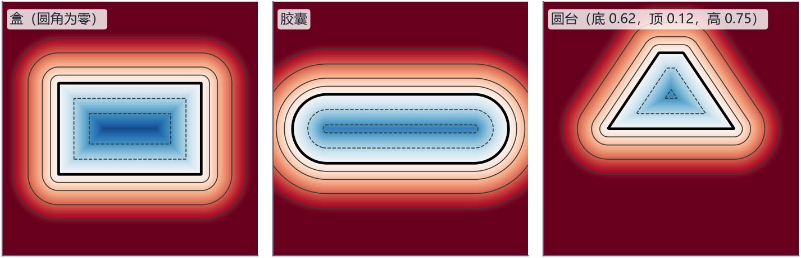
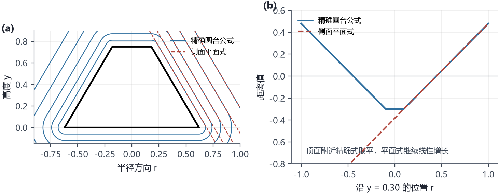
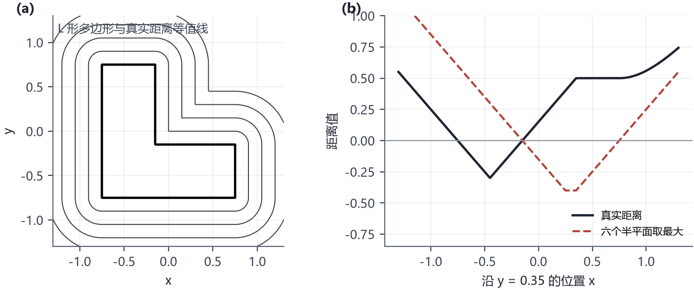

# 第 3 章 常见形状的解析 SDF

## 3.1 一个球的公式藏了什么

球的距离公式人人都会写，

$$d(\mathbf{p})=\lVert\mathbf{p}-\mathbf{c}\rVert-r , \tag{3.1}$$

但很少有人问它为什么这么短。把它当成"距离减半径"来记，就会在盒子上犯错。

推导要回到最近点。设 $\mathbf{p}\neq\mathbf{c}$，球面上离 $\mathbf{p}$ 最近的点一定在 $\mathbf{c}$ 指向 $\mathbf{p}$ 的射线与球面的交点上，因为球面关于球心各向同性，任何一个偏离这条射线的点，沿切向的分量都只会增加距离。把这个点写出来

$$\mathbf{s}^*=\mathbf{c}+r\,\frac{\mathbf{p}-\mathbf{c}}{\lVert\mathbf{p}-\mathbf{c}\rVert} , \tag{3.2}$$

于是

$$\lVert\mathbf{p}-\mathbf{s}^*\rVert=\lVert\mathbf{p}-\mathbf{c}\rVert-r . \tag{3.3}$$

符号由 $\lVert\mathbf{p}-\mathbf{c}\rVert<r$ 判断，两者一合并就是 (3.1)。这个公式在球内也是精确的，因为最近点公式 (3.2) 在内部同样成立，长度取绝对值即可。

## 3.2 盒

盒的中心在原点，半尺寸 $\mathbf{b}=(b_x,b_y,b_z)$。第一步是把点搬到一个对称的卦限里，

$$\mathbf{q}=\lvert\mathbf{p}\rvert-\mathbf{b} , \tag{3.4}$$

这里 $\lvert\mathbf{p}\rvert$ 是逐分量取绝对值。$\mathbf{q}$ 的每个分量等于"到该方向那一对面"的带符号距离，正数表示在这个面外。

如果 $\mathbf{q}$ 的三个分量都小于零，点在盒内，到最近的面就是从最大的那个分量，因为"最近的墙"是离得最近的那一面

$$d_{\text{in}}=\max(q_x,q_y,q_z)<0 . \tag{3.5}$$

如果有的分量为正，点在外面。把负的分量清零，得到 $\mathbf{q}^{+}=(\max(q_x,0),\max(q_y,0),\max(q_z,0))$，它的长度就是到盒的距离。这个清零动作对应"把点夹到盒子表面"，只有一个分量为正时退化成点到面的距离，两个或三个为正时是到棱或到角的距离。

两部分合起来

$$d(\mathbf{p})=\lVert\mathbf{q}^{+}\rVert+\min\big(\max(q_x,q_y,q_z),0\big) . \tag{3.6}$$

两项不会同时非零，内部时第一项为零，外部时第二项为零，所以可以直接相加。这样写比分支省，也避免 GPU 上的分支发散。



## 3.3 胶囊

胶囊是半径为 $r$ 的球沿线段 $[\mathbf{a},\mathbf{b}]$ 扫出来的形状。距离的计算分两步：先找到线段上离 $\mathbf{p}$ 最近的点，再减半径。

设 $\mathbf{pa}=\mathbf{p}-\mathbf{a}$，$\mathbf{ba}=\mathbf{b}-\mathbf{a}$。最近点在线段上的参数是

$$h=\operatorname{clamp}\!\left(\frac{\mathbf{pa}\cdot\mathbf{ba}}{\mathbf{ba}\cdot\mathbf{ba}},\,0,\,1\right) , \tag{3.7}$$

夹取的上下界对应两种退化：$h<0$ 说明投影落在线段起点之前，最近点就是 $\mathbf{a}$；$h>1$ 说明落在终点之后，最近点是 $\mathbf{b}$。于是

$$d(\mathbf{p})=\big\lVert\mathbf{pa}-h\,\mathbf{ba}\big\rVert-r . \tag{3.8}$$

把 (3.7) 的分母理解成"把 $\mathbf{ba}$ 归一化之后的投影长度"，就得到更常见的形式 $\mathbf{pa}\cdot\hat{\mathbf{ba}}$ 夹取到 $[0,\lVert\mathbf{ba}\rVert]$，两者等价。

## 3.4 环

环面（torus）的轴取 $y$ 轴，主半径 $R$，管半径 $r$。第一步把点压到 $xz$ 平面上算径向距离

$$\rho=\sqrt{p_x^2+p_z^2} , \tag{3.9}$$

第二步，环面上离 $\mathbf{p}$ 最近的点，其所在的"管截面圆心"在主圆上，位置是 $(\rho,0)$ 方向的 $R$ 处。把主圆压成一条直线，问题变成二维的圆距离

$$d(\mathbf{p})=\sqrt{(\rho-R)^2+p_y^2}-r . \tag{3.10}$$

写成代码时把两组坐标拼成一个二维向量 $\mathbf{q}=(\rho-R,\,p_y)$，然后求 $\lVert\mathbf{q}\rVert-r$。这个写法可以推广到任意绕轴的旋转体：把点压到含轴平面里，剩下的就是一个二维问题。

## 3.5 圆柱与圆台

圆柱是半径 $r$、半高 $h$ 的实心柱，轴沿 $y$。它的公式和盒一模一样，只是把 $x,z$ 两个方向合成一个径向

$$\mathbf{q}=\big(\rho-r,\ \lvert p_y\rvert-h\big),\qquad d=\lVert\mathbf{q}^{+}\rVert+\min\big(\max(q_0,q_1),0\big) . \tag{3.11}$$

圆台要麻烦一些，因为侧面是斜的。设底半径 $r_1$ 在 $y=0$，顶半径 $r_2$ 在 $y=H$。最近点可能落在三个地方：底面圆盘、顶面圆盘、侧面。侧面的最近点需要在斜边上求投影，而不能用"到侧面所在平面的距离"，因为平面是无限延伸的，越过顶点之后就不对了。

把二维坐标 $\mathbf{q}=(\rho,y)$ 写出来，底面与顶面的距离贡献是

$$\mathbf{c}_a=\big(\rho-\min(\rho,\,\rho_{\text{cap}}),\ \lvert y-h_c\rvert-h_c\big) , \tag{3.12}$$

其中 $\rho_{\text{cap}}$ 取 $r_1$ 或 $r_2$，取决于 $y$ 在哪一侧，$h_c$ 是半高。侧面贡献是把 $\mathbf{q}$ 投影到斜边线段上

$$\mathbf{c}_b=\mathbf{q}-\mathbf{k}_1+\mathbf{k}_2\operatorname{clamp}\!\left(\frac{(\mathbf{k}_1-\mathbf{q})\cdot\mathbf{k}_2}{\mathbf{k}_2\cdot\mathbf{k}_2},0,1\right) , \tag{3.13}$$

$\mathbf{k}_1=(r_2,h_c)$ 是斜边上端，$\mathbf{k}_2=(r_2-r_1,2h_c)$ 是斜边方向的两倍。最后取两段中较短的一段，符号由"是否同时越过侧面与端面"决定

$$d=s\sqrt{\min(\lVert\mathbf{c}_a\rVert^2,\lVert\mathbf{c}_b\rVert^2)},\qquad s=\begin{cases}-1,&\mathbf{c}_b^{(x)}<0\ \text{且}\ \mathbf{c}_a^{(y)}<0,\\ +1,&\text{其他}.\end{cases} \tag{3.14}$$

图 3-2 比较了 (3.14) 与"到侧面所在平面的距离"这两种写法。在侧面附近两者完全重合，因为那段距离由斜边主导；靠近顶面时精确式取平，平面式继续线性增长，误差在顶面中心达到最大。这个差别在渲染上未必看得出来，在碰撞上不能忽略。



(3.14) 在 $r_2=0$ 时有退化，轴上的点满足 $\mathbf{c}_b^{(x)}=0$，严格不等号失效，整条轴被判成外部。实现时把 $r_2$ 取一个极小的正数即可绕开。这类退化在解析 SDF 里很常见，处理方式都是扰动参数，代价是顶点附近一个半径等于扰动量的小球不准。

## 3.6 平面与半空间

平面最简单，法线 $\mathbf{n}$ 已归一化，到平面的带符号距离是

$$d(\mathbf{p})=\mathbf{n}\cdot\mathbf{p}-c , \tag{3.15}$$

其中 $c$ 是平面上任意一点与 $\mathbf{n}$ 的点积。这是精确距离，全空间无例外，因为最近点就是把点沿 $\mathbf{n}$ 投影到平面上。半空间就是把 $c$ 改成"平面加上一个无限大的圆盘"的含义，公式不变，符号约定不变。

任何一个凸形状都可以写成一堆半空间的交，第 7 章的裁剪与第 8 章的切割都靠它。

## 3.7 多边形

二维的多边形分两种情形。

凸多边形用半平面交。每条边确定一条有向直线，内侧为负，取所有边的最大值

$$d(\mathbf{p})=\max_{i}\big(\mathbf{n}_i\cdot\mathbf{p}-c_i\big) . \tag{3.16}$$

非凸多边形不行。图 3-3 右边是一个 L 形，公式 (3.16) 在缺口里给出负值，把缺口判成了内部，数值上也完全不对。原因是缺口的点虽然被某条边的外侧半平面覆盖，但它不满足"最近点在某条边上"这个前提，最近点落在远处的另一条边上。



通用的做法是两条并行：距离取所有边（线段）的最小值，符号用绕数或者奇偶规则判。两条线的代码都不长

```python
import numpy as np

def polygon_sdf(p, verts):
    d = 1e9
    inside = False
    for i in range(len(verts)):
        a, b = verts[i], verts[(i + 1) % len(verts)]
        ba = b - a
        h = np.clip((p - a) @ ba / (ba @ ba), 0.0, 1.0)
        d = min(d, np.linalg.norm(p - a - h * ba))
        if (a[1] > p[1]) != (b[1] > p[1]):
            xint = a[0] + (b[0] - a[0]) * (p[1] - a[1]) / (b[1] - a[1])
            if p[0] < xint:
                inside = not inside
    return -d if inside else d
```

这个写法的代价是 $O(n)$ 条边，且符号判定在自交多边形上会给出无意义的结果，因为"内部"本身就没有定义。第 14 章会看到同一个问题在三维里更麻烦，那里用射线奇偶判定符号，自交网格上一样失效。

## 3.8 这些公式的共同结构

回头看一遍：球是投影到点，胶囊是投影到线段，盒与圆柱是投影到轴对齐的矩形，环是投影到主圆，圆台是投影到斜边。每一个都是"把点搬到某个低维对象上的最近点，再减去一个半径或者取长度"。

这个结构决定了缩放的行为。把球按 $\mathbf{p}\mapsto\mathbf{p}/\mathbf{s}$ 缩放，公式变成 $\lVert\mathbf{p}/\mathbf{s}\rVert-r$，它不是距离，因为坐标被拉伸了。要恢复距离必须乘回最小的那个缩放分量

$$d_{\text{scaled}}(\mathbf{p})=s_{\min}\left\lVert\frac{\mathbf{p}}{\mathbf{s}}\right\rVert-s_{\min}r , \tag{3.17}$$

乘上 $s_{\min}$ 之后场变成保守的，比真实距离小，步进安全但步数按 $s_{\max}/s_{\min}$ 增加。这个因子在第 7 章正式推导。

---

这一章给了八个形状的公式，每个都从最近点推起。它们的共同点是精确，包括内部；共同的结构是把点投影到一个低维对象上。圆台那一节说明了"到侧面所在平面的距离"为什么不能当距离用，这个错误在工程里出现得比想象中多。

下一章对这个函数求导。梯度给出法线，二阶导给出曲率，两者都可以从解析式直接写出来，也可以用有限差分近似，差别在于误差的量级和计算的代价。
