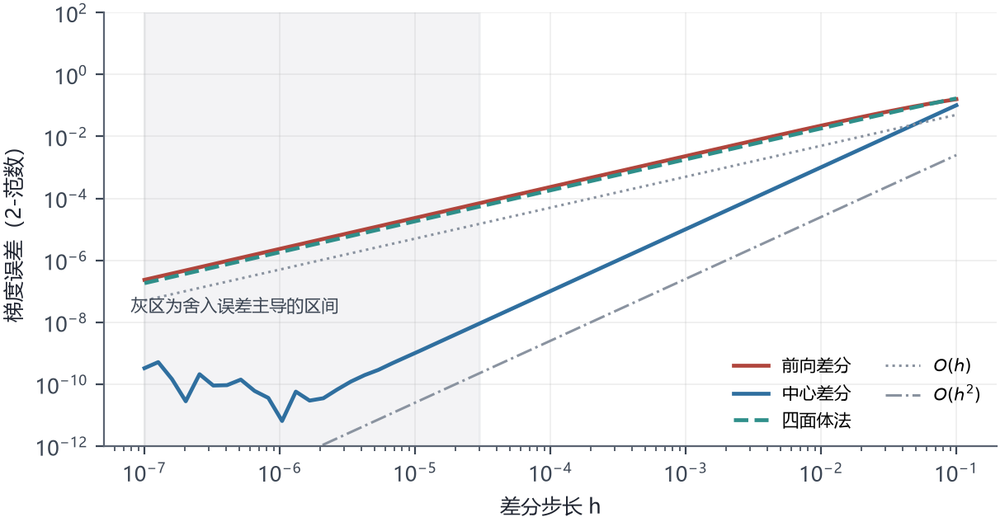
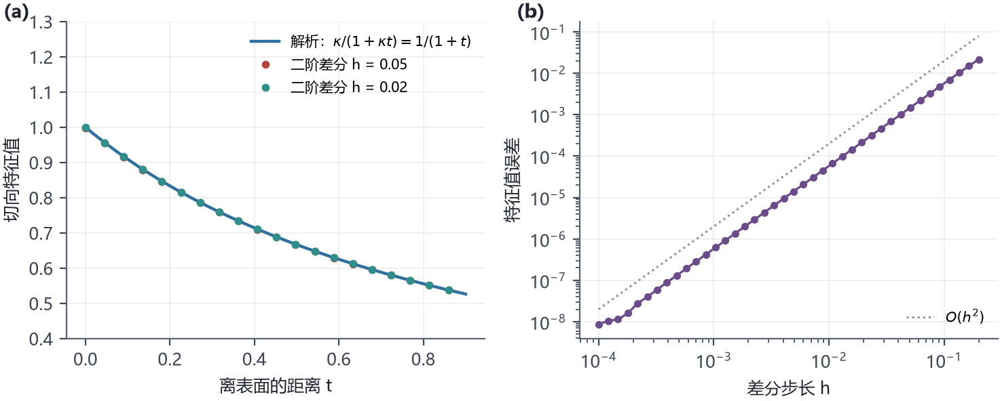
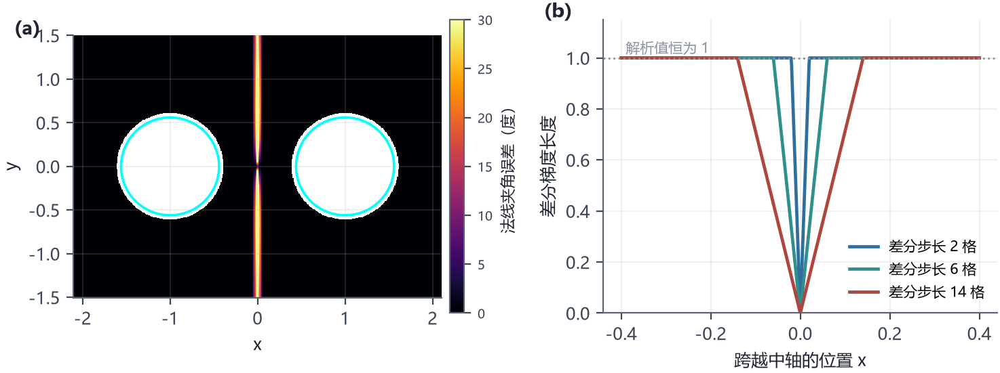

# 第 4 章 导数：法线、曲率与有限差分

## 4.1 球面上那道不该出现的暗边

用距离场渲染一个光滑的球，只看轮廓没有问题，球面中间也没有问题。问题在球的边缘，离轮廓还有十几个像素的地方，那里有一圈比周围暗的带，宽窄随视角变化，看起来像环境光遮蔽，又不像。

把着色改成只输出法线，暗带变成一条颜色突变的线。法线在那里从"指向相机"跳成"指向侧面"，中间没有过渡。再查法线是怎么算的，如果是用差分，就能找到原因：差分点取在表面上，而表面附近场变化剧烈，步长一旦跨过轮廓对应的几何位置，两侧的采样就被混在一起。

这一章把法线和曲率这两个量从距离场里取出来，解析的和数值的各一套，并且说清数值那一套的误差在哪里、该取多大的步长、在什么位置会失效。

## 4.2 梯度就是法线

有符号距离函数的梯度是一个单位向量，方向指向最近点。这个结论可以直接从定义推。

在 $\mathbf{p}$ 处最近点唯一，记作 $\mathbf{s}^*$，令

$$\mathbf{g}=\frac{\mathbf{p}-\mathbf{s}^*}{\lVert\mathbf{p}-\mathbf{s}^*\rVert} . \tag{4.1}$$

考虑沿 $\mathbf{g}$ 走一小步 $\epsilon$，走到 $\mathbf{p}+\epsilon\mathbf{g}$。这个点到 $\mathbf{s}^*$ 的距离是 $\lVert\mathbf{p}-\mathbf{s}^*\rVert+\epsilon$，而它到整个表面的距离不会超过这个值，所以

$$d(\mathbf{p}+\epsilon\mathbf{g})\le d(\mathbf{p})+\epsilon . \tag{4.2}$$

另一方面，1-Lipschitz 给出 $d(\mathbf{p}+\epsilon\mathbf{g})\ge d(\mathbf{p})-\epsilon$。沿 $\mathbf{g}$ 方向的方向导数存在时，它必须介于 $\pm1$ 之间，而 (4.2) 说明它不大于一。再取反方向，得到一。沿 $\mathbf{g}$ 的方向导数恰好是一，而任何方向的导数都不超过一，所以 $\mathbf{g}$ 是梯度方向，且 $\lVert\nabla d\rVert=1$。内部取负号的情形完全一样，只是 $\mathbf{g}$ 反向。

于是法线就是

$$\mathbf{n}(\mathbf{p})=\nabla d(\mathbf{p}) , \tag{4.3}$$

在表面上它指向外侧。内部取法线时要注意符号，因为梯度在内部指向内部，做内部折射或者次表面散射时要取反。

曲面法线之所以重要，是因为绝大部分着色模型都要它。用解析式算，法线是精确的，一次求值；用差分算，要三到六次场求值，误差还依赖步长。所以凡是能用解析式的地方都应该用解析式，这一点没有争议。

## 4.3 数值梯度

网格距离场没有解析式，只有采样。这时法线只能从相邻采样点估出来。

前向差分用三个采样

$$\frac{\partial d}{\partial x}\approx\frac{d(\mathbf{p}+h\mathbf{e}_x)-d(\mathbf{p})}{h} . \tag{4.4}$$

把 $d$ 在 $\mathbf{p}$ 处展开到二阶，分子是 $h\,\partial_x d+\tfrac{h^2}{2}\partial_{xx}d+O(h^3)$，除以 $h$ 之后误差是 $\tfrac{h}{2}\partial_{xx}d$，与 $h$ 成正比。这是一阶方法，而且误差的方向性很强：沿某个坐标轴走，误差就带上了那个方向的二阶导，斜面上法线因此偏向某一侧。

中心差分把两侧平均

$$\frac{\partial d}{\partial x}\approx\frac{d(\mathbf{p}+h\mathbf{e}_x)-d(\mathbf{p}-h\mathbf{e}_x)}{2h} , \tag{4.5}$$

二阶项在相减时抵消，剩下 $\tfrac{h^2}{6}\partial_{xxx}d$，是二阶方法。代价是六次采样。

四面体法用四个采样，位置取立方体的四个对角顶点

$$\mathbf{n}_1=\frac{(1,1,1)}{\sqrt3},\ \mathbf{n}_2=\frac{(1,-1,-1)}{\sqrt3},\ \mathbf{n}_3=\frac{(-1,1,-1)}{\sqrt3},\ \mathbf{n}_4=\frac{(-1,-1,1)}{\sqrt3} , \tag{4.6}$$

梯度估计为

$$\nabla d\approx\frac{3}{4h}\sum_{k=1}^{4}d(\mathbf{p}+h\mathbf{n}_k)\,\mathbf{n}_k . \tag{4.7}$$

系数 $3/4$ 来自这四个方向的外积之和等于 $\tfrac{4}{3}I$。把 $d$ 展开，线性项留下 $\tfrac{3}{4h}\cdot h\cdot\tfrac{4}{3}\nabla d=\nabla d$，二阶项因为方向成对相反也抵消，三阶项留下 $O(h)$ 的偏差。所以它是四采样、一阶、各向同性的方法。阶数不如中心差分，但在 GPU 上四次采样比六次便宜，而且采样方向不在坐标轴上，法线的方向偏差在斜面上更均匀。

图 4-1 把这三种方法的误差画出来。横轴是步长，纵轴是梯度误差的 2-范数。前向差分沿 $O(h)$ 的参考线走，中心差分沿 $O(h^2)$ 走，四面体法与前向差分同阶但整体低一点。左侧灰区是舍入误差主导的地方，误差随 $h$ 减小反而上升，因为 $d$ 是单精度或双精度浮点数，差值 $d(\mathbf{p}+h)-d(\mathbf{p})$ 的有效位数随 $h$ 减小而减少。

两类误差的平衡给出最优步长。截断误差按 $Ch^{p}$ 下降，舍入误差按 $\varepsilon/h$ 上升，两者相等时

$$h^*=\left(\frac{\varepsilon}{pC}\right)^{1/(p+1)} , \tag{4.8}$$

其中 $\varepsilon$ 是浮点精度与场值量级的乘积比。双精度下中心差分的最优步长在 $10^{-5}$ 量级，单精度下在 $10^{-3}$ 量级。实际代码里取"场景尺寸的 $10^{-4}$ 倍"是个稳妥的选择，既避开截断误差的平台，又不落到舍入误差的陡坡上。

还有一件事要提。法线的精度不只看梯度误差，还要看归一化之前的那一步。场值本身带采样误差，梯度把误差放大了 $1/h$ 倍，所以网格距离场的法线误差通常比位置误差大一个到两个数量级。第 14 章会算这笔账。

## 4.4 二阶导与曲率

距离场的二阶导有明确的几何意义。把 Hessian 记作 $H=\nabla^2 d$，它的特征值与表面的主曲率有关。

推导从等值面出发。$d$ 的等值面是一族与表面平行的曲面，离开表面的距离是 $t$。半径为 $r$ 的球面在距离 $t$ 处的等值面半径是 $r+t$，曲率从 $1/r$ 变成 $1/(r+t)$。把它写成原始的曲率

$$\kappa_t=\frac{\kappa}{1+\kappa t} . \tag{4.9}$$

距离场的 Hessian 在切向的特征值就是这个 $\kappa_t$，法向的特征值是零，因为沿法线方向 $d$ 是线性的。

两个推论。第一，对球面，Hessian 的两个切向特征值相等，等于 $1/(r+t)$，迹（也就是拉普拉斯）是 $2/(r+t)$，与平均曲率成正比。第二，(4.9) 的分母在中轴上趋近于零，$\kappa t\to-1$，特征值发散，第 2 章从梯度的角度看到的失效在这里以另一种形式出现。

图 4-2 左边画了球面外一段距离上的切向特征值，解析曲线是 $1/(1+t)$，两个不同步长的二阶差分结果几乎完全落在曲线上。右边是把步长从 $10^{-4}$ 扫到 $0.2$ 时，同一个特征值的误差，它按 $h^2$ 增长，没有出现舍入误差主导的平台，因为步长没有取到那么小。

二阶差分的误差比一阶更敏感，因为分母是 $h^2$，噪声被放大得更厉害。要估曲率，通常不能直接用网格距离场的二阶差分，误差会淹没信号。可行的做法是先做一次局部拟合，用一个二次曲面拟合邻域再取系数，或者用梯度场的差分，也就是对已经归一化的法线求差分，得到的是形状算子

$$S=-\nabla\mathbf{n} , \tag{4.10}$$

它的特征值直接是主曲率，不需要再除 $(1+\kappa t)$。形状算子的做法对噪声更稳，因为法线本身已经经过归一化，误差不会随二阶差分放大两遍。

## 4.5 中轴附近

图 4-3 把法线在中轴附近的失效画了出来。左边是并集场的法线夹角误差图，右图是跨越中轴时差分梯度长度的剖面。解析场在中轴两侧的梯度长度都是一，跨过中轴时中心差分的采样同时落在两个分支上，正负抵消，梯度长度在中轴上掉到零，凹陷的宽度正好是两倍步长。

这个现象决定了三件事。

法线在中轴附近不能信。归一化之后方向会更糟，因为长度趋近于零时方向由舍入误差决定。用 $\epsilon$ 做保护分母只能避免除零，不能恢复方向。

软阴影与环境光遮蔽在中轴附近会出现亮斑，因为它们都沿着法线方向采样距离值，法线错了，采样位置就偏了。

对表面着色没有影响，因为表面离中轴至少有一个局部厚度。中轴只出现在内部或者凹陷处，那里本来就不做表面着色，但会被体积渲染和内部散射用到，第 12 章会再提。

工程上的处理都是绕开而不是修好。法线取解析式，或者在场里额外存一份法线（第 15 章的砖块结构可以存四字节的八面体编码法线），或者在着色时把法线误差大的位置降权。

## 4.6 用法

法线是用得最多的。表面上取 $\mathbf{n}=\nabla d/\lVert\nabla d\rVert$，用解析式时不需要归一化，因为长度已经是一；用差分时必须归一化，因为长度会有偏差。

曲率用得少一些，但它的用途很特别。环境光遮蔽的解析近似需要一个"周围有多开阔"的量，曲率恰好是这个量的一阶描述：凸的地方遮蔽少，凹的地方遮蔽多。第 11 章会用到。边缘检测也可以用它，两个面的交线处曲率发散，法线的变化率突然变大，这个信号比深度差更稳。

还有一类用法是把梯度当力。碰撞里推出方向是梯度，建模里把顶点沿梯度吸附到表面也是梯度，也就是 (2.4) 那个投影公式。这些都要求梯度精确，所以宁可多花几次采样用中心差分，也不要用前向差分。

---

这一章把距离场的导数取了出来。梯度是单位向量，指向最近点，也给出法线；二阶导的切向特征值是平行曲面的主曲率，按 $\kappa/(1+\kappa t)$ 随距离衰减；数值差分有一阶和二阶两种，误差分别按 $h$ 与 $h^2$ 变化，与舍入误差的平衡决定最优步长；中轴是导数失效的唯一位置，它的影响局限在内部与着色，不影响求交。

下一章开始动形状。布尔运算把几个距离场拼成一个，取最小值就是并集，这件事的证明只用一句话，但它的后果要占一整篇。
